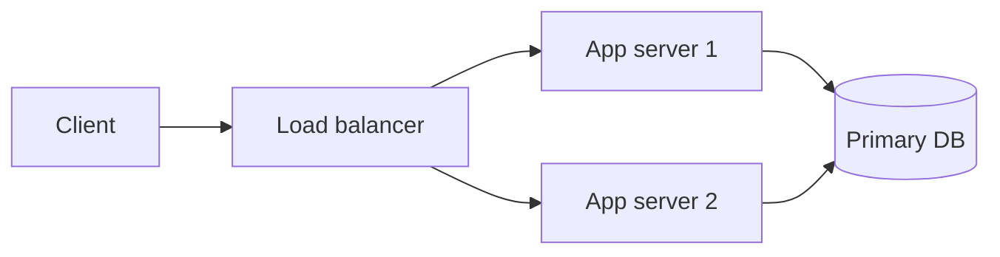

# Content guide

How pages on this site are written. Follow it for every new or edited page so the
English and Russian versions stay consistent and the build keeps passing.

## 1. Goal and audience

A restructured, updated and interactive version of
[The System Design Primer](https://github.com/donnemartin/system-design-primer)
(CC BY 4.0). Readers are engineers learning to design large-scale systems and preparing
for system design interviews. Every page should be:

- **Accurate and current.** The original text dates from 2017–2019. Fix outdated claims,
  add what changed by 2026 (managed cloud services, HTTP/3, Kafka-style logs, distributed
  SQL, Valkey/Redis, edge compute, SLOs, etc.) where it matters for design decisions.
- **Written in our own words.** Use the original as a map of *topics*, not as text to
  copy. Do not paste sentences from it or from any web source. Quotes are rarely needed;
  if one is, keep it under 15 words, in quotation marks, with attribution.
- **Scannable.** Short paragraphs, informative headings, tables for comparisons,
  a diagram where it shows a mechanism.
- **Interview-oriented.** Every topic page ends with what an interviewer will probe.

## 2. Files and frontmatter

- English: `src/content/docs/<section>/<slug>.mdx`
- Russian: `src/content/docs/ru/<section>/<slug>.mdx` — same slug, same filename.
- The list of sections and slugs lives in `scripts/pages.json`. Do not invent new slugs
  without adding them there.
- Every topic page is also a node on the skill map: add it to `src/data/skill-map.ts` with
  its direct prerequisites (`needs`). The build fails if a page is missing from the map, a
  prerequisite does not exist, the graph has a cycle, or a page in a study-plan timeline
  needs a page outside that timeline (`src/data/study-plan.ts`). On the overview tree a topic
  is labelled with its title (or its `label`), wrapped to at most three lines of about 17
  characters; the build fails if a label does not fit, so give long titles a short `label`.

```yaml
---
title: CAP theorem and PACELC            # short, Title case in EN; sentence case in RU
description: One sentence, 120–160 chars, used for search and link previews.
sidebar:
  order: 3                                # position inside the section (from pages.json order)
  badge:                                  # optional: only for new or substantially updated pages
    text: Updated                         # EN: New | Updated   RU: Новое | Обновлено
    variant: note                         # New → tip, Updated → note
---
```

## 3. Topic page template

```mdx
---
(frontmatter)
---
import { Aside } from '@astrojs/starlight/components';

Two or three sentences: what this is and why a system designer cares.

<Aside type="tip" title="TL;DR">
- 3–5 bullets a reader can memorise.
</Aside>

## Sections with H2 headings (H3 for subsections)
Explanation, mechanism diagram (mermaid), examples with concrete numbers.

## Trade-offs            (when there is a choice: a table of pros/cons or option vs option)

<Aside type="note" title="In the interview">
What interviewers look for, typical follow-up questions, common mistakes.
</Aside>

## Further reading
- 3–6 high-quality links (see §8).

## Related topics
- [Load balancers](/traffic/load-balancers/) — one line on why it is related.
```

Russian headings/titles for the fixed blocks:
`TL;DR` → `Коротко`, `In the interview` → `На собеседовании`,
`Trade-offs` → `Компромиссы`, `Further reading` → `Что почитать`,
`Related topics` → `Связанные темы`.

Length: topic pages ≈ 900–1,600 words (EN). Case studies ≈ 1,800–3,000.
OOD pages ≈ 500–900 words plus code.

## 4. Case study template (`practice/`)

Case studies keep the four classic headings; the seven steps of the
[interview framework](src/content/docs/start/interview-framework.mdx) sit inside them
(requirements and estimates → Step 1, high-level design → Step 2, API, data model and deep
dives → Step 3, scaling and failures → Step 4). Put the API and data model at the start of
Step 3.

1. Intro + TL;DR aside (the final architecture in 4 bullets).
2. `## Step 1 — Requirements and constraints`: use cases in scope / out of scope,
   non-functional requirements, assumptions, and a **back-of-the-envelope** table.
   Do the arithmetic in code before writing it (`python3 -c ...`) — numbers must add up.
3. `## Step 2 — High-level design`: mermaid diagram + walkthrough.
4. `## Step 3 — Core components`: APIs (request/response examples), data model, key
   algorithms, short code where it clarifies (Python 3.12, type hints).
5. `## Step 4 — Scaling the design`: bottlenecks one by one, the scaled diagram, what each
   added component buys and costs.
6. `## What's different in 2026`: how a team would build this today (managed services,
   streaming, object storage, etc.) and what still holds.
7. `In the interview` aside: likely follow-ups.
8. `## Further reading`.

Russian step headings: `Шаг 1 — Требования и ограничения`, `Шаг 2 — Высокоуровневый дизайн`,
`Шаг 3 — Ключевые компоненты`, `Шаг 4 — Масштабирование`, `Что изменилось к 2026 году`.

## 5. Russian version

- Write natural technical Russian, not a word-for-word translation. Same structure,
  same headings order, same diagrams (labels translated), same code (comments translated).
- Impersonal or «мы» style; avoid «ты». No anglicisms where a standard Russian term exists,
  but keep the English term in parentheses on first use when engineers search for it.
- Use «ё» where it matters (ещё, всё), Russian quotes «ёлочки», em dash —.
- Numbers: `1 000 000` or `1 млн`, decimal comma in prose (`2,5 мс`); keep code/units as is.

Glossary (use consistently):

| EN | RU |
|---|---|
| latency | задержка (latency) |
| throughput | пропускная способность |
| tail latency / p99 | хвостовая задержка / p99 |
| scalability | масштабируемость |
| availability | доступность |
| consistency | согласованность |
| eventual consistency | согласованность в конечном счёте (eventual consistency) |
| strong consistency / linearizability | строгая согласованность / линеаризуемость |
| partition tolerance | устойчивость к разделению сети |
| trade-off | компромисс |
| load balancer | балансировщик нагрузки |
| reverse proxy | обратный прокси |
| API gateway | API-шлюз |
| cache hit / miss | попадание / промах кэша |
| eviction | вытеснение |
| invalidation | инвалидация |
| replication / replica | репликация / реплика |
| leader / follower (primary / replica) | лидер / фолловер (основной узел / реплика) |
| failover | переключение на резерв (failover) |
| sharding / shard | шардирование / шард |
| partition (data) | партиция |
| consistent hashing | консистентное хеширование |
| message queue | очередь сообщений |
| back pressure | обратное давление (backpressure) |
| idempotency | идемпотентность |
| retry / backoff | повторная попытка / экспоненциальная задержка (backoff) |
| rate limiting | ограничение частоты запросов (rate limiting) |
| circuit breaker | предохранитель (circuit breaker) |
| service discovery | обнаружение сервисов (service discovery) |
| object storage | объектное хранилище |
| back-of-the-envelope estimate | прикидочный расчёт («на салфетке») |
| use case | сценарий использования |
| requirements | требования |
| interview | собеседование |

Terminology note: use **leader/follower** or **primary/replica** in both languages. Mention
the legacy "master–slave" name once, where readers may meet it in older material.

## 6. MDX rules (the build fails on these)

- In prose, `{`, `}` and `<` start JSX. Write them inside backticks (`` `O(log n)` ``,
  `` `Map<K, V>` ``) or as `&lt;` / `&#123;` / `&#125;`. Fenced code blocks are safe.
- Import every component you use, once, right after the frontmatter:
  `import { Aside, Tabs, TabItem, Steps, Card, CardGrid, LinkCard, Badge } from '@astrojs/starlight/components';`
  (import only the ones you use).
- Allowed components: Starlight built-ins listed above. Interactive widgets under
  `src/components/` are placed by the maintainer, do not add them yourself.
- Markdown tables are fine. Keep cells short; no multi-line code inside tables.
- No raw HTML except `<br />` if unavoidable. No images: draw with mermaid instead.

## 7. Links

- Internal links are **root-relative, without locale and without base path**, and end
  with a slash: `[CAP theorem](/fundamentals/cap-theorem/)`. The build adds
  `/system-design` and `/ru` automatically — the Russian page uses the same link.
- Anchors are allowed: `/data/replication/#leaderless-replication` — but anchors differ
  between languages, so avoid them in Russian pages unless you checked the heading id.
- External links: full `https://` URLs.

## 8. Further reading — link quality

- Prefer stable sources: official docs, RFCs, original papers, well-known books,
  engineering blogs of the companies that built the thing.
- Many links in the original (highscalability.com, slideshare.net, old company blogs)
  are dead or moved. Check every external link you add with WebFetch; if a classic
  article is gone, use its `web.archive.org` copy or drop it.
- Russian pages use the same links (they are mostly English sources); add a Russian
  source only if it is genuinely good.

## 9. Diagrams (mermaid)

````md

````

- `flowchart LR` or `TD`, `sequenceDiagram` and `classDiagram` are all fine.
- **Keep the natural width at 800px or less, in both languages.** The content column is about
  600px wide, so a wider diagram is scaled down and its labels become unreadable (on phones
  the site scrolls it sideways instead). Long chains go top to bottom (`flowchart TB`), long
  labels get `<br/>` every ~20 characters, sequence diagrams keep to four or five short
  participants. `npm run check:diagrams` renders every diagram and reports its width.
- Always quote labels: `id["Label (with) symbols"]`. ASCII ids only (`app1`, `cache`).
  Never use `end` as an id. No HTML in labels; use `<br/>` only inside quoted labels.
- Keep it under ~15 nodes; one idea per diagram. Translate labels in the Russian version.
- Do not set colors or themes — the site switches light/dark automatically.

## 10. Code

- Python 3.12 with type hints, dataclasses and enums, unless another language fits better.
- Illustrative, short, runnable where practical. Run it (`python3`) before publishing.
- Give each code block a language tag and, where helpful, a title:
  ` ```python title="lru_cache.py" `.

## 11. Self-check before you finish

```bash
node scripts/check-mdx.mjs src/content/docs/<section>/*.mdx src/content/docs/ru/<section>/*.mdx
node scripts/check-diagrams.mjs src/content/docs/<section>/*.mdx src/content/docs/ru/<section>/*.mdx
npm run build && npm run check:links
```

`check-mdx` checks MDX syntax, frontmatter, internal links against `scripts/pages.json`,
and that each page has its translation twin. `check-diagrams` renders every mermaid block
in a real browser (it needs `npx playwright install chromium` once) and fails on syntax
errors, diagrams wider than 800px and EN/RU diagram-count mismatches. The build validates
the skill map; `check:links` checks every internal link and `#anchor` in the built site.
If you changed `src/data/flashcards.ts`, run `npm run flashcards` and commit the decks.
Fix every ✗.
