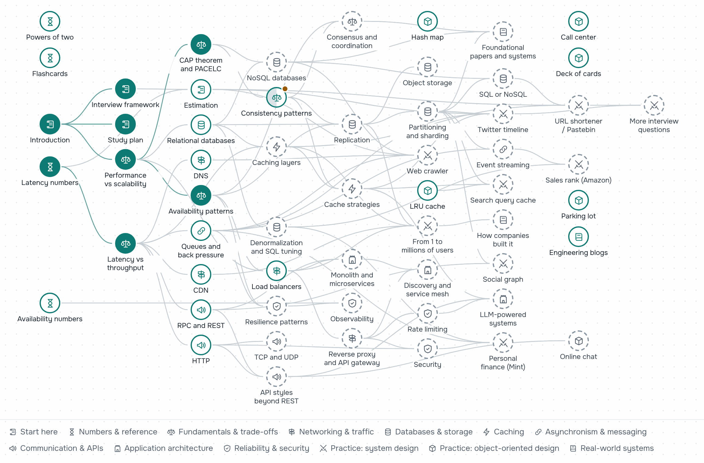

# System Design Primer: restructured, updated, bilingual

**English** · [Русский](README.ru.md)

Learn how to design large-scale systems and prepare for system design interviews.
This is a 2026 rewrite of Donne Martin's
[The System Design Primer](https://github.com/donnemartin/system-design-primer) as a site:
61 pages in English and Russian, a skill map of every topic, study plans, calculators and
flashcards. It runs in the browser; there is nothing to install.

### [Open the site](https://butyavk.github.io/system-design/) · [Skill map](https://butyavk.github.io/system-design/start/skill-map/) · [Study plan](https://butyavk.github.io/system-design/start/study-plan/)

<picture>
  <source media="(prefers-color-scheme: dark)" srcset=".github/readme/skill-map-en-dark.png">
  
</picture>

## How to learn

1. **Pick a plan** for the time you have. The [study plan](https://butyavk.github.io/system-design/start/study-plan/)
   turns the site into a checklist:

   | Plan | Time | What it covers |
   |---|---|---|
   | Short | 1–2 weeks | Breadth across the topics, a few practice questions solved end to end |
   | Medium | 3–6 weeks | Breadth plus some depth, many practice questions |
   | Long | 2–3 months | Breadth plus real depth and most of the practice questions |

2. **Follow the [skill map](https://butyavk.github.io/system-design/start/skill-map/).** Each topic
   sits to the right of the topics it builds on. The map shows what you have learned, what is
   ready to start, what you skipped and what to read next. Choose your plan above the map and
   the topics outside it fold away.
3. **Mark topics as learned** at the end of each page. Progress stays in your browser: no
   account, nothing is sent anywhere. The map can save it to a file and load it on another device.
4. **Practise out loud and on a timer** from the first week. The practice sections have
   8 system design case studies and 6 object-oriented design problems.

## The path

Six stages; each one builds on the previous ones.

| Stage | Sections | When you finish it |
|---|---|---|
| 1. Get oriented | [Start here](https://butyavk.github.io/system-design/start/introduction/), [Numbers & reference](https://butyavk.github.io/system-design/reference/latency-numbers/) | You know the interview format and can size load and storage in a few minutes |
| 2. Fundamentals | [Fundamentals & trade-offs](https://butyavk.github.io/system-design/fundamentals/performance-vs-scalability/) | You can name the trade-off behind a design choice: consistency, availability, latency |
| 3. Building blocks | [Networking & traffic](https://butyavk.github.io/system-design/traffic/dns/), [Databases & storage](https://butyavk.github.io/system-design/data/relational-databases/), [Caching](https://butyavk.github.io/system-design/caching/caching-layers/), [Asynchronism & messaging](https://butyavk.github.io/system-design/async/queues-and-back-pressure/), [Communication & APIs](https://butyavk.github.io/system-design/communication/http/) | You can pick a database, cache, queue and protocol, and say what each one costs |
| 4. Architecture & operations | [Application architecture](https://butyavk.github.io/system-design/architecture/monolith-and-microservices/), [Reliability & security](https://butyavk.github.io/system-design/reliability/rate-limiting/) | You can split a system into services and keep it running: limits, retries, monitoring, security |
| 5. Practice | [System design](https://butyavk.github.io/system-design/practice/url-shortener-pastebin/), [Object-oriented design](https://butyavk.github.io/system-design/ood/hash-map/) | You can run a 45-minute design interview from requirements to bottlenecks |
| 6. Real-world systems | [Papers, company architectures, engineering blogs](https://butyavk.github.io/system-design/real-world/foundational-papers/) | You can back your answers with how real companies built their systems |

## What's different from the original

| | Original | This site |
|---|---|---|
| Format | One long README | 61 pages in 13 sections, sidebar, full-text search, dark mode |
| Languages | English (+ community translations) | English and Russian, kept in sync page by page |
| Currency | Mostly 2017–2019 | Updated: HTTP/3, Kafka-style logs, distributed SQL, Valkey/Redis 8, SLOs, edge compute, OWASP Top 10:2025… |
| New topics | — | Object storage, event streaming, rate limiting, resilience patterns, observability, API styles, service meshes, consistent hashing, consensus and coordination, LLM-powered systems |
| Navigation | Table of contents | A skill map of every topic with its prerequisites, your progress, skipped topics and what to read next, shared with a 1–12-week study plan |
| Numbers | Static 2012 latency table | 2026 latency numbers with sources, interactive explorer, availability and estimation calculators |
| Flashcards | Anki decks to download | 150 on-site flashcards with spaced repetition, plus Anki decks in English and Russian exported from the same cards |
| Diagrams | PNG images | Mermaid diagrams that follow the light/dark theme, stay readable on phones and open full-screen with zoom |
| Case studies | 8 system design + 6 OOD | Same problems, recomputed estimates, fixed code (Python 3.12), "what's different in 2026" sections |
| Links | Many dead | Every external link checked; dead ones replaced or removed |

## Edit or run locally

You only need this to change the content. Requires Node.js 22.12+.

```bash
npm install
npm run dev        # http://localhost:4321/system-design/
npm run build      # static site in dist/
```

Content lives in `src/content/docs/` (English) and `src/content/docs/ru/` (Russian).
Read [CONTENT_GUIDE.md](CONTENT_GUIDE.md) before editing, then run the checks:

```bash
npm run check:content     # MDX syntax, frontmatter, links, EN/RU twins
npm run check:diagrams    # every diagram renders and is at most 800px wide (needs: npx playwright install chromium)
npm run build             # also validates the skill map graph
npm run check:links       # internal links and anchors in dist/
npm run flashcards        # re-export the Anki decks after editing src/data/flashcards.ts
```

Pushes to `main` run the same checks, then build and deploy to GitHub Pages (`.github/workflows/deploy.yml`).
To publish your own copy, set **Settings → Pages → Source** to **GitHub Actions** and change `site`/`base` in `astro.config.mjs`.

## Credits and license

Based on [The System Design Primer](https://github.com/donnemartin/system-design-primer)
© Donne Martin, licensed under [CC BY 4.0](https://creativecommons.org/licenses/by/4.0/).
This adaptation restructures, rewrites, translates and updates the material and adds
interactive tools; it is not endorsed by the original author.

The content of this repository is licensed under [CC BY 4.0](LICENSE).
