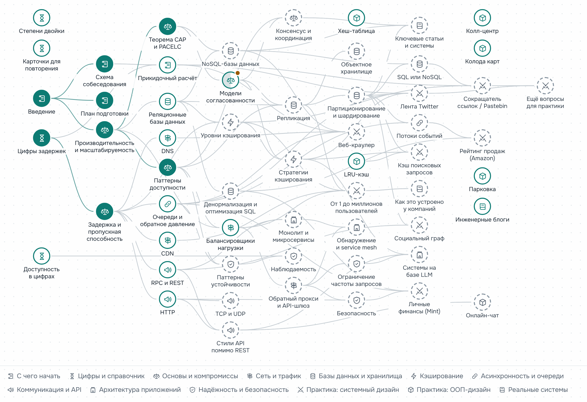

# Карта системного дизайна

[English](README.md) · **Русский**

Курс о том, как проектировать большие системы и готовиться к собеседованиям по системному дизайну.
Это переписанный в 2026 году
[The System Design Primer](https://github.com/donnemartin/system-design-primer) Донна Мартина,
собранный в сайт: 61 страница на русском и английском, карта навыков по всем темам, планы
подготовки, калькуляторы и карточки для повторения. Всё работает в браузере, ничего
устанавливать не нужно.

### [Открыть сайт](https://butyavk.github.io/system-design/ru/) · [Карта навыков](https://butyavk.github.io/system-design/ru/start/skill-map/) · [План подготовки](https://butyavk.github.io/system-design/ru/start/study-plan/)

<picture>
  <source media="(prefers-color-scheme: dark)" srcset=".github/readme/skill-map-ru-dark.png">
  
</picture>

## Как учиться

1. **Выберите план** под время, которое у вас есть. [План подготовки](https://butyavk.github.io/system-design/ru/start/study-plan/)
   превращает сайт в чек-лист:

   | План | Срок | Что входит |
   |---|---|---|
   | Короткий | 1–2 недели | Обзор основных тем и несколько задач, решённых от начала до конца |
   | Средний | 3–6 недель | Обзор плюс немного глубины, много задач |
   | Длинный | 2–3 месяца | Все темы, настоящая глубина и большинство задач |

2. **Идите по [карте навыков](https://butyavk.github.io/system-design/ru/start/skill-map/).** В её
   обзорном дереве каждая тема стоит правее тех, на которые опирается; кнопка **«На весь экран»**
   разворачивает дерево на всё окно. Карта показывает, что вы уже изучили, что можно начинать,
   что пропустили и что читать дальше. Выберите свой план над картой, и темы вне его свернутся
   в маленькие точки. Карточка выбранной темы пристраивается справа от карты, а в ней — блок
   **«Путь сюда»**: какие темы остались на пути и примерно сколько дней они займут в каждом плане.
3. **Отмечайте темы изученными** в конце каждой страницы — там же видно, что прочитать до темы
   и к чему она ведёт. Прогресс хранится только в вашем браузере: без регистрации, никуда не
   отправляется. **«Скачать прогресс»** под картой сохраняет его в файл, а **«Загрузить
   прогресс»** переносит на другое устройство.
4. **Тренируйтесь вслух и на время** с первой недели. В разделах практики 8 разборов задач
   по системному дизайну и 6 задач по объектно-ориентированному проектированию.

## Путь

Шесть этапов, каждый опирается на предыдущие.

| Этап | Разделы | После него вы |
|---|---|---|
| 1. Сориентироваться | [С чего начать](https://butyavk.github.io/system-design/ru/start/introduction/), [Цифры и справочник](https://butyavk.github.io/system-design/ru/reference/latency-numbers/) | Знаете формат собеседования и за несколько минут оцениваете нагрузку и объём данных |
| 2. Основы | [Основы и компромиссы](https://butyavk.github.io/system-design/ru/fundamentals/performance-vs-scalability/) | Называете компромисс, стоящий за проектным решением: согласованность, доступность, задержка |
| 3. Строительные блоки | [Сеть и трафик](https://butyavk.github.io/system-design/ru/traffic/dns/), [Базы данных и хранилища](https://butyavk.github.io/system-design/ru/data/relational-databases/), [Кэширование](https://butyavk.github.io/system-design/ru/caching/caching-layers/), [Асинхронность и очереди](https://butyavk.github.io/system-design/ru/async/queues-and-back-pressure/), [Коммуникация и API](https://butyavk.github.io/system-design/ru/communication/http/) | Выбираете базу данных, кэш, очередь и протокол и объясняете, чем платите за каждый |
| 4. Архитектура и эксплуатация | [Архитектура приложений](https://butyavk.github.io/system-design/ru/architecture/monolith-and-microservices/), [Надёжность и безопасность](https://butyavk.github.io/system-design/ru/reliability/rate-limiting/) | Делите систему на сервисы и держите её в рабочем состоянии: лимиты, повторы, мониторинг, безопасность |
| 5. Практика | [Системный дизайн](https://butyavk.github.io/system-design/ru/practice/url-shortener-pastebin/), [ООП-дизайн](https://butyavk.github.io/system-design/ru/ood/hash-map/) | Проходите 45-минутное собеседование по дизайну от требований до узких мест |
| 6. Реальные системы | [Ключевые статьи, архитектуры компаний, инженерные блоги](https://butyavk.github.io/system-design/ru/real-world/foundational-papers/) | Подкрепляете ответы тем, как реальные компании построили свои системы |

## Чем отличается от оригинала

| | Оригинал | Этот сайт |
|---|---|---|
| Формат | Один длинный README | 61 страница: 13 разделов и «О проекте», боковое меню, полнотекстовый поиск, тёмная тема |
| Языки | Английский (и переводы сообщества) | Русский и английский, синхронизированы постранично |
| Актуальность | В основном 2017–2019 годы | Обновлено: HTTP/3, журналы в духе Kafka, распределённый SQL, Valkey/Redis 8, SLO, вычисления на периферии (edge), OWASP Top 10:2025… |
| Новые темы | — | Объектное хранилище, потоки событий, ограничение частоты запросов, паттерны устойчивости, наблюдаемость, стили API, service mesh, консистентное хеширование, консенсус и координация, системы на базе LLM |
| Навигация | Оглавление | Карта навыков по всем темам: зависимости, ваш прогресс, пропущенные темы и что читать дальше; общая с планом подготовки на 1–2 недели, 3–6 недель или 2–3 месяца |
| Цифры | Статичная таблица задержек 2012 года | Цифры задержек 2026 года с источниками, интерактивная шкала, калькуляторы доступности и прикидочных расчётов |
| Карточки | Колоды Anki для скачивания | 150 карточек с интервальными повторениями прямо на сайте и колоды Anki на русском и английском из тех же карточек |
| Диаграммы | Картинки PNG | Диаграммы Mermaid: подстраиваются под светлую и тёмную тему, читаются на телефоне и открываются на весь экран с масштабированием |
| Разборы задач | 8 по системному дизайну и 6 по ООП | Те же задачи, пересчитанные оценки, исправленный код (Python 3.12), разделы «что изменилось к 2026 году» |
| Ссылки | Многие не работают | Все внешние ссылки проверены, нерабочие заменены или убраны |

## Правки и локальный запуск

Требуется Node.js 22.12+. Сайт собран на [Astro](https://astro.build/) и его теме для
документации [Starlight](https://starlight.astro.build/); `npm run dev` запускает локальную
копию, которая обновляется по мере правок.

```bash
npm install
npm run dev        # http://localhost:4321/system-design/
npm run build      # статический сайт в dist/
npm run preview    # собранный сайт с поиском по тому же адресу
```

### Правки текстов

Тексты лежат в `src/content/docs/` (английский) и `src/content/docs/ru/` (русский).
Перед правками прочитайте [CONTENT_GUIDE.md](CONTENT_GUIDE.md), после — запустите проверки:

```bash
npm run check:content     # синтаксис MDX, frontmatter, ссылки, пары страниц EN/RU
npm run check:diagrams    # каждая диаграмма рендерится и не шире 800px (нужно: npx playwright install chromium)
npm run build             # заодно проверяет граф карты навыков
npm run check:links       # внутренние ссылки и якоря в dist/
npm run check:external    # все внешние ссылки; долго и не в CI: некоторые сайты блокируют скрипты
npm run flashcards        # пересобрать колоды Anki после правок src/data/flashcards.ts
```

Каждый push в `main` запускает те же проверки, затем собирает сайт и публикует его на GitHub Pages (`.github/workflows/deploy.yml`).
Чтобы опубликовать свою копию, выберите **Settings → Pages → Source → GitHub Actions** и поменяйте `site`/`base` в `astro.config.mjs`.

### Занятия на локальной копии

Проще всего заниматься на опубликованном сайте. Локальная копия имеет смысл, если вы:

- **занимаетесь без интернета** (в самолёте, в дороге): локальная копия работает офлайн;
- **правите материал, пока учитесь** (свои примеры, заметки, исправления): вы и так работаете
  в проекте и сразу видите каждую правку;
- **хотите хранить прогресс рядом с проектом**: скачивайте файл прогресса с карты навыков
  в папку `progress/` внутри клона. Git её игнорирует: репозиторий публичный, и закоммиченный
  файл увидят все. Если нужна история прогресса в git, заведите отдельный приватный репозиторий.

В файлы проекта прогресс не записывается. Локально он тоже хранится в браузере, под адресом
`localhost:4321`, поэтому он отдельный от прогресса на опубликованном сайте: переносите его
кнопками **«Скачать прогресс»** и **«Загрузить прогресс»** на карте навыков. Держите порт
одним и тем же: если 4321 занят, сервер разработки возьмёт другой порт, а для браузера это
другой сайт с пустым прогрессом.

Поиск по сайту работает только в собранной копии: выполните `npm run build`, затем `npm run preview`.
Она открывается по тому же адресу, поэтому прогресс у них общий.

## Авторы и лицензия

Основано на [The System Design Primer](https://github.com/donnemartin/system-design-primer)
© Донн Мартин (Donne Martin), лицензия [CC BY 4.0](https://creativecommons.org/licenses/by/4.0/deed.ru).
Эта адаптация перестраивает, переписывает, переводит и обновляет материал и добавляет
интерактивные инструменты; автор оригинала её не одобрял и не проверял.

Содержимое репозитория распространяется по лицензии [CC BY 4.0](LICENSE).
