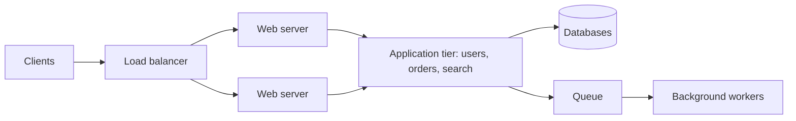
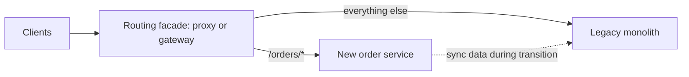

import { Aside } from '@astrojs/starlight/components';

Every system must decide how to divide its code into deployable units: one application, a few, or hundreds of small services. The decision shapes how teams work, how the system fails and what it costs to run. The industry has swung from monoliths to microservices and partly back. The current consensus is less about fashion and more about matching boundaries to teams and to real scaling needs.

<Aside type="tip" title="TL;DR">
- Separate the web tier from an application (platform) tier so each can scale and change independently.
- A **modular monolith**, one deployable with strictly enforced internal module boundaries, is the right default for most products and teams.
- Microservices pay off when many teams need to deploy independently, or when parts of the system have very different scaling, reliability or technology needs.
- Their cost is distributed-systems complexity: network calls, partial failure, data split across databases, and heavy platform and observability work.
- Migrate incrementally with the strangler-fig pattern, never with a big-bang rewrite.
</Aside>

## Web tier and application tier

The first split in most systems is between the **web tier**, which handles HTTP, sessions, rendering and the public API surface, and the **application or platform tier**, which holds business logic and talks to data stores.

Why split:

- **Independent scaling.** A new internal API or a heavy batch job adds application servers without adding web servers, and vice versa.
- **Reuse.** Web, mobile and partner APIs can share one platform tier instead of each re-implementing the logic.
- **Team separation.** Product teams iterate on the web layer while a platform team evolves the core.
- **Async work.** Workers in the application tier take slow jobs off the request path through [queues](/async/queues-and-back-pressure/).

## Single responsibility, from classes to services

The **single responsibility principle** says a unit of code should have one reason to change. Applied to architecture, each module or service owns one business capability (billing, search, notifications) and its data, and exposes a narrow, stable interface. Good boundaries follow the business domain (domain-driven design calls them *bounded contexts*), not technical layers. A "database service" or a "validation service" is a sign of the wrong cut.

This principle does not require a network boundary. You can apply it inside one codebase, which is the whole idea of the modular monolith.

## What microservices are

**Microservices** are an architecture in which an application is built as a set of small services that:

- each run as their own process and are **deployed independently**;
- each own their data. No other service reads their tables directly;
- communicate over the network through well-defined APIs (HTTP/JSON, gRPC) or events;
- are each owned by one team, end to end, including on-call.

A photo-sharing product might have services for user profiles, follow graph, feed, search, media upload and notifications, each with its own store and release cadence. "Micro" refers to scope (one capability), not to lines of code.

## The modular monolith as a strong default

A **modular monolith** is one deployable application whose code is split into modules with explicit public interfaces and enforced dependency rules. Module A may call B's public API but not touch B's internals or tables. It keeps the operational simplicity of a monolith, with one build, one deploy, in-process calls and one database (with a schema or set of tables per module), while getting most of the design benefits of services.

Shopify is the best-known example. Its large Ruby on Rails monolith, worked on by more than a thousand developers, was reorganised into components by business domain, with tooling that flags calls bypassing a component's public API. Microservices were considered and rejected because of their operational and latency costs.

To make modules real rather than folders:

- enforce boundaries in CI with dependency rules, architecture tests or a tool such as Packwerk or ArchUnit;
- give each module its own tables, and don't join across module tables;
- communicate through interfaces or in-process events, which can later become network calls or messages;
- keep the build fast with module-level test suites.

A well-modularised monolith is also the easiest system to split later, because the seams already exist.

## When splitting pays off

Microservices solve mostly **organisational** problems, and a few technical ones:

- **Many teams, one release train.** Once dozens of teams share one deployable, merges, test suites and release coordination slow everyone down. Independent services let each team ship on its own schedule.
- **Conway's law.** Melvin Conway observed in 1968 that systems mirror the communication structure of the organisations that build them. Service boundaries that match team boundaries reduce coordination. Boundaries that cut across teams create constant cross-team negotiation. Some organisations design teams first and let the architecture follow (the "inverse Conway manoeuvre").
- **Very different scaling profiles.** A video transcoder needs GPUs and scales with uploads; the account service needs little. Separating them avoids scaling everything for the needs of one part.
- **Fault and security isolation.** A memory leak in recommendations should not take down checkout. A PCI-scoped payment service can be locked down separately.
- **Technology fit.** A part that genuinely needs a different language or runtime, such as an ML model server, can have one.

If none of these applies, the split mostly adds cost.

## What microservices cost

- **Network calls instead of function calls.** Each hop adds latency (often a millisecond or more, versus nanoseconds in-process) and can fail. A request that touches 10 services in sequence, each at 99.9% availability, succeeds only about 99.0% of the time, roughly 87 hours of failure a year instead of under 9.
- **Partial failure.** Timeouts, retries, circuit breakers, idempotency and fallbacks become everyday code. See [resilience patterns](/reliability/resilience-patterns/).
- **Distributed data.** No cross-service transactions or joins. You need sagas or outbox-based events, accept [eventual consistency](/fundamentals/consistency-patterns/), and duplicate some data for reads.
- **Operations.** Dozens of pipelines, dashboards, alerts and on-call rotations; [service discovery](/architecture/service-discovery-and-mesh/); distributed tracing and centralised logs ([observability](/reliability/observability/)); version compatibility between services; a platform team to make it all bearable.
- **Testing and local development.** Running the whole system on a laptop becomes hard. Contract tests and shared staging environments are needed.
- **Wrong boundaries are expensive.** Moving a responsibility between services means API changes and data migrations, not a refactor in one repository. The worst outcome is a **distributed monolith**: services that must be deployed together and call each other synchronously for every request, with all the costs and none of the benefits.

Teams do move back. Twilio Segment merged more than 140 per-destination services into one service in 2018, and in 2023 a Prime Video monitoring team reported cutting infrastructure cost by over 90% by collapsing a distributed, serverless pipeline into a single process. Both are cases of boundaries drawn finer than the problem needed, not proof that services are wrong.

## Migrating: the strangler-fig pattern

Big-bang rewrites usually fail: they take years, the old system keeps changing, and nobody fully knows what it does. The **strangler fig** pattern, named by Martin Fowler after a vine that slowly grows around its host tree, replaces a system piece by piece.

1. Put a routing layer, such as a reverse proxy or [API gateway](/traffic/reverse-proxy-and-api-gateway/), in front of the legacy system.
2. Pick one capability with a clear seam. Build it anew and route its traffic there, gradually, with a percentage rollout or shadow traffic to compare results.
3. Keep data consistent during the transition with change data capture, dual writes through an outbox, or a temporary sync job.
4. Delete the legacy code path once traffic is fully moved. Repeat.

The same pattern works for extracting a module from a modular monolith, or for moving between platforms.

## Serverless

**Functions as a service** such as AWS Lambda, Google Cloud Run functions, Azure Functions and Cloudflare Workers take the service idea further: you deploy functions, and the platform handles servers, scaling (including to zero) and per-invocation billing. Container platforms like Google Cloud Run and AWS Fargate offer a middle ground: serverless operations for ordinary long-running HTTP services.

Serverless fits event-driven glue (react to an upload, a queue message, a webhook), spiky or low-traffic workloads, and scheduled jobs. Watch for:

- **Cold starts** on infrequently used functions (mitigated by provisioned concurrency or isolate-based runtimes);
- **Execution limits**: Lambda caps a run at 15 minutes, for example;
- **Cost at high steady load**, where always-on containers are often cheaper;
- **Downstream pressure**: thousands of concurrent functions can exhaust database connections;
- **Fragmentation**: hundreds of tiny functions are a distributed system that is hard to reason about.

Serverless is a deployment and billing model. The boundary questions above still apply.

## Comparison

| | Monolith | Modular monolith | Microservices |
|---|---|---|---|
| Deployables | One | One | Many, one per service |
| Module boundaries | Often implicit, erode over time | Explicit, enforced by tooling | Enforced by the network |
| Calls between parts | In-process | In-process | Network (RPC, HTTP, events) |
| Data | One shared schema | One database, tables owned per module | Database per service |
| Transactions | Local ACID | Local ACID | Sagas, outbox, eventual consistency |
| Independent deploy | No | No | Yes |
| Independent scaling | Scale the whole app | Scale the whole app | Per service |
| Fault isolation | Low | Low to medium | High, if designed for it |
| Operational overhead | Low | Low | High: platform, tracing, discovery |
| Best fit | Small team, early product | Most products, up to many teams | Many autonomous teams, very uneven scaling needs |

<Aside type="note" title="In the interview">
In a system design interview it is fine, and often expected, to draw services such as "feed service" and "user service". What matters is that you can justify the boundaries (different scaling, different data, different teams) and that you acknowledge the costs: how services find each other, what happens when one is slow, how data stays consistent without cross-service transactions. Good follow-ups to prepare for: "Would you start with microservices?", "How would you migrate this monolith?", "How do two services keep data in sync?" A red flag is splitting by technical layer or claiming microservices are automatically more scalable.
</Aside>

## Further reading

- [Microservices](https://martinfowler.com/articles/microservices.html) — James Lewis and Martin Fowler's defining article (2014).
- [Monolith First](https://martinfowler.com/bliki/MonolithFirst.html) — why most successful microservice systems started as monoliths.
- [Strangler Fig](https://martinfowler.com/bliki/StranglerFigApplication.html) — Fowler's updated description of incremental replacement.
- [Deconstructing the Monolith](https://shopify.engineering/deconstructing-monolith-designing-software-maximizes-developer-productivity) — Shopify's modular monolith in practice.
- [Goodbye Microservices](https://www.twilio.com/en-us/blog/developers/best-practices/goodbye-microservices) — Twilio Segment on merging 140+ services back into one.
- [How Do Committees Invent?](https://www.melconway.com/Home/Committees_Paper.html) — Conway's original 1968 paper.

## Related topics

- [Service discovery and service mesh](/architecture/service-discovery-and-mesh/) — how services find and talk to each other.
- [Reverse proxy and API gateway](/traffic/reverse-proxy-and-api-gateway/) — the front door for many services and the strangler-fig facade.
- [RPC and REST](/communication/rpc-and-rest/) — how services call each other.
- [Event streaming](/async/event-streaming/) — decoupling services with events instead of synchronous calls.
- [Resilience patterns](/reliability/resilience-patterns/) — surviving partial failure between services.
