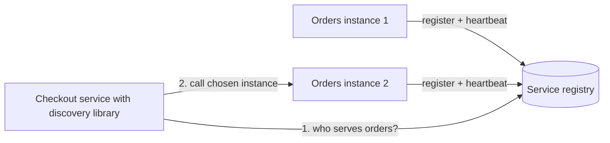
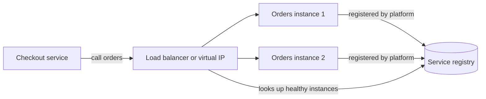
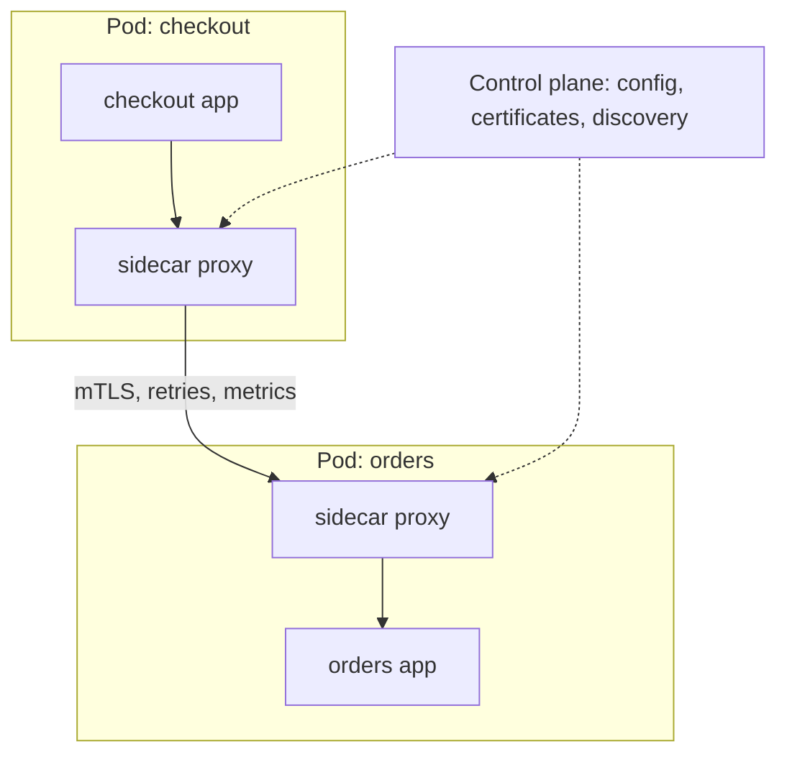

import { Aside } from '@astrojs/starlight/components';

In a system of many services, instances come and go constantly through autoscaling, deploys, crashes and rescheduling. Hard-coded IP addresses stop working within hours. **Service discovery** keeps an up-to-date map from a logical name such as `orders` to the healthy instances behind it. A **service mesh** goes further: it moves the whole service-to-service communication layer (encryption, retries, traffic shifting, telemetry) out of application code and into infrastructure.

<Aside type="tip" title="TL;DR">
- A service registry tracks which instances of each service are alive. Instances register (or are registered by the platform) and are removed when health checks or TTLs fail.
- Client-side discovery: the caller queries the registry and balances itself, with fewer hops but logic in every client. Server-side discovery: the caller hits a load balancer or virtual IP that does the lookup.
- On Kubernetes, Services, EndpointSlices and cluster DNS provide discovery out of the box. Consul, etcd and ZooKeeper cover other environments and coordination needs.
- A mesh adds mTLS, retries, timeouts, traffic splitting and uniform metrics without code changes, through sidecars or sidecar-less "ambient" data planes.
- A mesh is a platform investment. With a handful of services, libraries and a good load balancer are usually enough.
</Aside>

## The problem

Static configuration ("orders lives at 10.0.3.17:8080") breaks as soon as instances become ephemeral. Discovery needs three parts:

1. **Registration**: an instance is announced when it is ready, either by registering itself or by the platform (the orchestrator, or a registrar watching it).
2. **Health tracking**: instances that die or become unhealthy are removed quickly.
3. **Lookup**: callers resolve a name to the current set of healthy addresses, ideally with a push-based update rather than polling.

## Client-side discovery

The caller asks the registry for the instance list, caches it, receives updates, and picks an instance itself (round robin, P2C, zone-aware). Netflix popularised this with the Eureka registry and the Ribbon client library. Today the same idea appears in **gRPC's xDS support**, where clients receive endpoints and load-balancing policy from a control plane, and in client-side libraries generally.

- **Pros:** no extra hop; smart, per-request balancing that suits long-lived HTTP/2 and gRPC connections; the client can prefer instances in its own zone.
- **Cons:** every language and framework needs a discovery library, kept up to date; the registry is now a dependency of every client; behaviour drifts between client versions.

## Server-side discovery

The caller sends traffic to a stable address: a load balancer, a proxy, or a virtual IP. The router consults the registry and forwards. AWS internal load balancers and Kubernetes ClusterIP Services work this way.

- **Pros:** clients stay simple and language-agnostic; balancing policy lives in one place.
- **Cons:** an extra component to run and scale, and possibly an extra hop. An L4 virtual IP balances per connection, so long-lived gRPC connections may pin to one instance.

A service mesh is a hybrid: a proxy beside each workload (or on each node) does client-side discovery and balancing on the application's behalf, so the app sees a simple local or virtual address.

## Registries

| Registry | Model | Health and liveness | Notes |
|---|---|---|---|
| Kubernetes Services + EndpointSlices + CoreDNS | Platform-managed: pods matching a selector become endpoints | Readiness probes; unready pods drop out of EndpointSlices | `orders.shop.svc.cluster.local` resolves to a ClusterIP, or to pod IPs for a headless Service. kube-proxy or an eBPF data plane routes the VIP |
| HashiCorp Consul | Service catalog with a DNS and HTTP API, plus a key-value store and its own mesh | Agent-run checks: HTTP, TCP, gRPC, script, and TTL checks the service must refresh | Works across VMs, Kubernetes and multiple data centres. Licensed under BUSL 1.1 since version 1.17 |
| etcd | Strongly consistent key-value store (Raft) | Leases with TTLs kept alive by the client. Keys vanish when the lease expires | The store behind Kubernetes. Discovery is built from leases plus watches |
| Apache ZooKeeper | Hierarchical, consistent store | Ephemeral nodes that disappear when the client's session ends | Long used for coordination (Hadoop, HBase, older Kafka). Kafka 4.0 dropped it for the built-in KRaft |
| Eureka (Netflix) | AP registry, favours availability over consistency | Client heartbeats | JVM-centric; mostly found in Spring Cloud estates |
| Cloud-native | AWS Cloud Map, ECS Service Connect, VPC Lattice | Provider-managed | Discovery as a managed feature of the platform |

Consistency matters less than you might think. A registry that is briefly stale only means a few requests hit an instance that just left, and callers must handle that with retries and timeouts anyway. That is why AP designs like Eureka work. For **leader election and locks**, by contrast, use a consensus-backed store whose writes are linearizable: etcd, ZooKeeper (call `sync()` before reads that must be current) or Consul (with `consistent` reads). See [consistency patterns](/fundamentals/consistency-patterns/) and [consensus and coordination](/fundamentals/consensus-and-coordination/).

## Health checks and TTLs

There are two ways for a registry to notice that an instance has gone:

- **Active checks**: the registry or its agent probes the instance (HTTP `/healthz`, TCP connect, gRPC health protocol). Kubernetes splits these into *liveness* (restart me) and *readiness* (send me traffic) probes. Only readiness affects discovery.
- **Heartbeats / TTLs**: the instance keeps renewing a lease, a TTL check or a session. If it stops, because it crashed or was partitioned, the entry expires. Detection time is roughly the TTL, so a 10-second TTL means up to 10 seconds of traffic to a dead instance unless callers detect failures themselves.

Practical points:

- **Graceful shutdown.** Deregister (fail readiness) first, wait for callers to see it, drain in-flight requests, and only then exit. Most "errors during deploys" come from skipping this.
- **Client-side caching.** DNS-based discovery inherits DNS caching problems. Runtimes that cache lookups for a long time or connection pools that never re-resolve keep calling old addresses. Prefer push updates (watches, xDS) or short TTLs with re-resolution.
- **Combine with outlier detection.** Registries are slow to notice gray failures, such as an instance that is up but returns errors. Callers or proxies should eject bad endpoints from real traffic, as described in [load balancers](/traffic/load-balancers/).
- **Protect the registry.** If the registry fails, clients should keep using their last known good list rather than dropping everything.

## Service mesh

A **service mesh** adds a data plane of proxies that carry all service-to-service traffic, plus a control plane that configures them with discovery data, certificates and policies.

What a mesh typically provides, with no application changes:

- **mTLS everywhere.** Each workload gets a short-lived certificate tied to its identity (often SPIFFE-style), rotated automatically. Traffic is encrypted, and authorisation policies can say "only `checkout` may call `orders`" based on cryptographic identity rather than IP address.
- **Reliability controls.** Timeouts, retries (with budgets, so retries cannot amplify an outage), outlier ejection, circuit breaking and fault injection for testing. See [resilience patterns](/reliability/resilience-patterns/).
- **Traffic management.** Weighted splits for canary and blue/green releases, header-based routing, mirroring traffic to a new version, failover across zones or clusters.
- **Uniform telemetry.** Request rate, error rate and latency for every service pair, plus trace-header propagation, all in the same format. Services still need to forward trace headers themselves for complete traces. See [observability](/reliability/observability/).

### Data plane options in 2026

- **Sidecar proxies.** A proxy container in every pod: Envoy in Istio's classic mode, Linkerd's Rust "micro-proxy". Full L7 features per workload and strong isolation (each pod holds only its own keys). The costs: CPU and memory per pod (provisioned for the worst case), two proxy hops per call, and pod restarts to inject or upgrade. Kubernetes' native sidecar containers (stable since v1.33) fixed old start-up and shutdown ordering problems.
- **Sidecar-less ("ambient") data planes.** Istio's **ambient mode**, generally available since Istio 1.24 (November 2024), splits the work. A per-node **ztunnel** (written in Rust) handles L4: mTLS, identity, L4 authorisation and telemetry. Optional per-namespace or per-service **waypoint** proxies (Envoy) are added only where L7 features are needed. Workloads join the mesh by labelling a namespace, with no restarts. Istio's own measurements show lower overhead and latency than sidecars, especially without a waypoint. Ambient is stable for single-cluster meshes; its multi-network multicluster support only reached beta in Istio 1.29 (February 2026), so sidecars remain the safer choice for multicluster and VM workloads.
- **eBPF and per-node proxies.** **Cilium** service mesh handles L3/L4 in the kernel with eBPF and uses a per-node Envoy for L7, also without sidecars. Its SPIFFE-based mutual authentication never left beta and was deprecated in Cilium 1.20 (July 2026). The suggested replacement is ztunnel transparent encryption, which borrows Istio's ztunnel for L4 mTLS and is itself still beta.
- **Proxyless.** gRPC clients can consume xDS configuration directly from a mesh control plane, so balancing and routing happen in the client library without any proxy.

Major options: **Istio** (CNCF graduated; sidecar or ambient), **Linkerd** (CNCF graduated; Rust sidecars, simplicity-focused; the open-source project ships edge releases, with stable builds from vendors), **Cilium**, **Consul service mesh** (Envoy sidecars; spans VMs and Kubernetes), and cloud offerings such as Google Cloud Service Mesh. AWS App Mesh was discontinued on 30 September 2026. AWS points ECS users to ECS Service Connect and EKS users to Amazon VPC Lattice, which needs no sidecars. Meshes and gateways increasingly share the **Kubernetes Gateway API** for configuration (its GAMMA initiative, part of the Standard channel since Gateway API v1.1 in 2024, covers mesh routing).

## When a mesh is overkill

A mesh is worth it when you have many services and many teams, need zero-trust mTLS for compliance, run frequent canary releases, or need consistent telemetry across polyglot services. It is usually overkill when:

- you have a monolith or a few services that one team owns, where a good HTTP client library with timeouts and retries and a load balancer do the job;
- nobody is available to own the control plane, its upgrades and its failure modes. A misconfigured mesh can break *all* traffic at once;
- latency budgets are extremely tight and every proxy hop counts;
- your platform already provides what you need: managed L7 load balancers, cloud IAM between services, VPC-level encryption.

Start with the specific problem, such as "we need mTLS" or "we need per-service golden metrics", and pick the lightest tool that solves it.

## Trade-offs

| Approach | Pros | Cons |
|---|---|---|
| Static config / plain DNS | Trivial | Breaks with ephemeral instances; slow updates |
| Client-side discovery (library or proxyless gRPC) | No extra hop; smart balancing | Per-language libraries; logic spread across clients |
| Server-side discovery (LB or VIP) | Simple, language-agnostic clients | Extra component and hop; L4 VIPs pin long connections |
| Sidecar mesh | Full L7 features per workload, strong isolation | Per-pod overhead, upgrade friction, operational complexity |
| Ambient or eBPF mesh | Much lower overhead, no restarts, L7 only where needed | Newer; per-node components are shared; L7 needs waypoints |

<Aside type="note" title="In the interview">
When your design has several services, say how they find each other: "on Kubernetes, via Services and DNS" or "via a registry such as Consul with health checks." Interviewers probe what happens when an instance dies (TTL or health-check detection plus caller retries), how deploys avoid errors (readiness and draining), and whether you would add a mesh (only with a concrete reason: mTLS, canaries, uniform telemetry, at a scale that justifies the operational cost). Mentioning sidecar overhead and ambient or sidecar-less options shows up-to-date knowledge. Avoid presenting a mesh as free.
</Aside>

## Further reading

- [Pattern: Client-side service discovery](https://microservices.io/patterns/client-side-discovery.html) and [Server-side service discovery](https://microservices.io/patterns/server-side-discovery.html) — Chris Richardson's pattern descriptions.
- [Kubernetes: Service](https://kubernetes.io/docs/concepts/services-networking/service/) — Services, EndpointSlices, headless Services and DNS.
- [Consul documentation](https://developer.hashicorp.com/consul/docs) — registry, health checks and mesh across platforms.
- [Istio: ambient mode overview](https://istio.io/latest/docs/ambient/overview/) — ztunnel and waypoint architecture.
- [Istio: sidecar or ambient?](https://istio.io/latest/docs/overview/dataplane-modes/) — a side-by-side comparison of data plane modes, including latency figures.
- [Linkerd overview](https://linkerd.io/2-edge/overview/) — a lightweight, sidecar-based mesh.

## Related topics

- [Monolith, modular monolith and microservices](/architecture/monolith-and-microservices/) — why there are many services to discover in the first place.
- [Load balancers](/traffic/load-balancers/) — algorithms and health checks used by discovery-aware proxies.
- [DNS](/traffic/dns/) — the oldest discovery mechanism and its caching pitfalls.
- [Resilience patterns](/reliability/resilience-patterns/) — retries, timeouts and circuit breakers that meshes implement.
- [Security](/reliability/security/) — mTLS and service identity.
- [Consensus and coordination](/fundamentals/consensus-and-coordination/) — what etcd, ZooKeeper and Consul do under the hood when used for leader election and locks.
