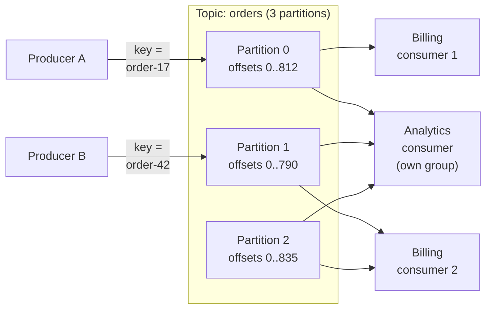
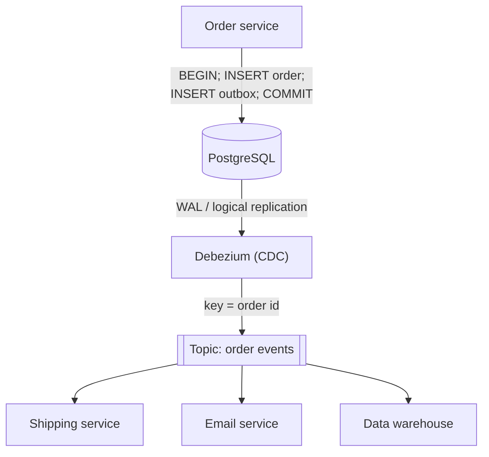

import { Aside } from '@astrojs/starlight/components';

A log-based broker stores events in an append-only, replicated log and keeps them after they are read. Consumers track their own position in the log. Any number of independent consumers can read the same events, a new consumer can start from last week, and a buggy one can rewind and reprocess. That makes the log the backbone for data pipelines, change propagation between services and real-time analytics, a different job from a [work queue](/async/queues-and-back-pressure/).

<Aside type="tip" title="TL;DR">
- A **topic** is split into **partitions**. Order is guaranteed only within a partition, so choose the partition key by what must stay ordered (for example `order_id`).
- A **consumer group** shares partitions among its members: one partition goes to at most one member. Parallelism is capped by the partition count.
- Consumers commit **offsets**. Commit after processing for at-least-once. Data stays for the **retention** period, so you can **replay**.
- **Exactly-once** in Kafka covers read-process-write *within Kafka*. Anything external still needs idempotent writes.
- To publish events reliably when the database changes, use the **transactional outbox** and **change data capture** instead of dual writes.
</Aside>

## The log abstraction

A log is an ordered, append-only sequence of records. Each record gets a sequential **offset** in its partition. Producers append to the end. Consumers read forward from an offset they choose and remember. Reading does not delete anything: records expire by age or size, or are compacted by key.

The producer hashes the record key to choose a partition, so all events for `order-17` land in one partition, in order. Each partition is replicated to several brokers, and the partition leader takes writes. In Kafka, a write is committed when all in-sync replicas have it. With `acks=all` and `min.insync.replicas=2` on a replication factor of 3, a single broker failure loses no acknowledged writes. Those two settings are not the broker defaults (`min.insync.replicas` and `default.replication.factor` both default to 1), so set them explicitly for important topics.

## Log-based brokers in 2026

| | Apache Kafka | Redpanda | Apache Pulsar | Amazon Kinesis Data Streams |
|---|---|---|---|---|
| What it is | The reference log broker (JVM) | Kafka-API-compatible broker in C++ | Stateless brokers over Apache BookKeeper | Fully managed AWS service |
| Metadata | KRaft (built-in Raft) | Built-in Raft | Oxia (recommended) or ZooKeeper | Managed |
| Unit of scale | Partition | Partition | Partition | Shard |
| Long-term storage | Tiered storage to object stores | Tiered storage (enterprise licence) | Tiered storage | Up to 365 days retention |
| Licence | Apache 2.0 | Community: BSL (to Apache 2.0 after 4 years) | Apache 2.0 | Proprietary service |

Notes that change design decisions:

- **Kafka 4.0** (2025) dropped ZooKeeper entirely. Clusters run on **KRaft**, so there is one system to operate. Tiered storage, which moves old segments to object storage, became production-ready in 3.9. The new consumer rebalance protocol (KIP-848) became GA in 4.0. **Share groups** ("queues for Kafka"), with per-record acknowledgement and delivery counts, became production-ready in 4.2. Producers default to `acks=all` with idempotence on. A "diskless topics" proposal (KIP-1150), which writes directly to object storage, was accepted in 2026 and is still being implemented.
- **Managed Kafka** (Amazon MSK, Confluent Cloud, Aiven and others) is the usual choice, because running brokers yourself is real work.
- **Pulsar** separates serving (brokers) from storage (bookies). Brokers can be added or replaced without moving data. It offers exclusive, failover, shared and key-shared subscriptions, so one system covers both queue and log use cases. Version 5.0 was released in October 2026.
- **Kinesis** shards accept up to 1 MB/s or 1,000 records/s of writes and serve 2 MB/s of reads, shared by all standard consumers. Enhanced fan-out gives each registered consumer its own 2 MB/s per shard. Retention defaults to 24 hours and can be raised to 365 days. Records can be up to 10 MiB since late 2025. On-demand mode adds shards automatically.

## Partitions and ordering

- **Order exists per partition only.** Records with different keys in different partitions have no defined order between them.
- **Pick the key by invariant.** If "payment captured" must follow "order placed", both events need the same key (the order ID), not the event type.
- **Hot keys** create hot partitions. One celebrity account or one huge tenant can saturate a partition while the others idle. Options: a compound key (`tenant:shard-n`) at the cost of order across shards, or a dedicated topic for the giant.
- **Adding partitions changes the key-to-partition mapping** for new records, which breaks per-key order during the change. Over-provision partitions up front.
- **Retries can reorder** a partition unless the producer is idempotent (the Kafka default).

**Sizing example.** You expect 50 MB/s now and a 3× growth in two years. One consumer instance processes about 10 MB/s. You need at least 5 partitions today and 15 for the growth. Pick around 24 to leave room for unequal key distribution. On Kinesis, 50 MB/s of writes needs at least 50 shards in provisioned mode.

## Consumer groups and offsets

A **consumer group** is a set of instances that share the work of reading a topic. The group coordinator assigns each partition to exactly one member. With 12 partitions and 4 members, each member reads 3 partitions. A 13th member would sit idle. A different group (say, analytics) reads the same topic independently, with its own offsets.

Each group stores its progress as committed offsets (Kafka keeps them in an internal topic). The commit point sets the delivery semantics:

| Commit | On crash | Semantics |
|---|---|---|
| Before processing | Records after the commit are skipped | At-most-once |
| After processing | Records since the last commit are reprocessed | At-least-once (default) |
| In the same transaction as the output | Neither | Exactly-once, if output is in Kafka or the same store |

**Consumer lag** is the distance between the newest offset and the committed offset. It is the key health metric for streaming. Lag of 1.8 million records, with consumers doing 30,000 records/s against 20,000 records/s of new data, drains in 1,800,000 ÷ 10,000 = 180 s. Alert on lag converted to *time*, and on lag that keeps growing.

**Rebalancing** happens when members join, leave or time out. Partitions move, and uncommitted work is redone. The KIP-848 protocol in Kafka 4.x (clients opt in with `group.protocol=consumer`; since Kafka 4.3, consumers still on the classic protocol log a recommendation to switch, because it will be deprecated) moves only the partitions that must move instead of pausing the whole group.

## Retention, compaction and replay

- **Time or size retention.** Kafka keeps 7 days by default. With tiered storage, keeping months is cheap.
- **Log compaction** keeps at least the latest record per key and removes older ones. A record with a key and an empty value (a *tombstone*) deletes the key. A compacted topic is a durable, replayable table: current customer profiles, feature flags, the outbox of an aggregate.
- **Replay** is the log's superpower. Reset a group's offsets to last Tuesday to reprocess after a bug fix, or start a new group from the earliest offset to build a new search index. This works only if consumers are idempotent and events carry enough data to be reprocessed without calling services that have since changed.

## Delivery semantics: what "exactly-once" really means

- **At-most-once**: no duplicates, possible loss. Fine for metrics sampling and logs you can afford to drop.
- **At-least-once**: no loss, possible duplicates. The default, and the right one for most work, paired with idempotent consumers.
- **Exactly-once** in Kafka is built from three parts:
  1. the **idempotent producer** (producer ID plus per-partition sequence numbers), which removes duplicates caused by producer retries;
  2. **transactions**, which write to several partitions *and* commit consumer offsets atomically;
  3. consumers reading with `isolation.level=read_committed`, which never see aborted writes.

Kafka Streams turns this on with `processing.guarantee=exactly_once_v2`. The guarantee covers a consume → transform → produce loop that stays inside Kafka. Once a consumer writes to Postgres, calls an API or sends an email, you are back to at-least-once plus idempotence, or you store the offsets in the same database transaction as the output. That is why "effectively-once" is the more honest name.

## Publishing events reliably: transactional outbox and CDC

A service often has to update its database *and* publish an event: "order placed". Two separate writes (a **dual write**) can fail between steps. The row is saved but the event is lost, or the event is published but the transaction rolls back. A distributed transaction (2PC) across database and broker is rarely available or wise.

The **transactional outbox** writes the event to an `outbox` table in the **same local transaction** as the business change. A separate relay publishes outbox rows to the broker. The relay can poll the table, or it can use **change data capture (CDC)**, which tails the database's replication log (PostgreSQL logical replication, MySQL binlog). Debezium is the common open-source CDC tool. It runs as a Kafka Connect source connector, as the standalone Debezium Server (targets include Kinesis, Pub/Sub and Pulsar), or embedded in a Java application. Its outbox event router routes each outbox row to a topic by aggregate type, using the aggregate ID as the key.

Properties to state in an interview:

- The event is published **if and only if** the transaction commits, and in commit order.
- The relay can publish a row twice (for example, a crash after publishing but before saving its position). Consumers dedupe by the event ID.
- Outbox rows can be deleted right after insertion or by a periodic job. CDC reads the insert from the log, so the table stays small.
- CDC on ordinary tables, without an outbox, is great for replication and analytics, but it exposes your internal schema as a public contract. The outbox lets you publish deliberate, versioned events.

## Event sourcing and CQRS in brief

**Event sourcing** stores the sequence of changes ("item added", "address changed") as the source of truth. Current state is derived by replaying them. You get a full audit trail, can answer "what did we know on 1 March", and can build new views from history. The costs: event schemas are forever, so versioning is mandatory; rebuilding state needs snapshots; and fixing bad data means writing compensating events.

**CQRS** (command query responsibility segregation) uses separate models for writes and reads. Reads are served from projections built off the event stream: a search index, a denormalised table, a cache. Reads scale independently and each view fits its query. The price is eventual consistency between the write and read sides, plus extra infrastructure. Martin Fowler's warning still applies: most systems are better off with one model. Use these patterns where audit, temporal queries or very different read shapes justify them.

## Queue vs log

| | Message queue (RabbitMQ, SQS) | Log (Kafka, Kinesis, Pulsar) |
|---|---|---|
| After consumption | Message deleted on ack | Record kept until retention |
| Consumers | Competing workers share one queue | Many independent groups, each with offsets |
| Replay | No (except DLQ redrive) | Yes, from any retained offset |
| Ordering | Weak, or per message group | Strict per partition |
| Parallelism | Add workers freely | Capped by partition count |
| Per-message retry and delay | Built in (visibility, DLQ) | Manual (retry topics), or share groups |
| Who tracks progress | Broker, per message | Consumer, as one offset per partition |
| Typical use | Background jobs, task distribution | Event pipelines, CDC, analytics, event sourcing |

Use a queue to distribute *work*. Use a log to distribute *facts*. Many systems use both: a log of facts, and small queues for the jobs those facts trigger.

<Aside type="note" title="In the interview">
- Say what the partition key is and why. Expect the follow-up "what about a hot key?"
- When the design updates a database and emits an event, the interviewer is probing for dual writes. Answer: transactional outbox plus CDC, and idempotent consumers.
- Be precise about exactly-once: Kafka transactions inside Kafka, effectively-once (idempotence) at the edges.
- Mention consumer lag as the health metric and replay as the recovery tool. Know that parallelism equals the partition count.
- Common mistakes: global ordering assumptions, choosing a log when a simple job queue would do, and event sourcing for a CRUD app.
</Aside>

## Further reading

- [The Log: what every software engineer should know about real-time data's unifying abstraction](https://engineering.linkedin.com/distributed-systems/log-what-every-software-engineer-should-know-about-real-time-datas-unifying): Jay Kreps' essay that shaped Kafka.
- [Kafka design: message delivery semantics](https://kafka.apache.org/43/design/design/): official explanation of idempotence, transactions and compaction.
- [Exactly-once semantics are possible: here's how Kafka does it](https://www.confluent.io/blog/exactly-once-semantics-are-possible-heres-how-apache-kafka-does-it/): the design and its limits.
- [Pattern: transactional outbox](https://microservices.io/patterns/data/transactional-outbox.html): Chris Richardson's pattern description.
- [Debezium outbox event router](https://debezium.io/documentation/reference/stable/transformations/outbox-event-router.html): a production outbox relay built on CDC.
- [Designing Data-Intensive Applications, 2nd edition](https://www.oreilly.com/library/view/designing-data-intensive-applications/9781098119058/): Kleppmann and Riccomini (2026), the stream processing and derived data chapters.

## Related topics

- [Message queues and back pressure](/async/queues-and-back-pressure/): work queues, DLQs and sizing consumers.
- [Partitioning and sharding](/data/partitioning-and-sharding/): the same key-choice and hot-spot problems in databases.
- [Replication](/data/replication/): leaders, followers and replication logs, the mechanism CDC builds on.
- [Consistency patterns](/fundamentals/consistency-patterns/): what eventual consistency means for read models built from streams.
- [Monolith and microservices](/architecture/monolith-and-microservices/): events as the contract between services.
