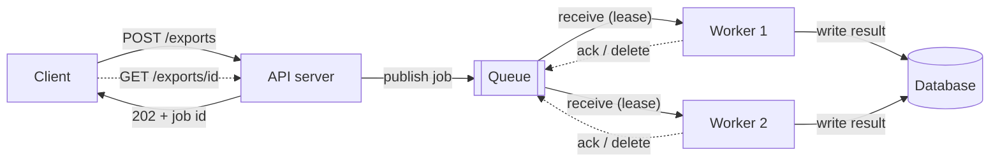
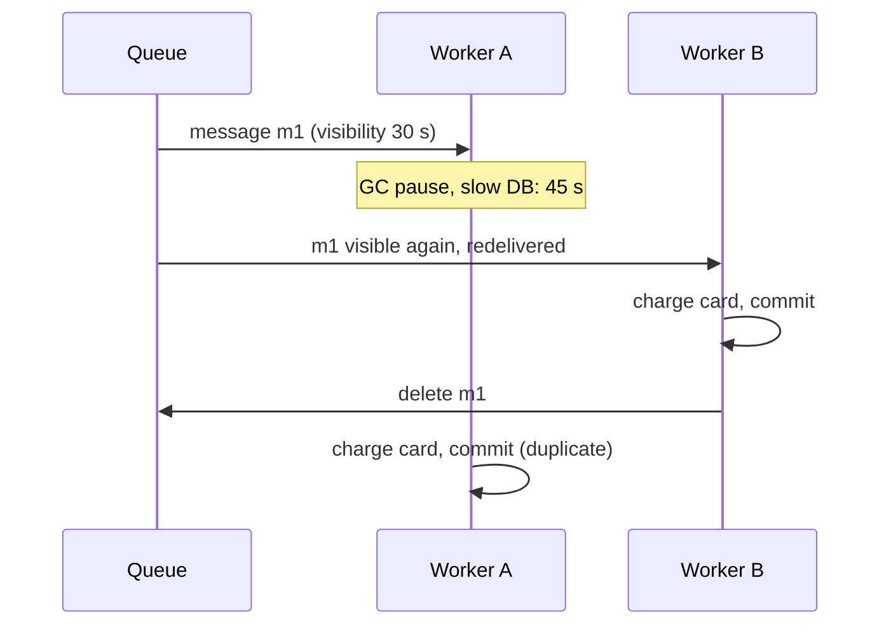

import { Aside } from '@astrojs/starlight/components';

A message queue lets one part of a system hand work to another without waiting for it to finish. The caller gets a fast answer, and workers do the slow part in the background at their own pace. That buys lower latency, burst absorption and looser coupling. It also brings duplicates, reordering, poison messages and queues that grow without limit, and the design has to handle each of them.

<Aside type="tip" title="TL;DR">
- Use a queue when the user does not need the result right away: emails, thumbnails, exports, webhooks, fan-out writes.
- Real brokers deliver **at least once**. Expect duplicates and make consumers **idempotent**. Acknowledge only after the work is committed.
- Cap redeliveries and send failures to a **dead-letter queue**. A poison message must not loop forever.
- **Bound every queue.** When it is full, reject early (429/503 with `Retry-After`). Clients retry with **exponential backoff and jitter**.
- Size workers with **Little's law**: jobs in flight = arrival rate × time per job. Then add headroom so a backlog can drain.
</Aside>

## Why go asynchronous

Three different problems lead to a queue:

- **Slow work on the request path.** Transcoding a video takes minutes, so nobody should hold an HTTP connection open for it. The API stores the upload, enqueues a job and answers `202 Accepted` with a job ID. The client polls a status endpoint or receives a webhook later.
- **Bursty load.** A flash sale can produce 10× normal traffic for five minutes. A queue stores the spike so workers can process it at a steady rate instead of being sized for the peak.
- **Coupling.** The producer does not need to know who consumes the message, how many consumers there are, or whether they are up right now. Each side deploys, scales and fails on its own.

Queues also carry work that nobody requested: nightly aggregates, cache warming, reindexing. The product can often hide the delay. A new post shows up on the author's own timeline at once, while delivery to followers' feeds runs in the background.

## How a message queue works



1. **Publish.** The producer sends a message and waits for the broker to confirm it was stored durably, for example with RabbitMQ publisher confirms or an SQS `SendMessage` response. Fire-and-forget publishing loses messages when the broker restarts.
2. **Receive.** A worker pulls one message or a batch. The broker does not delete the message. It hides it from other workers for a **lease**: the *visibility timeout* in SQS, an unacknowledged delivery in RabbitMQ, a pending entry in Redis Streams.
3. **Process** the message, then **acknowledge** it (ack or delete). If the worker crashes or the lease expires first, the broker hands the message to someone else.

That third step is what makes queues reliable, and it is also why duplicates happen.

## Task queues and schedulers

A **task queue** is a message queue plus a worker framework. You call a function asynchronously, and the framework handles serialization, delayed retries, rate limits, results and periodic schedules. Examples: **Celery** in Python (stable brokers: RabbitMQ, Redis, SQS), **Sidekiq** in Ruby and **BullMQ** in Node.js (both on Redis).

Check the acknowledgement mode. By default Celery acknowledges a task just *before* running it, so a crash mid-task loses it. `acks_late` acknowledges afterwards, so a crash runs the task again. Use it for idempotent tasks only.

Multi-step processes with waits and compensation fit a **durable execution** engine such as Temporal better than hand-built chains of queues and status tables. Schedulers have queue problems too: one cron host is a single point of failure, and managed schedulers such as Amazon EventBridge Scheduler deliver **at least once**, so scheduled jobs must be safe to run twice.

## Choosing a broker

| | RabbitMQ 4.x | Amazon SQS | Redis / Valkey Streams |
|---|---|---|---|
| Model | Exchanges route to queues | Managed queue, pull over HTTPS | Append-only stream with consumer groups |
| Durability | Quorum queues replicated with Raft | Stored across several AZs | Depends on AOF/RDB settings; replication is async |
| Ordering | Per queue; lost with competing consumers | Standard: best effort. FIFO: per message group | Per stream |
| Redelivery | Unacked messages requeued; delivery limit | Visibility timeout, `maxReceiveCount` | Pending list, `XAUTOCLAIM` |
| Operations | You run the cluster (or a managed offer) | None | Usually already running for caching |
| Best for | Rich routing, AMQP clients, moderate volume | Default choice on AWS, spiky workloads | Low latency, simple pipelines |

Current facts worth knowing:

- **RabbitMQ 4.x** removed classic mirrored queues. Replicated queues are now **quorum queues**, which since 4.0 dead-letter or drop a message after 20 deliveries by default. AMQP 1.0 is native next to AMQP 0-9-1, and **streams** add a replayable log inside the same broker.
- **SQS** standard queues offer nearly unlimited throughput with at-least-once delivery and best-effort order. FIFO queues keep order within a *message group* and drop producer retries that reuse a deduplication ID within 5 minutes. By default they handle 300 API calls/s per action, or 3,000 messages/s in batches of 10, and high-throughput mode goes much higher. Messages can be up to 1 MiB (since 2025) and are kept for up to 14 days.
- **Redis Streams** (`XADD`, `XREADGROUP`, `XACK`) keep unacknowledged entries in a pending list, unlike pub/sub, which drops messages when nobody is subscribed. The weak point is durability: with `appendfsync everysec` a crash can lose about a second of writes, and a failover can lose writes the replica had not yet received.

If several independent consumers need the same events, you need replay, or volumes reach hundreds of MB/s, use a **log** such as Kafka. See [event streaming](/async/event-streaming/). Since Kafka 4.2, *share groups* also give Kafka queue-style consumption, with per-record acknowledgement.

## Delivery guarantees in practice

Over an unreliable network, a broker can promise **at-most-once** delivery (ack before processing, accept loss) or **at-least-once** delivery (ack after processing, accept duplicates). Almost every system picks at-least-once. Duplicates arrive when:

- a worker commits its side effect, then crashes before the ack;
- processing outlives the visibility timeout, so a second worker gets the same message;
- the producer times out waiting for a publish confirm and sends again;
- the broker itself delivers twice (SQS standard queues can).



What you can build is **effectively-once processing**: at-least-once delivery plus an idempotent consumer. Either make the operation naturally idempotent (an upsert keyed by order ID, "set status to SHIPPED" rather than "increment counter"), or record processed message IDs in the **same transaction** as the side effect:

```python title="idempotent_consumer.py"
import sqlite3

db = sqlite3.connect(":memory:")
db.executescript("""
CREATE TABLE processed_messages (message_id TEXT PRIMARY KEY);
CREATE TABLE balances (account TEXT PRIMARY KEY, cents INTEGER NOT NULL);
INSERT INTO balances VALUES ('acc-1', 0);
""")


def handle(message_id: str, account: str, cents: int) -> bool:
    """Apply a deposit at most once, however many times the broker delivers it."""
    with db:  # one transaction: dedup record and side effect commit together
        cur = db.execute(
            "INSERT INTO processed_messages (message_id) VALUES (?) "
            "ON CONFLICT (message_id) DO NOTHING",
            (message_id,),
        )
        if cur.rowcount == 0:
            return False  # duplicate delivery: already applied, just ack it
        db.execute("UPDATE balances SET cents = cents + ? WHERE account = ?", (cents, account))
    return True  # caller acks/deletes the message only after the commit


for _ in range(3):  # the broker redelivers the same message three times
    print(handle("msg-7f3a", "acc-1", 500))
print(db.execute("SELECT cents FROM balances").fetchone()[0])  # 500, not 1500
```

Side effects outside your database, such as calling a payment provider or sending an email, need the downstream API to accept an **idempotency key** derived from the message ID.

## Acknowledgements, retries and dead letters

- **Ack after commit, never before.** Auto-ack modes trade safety for speed.
- **Size the lease to the work.** Set the visibility timeout above the p99 processing time. For long jobs, extend the lease from a heartbeat (`ChangeMessageVisibility` in SQS). An SQS lease can last up to 12 hours. RabbitMQ closes a consumer's channel when an acknowledgement takes longer than 30 minutes by default.
- **Separate transient from permanent errors.** A timeout to a dependency deserves a delayed retry. A malformed payload never succeeds, so dead-letter it immediately.
- **Delay retries.** Instant requeueing turns one failing dependency into a hot loop. Use delay queues, a longer visibility timeout per attempt, or retry topics with increasing delays.
- **Cap attempts and dead-letter.** A **poison message** fails every time. Without a cap it loops forever and, in a FIFO queue, blocks its whole group. Set a cap (SQS `maxReceiveCount`, RabbitMQ delivery limit with a dead-letter exchange), then move the message to a **dead-letter queue (DLQ)**.
- **Operate the DLQ.** Alert when it holds anything, keep its retention longer than the source queue's, and have a tool to inspect messages and redrive them after a fix.

## Ordering caveats

Even a strictly FIFO queue loses order once several workers consume it in parallel: worker 2 can finish message 2 before worker 1 finishes message 1. Retries and DLQ redrives reorder further. Options, cheapest first:

1. **Design so order does not matter.** Carry a version or timestamp and ignore stale updates, or use commutative operations.
2. **Order per key, not globally.** Route all messages for one entity to one serial consumer: an SQS FIFO message group, a Kafka partition key, or RabbitMQ single active consumer.
3. **Global order** means a single consumer, and the throughput of one.

## Back pressure

A queue only buffers. If producers outpace consumers for long enough, an unbounded queue turns overload into minutes of latency, then memory or disk exhaustion. Every message in it ends up processed too late to matter. **Back pressure** pushes the overload back to the source instead:

- **Bound the queue.** Set a maximum length, for example `x-max-length` with `x-overflow: reject-publish` in RabbitMQ. On a managed queue without a hard cap, have the producer check depth or the age of the oldest message and refuse new work above a threshold.
- **Reject at the edge.** Return `429 Too Many Requests` when one client exceeds its quota and `503 Service Unavailable` when the whole service is saturated, with `Retry-After` in both cases. See [rate limiting](/reliability/rate-limiting/).
- **Shed by value.** Drop low-priority or expired work first. A job whose user has already given up is pure waste.
- **Watch the age of the oldest message**, not only depth. Ten thousand messages may be two seconds of work or two hours.

Clients must retry politely. Use **exponential backoff with full jitter**: `sleep = random(0, min(cap, base × 2^attempt))`. Cap the number of attempts. Without jitter, every client that failed together retries together and hits the recovering service at the same moment. More in [resilience patterns](/reliability/resilience-patterns/).

## Sizing consumers with Little's law

Little's law, `L = λ × W`, links jobs in flight (`L`), arrival rate (`λ`) and time per job (`W`). See [latency vs throughput](/fundamentals/latency-vs-throughput/).

**Worked example.** Thumbnails arrive at 400 jobs/s and take 0.5 s each on average.

| Step | Calculation | Result |
|---|---|---|
| Jobs in flight at steady state | 400 × 0.5 | 200 |
| Slots for 70% utilisation | 200 ÷ 0.7 | 286 |
| Pods at 16 concurrent jobs each | 286 ÷ 16, rounded up | 18 pods (288 slots) |
| Maximum throughput | 288 ÷ 0.5 | 576 jobs/s |
| Backlog after a 10-minute outage | 400 × 600 | 240,000 jobs |
| Time to drain with 18 pods | 240,000 ÷ (576 − 400) | ≈ 23 min |
| Time to drain with 25 pods | 240,000 ÷ (800 − 400) | 10 min |

Headroom sets how fast you recover, not just whether you keep up. The same numbers bound the queue: if a thumbnail is useless after waiting 10 s, there is no point holding more than 576 × 10 ≈ 5,800 messages. Anything beyond that will be stale before a worker reaches it. Autoscale on the age of the oldest message or on backlog per worker rather than on CPU.

## When not to go async

- **The user needs the answer now**: login, search, price checks, input validation. A queue only adds latency.
- **The work is cheap.** Enqueue, poll and dequeue can cost more than a 5 ms inline call.
- **Read-your-writes matters.** Async paths make the user's next read stale unless you design for it.
- **The system is small.** A broker is another stateful service to run. A database table with `SELECT … FOR UPDATE SKIP LOCKED` is a perfectly good queue at modest volume.

Debugging also gets harder, because a failure surfaces minutes later in another process. Put trace context in message headers (see [observability](/reliability/observability/)).

## Trade-offs

| | Synchronous call | Queue (RabbitMQ, SQS) | Log (Kafka, Kinesis) |
|---|---|---|---|
| User-facing latency | Full cost of the work | Enqueue only | Append only |
| Failure of the consumer | Caller fails | Work waits in the queue | Work waits; replay possible |
| Consumers per message | One | One (competing workers) | Many independent groups |
| Duplicates, ordering | Caller retries | At-least-once, weak order | At-least-once, order per partition |
| Operational cost | Lowest | Medium | Highest |

<Aside type="note" title="In the interview">
- Say *why* a step is async (slow, bursty, or decoupled) and what the user sees meanwhile (`202`, status polling, optimistic UI).
- Interviewers will ask: what if the worker crashes mid-job? Expected answer: lease or visibility timeout, at-least-once, idempotent consumer, DLQ.
- Size the worker pool aloud with Little's law, and mention how long a backlog takes to drain.
- Common mistakes: claiming "exactly-once" from a broker, unbounded queues, retries without jitter, and assuming FIFO order survives parallel consumers.
</Aside>

## Further reading

- [Applying back pressure when overloaded](https://mechanical-sympathy.blogspot.com/2012/05/apply-back-pressure-when-overloaded.html): Martin Thompson on bounded queues and rejecting excess load.
- [Queues don't fix overload](https://ferd.ca/queues-don-t-fix-overload.html): Fred Hebert on why a bigger buffer only delays the failure.
- [Exponential backoff and jitter](https://aws.amazon.com/blogs/architecture/exponential-backoff-and-jitter/): AWS simulations comparing jitter strategies.
- [RabbitMQ quorum queues](https://www.rabbitmq.com/docs/quorum-queues): replication, delivery limits and poison-message handling.
- [Amazon SQS dead-letter queues](https://docs.aws.amazon.com/AWSSimpleQueueService/latest/SQSDeveloperGuide/sqs-dead-letter-queues.html): redrive policy and retention pitfalls.
- [Celery: tasks](https://docs.celeryq.dev/en/stable/userguide/tasks.html): acknowledgement modes, retries and why tasks should be idempotent.

## Related topics

- [Event streaming](/async/event-streaming/): logs, partitions, replay and the transactional outbox.
- [Rate limiting](/reliability/rate-limiting/): rejecting excess load before it reaches the queue.
- [Resilience patterns](/reliability/resilience-patterns/): retries, budgets, timeouts and load shedding.
- [Latency vs throughput](/fundamentals/latency-vs-throughput/): Little's law and why latency explodes near full utilisation.
- [Observability](/reliability/observability/): queue age, consumer lag and tracing across async hops.
