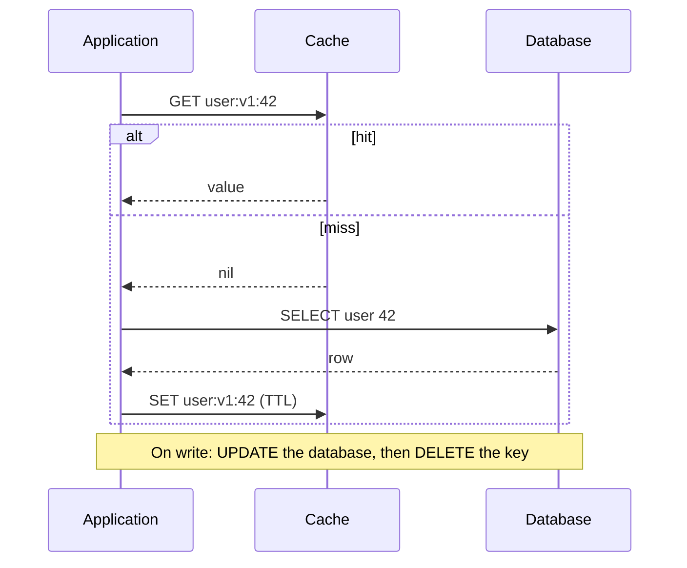
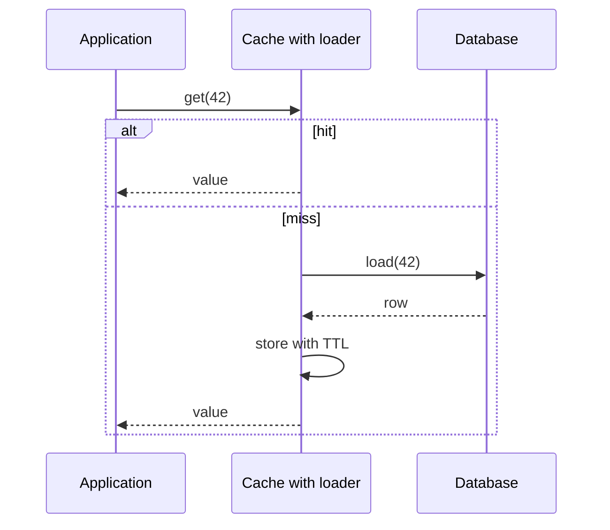
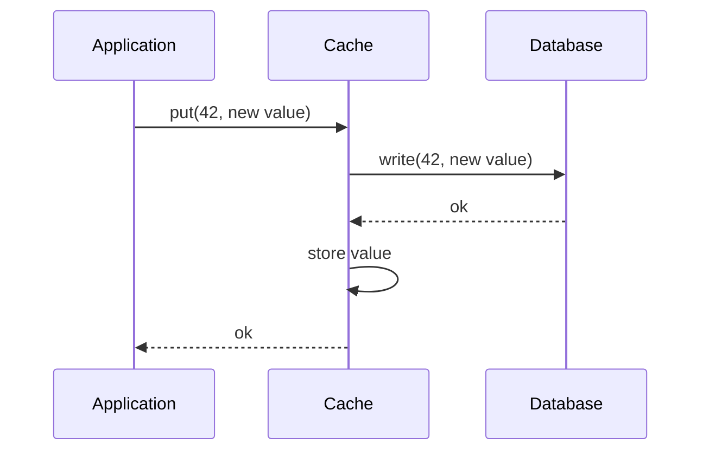
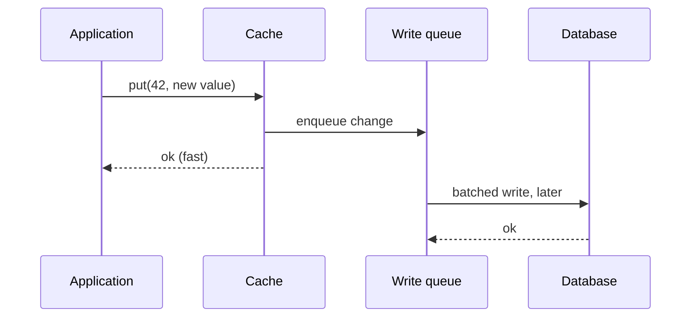
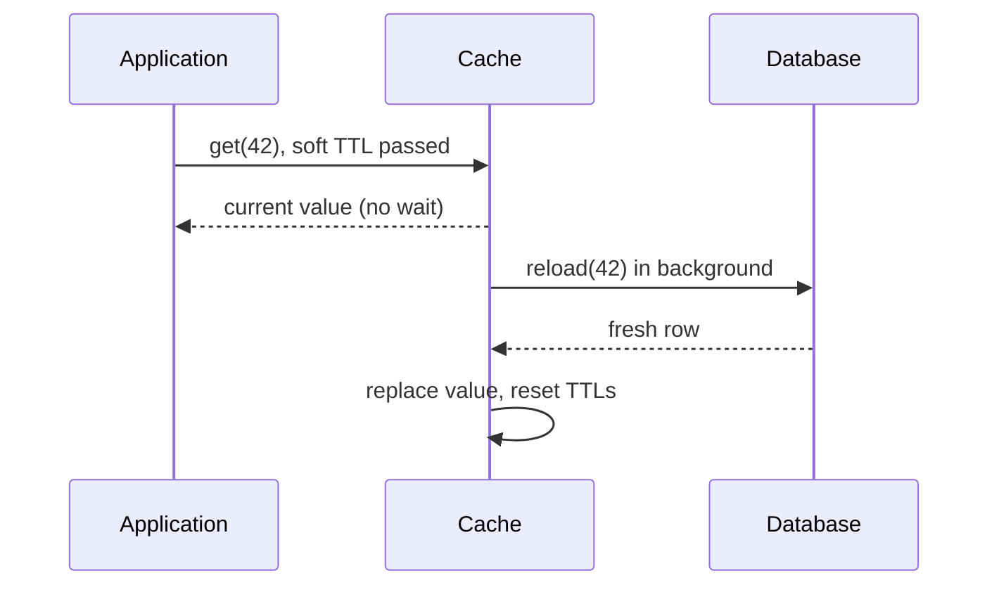
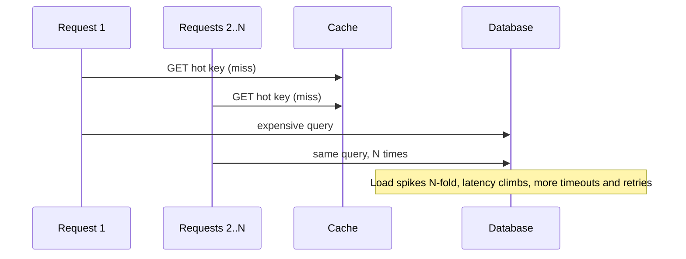
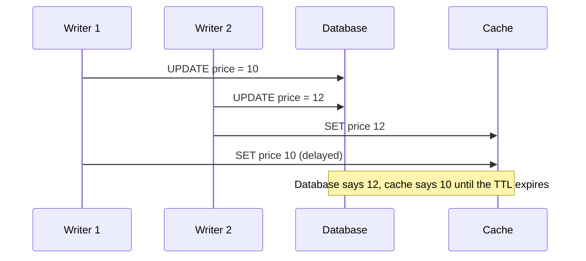

import { Aside } from '@astrojs/starlight/components';

Once you know [where to cache](/caching/caching-layers/), the next questions are how data gets into the cache, how it leaves, and what happens when many clients, writers and failures interact. These choices decide whether a cache is a quiet speed-up or the cause of your next outage.

<Aside type="tip" title="TL;DR">
- **Cache-aside** (lazy loading) is the default: the application reads the cache, loads from the database on a miss, and deletes the key on write.
- **Write-through** keeps the cache fresh at the cost of write latency; **write-behind** makes writes fast but can lose data; **refresh-ahead** hides reload latency for hot keys.
- Invalidate by **deleting** keys after the database commit, keep a **TTL** as a safety net, and use **CDC** when many services write the same data.
- Protect the origin from **stampedes** (coalescing, locks, early refresh), **penetration** (negative caching, Bloom filters) and **hot keys** (local caches, key replication).
</Aside>

## Read and write strategies

### Cache-aside (lazy loading)

The application owns both paths. The cache knows nothing about the database.



- **Pros:** only requested data is cached; the cache can fail or be flushed without losing data; works with any cache and any database; the cached shape can differ from the table shape.
- **Cons:** a miss costs three round trips; first reads after a deploy or flush are slow; data is stale until the TTL expires or the key is deleted; races between readers and writers (see below).
- **Use when:** read-heavy workloads with a clear object model. This is how Memcached and most Redis or Valkey deployments are used.

A correct, minimal implementation in modern Python. Unlike many textbook versions, it builds the key in exactly one place (so reads and writes cannot use different keys), uses a parameterised query, returns the same type on a hit and a miss, caches "not found", and adds jitter to TTLs.

```python title="user_cache.py"
import json
import random
import sqlite3
from dataclasses import asdict, dataclass

import redis

TTL_SECONDS = 300
NEGATIVE_TTL_SECONDS = 30
MISSING = b"__missing__"  # sentinel for "no such user" (negative caching)

cache = redis.Redis(host="localhost", port=6379)
db = sqlite3.connect("app.db")


@dataclass(frozen=True)
class User:
    id: int
    name: str
    email: str


def user_key(user_id: int) -> str:
    # One function builds the key, so readers and writers can never disagree.
    return f"user:v1:{user_id}"


def ttl_with_jitter(base: int) -> int:
    # Spread expirations so keys written together do not expire together.
    return base + random.randint(0, base // 10)


def get_user(user_id: int) -> User | None:
    key = user_key(user_id)
    cached = cache.get(key)
    if cached == MISSING:
        return None
    if cached is not None:
        return User(**json.loads(cached))

    # Cache miss: read the source of truth with a parameterised query.
    row = db.execute(
        "SELECT id, name, email FROM users WHERE id = ?", (user_id,)
    ).fetchone()
    if row is None:
        cache.set(key, MISSING, ex=NEGATIVE_TTL_SECONDS)
        return None

    user = User(*row)
    cache.set(key, json.dumps(asdict(user)), ex=ttl_with_jitter(TTL_SECONDS))
    return user


def update_email(user_id: int, email: str) -> None:
    with db:  # commit the database transaction first...
        db.execute("UPDATE users SET email = ? WHERE id = ?", (email, user_id))
    cache.delete(user_key(user_id))  # ...then invalidate; the next read reloads
```

The same code works unchanged with Valkey, which speaks the same protocol.

### Read-through

The cache sits in the read path and loads missing entries itself, through a loader function or a built-in connector. The application only talks to the cache.



- **Pros:** loading logic lives in one place; the cache can coalesce concurrent misses for the same key into a single load.
- **Cons:** needs a cache that supports loaders (in-process libraries such as Caffeine, data grids, or managed caches such as DynamoDB Accelerator); the cached shape is tied to the loader.
- **Use when:** you can centralise data access in a library or use a database-specific cache.

### Write-through

Writes go to the cache, and the cache (or a library in front of it) writes synchronously to the database before acknowledging.



- **Pros:** cached data is fresh after every write through this path; reads right after a write are fast.
- **Cons:** every write pays two writes of latency; the cache fills with data that may never be read (use a TTL); writes that bypass the cache (migrations, other services) leave it stale; a new or restarted cache node is empty until data is written, so combine it with cache-aside or read-through for reads.
- **Use when:** data is read soon after it is written and writes go through one service. DynamoDB Accelerator (DAX) is a managed write-through and read-through cache.

### Write-behind (write-back)

The application writes to the cache and gets an immediate acknowledgement; the cache flushes changes to the database asynchronously, often batched.



- **Pros:** very low write latency; absorbs write bursts; can coalesce many updates to one key into one database write (counters, likes, view counts).
- **Cons:** data is lost if the cache or queue fails before flushing; the database is behind the cache, so other readers of the database see old data; ordering, retries and idempotency are your problem; the most complex option to run correctly.
- **Use when:** losing a few seconds of updates is acceptable (view counters, analytics, game state checkpoints), or the queue is durable (for example, a log such as Kafka in front of the database).

### Refresh-ahead

The cache reloads hot entries **before** they expire, so readers rarely see a miss. Typical implementations use a soft TTL (after which an access triggers an asynchronous reload while the old value is still served) and a hard TTL (after which the entry is gone).



- **Pros:** hides reload latency for popular keys; smooths load on the database; keeps serving if the database is briefly down (until the hard TTL).
- **Cons:** wasted work for keys that will not be read again; readers may get a value one refresh period old; needs a cache or library that supports it (Caffeine's `refreshAfterWrite`, HTTP `stale-while-revalidate`).
- **Use when:** a small set of hot keys is expensive to rebuild: home pages, configuration, exchange rates, ranking results.

### Comparison

| Strategy | Who loads on a miss | Write path | Freshness | Write latency | Main risk | Typical use |
|---|---|---|---|---|---|---|
| Cache-aside | Application | DB, then delete key | Stale until TTL or delete | DB only | Read-write races | General default |
| Read-through | Cache loader | Usually as cache-aside | Same as cache-aside | DB only | Tied to cache features | Central data-access layer |
| Write-through | Cache loader or app | Cache and DB synchronously | Fresh for writes via the cache | DB + cache | Bypassing writes go stale | Read-after-write data |
| Write-behind | Cache | Cache, DB later | Cache fresh, DB lags | Cache only | Data loss on failure | Counters, bursts |
| Refresh-ahead | Cache, proactively | Any of the above | Within one refresh period | Unchanged | Wasted reloads | Hot, expensive keys |

## Invalidation

Invalidation is where caches go wrong. Common approaches, usually combined:

- **TTL.** Every entry expires after a fixed time. Simple and self-healing, it bounds staleness even when other mechanisms fail. Always set one, and add jitter so entries written together do not expire together.
- **Explicit delete on write.** After committing the database change, delete the affected keys. Fast and precise, but only covers writes that go through code that knows the keys.
- **Versioned keys.** Put a version in the key (`product:42:v17`, or a namespace generation such as `catalog:gen:8:product:42`). A write bumps the version in the database; readers build keys from the current version, so old entries are never read and simply age out. Bumping a namespace generation invalidates a whole group at once. This is also how CDNs handle immutable assets.
- **CDC-driven invalidation.** A change-data-capture pipeline tails the database log and deletes or refreshes keys for every committed change, regardless of which service wrote it. Facebook's memcache deployment did this with daemons reading the MySQL commit log; today the usual tools are Debezium or a database's native change streams, publishing to Kafka. It also broadcasts invalidations to every region and to in-process L1 caches.

Deletions and invalidation messages can be lost or delayed, so keep TTLs as the backstop, make invalidation idempotent, and monitor consistency (Meta reports measuring cache-versus-database consistency of its TAO cache directly).

## Eviction policies

When the cache is full, the eviction policy decides what to drop.

| Policy | Evicts | Good for | Weakness |
|---|---|---|---|
| LRU | Least recently used | Recency-driven workloads | A one-off scan flushes hot data |
| LFU | Least frequently used | Stable popularity | Slow to forget items that used to be popular; needs decay |
| TTL-based | Entries closest to expiry (Redis `volatile-ttl`) | Data with meaningful lifetimes | Ignores popularity |
| FIFO or random | Oldest or any entry | Cheap, predictable | Lower hit ratio |
| W-TinyLFU | Rejects newcomers less popular than the eviction victim | Mixed and skewed workloads | More complex; mostly in libraries |

Redis and Valkey approximate LRU and LFU by sampling a few keys rather than tracking exact order, and their default policy is `noeviction` (writes fail when memory is full). For a pure cache set `maxmemory` and `allkeys-lru` or `allkeys-lfu`; use `volatile-*` policies when the same instance also holds keys that must not be evicted.

**W-TinyLFU**, used by the Caffeine library for Java, combines a small LRU "window" for new entries with a large segmented LRU main area, and admits an entry into the main area only if a compact frequency sketch says it is more popular than the entry it would evict. It resists scans and adapts the window size automatically, and it matches or beats other policies across many real traces.

Two newer FIFO-based policies from CMU and Emory researchers, **S3-FIFO** (SOSP 2023) and **SIEVE** (NSDI 2024), quickly drop keys that are seen only once and need no locking on a hit. In the authors' trace studies they matched or beat LRU and other state-of-the-art policies on hit ratio while scaling better across threads, and SIEVE has already been added to several production cache libraries.

## Failure modes and fixes

### Cache stampede (thundering herd)

A popular key expires, or the cache restarts, and hundreds of concurrent requests miss at once and all hit the database with the same expensive query.



Fixes, from simplest to most robust:

- **TTL jitter** — avoids many keys expiring at the same moment.
- **Request coalescing (single-flight)** — within one process, only the first miss for a key goes to the database; concurrent callers wait for its result.
- **Distributed lock or lease** — the first client to miss takes a short lock (`SET lock:key token NX PX 5000`) and recomputes; others briefly wait, retry, or get the stale value. Facebook's memcache **leases** did this and cut the peak database query rate for herd-prone keys from 17,000/s to 1,300/s.
- **Serve stale while revalidating** — keep the old value past its soft TTL and let one request refresh it.
- **Probabilistic early expiration (XFetch)** — each reader may refresh a little before expiry, with a probability that rises as expiry approaches and with the cost of recomputation:

```python title="xfetch.py"
import math
import random
import time


def should_refresh_early(expiry: float, recompute_secs: float, beta: float = 1.0) -> bool:
    """XFetch: refresh before expiry with a probability that rises as expiry nears.

    -log(random()) is exponentially distributed, so most callers see a small
    head start and only a few refresh well ahead of time.
    """
    head_start = -recompute_secs * beta * math.log(1.0 - random.random())
    return time.time() + head_start >= expiry
```

Store `expiry` and the measured `recompute_secs` with the value. For a value that takes 1 s to rebuild, a read 10 s before expiry triggers a refresh with probability of about 0.005%, at 2 s about 14%, and at 0.5 s about 61%. Under steady traffic one of the early readers rebuilds the value while everyone else keeps hitting the cache.

### Cache penetration

Requests for keys that do not exist (deleted IDs, typos, or deliberate attacks with random IDs) always miss the cache and always hit the database.

- **Negative caching** — cache "not found" with a short TTL (the `MISSING` sentinel above).
- **Bloom filter** — keep a compact probabilistic set of all valid IDs in front of the cache. "Definitely absent" requests are rejected without touching the database; false positives only cost a normal lookup. Redis 8 includes Bloom filters; Valkey offers them through its `valkey-bloom` module.
- **Validate input** — reject malformed IDs at the edge and rate-limit clients that generate many misses.

### Hot keys

One key receives so much traffic that the single cache shard holding it saturates (a celebrity's profile, a flash-sale item).

- **Local L1 cache** with a TTL of a second or two on each app server absorbs most reads.
- **Key replication** — store copies under `item:42#0` … `item:42#7`, read a random copy and write or delete all copies.
- **Read replicas** for the cache shard, or a dedicated cluster for known hot data.
- **Detect** hot keys with per-key metrics or sampling (`redis-cli --hotkeys` and `valkey-cli --hotkeys` work when an LFU eviction policy is set), and do not let one key's traffic be rehashed onto another node that will also fall over.

### Mass expiry and cache outages

If many keys expire together or the cache cluster fails, the database receives the full read load at once (sometimes called a cache avalanche). Use TTL jitter, keep cache replicas across zones, put a [circuit breaker](/reliability/resilience-patterns/) and rate limit in front of the database, and warm caches before shifting traffic. Facebook's "gutter" pool, a small set of spare cache servers that temporarily take over for failed ones, is a good example.

### The delete-vs-update race

Two writers update the same row. If each writer **sets** the new value in the cache, the cache writes can arrive in a different order from the database commits:



If both writers **delete** the key instead, the order does not matter: a delete is idempotent, and the next reader loads the latest committed value. That is why "update the database, then delete the key" is the safer default, and why Facebook's memcache used deletes rather than sets on writes.

Deleting does leave a narrower race: a reader misses, reads the old value from the database, and is delayed; meanwhile a writer commits and deletes the key; then the reader puts the old value back. It needs a slow reader and a write in a small window, and is fixed by:

- **TTL** to bound how long the stale value can live.
- **Leases or versioned sets** — the cache rejects a `SET` from a reader whose lease was invalidated by a delete, or one that carries an older version (compare-and-set).
- **Delayed second delete** — delete again a short time after the write, so late stale sets are cleaned up.
- **CDC invalidation**, which deletes after the commit is durable and can be retried.

Also always commit the database transaction **before** deleting; deleting first lets a reader repopulate the cache with the old value before the commit lands.

<Aside type="note" title="In the interview">
- State the strategy and the invalidation rule together: "cache-aside, delete on write after commit, 5-minute TTL with jitter."
- Expect "what if a key gets a million requests per second?" (L1 cache, key replication) and "what if the cache cluster restarts?" (coalescing, leases, warming, rate limiting).
- Explain why you delete rather than update on write, and the remaining race.
- Know where write-behind is acceptable and where it is not (never for payments without a durable log).
- Common mistakes: no TTL, caching without a plan for invalidation, and assuming the cache is always available.
</Aside>

## Further reading

- [Scaling Memcache at Facebook](https://www.usenix.org/conference/nsdi13/technical-sessions/presentation/nishtala) — leases, invalidation via the commit log, gutter pools (NSDI 2013).
- [Cache made consistent](https://engineering.fb.com/2022/06/08/core-infra/cache-made-consistent/) — how Meta measures and improves TAO cache consistency.
- [Optimal Probabilistic Cache Stampede Prevention](https://www.vldb.org/pvldb/vol8/p886-vattani.pdf) — the XFetch paper (VLDB 2015).
- [TinyLFU: A Highly Efficient Cache Admission Policy](https://arxiv.org/abs/1512.00727) and Caffeine's [efficiency notes](https://github.com/ben-manes/caffeine/wiki/Efficiency).
- [Caching strategies](https://docs.aws.amazon.com/AmazonElastiCache/latest/dg/Strategies.html) (ElastiCache docs) and [Key eviction](https://redis.io/docs/latest/develop/reference/eviction/) (Redis docs).

## Related topics

- [Caching layers](/caching/caching-layers/) — where caches sit and how to size them.
- [LRU cache](/ood/lru-cache/) — build the classic eviction policy from scratch.
- [Consistency patterns](/fundamentals/consistency-patterns/) — weak, eventual and strong consistency as seen by cache readers.
- [Event streaming](/async/event-streaming/) — the CDC pipelines behind log-driven invalidation.
- [Resilience patterns](/reliability/resilience-patterns/) — circuit breakers and load shedding when the cache fails.
