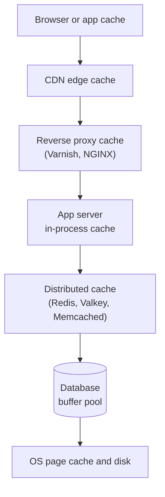

import { Aside } from '@astrojs/starlight/components';

A cache keeps a copy of data closer to where it is needed so that later requests skip slower work: a network hop, a disk read, a query or a page render. Caching is the cheapest way to cut latency and protect a database, and it shows up at every layer of a system. It is also where many outages and stale-data bugs come from, so a designer must know what each layer buys and costs.

<Aside type="tip" title="TL;DR">
- Caching works because access is **skewed**: a small share of keys gets most requests, and recently used data tends to be used again.
- Caches exist at every layer: browser, CDN, reverse proxy, application (in-process and distributed), and inside the database itself.
- Prefer caching **objects** (a user profile, a rendered fragment) over raw query results: objects map cleanly to invalidation events.
- Effective latency is `h·t_cache + (1−h)·t_origin`. The jump from 90% to 99% hits cuts origin load tenfold.
- For a shared cache, Valkey (BSD) and Redis (AGPLv3 option since Redis 8) are both solid; Memcached remains the simplest pure cache.
</Aside>

## Why caching works — and what it costs

Two properties of real workloads make caches effective:

- **Temporal locality.** Data that was just read is likely to be read again soon (a viral post, a logged-in user's profile).
- **Skew.** Popularity follows a long-tailed, roughly Zipf-like distribution. With a Zipf exponent of 1 over one million items, the most popular 1% of items receive about 68% of requests and the top 10% about 84%. Caching a small hot set therefore absorbs most of the traffic.

Skew also explains why caches protect databases. A database spreads load over partitions by key, and a popular item concentrates traffic on one partition. A cache in front absorbs those hot reads and smooths spikes.

The costs are just as real:

- **Staleness.** A cached copy can disagree with the source of truth. Every cache needs an answer to "how stale may this be, and who fixes it?"
- **Modal behaviour.** With a 95% hit ratio, the database only sees 5% of reads. If the cache is flushed, restarted or partitioned, the database suddenly receives 20 times its usual load. The cache has become load-bearing.
- **Cold starts.** New cache nodes and fresh deploys start empty and lean on the origin until warm.
- **Memory and complexity.** RAM is far more expensive than disk, and every cache adds code paths for misses, failures and invalidation.

## Where to cache



Each layer is closer to the user (and cheaper per hit) than the one below it, but holds less specific, less controllable data.

| Layer | What it caches | Controlled by | Typical hit latency | Watch out for |
|---|---|---|---|---|
| Browser or mobile app | Static assets, API responses | `Cache-Control`, `ETag`, service workers | ~0 ms (local) | You cannot purge it; version asset URLs |
| CDN | Static files, media, cacheable API and HTML | HTTP headers, CDN rules, purge API | Single-digit to tens of ms | Personalised content leaking into shared caches |
| Reverse proxy | Full HTTP responses, fragments | Proxy config (for example Varnish's VCL) | Under a millisecond plus network | Cache keys missing a header such as `Accept-Language` |
| In-process (L1) | Hot objects, config, compiled templates | Application code (for example Caffeine) | Microseconds | Each server holds its own copy; invalidation fan-out |
| Distributed cache | Objects, sessions, counters, rendered fragments | Application code | Sub-millisecond in the same zone | Network hop, hot keys, cluster failures |
| Database buffer cache | Data and index pages | DB settings | Microseconds inside the DB | Too small a buffer pool turns reads into disk I/O |

Some notes per layer:

- **Client caching** is free capacity: a response the browser reuses never reaches you. Long-lived, fingerprinted asset URLs (`app.3f9c.js` with `Cache-Control: max-age=31536000, immutable`) plus short-lived HTML is the standard recipe. See [HTTP](/communication/http/) for the headers.
- **CDN caching** is covered in [Content delivery networks](/traffic/cdn/). CDNs increasingly cache API responses too, using short TTLs and `stale-while-revalidate`.
- **Web server / reverse proxy caching**: Varnish has long been the classic HTTP accelerator. Its open-source project has been renamed **Vinyl Cache** (announced in 2025; Vinyl Cache 9.0 shipped in March 2026), while Varnish Software continues a separate project under the Varnish Cache name. NGINX and most API gateways offer similar response caching. See [Reverse proxy and API gateway](/traffic/reverse-proxy-and-api-gateway/).
- **Database caching**: every database caches pages in memory. PostgreSQL's `shared_buffers` (a common starting point is 25% of RAM on a dedicated server) works alongside the OS page cache; MySQL's InnoDB buffer pool is often given up to 80% of RAM. Tuning these for your working set is often the cheapest win. MySQL removed its built-in query result cache in 8.0 because it scaled poorly and was invalidated per table.
- **Application caching**: an in-memory key-value store between the application and its database. In-process caches are fastest but duplicated per server; a distributed cache is shared, survives deploys, and can be sized independently. Many systems use both: a small L1 with a TTL of seconds in front of a shared L2.

## Query-level vs object-level caching

There are two broad ways to decide **what a cache entry is**.

**Query-level caching** hashes the query text and parameters into a key and stores the result set. It is easy to bolt on, but invalidation is the problem: when one row changes, you cannot cheaply tell which cached queries included it. You either flush whole tables' worth of entries or live with staleness until TTLs expire. This is exactly why MySQL's query cache was retired.

**Object-level caching** stores what the application thinks in: a `User` with its settings, a product page model, a rendered comment thread. The key is derived from the object's identity (`user:v1:42`), so when the underlying data changes the application knows which key to delete. Objects can also be assembled asynchronously: workers listen for changes and rebuild the cached object, so readers almost never miss.

| | Query-level | Object-level |
|---|---|---|
| Key | Hash of SQL and parameters | Domain identity (`user:42`, `feed:42:page:1`) |
| Invalidation | Hard: a row change maps to unknown queries | Clear: an entity change maps to known keys |
| Reuse across code paths | Low (only identical queries hit) | High (every reader of the object hits) |
| Effort | Low to add | Requires modelling the cached objects |

Granularity is a spectrum: row, query result, assembled object, rendered fragment, full page. Higher levels save more work per hit but are invalidated by more kinds of change.

## What to cache

Good candidates are read often, expensive to produce and tolerant of brief staleness:

- Rendered HTML fragments or full pages for anonymous users.
- Assembled objects: user profiles, product details, permissions.
- Aggregates and derived data: counters, leaderboards, timelines and activity feeds, social graph adjacency lists.
- Results of slow external calls: currency rates, geolocation, third-party API responses.
- Configuration, feature flags and public keys used to verify tokens.
- Negative results ("no such user") with a short TTL.

Poor candidates: data that must be exactly current (account balances during a transfer), data written far more often than read, and huge blobs that belong in object storage behind a CDN. **Sessions** are a special case: they are often stored in Redis or Valkey, but then the store is the session's system of record, not a cache, and must be configured for persistence and replication accordingly.

## Cache key design

A cache key must change whenever the cached value would change, and must not change otherwise.

- **Namespace and version:** `user:v2:42`. Bumping `v2` when the serialised format changes makes old entries unreachable instead of crashing new code.
- **Include every input that changes the output:** locale, currency, user tier, A/B variant, API version. Missing one serves one user's variant to another.
- **Normalise:** sort query parameters, lowercase case-insensitive values, drop tracking parameters (`utm_*`) so equivalent requests share an entry.
- **Bound the length:** hash long composite inputs. Memcached limits keys to 250 characters, and long keys waste memory anywhere.
- **Isolate tenants and users:** a personalised value must include the user or tenant ID; never let a shared cache serve private data under a shared key.
- **Avoid unbounded attacker-controlled keys:** caching every arbitrary search string invites memory exhaustion and pollutes the cache.

## Hit-ratio math

With hit ratio `h`, cache latency `t_cache` and origin latency `t_origin`:

```text
effective latency = h · t_cache + (1 − h) · t_origin
origin load       = (1 − h) · request rate
```

(With a look-aside cache a miss actually costs `t_cache + t_origin`, which adds `t_cache` to every miss; at sub-millisecond cache latency the difference is negligible.)

Example: Redis at 0.5 ms, a database query at 20 ms, 50,000 reads per second:

| Hit ratio | Effective latency | Speed-up | Reads reaching the database |
|---|---|---|---|
| 0% | 20.0 ms | 1.0× | 50,000/s |
| 50% | 10.3 ms | 2.0× | 25,000/s |
| 80% | 4.4 ms | 4.5× | 10,000/s |
| 90% | 2.5 ms | 8.2× | 5,000/s |
| 95% | 1.5 ms | 13.6× | 2,500/s |
| 99% | 0.7 ms | 28.8× | 500/s |
| 99.9% | 0.5 ms | 38.5× | 50/s |

Two lessons. First, the last few percent matter most: going from 90% to 99% reduces database load tenfold. Second, the origin must still survive the miss traffic, and a cold or failed cache drops `h` to zero. Capacity-plan the database for a degraded hit ratio, or protect it with request coalescing and rate limits (see [Cache strategies](/caching/cache-strategies/)).

## Redis vs Valkey vs Memcached

**The licensing story.** Redis was BSD-licensed up to version 7.2. In March 2024 Redis Ltd. moved new versions to a dual source-available licence (RSALv2 or SSPLv1), which cloud providers could not offer as a managed service without an agreement. Within weeks the Linux Foundation launched **Valkey**, a fork of Redis 7.2.4 under the BSD licence, backed by AWS, Google Cloud, Oracle, Ericsson and others. In May 2025, **Redis 8** added the OSI-approved **AGPLv3** as a third licence option and folded the former Redis Stack modules (JSON, time series, probabilistic structures, the query engine) and a new vector set type into the core. Valkey continued independently: Valkey 9.0 (October 2025) added atomic slot migration, per-field hash expiration and numbered databases in cluster mode, and Valkey 9.1 (May 2026) added per-database ACLs for isolating tenants and lower per-key memory overhead. Managed offerings now include ElastiCache and Memorystore for Valkey alongside Redis Cloud.

| | Redis 8.x | Valkey 9.x | Memcached |
|---|---|---|---|
| Licence | RSALv2, SSPLv1 or AGPLv3 (your choice) | BSD-3-Clause | BSD-3-Clause |
| Governance | Redis Ltd. | Linux Foundation | Community project |
| Data model | Strings, hashes, lists, sets, sorted sets, streams, JSON, time series, Bloom filters, vector sets | Redis 7.2 types plus later additions; JSON, Bloom and search via official modules | Strings (opaque byte values) |
| Threading | Single-threaded command execution with I/O threads | Single-threaded execution with improved multi-threaded I/O | Fully multi-threaded |
| Persistence | RDB snapshots and AOF | RDB snapshots and AOF | None (pure cache) |
| Replication and clustering | Built-in replicas, Sentinel, Cluster | Built-in replicas, Sentinel, Cluster | None built in; clients shard keys |
| Value size | Up to 512 MB per string | Up to 512 MB per string | 1 MB per item by default (configurable) |
| Best at | Rich data structures, broad feature set, vendor support | Redis-compatible open source, cloud-managed defaults | Simple, very fast, memory-efficient object cache |

Practical guidance: for a new cache in the cloud, Valkey is a natural choice: AWS and Google Cloud offer it as a managed service, and it works with existing Redis clients. Choose Redis 8 when you want its integrated modules or vendor support and can accept its licences. Choose Memcached when you need a plain, multi-threaded object cache and nothing else. Whatever you pick, remember that eviction defaults to `noeviction` in both Redis and Valkey: configure `maxmemory` and an eviction policy for cache workloads.

## Avoid file-based caching on stateless servers

Caching to the local disk (or local memory) of application servers looks free but works against horizontal scaling:

- Each server warms its own copy, so with N servers the hit ratio is lower and the origin sees up to N times the misses.
- Instances are no longer interchangeable: autoscaling, redeploys and crashes throw the cache away.
- Invalidation must reach every server, which needs a broadcast channel.
- Disk caches fill disks and outlive the code that wrote them.

Keep application servers stateless and put shared cached data in a dedicated tier (a distributed cache, a reverse proxy, a CDN). A small in-process L1 cache is fine when entries have a short TTL or are invalidated through pub/sub or server-assisted client-side caching (Redis has had `CLIENT TRACKING` since version 6).

<Aside type="note" title="In the interview">
- Say where you cache and why for each layer: "static assets at the CDN, timelines in Redis, the user object in an L1 cache with a 5-second TTL."
- Quantify: expected hit ratio, latency saved, database load at that hit ratio, and what happens if the cache is cold.
- Be ready for "what if the cache cluster goes down?" Answers: replicas, request coalescing, rate limiting the origin, serving stale data, and warming before shifting traffic.
- Explain cache keys for personalised data; leaking one user's data through a shared key is a classic mistake.
- Know the Redis/Valkey licensing story at a high level; interviewers increasingly ask about it.
</Aside>

## Further reading

- [HTTP caching](https://developer.mozilla.org/en-US/docs/Web/HTTP/Guides/Caching) (MDN) and [RFC 9111: HTTP Caching](https://www.rfc-editor.org/rfc/rfc9111).
- [Caching challenges and strategies](https://aws.amazon.com/builders-library/caching-challenges-and-strategies/) — Amazon Builders' Library on modal behaviour, cold starts and negative caching.
- [Scaling Memcache at Facebook](https://www.usenix.org/conference/nsdi13/technical-sessions/presentation/nishtala) — NSDI 2013, still the best case study of a large application cache.
- [Introducing Valkey 9.0](https://valkey.io/blog/introducing-valkey-9/) and [Redis is now available under the AGPLv3 open source license](https://redis.io/blog/agplv3/).
- [Redis licences](https://redis.io/legal/licenses/) — which version is under which licence.

## Related topics

- [Cache strategies](/caching/cache-strategies/) — how data gets into and out of the cache, eviction and failure modes.
- [Content delivery networks](/traffic/cdn/) — the edge layer of the cache hierarchy.
- [Reverse proxy and API gateway](/traffic/reverse-proxy-and-api-gateway/) — response caching in front of application servers.
- [Latency numbers](/reference/latency-numbers/) — memory, network and disk timings behind the hit-ratio math.
- [LRU cache](/ood/lru-cache/) — implementing the classic eviction policy.
- [LLM-powered systems](/architecture/llm-applications/) — prompt caching and semantic caching, and how the latter leaks data between users.
