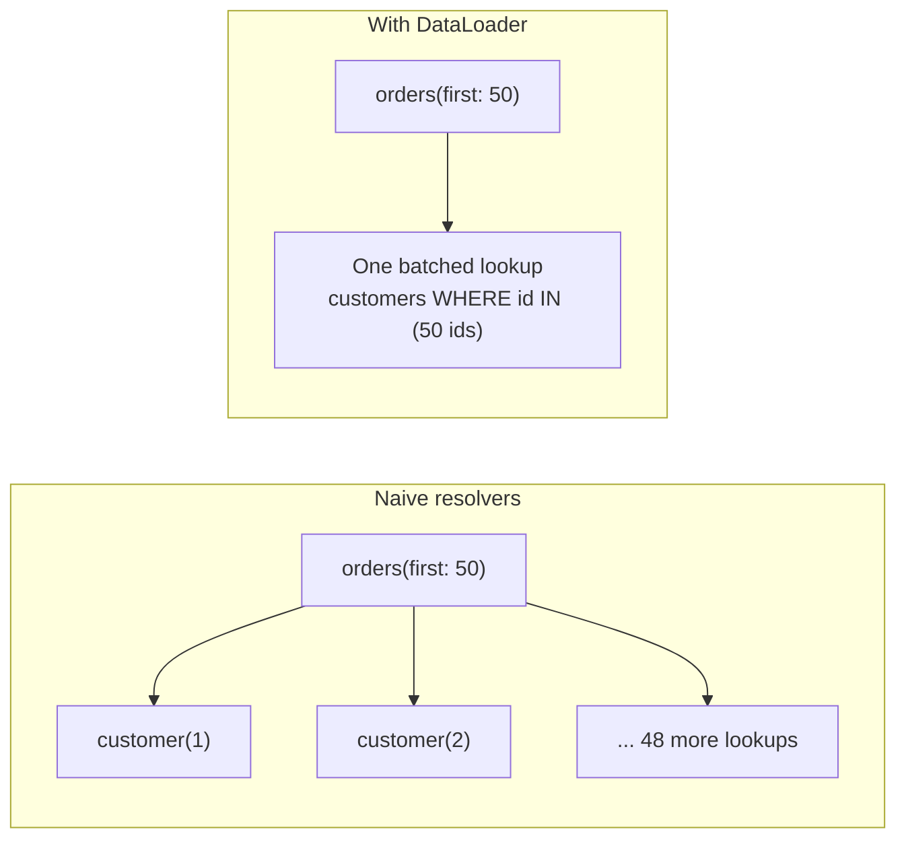
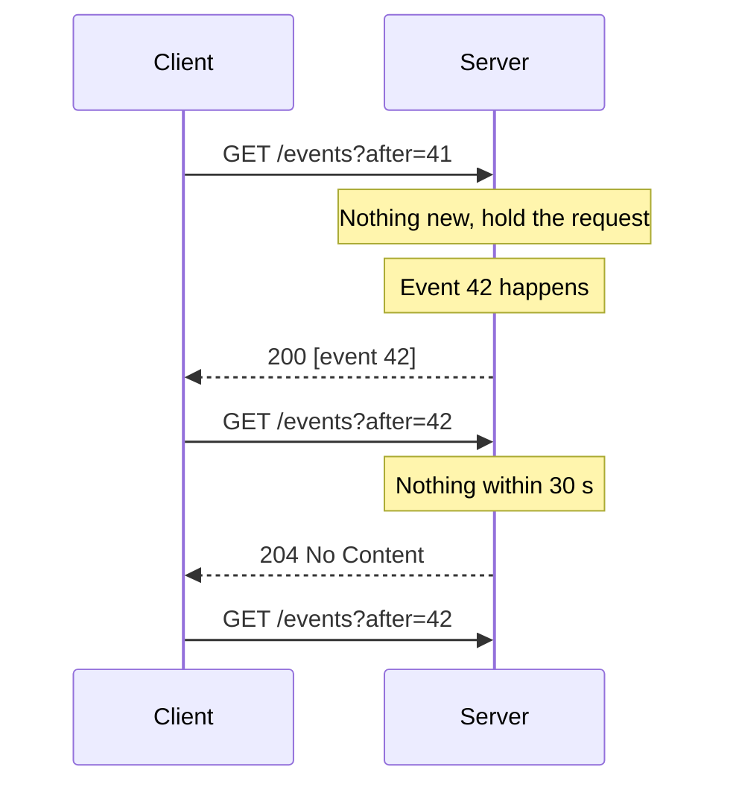
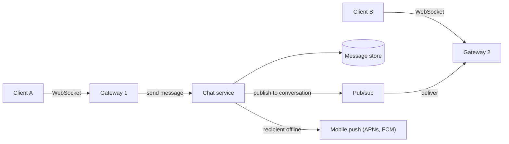

import { Aside } from '@astrojs/starlight/components';

Request/response APIs ([RPC and REST](/communication/rpc-and-rest/)) cover most traffic, but two needs
keep pushing designs beyond them: clients that want to choose *exactly which data* they get, and
servers that need to *push* data the moment something happens. GraphQL answers the first;
long polling, Server-Sent Events, WebSockets and webhooks answer the second in different ways. Each
moves cost somewhere — into the server, the connection layer or the receiving system — so the choice
is a design decision, not a fashion.

<Aside type="tip" title="TL;DR">
- GraphQL: one endpoint, client-shaped queries. Great for varied UIs; you must handle N+1 queries (DataLoader), weak HTTP caching and query-cost limits.
- Server push to browsers: SSE for one-way streams (notifications, dashboards, LLM tokens), WebSockets for two-way, low-latency traffic (chat, collaboration, games), long polling as the universal fallback.
- Server push to other *servers*: webhooks — signed, retried with backoff, delivered at least once, so receivers must deduplicate.
- Long-lived connections need a fan-out layer (pub/sub), heartbeats, reconnect with resume, and a plan for deploys.
</Aside>

## GraphQL

GraphQL, open-sourced by Facebook in 2015, exposes a typed **schema** through a single endpoint. The
client sends a query naming the fields it wants, and the server returns JSON in the same shape:

```graphql
query OrderPage($id: ID!) {
  order(id: $id) {
    status
    total { amount currency }
    items(first: 10) { name quantity }
    customer { name loyaltyTier }
  }
}
```

**Strengths.** One round trip assembles a whole screen that REST might serve with three or four
calls; each client fetches only the fields it renders (no over-fetching); the schema is a strongly
typed, introspectable contract that drives code generation; and fields can be added and deprecated
without versioning the endpoint. A GraphQL layer is often a "backend for frontend" aggregating many
internal services, and federation lets several teams contribute parts of one schema.

### The N+1 problem and DataLoader

Each field is computed by a **resolver**. Written naively, listing 50 orders and their customers
runs one query for the orders and then 50 separate customer lookups — N+1 calls, and nested lists
multiply further. The standard fix is **batching**: a DataLoader collects all keys requested during
one tick of execution and issues a single `WHERE id IN (...)` query, and also memoises results for
the duration of one request.



Create a fresh loader per request, so its cache never leaks data between users.

### Caching is harder

REST gets caching almost for free: a `GET /orders/981` has a URL a CDN can key on. GraphQL
traditionally sends every query as a POST to `/graphql`, so HTTP caches see nothing cacheable.
Workarounds:

- **Persisted queries.** Clients send a hash of a pre-registered query instead of its text, which makes requests small enough for GET, cacheable at a CDN, and lets the server refuse unknown queries.
- **Client-side normalised caches** (Apollo Client, Relay) store objects by type and ID and update every view that shows them.
- **Server-side response or resolver caching**, using cache hints per type or field.

### Limiting query cost

Clients write the queries, so a client can also write an expensive one: deep nesting, huge page
sizes, hundreds of aliases. A public GraphQL API needs explicit **demand control**:

- Limit depth, breadth and aliases per operation, and require page-size arguments on every list.
- Estimate cost before execution and reject or charge it. GitHub's public API, for example, requires `first` or `last` between 1 and 100 on every connection, rejects queries that could touch more than 500,000 nodes, and gives each user a budget of 5,000 points per hour.
- Set execution timeouts and rate-limit by cost, not by request count.
- Authorise in resolvers or the domain layer, per object, not per endpoint.

**Use GraphQL when** many clients (web, iOS, Android, partners) need different views of a rich,
connected domain. **Avoid it for** simple CRUD services, file transfer, or internal service-to-service
calls, where gRPC is simpler and faster.

## Pushing data from server to client

HTTP was designed for clients to ask. To let the server speak first, there are three browser-friendly
techniques, plus the "just ask often" baseline:

- **Short polling:** the client asks every N seconds. Simple and stateless, but 1 million clients polling every 5 seconds is 200,000 requests per second, almost all returning "nothing new", and updates arrive up to N seconds late.
- **Long polling**, **SSE** and **WebSockets**, below.

### Long polling

The client sends a request; the server holds it open until there is something to send or a timeout
(say 30 seconds) expires, then responds; the client immediately sends the next request.



It works through every proxy and firewall because it is just HTTP. Costs: each message costs a full
request with headers, there is a gap between a response and the next request, and the client must
send a cursor (`after=42`) so nothing is lost or duplicated in that gap. Today it is mostly a
fallback when SSE or WebSockets are blocked.

### Server-Sent Events (SSE)

SSE is a long-lived HTTP response with `Content-Type: text/event-stream`, through which the server
writes events as lines of text:

```text
id: 1042
event: order.updated
data: {"order_id":"ord_981","status":"shipped"}

retry: 5000
```

- **One direction only:** server to client. The client sends anything else as ordinary requests.
- **Reconnection is built in.** The browser's `EventSource` reconnects automatically and sends `Last-Event-ID`, so the server can resume where the stream stopped.
- **Plain HTTP:** works with existing auth cookies, proxies, HTTP/2 and HTTP/3. Under HTTP/1.1 browsers allow only six connections per domain, shared across tabs, so serve SSE over HTTP/2 or later.
- **Text only** (UTF-8). Binary data must be encoded.
- `EventSource` cannot set custom headers such as `Authorization`, so many clients read the stream with `fetch()` instead. LLM APIs commonly stream generated tokens
this way.

### WebSockets

A WebSocket (RFC 6455) starts as an HTTP request with `Upgrade: websocket`; the server answers
`101 Switching Protocols`, and from then on the TCP connection carries **full-duplex** text or binary
frames in both directions with only a few bytes of framing each. RFC 8441 and RFC 9220 define how to
run WebSockets over HTTP/2 and HTTP/3 streams.

What WebSockets do *not* give you, and you must build:

- **Reconnect and resume.** A dropped connection loses anything in flight; clients need backoff with jitter (to avoid reconnect storms after a deploy) and a sequence number to request missed messages.
- **Heartbeats.** Proxies and load balancers close connections that look idle; send ping/pong frames more often than their idle timeout.
- **Delivery semantics.** There are no acknowledgements at the application level; add message IDs and acks if you need at-least-once delivery.
- **Auth and authorisation** at connect time *and* when a token expires during a long session.
- **Operations.** Connections are stateful and long-lived: rolling deploys must drain them gracefully, and L4 load balancing can leave new servers idle while old ones stay full.

**WebTransport** — streams and unreliable datagrams over HTTP/3 — became available across major
browsers in 2026 and suits games and media that want UDP-like behaviour in the browser, but it is
still young compared with WebSockets.

## Webhooks: server-to-server push

A webhook is an HTTP POST that your system sends to a URL another system registered, whenever an
event they subscribed to happens: a payment succeeded, a build finished, an order shipped. It is the
standard way to push events across organisational boundaries.

**For the sender:**

- **Retries.** Receivers go down. Retry failed deliveries with exponential backoff and jitter over hours or days (Stripe retries for up to three days), treat any non-`2xx` as failure, and disable endpoints that keep failing — telling the owner through another channel.
- **Signatures.** Sign each delivery so receivers can prove it came from you and wasn't altered: an HMAC-SHA256 over the event ID, a timestamp and the raw body, sent in headers. Support two secrets at once so they can be rotated without downtime.
- **Delivery from a queue,** never inline in the request that caused the event, with per-endpoint concurrency limits so one slow receiver doesn't block others.
- **Safety.** Customer-supplied URLs can point at your internal network; resolve and block private address ranges to prevent server-side request forgery (SSRF).
- **Thin payloads.** Many providers send only the event type and object ID, and the receiver fetches the current state through the API. That sidesteps ordering problems and keeps sensitive data out of logs.

**For the receiver:**

- Verify the signature over the **raw** body and reject stale timestamps (a 5-minute tolerance is common) to block replays.
- Respond `2xx` quickly and process asynchronously from a queue.
- **Deduplicate**: delivery is at-least-once, so store processed event IDs and skip repeats — the same idempotency idea as for API requests.
- Don't assume order. Events can arrive out of sequence; compare versions or fetch the latest state.

```python title="verify_webhook.py"
import base64
import hashlib
import hmac
import time

TOLERANCE_S = 300  # reject deliveries older or newer than 5 minutes


def sign(secret: bytes, msg_id: str, timestamp: int, body: bytes) -> str:
    signed = f"{msg_id}.{timestamp}.".encode() + body
    return "v1," + base64.b64encode(hmac.new(secret, signed, hashlib.sha256).digest()).decode()


def verify(secret: bytes, headers: dict[str, str], body: bytes, seen_ids: set[str]) -> bool:
    msg_id = headers["webhook-id"]
    timestamp = int(headers["webhook-timestamp"])
    if abs(time.time() - timestamp) > TOLERANCE_S:
        return False                                   # too old: possible replay
    expected = sign(secret, msg_id, timestamp, body)
    if not any(hmac.compare_digest(expected, s) for s in headers["webhook-signature"].split()):
        return False                                   # forged or tampered body
    if msg_id in seen_ids:
        return False                                   # duplicate delivery: already processed
    seen_ids.add(msg_id)
    return True


secret = b"whsec-demo-secret-32-bytes-long!"
body = b'{"type":"order.shipped","order_id":"ord_981"}'
now = int(time.time())
headers = {"webhook-id": "msg_2Lq9", "webhook-timestamp": str(now),
           "webhook-signature": sign(secret, "msg_2Lq9", now, body)}
seen: set[str] = set()
print(verify(secret, headers, body, seen))                          # True
print(verify(secret, headers, body, seen))                          # False: duplicate
print(verify(secret, headers, body.replace(b"981", b"982"), set())) # False: tampered
```

The header names follow the open Standard Webhooks specification; Stripe, GitHub and others use
their own names for the same idea. In production, keep `seen_ids` in a database or a cache with a TTL
longer than the sender's retry window.

## Comparison

| Style | Direction | Connection | Built-in recovery | Best for |
|---|---|---|---|---|
| REST / RPC | Client asks | Short requests over pooled connections | Retries, idempotency keys | CRUD, commands, most APIs |
| GraphQL | Client asks (subscriptions push) | Same as REST | Same as REST | Varied clients over a connected domain |
| Short polling | Client asks repeatedly | Short requests | Next poll | Low update rates, simplest possible |
| Long polling | Server to client | Held request, repeated | Cursor on next request | Fallback where streaming is blocked |
| SSE | Server to client | One long HTTP response | Auto-reconnect with `Last-Event-ID` | Feeds, notifications, dashboards, LLM streaming |
| WebSockets | Both ways | One long-lived upgraded connection | None — build it | Chat, collaboration, games, trading UIs |
| Webhooks | Server to another server | Short POST per event | Sender retries with backoff | Integrations between organisations |

## Designing real-time features

Every push design shares one shape: clients hold connections to a fleet of **connection
gateways**, and a **pub/sub layer** (Redis or Valkey pub/sub, NATS, or a Kafka-style log) routes each
event to whichever gateway holds the recipient's connection.



Gateways stay thin and stateless apart from their sockets; persistence and business logic live
behind them. Size by concurrent connections: if one gateway comfortably holds 100,000 mostly idle
connections (an assumption to benchmark, not a constant), 10 million online users need about 100
gateways before redundancy.

- **Chat and collaboration:** WebSockets — both sides send often and latency matters. Persist every message before fanning it out, give each a per-conversation sequence number so clients can resync after reconnecting, and fall back to mobile push when the recipient is offline. See the [online chat](/ood/online-chat/) design.
- **Notifications:** SSE (or the app's existing WebSocket) while the app is open; mobile push or email when it isn't; webhooks when the consumer is another company's system.
- **Live dashboards:** SSE is usually enough — data flows one way and auto-reconnect is free. If a few seconds of staleness is acceptable, polling a cached endpoint is simpler still. Aggregate on the server and push deltas at a fixed rate (say once per second) rather than every raw event.
- **Feeds and tickers with huge audiences:** fan out through a CDN or edge service that supports streaming, so origin servers don't hold millions of connections.

<Aside type="note" title="In the interview">
- For any "real-time" requirement, first ask how fresh the data must be. "Within 30 seconds" may mean polling; "sub-second, both ways" means WebSockets.
- Explain how a message reaches a user connected to a *different* server — the pub/sub layer is what interviewers look for.
- Cover reconnects: sequence numbers, missed-message sync, backoff with jitter, and what happens during a deploy.
- For GraphQL, expect N+1 and "how do you stop an expensive query?"; for webhooks, expect retries, signatures and duplicate handling.
- Common mistakes: WebSockets for one-way updates where SSE fits, no offline path, assuming webhooks arrive exactly once and in order.
</Aside>

## Further reading

- [GraphQL: Performance](https://graphql.org/learn/performance/) and [Security](https://graphql.org/learn/security/) — official guidance on N+1, persisted queries, depth and cost limits.
- [DataLoader](https://github.com/graphql/dataloader) — the reference batching and caching utility.
- [MDN: Using server-sent events](https://developer.mozilla.org/en-US/docs/Web/API/Server-sent_events/Using_server-sent_events) — the event-stream format, reconnection and connection limits.
- [RFC 6455: The WebSocket Protocol](https://www.rfc-editor.org/rfc/rfc6455.html) — handshake, framing and closing.
- [Standard Webhooks specification](https://github.com/standard-webhooks/standard-webhooks/blob/main/spec/standard-webhooks.md) — signatures, retries and idempotency for webhook senders.
- [Stripe: Receive events in your webhook endpoint](https://docs.stripe.com/webhooks) — a production example of retries, signatures and duplicate handling.

## Related topics

- [RPC and REST](/communication/rpc-and-rest/) — the request/response baseline these styles extend.
- [HTTP](/communication/http/) — HTTP/2 and HTTP/3 make SSE and many concurrent streams practical.
- [TCP and UDP](/communication/tcp-and-udp/) — the long-lived connections underneath, and why games prefer UDP.
- [Event streaming](/async/event-streaming/) — the pub/sub and log layer behind real-time fan-out.
- [Rate limiting](/reliability/rate-limiting/) — cost-based limits for GraphQL and connection limits for sockets.
- [Online chat](/ood/online-chat/) — object model for a chat system.
