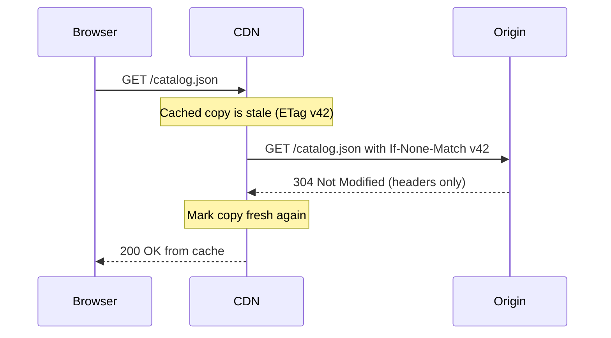
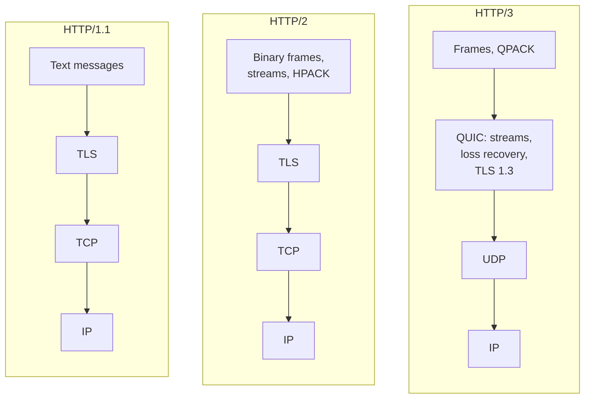

import { Aside } from '@astrojs/starlight/components';

HTTP is the request/response protocol behind browsers, public APIs, most internal service calls,
CDNs and object storage. Its *semantics* (methods, status codes, headers, caching rules) have stayed
stable for decades, while its *transport* has changed three times: text over TCP, binary frames over
TCP, and streams over QUIC. A designer needs both halves — semantics decide what intermediaries may
cache and retry; transport decides latency, connection counts and failure modes.

<Aside type="tip" title="TL;DR">
- Safe methods (GET, HEAD, OPTIONS, TRACE and the new QUERY) change nothing; idempotent ones (safe ones plus PUT and DELETE) can be retried automatically. POST and PATCH need an idempotency key to retry safely.
- In practice only GET and HEAD responses are cached. Control it with `Cache-Control`, and revalidate cheaply with `ETag` plus `If-None-Match` (answer `304`).
- HTTP/2 multiplexes many requests over one TCP connection, but a lost packet still stalls all of them. HTTP/3 runs over QUIC (UDP) and removes that stall.
- A cold HTTPS request costs 3 round trips with TCP + TLS 1.3, 2 with QUIC, 1 on a reused connection — so reuse connections and pool them.
</Aside>

## Request and response

A client opens a connection, sends a request (method, target, headers, optional body) and receives
a response (status code, headers, optional body). Every message is self-describing, so proxies,
load balancers, CDNs and caches can sit in the path and act on the headers without understanding the
application.

```http
GET /v1/orders/8812 HTTP/1.1
Host: api.example.com
Accept: application/json
Authorization: Bearer eyJhbGciOi...
If-None-Match: "a1f3"

HTTP/1.1 200 OK
Content-Type: application/json
Cache-Control: private, max-age=60
ETag: "b7c9"

{"id": 8812, "status": "shipped"}
```

The server keeps no conversation state between requests: anything it needs (identity, locale,
version) travels in each request or is looked up from a shared store. That statelessness is what
lets you put any number of identical servers behind a [load balancer](/traffic/load-balancers/).

## Methods: safe, idempotent, cacheable

The table follows RFC 9110 (plus RFC 5789 for PATCH and RFC 10008 for QUERY). Several popular
summaries — including the original primer — get the cacheability column wrong.

| Method | Typical use | Safe | Idempotent | Response cacheable |
|---|---|---|---|---|
| GET | Read a representation | Yes | Yes | Yes |
| HEAD | GET without the body | Yes | Yes | Yes |
| QUERY | Search with the query in the body | Yes | Yes | Yes (key includes the body) |
| OPTIONS | Capabilities, CORS preflight | Yes | Yes | No |
| TRACE | Loop-back diagnostics, usually disabled | Yes | Yes | No |
| PUT | Create or fully replace at a known URI | No | Yes | No |
| DELETE | Remove the resource | No | Yes | No |
| POST | Create in a collection, run an action | No | No | Rarely (see below) |
| PATCH | Partial update | No | No | Rarely (see below) |
| CONNECT | Open a tunnel through a proxy | No | No | No |

- **Safe** means the client does not request a state change, so crawlers and prefetchers may call it freely. Logging and metrics on the server don't count.
- **Idempotent** means sending the request twice has the same *intended* effect as once. This is what lets HTTP clients, proxies and service meshes retry after a dropped connection.
- **POST and PATCH caching.** A response is reusable only if it carries explicit freshness *and* a `Content-Location` equal to the request URI, and then only for a later GET or HEAD. RFC 9110 itself notes that most caches support only GET and HEAD, so in designs treat POST and PATCH responses as uncacheable.
- A successful response to an unsafe method (POST, PUT, PATCH, DELETE) passing through a cache **invalidates** stored responses for that URI.
- PATCH *can* be made idempotent (for example with `If-Match`), and POST can be made retry-safe with an [idempotency key](/communication/rpc-and-rest/).
- **QUERY** (RFC 10008, June 2026) closes an old gap: a search too large or complex for a GET URL used to become a POST, which caches and retry logic must treat as unsafe. QUERY carries the query in the body and stays safe, idempotent and cacheable. It is new, so check that your frameworks, proxies and CDN pass and cache it before relying on it.

## Status codes

The first digit is the class: `1xx` informational, `2xx` success, `3xx` redirection, `4xx` the
client must change something, `5xx` the server or something behind it failed. The codes worth knowing
by heart:

| Code | Meaning | Design note |
|---|---|---|
| 200 / 204 | OK / OK with no body | |
| 201 Created | New resource made | Return its URI in `Location` |
| 202 Accepted | Queued for async processing | Return a job URL to poll |
| 301 / 308 | Moved permanently | 308 keeps the method and body |
| 302 / 307 | Temporary redirect | 307 keeps the method and body |
| 304 Not Modified | Cached copy is still valid | No body, saves bandwidth |
| 400 / 422 | Malformed / semantically invalid input | Don't retry |
| 401 / 403 | Not authenticated / not allowed | 401 means "who are you?" |
| 404 / 409 | Not found / state conflict | 409 for duplicate or version clash |
| 412 Precondition Failed | `If-Match` did not match | Optimistic concurrency |
| 429 Too Many Requests | Rate limited | Send `Retry-After` |
| 500 | Unhandled server error | |
| 502 / 504 | Bad gateway / gateway timeout | Upstream failed or was slow |
| 503 Service Unavailable | Overloaded or in maintenance | Send `Retry-After` |

Retry rule of thumb: retry `408`, `429` and `503` with backoff (honouring `Retry-After`), retry `502`/`504`
only for idempotent requests, never retry other `4xx` unchanged. Return machine-readable error bodies
— RFC 9457 "problem details" (`application/problem+json`) is the standard shape.

## Caching headers

Caching is where HTTP semantics pay off most: a browser cache, a [CDN](/traffic/cdn/) and a reverse
proxy can all serve a response without touching your servers, as long as the headers say they may.

```http
Cache-Control: public, max-age=31536000, immutable      # fingerprinted asset: app.3f9a.js
Cache-Control: public, max-age=60, s-maxage=300, stale-while-revalidate=30
Cache-Control: private, no-cache                         # per-user page: store, but revalidate
Cache-Control: no-store                                  # secrets: never store anywhere
Vary: Accept-Encoding
```

- `max-age` sets freshness for every cache; `s-maxage` overrides it for shared caches (CDNs, proxies).
- `private` keeps a response out of shared caches — essential for anything personalised.
- `no-cache` does **not** mean "don't cache": the copy may be stored but must be revalidated before each use. `no-store` is the one that forbids storing.
- `stale-while-revalidate` and `stale-if-error` (RFC 5861) let a cache serve a slightly stale copy while it refreshes in the background, or while the origin is down.
- `Vary` lists request headers that change the response; every extra value multiplies cache entries.

**Validators and conditional requests.** An `ETag` is an opaque version tag (often a content hash);
`Last-Modified` is a coarser timestamp. When a stored copy goes stale, the cache asks the origin
whether it changed instead of downloading it again:



The same validators protect writes. A client sends `If-Match: "v42"` with its PUT; if someone else
updated the resource first, the server answers `412` instead of silently overwriting — optimistic
concurrency without locks.

## From HTTP/1.1 to HTTP/3



**HTTP/1.1** made connections persistent by default (keep-alive), so several requests can share one
TCP connection — but only one at a time. Pipelining (sending several requests without waiting) is in
the spec yet effectively unused, because responses must come back in order and one slow response
blocks the rest. Browsers work around this by opening about six connections per origin.

**HTTP/2** (RFC 9113) splits messages into binary frames tagged with a stream ID, so many requests
and responses interleave on one connection, and headers are compressed with HPACK. That fixes
blocking *at the HTTP layer*. It cannot fix blocking *in TCP*: TCP delivers one ordered byte stream,
so when a single packet is lost, every stream on the connection waits for its retransmission
(explained in [TCP and UDP](/communication/tcp-and-udp/)). On lossy mobile networks one HTTP/2
connection can therefore do worse than six HTTP/1.1 ones. Server push has been dropped in practice
(Chrome disabled it in version 106); `103 Early Hints` and preload replace it.

**HTTP/3** (RFC 9114, 2022) maps the same semantics onto QUIC (RFC 9000), a transport that runs over
UDP and builds streams, loss recovery, congestion control and TLS 1.3 into one layer. Loss on one
stream no longer stalls the others, the transport and TLS handshakes are combined, and connections
survive a client changing networks (Wi-Fi to cellular) because they are identified by connection
IDs rather than by IP and port. Clients discover HTTP/3 through the `Alt-Svc` response header or a
DNS `HTTPS` record (RFC 9460), and fall back to HTTP/2 when UDP is blocked.

As of October 2026 every major browser enables HTTP/3 by default, and W3Techs reports about 41% of
websites supporting it, mostly via CDNs and managed load balancers. Self-hosting is less uniform
(nginx still labels its HTTP/3 module experimental), and QUIC usually costs more CPU per byte than
kernel TCP because it runs in user space and encrypts every packet.

| | HTTP/1.1 | HTTP/2 | HTTP/3 |
|---|---|---|---|
| Transport | TCP | TCP | QUIC over UDP |
| Concurrency per connection | 1 request at a time | Many streams | Many streams |
| Head-of-line blocking | HTTP and TCP level | TCP level | Per stream only |
| Header compression | None | HPACK | QPACK |
| Cold-start round trips (with TLS 1.3) | 2 before the request | 2 before the request | 1 before the request |
| Survives network change | No | No | Yes (connection migration) |

## The cost of a secure connection

Before the first byte of a response arrives, a fresh HTTPS connection pays for its handshakes. TLS
1.3 (RFC 8446, revised in 2026 as RFC 9846) needs one round trip versus two for TLS 1.2; QUIC folds
the transport handshake into the same flight.

| Connection setup | Round trips to first response byte | At 100 ms RTT |
|---|---|---|
| New TCP + TLS 1.2 | 4 | 400 ms |
| New TCP + TLS 1.3 | 3 | 300 ms |
| TCP + TLS 1.3 resumption with 0-RTT | 2 | 200 ms |
| New QUIC (HTTP/3) | 2 | 200 ms |
| QUIC resumption with 0-RTT | 1 | 100 ms |
| Reused warm connection | 1 | 100 ms |

**0-RTT and replay.** On resumption, a client may send its request inside the very first flight
("early data"). An attacker who captures that flight can replay it, and the TLS layer cannot fully
prevent replays across connections. So servers and CDNs should accept early data only for safe,
idempotent requests; for anything else the server can answer `425 Too Early` (RFC 8470), and the
client resends after the full handshake.

Current browsers also negotiate a hybrid post-quantum key exchange (X25519MLKEM768) by default; it
adds over a kilobyte to the first handshake message but no extra round trips.

## Connection reuse and pooling

Handshakes are only part of the cost: a new TCP connection also starts with a small congestion
window and needs several round trips to reach full speed. Reusing warm connections removes both.

- **Client-side pools.** HTTP clients and SDKs keep idle connections per host. With HTTP/1.1 the pool size caps concurrency (one in-flight request per connection); with HTTP/2 and HTTP/3 one connection carries many concurrent streams, up to a server-set limit (commonly about 100).
- **Idle timeouts.** Make the client's idle timeout shorter than the server's and the load balancer's; otherwise the client reuses a connection the server has just closed and gets a reset.
- **Long-lived connections vs balancing.** A pool of HTTP/2 connections pinned to a few backends defeats an L4 load balancer: new servers get no traffic. Use L7 (per-request) balancing, client-side balancing, or a maximum connection age that forces periodic reconnects.
- **Edge termination.** Terminate TLS and HTTP/3 at the CDN or load balancer near the user, then reuse a small number of warm connections from there to the origin.

<Aside type="note" title="In the interview">
- Expect "is PUT idempotent? is POST?" and "how do you make a payment POST safe to retry?" — answer with idempotency keys.
- Show you know what to cache where: `private` for user data, `s-maxage` for the CDN, `immutable` for fingerprinted assets, `ETag` for revalidation.
- When asked "why HTTP/3?", name TCP head-of-line blocking, the shorter handshake and connection migration — and the costs: UDP blocked on some networks, higher CPU, less mature self-hosted tooling.
- Common mistakes: treating `no-cache` as "don't cache", retrying non-idempotent requests on timeout, ignoring connection reuse when estimating latency.
</Aside>

## Further reading

- [RFC 9110: HTTP Semantics](https://www.rfc-editor.org/rfc/rfc9110.html) — the authoritative source for methods, status codes and conditional requests.
- [RFC 9111: HTTP Caching](https://www.rfc-editor.org/rfc/rfc9111.html) — freshness, validation and `Cache-Control` directives.
- [MDN: HTTP caching](https://developer.mozilla.org/en-US/docs/Web/HTTP/Guides/Caching) — a practical guide to private and shared caches.
- [High Performance Browser Networking: HTTP/2](https://hpbn.co/http2/) — Ilya Grigorik's chapter on framing, streams and HPACK.
- [HTTP/3 explained](https://http3-explained.haxx.se/) — Daniel Stenberg's free book on QUIC and HTTP/3.
- [A detailed look at TLS 1.3](https://blog.cloudflare.com/rfc-8446-aka-tls-1-3/) — Cloudflare on the 1-RTT handshake and 0-RTT risks.

## Related topics

- [TCP and UDP](/communication/tcp-and-udp/) — the transports underneath, and head-of-line blocking in detail.
- [RPC and REST](/communication/rpc-and-rest/) — API styles built on HTTP semantics.
- [CDN](/traffic/cdn/) — where `Cache-Control` and HTTP/3 termination matter most.
- [Caching layers](/caching/caching-layers/) — HTTP caching as one layer among several.
- [Load balancers](/traffic/load-balancers/) — L4 vs L7 balancing of long-lived connections.
- [Security](/reliability/security/) — TLS, cookies and headers from the defender's side.
