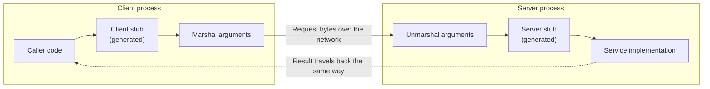

import { Aside } from '@astrojs/starlight/components';

Once two processes need to talk, someone has to decide what the conversation looks like. **RPC**
models it as calling functions on a remote server; **REST** models it as reading and changing
resources through a small, uniform set of operations. Both usually run over HTTP today, and the
choice is less about technology than about who the clients are, how much they need to evolve
independently, and what infrastructure (caches, gateways, browsers) sits in between.

<Aside type="tip" title="TL;DR">
- RPC exposes *operations* (`CancelOrder`); REST exposes *resources* (`POST /orders/981:cancel` or `PATCH /orders/981`).
- gRPC = Protocol Buffers + HTTP/2 + generated stubs: compact, typed, streaming, ideal between internal services. Browsers need gRPC-Web or Connect.
- REST over JSON is the default for public APIs: any HTTP client works, HTTP caching and tooling apply, OpenAPI describes the contract.
- Whatever the style: version deliberately, paginate with cursors, make writes retry-safe with idempotency keys, and set deadlines on every call.
</Aside>

## RPC: calling a function somewhere else

A remote procedure call makes a network request look like a local function call. The caller invokes
a **client stub** with ordinary arguments; the stub **marshals** them (serialises into bytes), sends
the message, and waits; a **server stub** unmarshals the request, calls the real implementation and
sends the result back the same way.



Stubs are generated from an **interface definition language** (IDL) file, so both sides agree on
names and types at compile time. The illusion of a local call is also RPC's oldest trap: a remote call
takes microseconds to milliseconds instead of nanoseconds, can time out, and can fail *after* the server did the work. Good RPC
frameworks make these differences explicit with deadlines, status codes and retry policies rather
than hiding them.

### gRPC and Protocol Buffers

gRPC, open-sourced by Google and now a CNCF project, is the dominant RPC framework for
service-to-service traffic. The contract is a `.proto` file:

```protobuf title="orders.proto"
syntax = "proto3";

package shop.orders.v1;

import "google/protobuf/timestamp.proto";

service OrderService {
  // Unary: one request, one response.
  rpc GetOrder(GetOrderRequest) returns (Order);
  rpc CancelOrder(CancelOrderRequest) returns (Order);
  // Server streaming: the server pushes status changes until the order is delivered.
  rpc WatchOrder(GetOrderRequest) returns (stream OrderEvent);
}

message GetOrderRequest {
  string order_id = 1;
}

message CancelOrderRequest {
  string order_id = 1;
  string reason = 2;
  string request_id = 3;  // idempotency key
}

message Order {
  string order_id = 1;
  Status status = 2;
  int64 total_cents = 3;
  google.protobuf.Timestamp updated_at = 4;
  reserved 5;  // removed field: the number is never reused

  enum Status {
    STATUS_UNSPECIFIED = 0;
    STATUS_PLACED = 1;
    STATUS_SHIPPED = 2;
    STATUS_DELIVERED = 3;
    STATUS_CANCELLED = 4;
  }
}

message OrderEvent {
  Order order = 1;
}
```

What a designer should know about it:

- **Encoding.** Protocol Buffers write field *numbers*, not names, in a compact binary format. The `Order` above encodes to 22 bytes, against 93 bytes for the equivalent compact JSON. Adding fields is backward compatible; renumbering or reusing a number is not — hence `reserved`.
- **Transport.** Every call is an HTTP/2 POST to `/package.Service/Method` with `content-type: application/grpc`; the result status travels in HTTP trailers (`grpc-status`). Many calls share one connection.
- **Four call shapes:** unary, server streaming, client streaming and bidirectional streaming. Streaming suits feeds, uploads and long-running watches without inventing a separate push channel.
- **Deadlines and cancellation** propagate across hops: if the caller gives up after 300 ms, downstream services can stop work too.
- **Ecosystem:** interceptors, health checking, retries, hedging and client-side load balancing are built in or standard in service meshes.
- **Limits:** browsers cannot speak raw gRPC (they can't read HTTP/2 trailers), so web clients use gRPC-Web through a proxy or the Connect protocol; payloads aren't human-readable without tooling; and long-lived HTTP/2 connections need L7 or client-side [load balancing](/traffic/load-balancers/).

### Thrift and Avro

- **Apache Thrift**, created at Facebook, combines an IDL, code generators for many languages and a pluggable stack of protocols (binary, compact, JSON) and transports. It is still maintained and used inside large companies, but new projects mostly pick gRPC because of its larger ecosystem.
- **Apache Avro** is first a serialisation format and only secondarily an RPC system. Data is written with its schema (or a schema ID from a schema registry), and readers resolve differences between writer and reader schemas, which makes it strong for **schema evolution** in data pipelines and event streams such as Kafka. Code generation is optional.
- **JSON-RPC 2.0** is the minimalist end: method name plus params in JSON over any transport. It is simple to implement and has seen a revival as the message format of the Model Context Protocol (MCP) for AI tools.

## REST: resources and a uniform interface

REST is an architectural style described by Roy Fielding in 2000, not a protocol. Its constraints are
client–server separation, **statelessness**, **cacheable** responses, a layered system, optional
code-on-demand, and the one that makes REST distinctive — a **uniform interface**:

1. **Resources are identified by URIs:** `/orders/981`, `/customers/42/orders`.
2. **Resources are manipulated through representations:** the client sends and receives JSON (or another media type), never the server's internal objects.
3. **Messages are self-descriptive:** method, status code and headers carry the meaning, so intermediaries understand them. A `GET` is safe and cacheable; a `PUT` is idempotent; a `404` means the same everywhere.
4. **Hypermedia as the engine of application state (HATEOAS):** responses include links to the actions available next, so clients follow links instead of building URLs.

```json
{
  "id": "ord_981",
  "status": "placed",
  "total_cents": 4999,
  "_links": {
    "self":   { "href": "/orders/ord_981" },
    "cancel": { "href": "/orders/ord_981/cancellation", "method": "POST" },
    "items":  { "href": "/orders/ord_981/items" }
  }
}
```

**HATEOAS in practice is rare.** Most "REST" APIs stop at level 2 of the Richardson maturity model:
resources, proper methods and status codes, but clients hard-code URL templates from documentation
or an OpenAPI description. Full hypermedia shows up mostly in pagination links and in a few
standards (HAL, JSON:API). That is a pragmatic choice, not a failure — but don't claim HATEOAS
unless clients actually navigate by links.

Statelessness is the part that matters most for scaling: because each request carries everything
the server needs (including the auth token), any instance can serve it, and instances can be added or
removed freely.

## The same API in both styles

An order service for an online shop, designed both ways:

| Operation | RPC style (gRPC or JSON over POST) | REST style |
|---|---|---|
| Place an order | `OrderService.PlaceOrder(items, address)` | `POST /orders` → `201`, `Location: /orders/ord_981` |
| Get one order | `OrderService.GetOrder(order_id)` | `GET /orders/ord_981` |
| List a customer's orders | `OrderService.ListOrders(customer_id, page_token)` | `GET /customers/42/orders?limit=20&cursor=...` |
| Change the delivery address | `OrderService.UpdateAddress(order_id, address)` | `PATCH /orders/ord_981` with the new address |
| Cancel an order | `OrderService.CancelOrder(order_id, reason)` | `POST /orders/ord_981/cancellation` or `POST /orders/ord_981:cancel` |
| Refund part of an order | `PaymentService.Refund(order_id, amount)` | `POST /orders/ord_981/refunds` |
| Track delivery live | `OrderService.WatchOrder(order_id)` (server stream) | No native fit: poll, SSE or webhooks |

Cancelling and refunding show where REST strains: they are *actions*, not edits of a field.
Good REST designs model them as creating a sub-resource (a cancellation, a refund) or, as Google's API
guidelines do, as **custom methods** with a colon verb (`POST /orders/ord_981:cancel`). The live
tracking row shows where RPC frameworks shine: streaming is part of the contract.

## Disadvantages of each

**RPC**

- Clients are coupled to the server's operation list; every new use case tends to add a method.
- Binary payloads and HTTP/2 trailers make debugging harder without tooling (`grpcurl`, reflection).
- Everything is a POST, so HTTP caches, CDNs and browser tooling can't help; caching moves into the application.
- Browser support needs gRPC-Web or Connect; public consumers expect plain JSON.

**REST**

- Not every operation fits CRUD on resources; forcing actions into verbs produces awkward designs.
- Composite screens may need several round trips (an order, its items, the customer) — or bespoke "expand" parameters.
- Responses tend to grow over time and clients download fields they don't use (over-fetching); GraphQL targets exactly this (see [API styles](/communication/api-styles/)).
- JSON is verbose and untyped unless you invest in OpenAPI and code generation.

## Versioning, pagination and idempotency

**Versioning.** Prefer additive, backward-compatible changes (new optional fields, new endpoints)
and reserve a new major version for breaking ones. Common schemes: a path prefix (`/v1/orders`),
which is simple and cache-friendly; a header or media-type version; or dated versions pinned per
client, as Stripe does. In Protobuf the package name carries the major version (`shop.orders.v1`).
Announce retirements with the `Deprecation` (RFC 9745) and `Sunset` (RFC 8594) response headers.

**Pagination.** Offset pagination (`?offset=10000&limit=20`) is easy but gets slower with depth and
skips or duplicates items when data changes between pages. **Cursor** (keyset) pagination returns an
opaque token encoding the last position (`?cursor=eyJpZCI6...`); it stays fast at any depth and is
stable under inserts. gRPC APIs follow the same idea with `page_size`, `page_token` and
`next_page_token`.

**Idempotency.** Networks fail *after* the server has acted, so clients retry, and a retried
"charge the card" must not charge twice. GET, PUT and DELETE are idempotent by definition; for POST
the client sends a unique **idempotency key** (`Idempotency-Key` header in HTTP APIs, a `request_id`
field in RPC). The server stores the first result under that key and replays it for retries:

```python title="idempotency.py"
import hashlib
import json
from dataclasses import dataclass
from typing import Callable


@dataclass(frozen=True)
class StoredResponse:
    request_hash: str
    status: int
    body: dict


class IdempotencyStore:
    """In production: a table or Redis key with a TTL (e.g. 24 h), written atomically."""

    def __init__(self) -> None:
        self._data: dict[str, StoredResponse] = {}

    def handle(self, key: str, payload: dict, action: Callable[[dict], tuple[int, dict]]) -> tuple[int, dict]:
        request_hash = hashlib.sha256(json.dumps(payload, sort_keys=True).encode()).hexdigest()
        if (seen := self._data.get(key)) is not None:
            if seen.request_hash != request_hash:
                return 422, {"error": "Idempotency-Key reused with a different payload"}
            return seen.status, seen.body          # replay the first result, do not re-run
        status, body = action(payload)
        self._data[key] = StoredResponse(request_hash, status, body)
        return status, body


charges: list[dict] = []

def create_charge(payload: dict) -> tuple[int, dict]:
    charges.append(payload)
    return 201, {"charge_id": f"ch_{len(charges)}", **payload}


store = IdempotencyStore()
first = store.handle("8e1f-uuid", {"amount": 4999}, create_charge)
retry = store.handle("8e1f-uuid", {"amount": 4999}, create_charge)   # client timed out and retried
misuse = store.handle("8e1f-uuid", {"amount": 10}, create_charge)
print(first, retry, misuse[0], len(charges))
assert first == retry and misuse[0] == 422 and len(charges) == 1
```

A production version must also handle two retries arriving concurrently (lock the key, or answer
`409` while the first is in progress) and write the key and the business change in one transaction.
An IETF draft for a standard `Idempotency-Key` header describes the same contract: `400` for a
missing key, `422` for a reused key with a different payload, `409` for a concurrent retry.

## Trade-offs: which one to choose

| Situation | Usual choice | Why |
|---|---|---|
| Public API for third-party developers | REST + JSON + OpenAPI | Works with any language and `curl`, HTTP caching, familiar conventions |
| Internal service-to-service calls | gRPC | Typed contracts, compact encoding, deadlines, streaming, generated clients |
| Browser or mobile app talking to your backend | REST, or GraphQL for many screen shapes | Browser-native; GraphQL when clients need flexible aggregation |
| High-volume event or data pipeline | Avro or Protobuf messages over Kafka-style logs | Schema evolution and compactness matter more than request/response |
| Push from server to client | gRPC streaming internally; SSE, WebSockets or webhooks externally | See [API styles](/communication/api-styles/) |

Many organisations use both: gRPC inside, and an [API gateway](/traffic/reverse-proxy-and-api-gateway/)
that exposes REST/JSON outside (gRPC-to-JSON transcoding is a common gateway feature). Whatever the
style, the harder problems are the same — contracts that evolve without breaking clients, timeouts,
retries and idempotency.

<Aside type="note" title="In the interview">
- Sketch the API early: 4–6 endpoints or RPCs with request and response fields. Interviewers judge naming, resource modelling and status codes.
- Justify the style by the client: "public partners → REST; our 40 internal services → gRPC with deadlines".
- Expect "what happens if the client retries `POST /payments`?" — answer with idempotency keys and where they are stored.
- Expect "how do you paginate a feed?" — cursors, not offsets, and why.
- Common mistakes: verbs in REST paths (`/getOrder`), returning `200` with an error body, no versioning story, claiming HATEOAS without links.
</Aside>

## Further reading

- [Fielding's dissertation, chapter 5: REST](https://ics.uci.edu/~fielding/pubs/dissertation/rest_arch_style.htm) — the original definition and its constraints.
- [Richardson Maturity Model](https://martinfowler.com/articles/richardsonMaturityModel.html) — Martin Fowler on the levels from RPC-over-HTTP to hypermedia.
- [gRPC core concepts](https://grpc.io/docs/what-is-grpc/core-concepts/) — call types, deadlines and cancellation.
- [Protocol Buffers documentation](https://protobuf.dev/) — encoding, schema evolution rules and style guide.
- [Google API Improvement Proposals: pagination](https://google.aip.dev/158) — a well-reasoned design guide; see also custom methods (AIP-136).
- [Designing robust APIs with idempotency](https://stripe.com/blog/idempotency) — Stripe on idempotency keys, retries and jitter.

## Related topics

- [HTTP](/communication/http/) — methods, status codes and caching that REST relies on.
- [API styles](/communication/api-styles/) — GraphQL, WebSockets, SSE and webhooks.
- [Reverse proxy and API gateway](/traffic/reverse-proxy-and-api-gateway/) — where public APIs are authenticated, rate-limited and transcoded.
- [Monolith and microservices](/architecture/monolith-and-microservices/) — why service-to-service RPC volume explodes.
- [Resilience patterns](/reliability/resilience-patterns/) — timeouts, retries with backoff and circuit breakers around every call.
