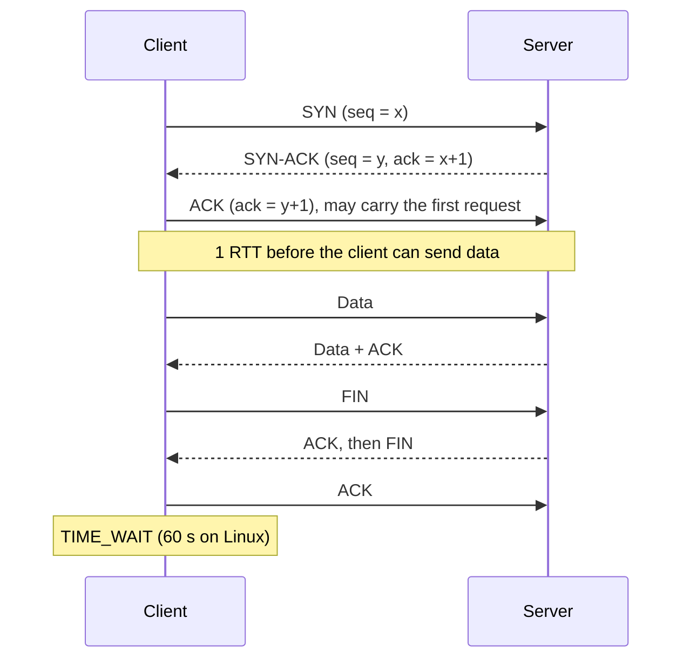
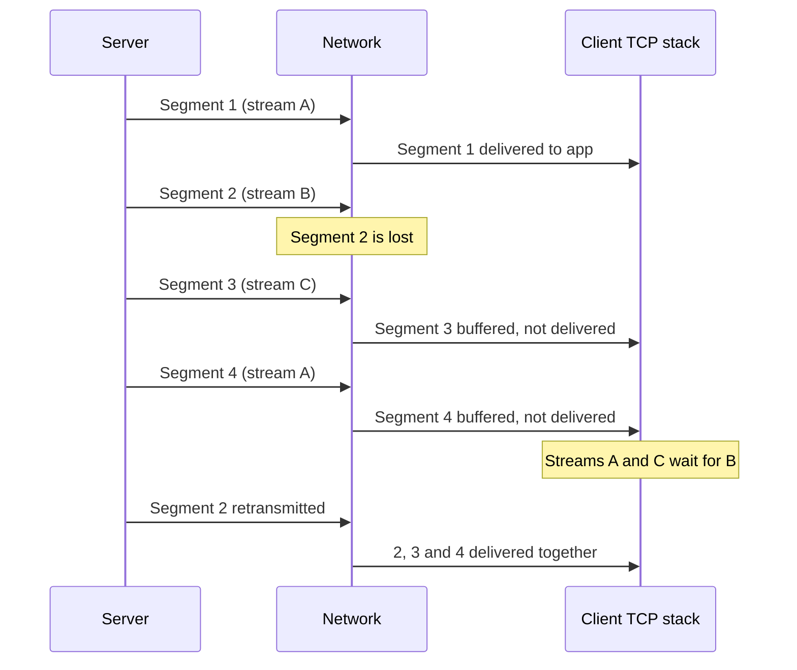

import { Aside } from '@astrojs/starlight/components';

Almost every byte your system sends rides on one of two transport protocols. TCP turns an unreliable
network into a reliable, ordered byte stream and pays for it in round trips and per-connection state.
UDP hands individual datagrams to the network and promises nothing more. Choosing between them — or
picking QUIC, which builds TCP-like guarantees on top of UDP — shapes latency, scalability and how
your system behaves when packets are lost.

<Aside type="tip" title="TL;DR">
- TCP: connection setup costs one round trip; then reliable, in-order delivery with flow control (don't overrun the receiver) and congestion control (don't overrun the network).
- UDP: no connection, no ordering, no retransmission, no congestion control — 8 bytes of header and the application decides everything else.
- Connections are not free: handshakes, slow start, kernel buffers, a thread or process per connection on some servers, and ephemeral ports in TIME_WAIT. Pool and reuse them.
- Head-of-line blocking: one lost TCP segment stalls everything behind it, even data for unrelated requests. QUIC fixes it with independent streams over UDP.
</Aside>

## TCP: a reliable byte stream

### Connection setup and teardown

TCP (RFC 9293) is connection-oriented. Before any data flows, both sides exchange initial sequence
numbers in a three-way handshake; teardown uses FIN segments in each direction.

The side that closes first keeps the socket in **TIME_WAIT** so that late segments from the old
connection can't be mistaken for a new one. TCP Fast Open (RFC 7413) can carry data in the SYN on
repeat connections, but middlebox problems kept it niche; in practice, connection reuse and TLS 1.3
or QUIC do more to cut setup latency.

### Reliable, ordered delivery

- Every byte has a **sequence number**; the receiver acknowledges what it has received, and the sender retransmits anything not acknowledged within a timeout or signalled missing by duplicate ACKs.
- A **checksum** catches corruption; corrupt segments are dropped and later resent.
- The receiver **reorders** out-of-order segments and hands the application a contiguous byte stream. The application never sees gaps — but it also never sees *anything* past a gap until it is filled.

TCP carries bytes, not messages. Protocols on top (HTTP, gRPC, database wire protocols) add their
own framing, such as length prefixes, to find message boundaries.

### Flow control and congestion control

Two different windows cap how much unacknowledged data a sender may have in flight; the effective
limit is the smaller of the two.

- **Flow control** protects the *receiver*. It advertises a receive window (rwnd): how much buffer it has left. A slow consumer shrinks the window and the sender pauses — a built-in form of [back pressure](/async/queues-and-back-pressure/).
- **Congestion control** protects the *network*. The sender keeps a congestion window (cwnd), growing it while ACKs arrive and cutting it when loss or rising delay signals congestion.

A new connection starts in **slow start** with a small window — 10 segments, about 14.6 KB (RFC 6928,
the Linux default) — and roughly doubles it every round trip. At that rate a 1 MB response needs
about 7 round trips to deliver; at 100 ms RTT that is 0.7 s before bandwidth even matters. This is
why warm, reused connections are so much faster than new ones, and why Linux by default shrinks the
window again after a connection has been idle.

To fill a long, fast path the window must reach the **bandwidth-delay product**: 1 Gbit/s × 100 ms
= 12.5 MB in flight. Buffers smaller than that cap throughput regardless of link speed.

Algorithms differ in what they treat as congestion. **CUBIC** (RFC 9438), the default in Linux,
Windows and Apple stacks, reacts to packet loss. **BBR**, developed at Google, models bottleneck
bandwidth and round-trip time instead, which helps on lossy long-distance links; Google uses it for
its own traffic, and its specification is still an IETF draft in 2026.

## UDP: datagrams and nothing else

UDP (RFC 768) adds ports and a checksum to IP — an 8-byte header — and stops there. Each `send` is
one datagram that arrives whole, arrives late, arrives twice, arrives out of order or never arrives.
There is no connection state, no retransmission and no congestion control, so the application must
decide how to handle loss and how fast it may send.

What that buys:

- **No setup cost.** The first datagram carries data. A DNS lookup is one datagram out, one back.
- **No head-of-line blocking.** A lost datagram delays nothing else; the application can skip it.
- **Broadcast and multicast.** One send can reach every host on a subnet (broadcast) or a subscribed group (multicast); TCP can only talk to one peer.
- **Cheap fan-in.** One socket can serve millions of clients without per-client kernel state.

Where it is used:

- **Bootstrapping protocols.** A DHCP client has no IP address yet, so it broadcasts a discover message from UDP port 68 to port 67 and lets any server answer. DNS, NTP and SNMP are UDP for similar latency and simplicity reasons.
- **Real-time media.** Voice and video (WebRTC sends SRTP, normally over UDP) prefer a glitch to a stall: a retransmitted audio frame that arrives 300 ms late is useless.
- **Games.** Fast-paced multiplayer games send state snapshots many times a second; only the newest matters, so a lost one is simply superseded.
- **Lossy-tolerant hot paths.** Facebook's memcache clients sent reads over UDP and treated a dropped reply as a cache miss, cutting latency by about a fifth; writes and deletes stayed on TCP.

The flip side: UDP is a favourite tool for **amplification DDoS** — an attacker spoofs the victim's
address and a server sends a large reply to it. Never answer an unauthenticated small UDP request
with a much larger response; memcached disabled UDP by default in 2018 after it was abused exactly
this way, and QUIC servers may send at most three times the bytes they received until the client's
address is validated.

## The cost of connections

TCP connections are cheap individually and expensive in aggregate:

| Cost | Where it bites | Typical mitigation |
|---|---|---|
| Handshake RTTs (plus TLS) | Every new connection, worst across regions | Keep-alive, connection pools, edge termination |
| Slow start | First few hundred KB on each new connection | Reuse warm connections |
| Kernel buffers | Many idle or slow clients | Autotuning, limits, small idle timeouts |
| Process or thread per connection | PostgreSQL forks a process per client connection | Pooler such as PgBouncer, fewer app instances |
| Ephemeral ports in TIME_WAIT | High rate of short connections to one backend | Reuse connections, spread across backend IPs |
| Load-balancer and NAT state | Millions of long-lived connections | Connection limits, idle timeouts |

Two quick numbers. Linux uses ephemeral ports 32768–60999, about 28,000 per source IP and
destination; with a 60-second TIME_WAIT, one client opening a fresh connection per request to a
single backend runs out at roughly 470 new connections per second. And a fleet of 500 application
instances each holding 20 database connections already asks for 10,000 server-side connections —
far beyond what a single relational database handles well. Hence **connection pools** at the client
and **poolers or proxies** in front of databases and caches.

## Head-of-line blocking, explained once

Head-of-line (HOL) blocking happens whenever independent pieces of data share one ordered channel:
the item at the front stalls everything queued behind it.

- **At the application layer**, HTTP/1.1 suffers it because responses on one connection must come back in request order.
- **At the transport layer**, TCP suffers it because it promises one ordered byte stream. HTTP/2 multiplexes many streams over TCP, but when segment 2 (stream B) is lost, the kernel withholds segments 3 and 4 too, even though they belong to other streams. The stall lasts at least one RTT and, if the retransmission is also lost, much longer.

UDP-based protocols avoid it by delivering each datagram independently, and QUIC keeps per-stream
ordering without imposing ordering across streams — so a loss in stream B delays only stream B.

## QUIC: reliability rebuilt on UDP

QUIC (RFC 9000, 2021) is a full reliable transport that runs over UDP and lives in user space
rather than the kernel. Running over UDP lets it pass through existing middleboxes and evolve
without waiting for operating-system upgrades.

- **Streams:** many independent, ordered, reliable streams per connection, with flow control per stream and per connection.
- **Built-in TLS 1.3:** transport and crypto handshakes are combined (1 RTT, or 0-RTT on resumption), and almost all headers are encrypted, so middleboxes can't ossify the protocol.
- **Connection IDs:** a connection survives a client changing IP or port, for example Wi-Fi to cellular.
- **Modern loss recovery:** packet numbers are never reused, which removes ambiguity about which copy of a retransmission was acknowledged.
- **Optional unreliable datagrams** (RFC 9221) for media and games that want QUIC's encryption and congestion control without retransmission.

QUIC is the transport for HTTP/3 and WebTransport. Costs: more CPU per byte than kernel TCP, UDP
blocked or throttled on some corporate networks (so clients keep a TCP fallback), and fewer
observability tools, because the payload and most headers are encrypted.

## Trade-offs

| Need | TCP | UDP (custom protocol) | QUIC |
|---|---|---|---|
| Every byte, in order | Yes, built in | Must build it yourself | Yes, per stream |
| Lowest latency, late data is useless | Stalls on loss | Yes | With datagram extension |
| Many independent requests on one connection | HOL blocking | Yes | Yes |
| Broadcast or multicast | No | Yes | No |
| Setup cost | 1 RTT + TLS | None | 1 RTT including TLS, 0-RTT on resumption |
| Congestion control | Built in | Your responsibility | Built in |
| Passes every firewall | Yes | Often blocked | Often blocked, needs TCP fallback |
| Typical users | HTTP/1.1–2, databases, SSH, SMTP, Kafka | DNS, DHCP, NTP, VoIP, games | HTTP/3, WebTransport, modern mobile apps |

Default to TCP (or HTTP over it) for anything that must arrive intact. Pick UDP when timeliness beats
completeness or you need broadcast, and accept that you now own congestion control and security.
Pick QUIC — usually by enabling HTTP/3 at your CDN or load balancer — when clients are on lossy or
changing networks.

<Aside type="note" title="In the interview">
- Walk through the three-way handshake and say what it costs: one RTT, plus one more for TLS 1.3.
- For a video call or game, explain why UDP: late data is worse than lost data. For a chat app, explain why TCP (or WebSockets over it) is fine.
- Expect "what is head-of-line blocking and how does HTTP/3 fix it?" — distinguish the HTTP-level and TCP-level kinds.
- Mention connection pooling when the design has many app servers talking to one database or cache; quantify connections per instance times instances.
- Common mistakes: saying UDP is "faster" without saying what you give up; forgetting that UDP needs application-level congestion control and amplification protection.
</Aside>

## Further reading

- [RFC 9293: Transmission Control Protocol](https://www.rfc-editor.org/rfc/rfc9293.html) — the consolidated 2022 TCP specification.
- [High Performance Browser Networking: Building Blocks of TCP](https://hpbn.co/building-blocks-of-tcp/) — handshakes, slow start and head-of-line blocking with numbers.
- [High Performance Browser Networking: Building Blocks of UDP](https://hpbn.co/building-blocks-of-udp/) — NAT traversal, STUN, TURN and ICE.
- [RFC 9000: QUIC](https://www.rfc-editor.org/rfc/rfc9000.html) — the QUIC transport specification.
- [UDP vs. TCP](https://gafferongames.com/post/udp_vs_tcp/) — Glenn Fiedler on why real-time games use UDP.
- [Scaling Memcache at Facebook](https://www.usenix.org/system/files/conference/nsdi13/nsdi13-final170_update.pdf) — NSDI 2013 paper; see the UDP-for-reads design.

## Related topics

- [HTTP](/communication/http/) — HTTP/1.1, HTTP/2 and HTTP/3 on top of these transports.
- [API styles](/communication/api-styles/) — WebSockets, SSE and long polling all ride on long-lived TCP connections.
- [Load balancers](/traffic/load-balancers/) — L4 balancing works at the TCP/UDP level.
- [Latency numbers](/reference/latency-numbers/) — round-trip times that make handshakes expensive.
- [Queues and back pressure](/async/queues-and-back-pressure/) — flow control is back pressure at the transport layer.
