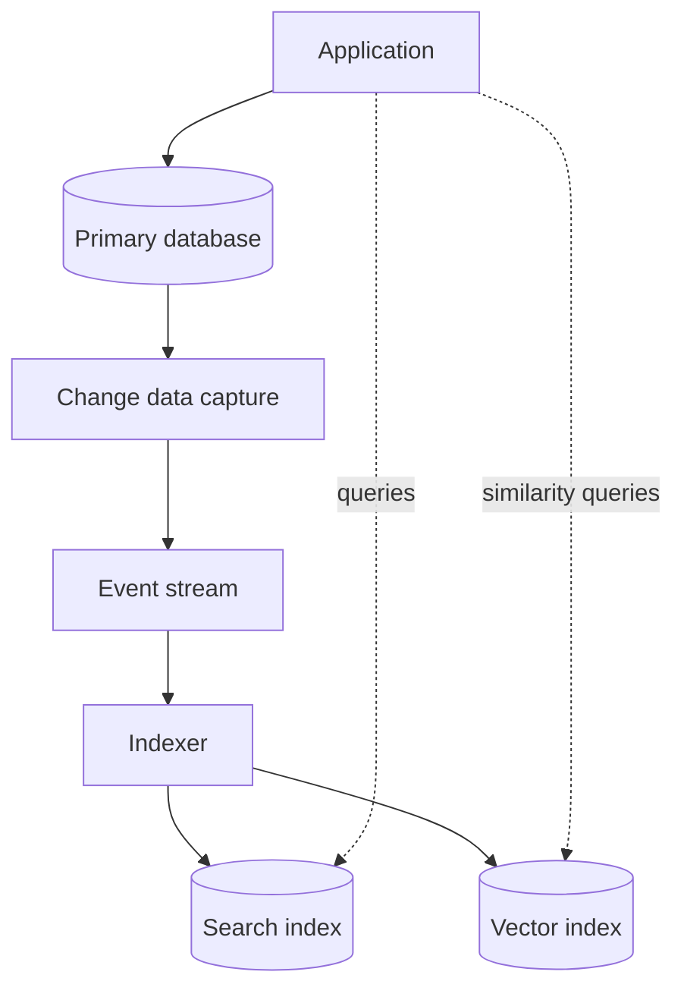

import { Aside } from '@astrojs/starlight/components';

"NoSQL" is an umbrella for databases that drop the relational model in exchange for something else: a simpler data model that partitions easily, a flexible schema, or a storage layout tuned to one query shape. For a system designer the useful question is never "SQL or NoSQL?" in the abstract, but "which data model matches the way this data is read and written?"

<Aside type="tip" title="TL;DR">
- NoSQL stores trade joins, ad-hoc queries and (often) cross-record transactions for horizontal scale, predictable latency and schema flexibility.
- Four classic families: **key-value**, **document**, **wide-column**, **graph**. Three more matter in 2026: **time-series**, **search engines** and **vector stores**.
- BASE describes a design posture, not a product. Many NoSQL systems now offer ACID within a partition or even across items.
- NoSQL modelling starts from access patterns: list the queries first, then choose keys and denormalise so each query hits one partition.
</Aside>

## What NoSQL changes

A relational database stores normalised tables and lets you ask any question at query time. Most NoSQL stores flip that: you decide the questions up front and store data in the shape of the answers. Typical consequences:

- **Partition-first design.** Data is spread across nodes by a partition key, so single-key reads and writes scale almost linearly. Queries that span partitions are slow or impossible.
- **Denormalisation.** Related data is embedded or duplicated instead of joined. Joins, if any, happen in application code.
- **Schema-on-read.** The database does not enforce a schema; the application (or a validation layer) does.
- **Tunable consistency.** Many stores let each request choose between fast, possibly stale reads and slower, strongly consistent ones.

The line has blurred since the original primer was written. MongoDB has supported multi-document ACID transactions since 4.0, DynamoDB offers transactions of up to 100 items, and PostgreSQL stores and indexes JSON documents. Choose by data model and access pattern, not by the label.

## BASE vs ACID

**ACID** (atomicity, consistency, isolation, durability) is the contract of a classic relational transaction. **BASE** was coined as its counterpart for large cluster services by Eric Brewer's group at Berkeley in 1997, and popularised by Dan Pritchett's 2008 ACM Queue article:

- **Basically available** — the system keeps answering, even if some answers are partial or stale.
- **Soft state** — replicas may hold different values at a given moment; state changes as replication catches up.
- **Eventually consistent** — if writes stop, all replicas converge.

| Property | ACID | BASE |
|---|---|---|
| Unit of correctness | Transaction across many rows | Single item or partition |
| Typical CAP behaviour on a partition (not part of ACID itself) | Prefers consistency (may reject writes) | Prefers availability (may serve stale data) |
| Conflict handling | Prevented by locks or MVCC | Detected and resolved later (last-writer-wins, version vectors, CRDTs) |
| Who keeps invariants | The database | Largely the application |

In practice, the choice is per operation, not per product. Cassandra lets each query pick a consistency level (`ONE`, `QUORUM`, `ALL`), and DynamoDB reads are eventually consistent unless you ask for `ConsistentRead`. See [CAP and PACELC](/fundamentals/cap-theorem/) for the underlying trade-off.

## The four classic families

### Key-value stores

**Abstraction:** a huge hash map from key to an opaque value (some keep keys sorted, which enables range scans).

- **Strengths:** simplest model to partition and replicate; constant-time lookups; very high throughput; values can be anything.
- **Weaknesses:** the store cannot query inside values; secondary access paths mean maintaining extra keys yourself.
- **Examples:** Redis and Valkey (in-memory, rich data structures; Valkey is the BSD-licensed fork made after Redis's 2024 licence change, and Redis 8 added an AGPLv3 option in 2025), Amazon DynamoDB, etcd (small, strongly consistent configuration data), FoundationDB, and embedded engines such as RocksDB that sit underneath many other databases.
- **Use for:** sessions, caches, feature flags, counters, shopping carts, idempotency keys.

### Document stores

**Abstraction:** a key-value store whose values are structured documents (JSON or BSON) that the database understands and can index.

- **Strengths:** one document holds an entire aggregate (an order with its lines), so most reads are a single lookup; fields can vary between documents; secondary indexes on nested fields.
- **Weaknesses:** many-to-many relationships lead to duplication or application-side joins; large documents that grow over time are costly to rewrite (MongoDB caps documents at 16 MiB).
- **Examples:** MongoDB, Couchbase, Google Firestore, Azure Cosmos DB; PostgreSQL `jsonb` covers many of the same needs inside a relational database.
- **Use for:** catalogues, content, user profiles, event payloads — data read and written as whole aggregates.

### Wide-column stores

**Abstraction:** a two-level map, `partition key → rows sorted by clustering key → columns`. A partition is stored together and sorted, so "all events for device X between T1 and T2" is one sequential read.

- **Strengths:** massive write throughput (log-structured, LSM-tree storage); linear scale-out to hundreds of nodes; multi-datacentre replication; tunable consistency.
- **Weaknesses:** you must design one table per query; no joins; deletes create tombstones that slow reads until compaction; unbounded partitions become hot spots.
- **Examples:** Apache Cassandra (5.0 added storage-attached secondary indexes and vector search), ScyllaDB (Cassandra-compatible; source-available since version 2025.1, with 6.2 the last AGPL release), Google Cloud Bigtable, Apache HBase.
- **Use for:** time-ordered data at scale — messaging history, IoT telemetry, activity feeds, fraud signals.

### Graph databases

**Abstraction:** a property graph — nodes and edges, both carrying key-value properties. Traversing an edge is a pointer hop, not an index lookup, so multi-hop queries stay fast as the data grows.

- **Strengths:** queries such as "friends of friends who bought X" or "shortest path between two accounts" are short and efficient; the schema evolves easily.
- **Weaknesses:** graphs are hard to partition, because any cut leaves edges crossing machines; whole-graph analytics usually run in a separate engine; fewer engineers know the query languages.
- **Examples:** Neo4j (Cypher), Amazon Neptune, Memgraph, TigerGraph, JanusGraph.
- **Use for:** fraud rings, recommendations, knowledge graphs, network and access-permission graphs.

The original primer called graph databases "relatively new". That is no longer true: Neo4j dates from 2007, and graph querying has been standardised. ISO published **GQL** (ISO/IEC 39075) in April 2024, and SQL:2023 added **SQL/PGQ** for graph queries over relational tables. Very large social graphs are still usually served by a sharded key-value or SQL store with a graph API on top, as Facebook's TAO does.

## Families that matter in 2026

### Time-series databases

Time-series data is append-mostly, arrives in time order, and is queried by time range with aggregation ("p99 latency per minute over the last day"). Time-series databases exploit this with time-partitioned storage, compression of consecutive values (delta and XOR encodings shrink timestamps and slowly changing numbers dramatically), downsampling and automatic retention.

Examples: Prometheus and VictoriaMetrics for metrics, InfluxDB, TimescaleDB (a PostgreSQL extension), QuestDB, and column stores such as ClickHouse that handle time-series analytics well. Watch out for **cardinality**: every unique combination of labels is a new series, and a label such as `user_id` can explode memory use.

### Search engines

A search engine is built around an **inverted index**: for each term, a sorted list of the documents (and positions) that contain it. A query intersects posting lists and ranks results with a relevance model such as BM25.

| Term | Posting list (document IDs) |
|---|---|
| `cache` | 3, 8, 21, 40 |
| `redis` | 8, 21, 77 |
| `cache` AND `redis` | 8, 21 |

Elasticsearch and OpenSearch (both built on Apache Lucene) add sharding, replication, aggregations and vector search. Search indexes are **near real-time**: a new document becomes searchable after a refresh (by default every second in Elasticsearch). They are rarely the source of truth; the usual pattern streams changes from the primary database into the index.

Because the index lags the database, design for it: show "your change is being processed", or read your own writes from the primary.

### Vector databases and vector search

Machine-learning models turn text, images or users into **embeddings**: vectors of hundreds or thousands of numbers, where similar items lie close together. Vector search finds the nearest neighbours of a query vector. Exact search compares the query with every vector, so production systems use **approximate nearest neighbour (ANN)** indexes:

- **HNSW** — a layered proximity graph; high recall and low latency, but memory-hungry.
- **IVF** — cluster the vectors, then search only the nearest clusters; often combined with **product quantisation** to compress vectors.
- **Disk-based and object-storage-backed indexes** — slower, but far cheaper per vector at billion scale.

Every ANN index trades **recall** (the share of true neighbours found) against latency and memory. Production systems also need metadata filtering ("only documents this user may see") and usually **hybrid search**, which combines BM25 keyword scores with vector similarity.

Options range from extensions to dedicated engines: `pgvector` for PostgreSQL, vector features in Elasticsearch, OpenSearch, Redis and Cassandra, dedicated databases such as Milvus, Qdrant, Weaviate and Pinecone, and object-storage-backed services such as Amazon S3 Vectors. A dedicated engine pays off at hundreds of millions of vectors or under heavy filtered-query load. Below that, the database you already run is often enough.

## Modelling around access patterns

Relational modelling starts from entities; NoSQL modelling starts from **queries**. The workflow:

1. List every access pattern with its expected rate and latency target ("get order by ID", "list a customer's orders, newest first").
2. Choose partition and sort keys so that each pattern reads **one partition**, ideally in one request.
3. Denormalise: copy the fields each query needs into the item it reads.
4. Add secondary indexes for the remaining patterns; each one costs extra write capacity.
5. Check for hot partitions: a key that receives a disproportionate share of traffic hits per-partition limits (in DynamoDB, 3,000 read units and 1,000 write units per second).

**DynamoDB single-table design** takes this to its logical end: several entity types share one table, and related items share a partition key so one query returns an "item collection" that a relational database would assemble with a join.

| PK | SK | Attributes |
|---|---|---|
| `CUSTOMER#42` | `PROFILE` | name, email, tier |
| `CUSTOMER#42` | `ORDER#2026-09-30#1001` | total, status |
| `CUSTOMER#42` | `ORDER#2026-10-05#1002` | total, status |
| `ORDER#1002` | `LINE#1` | sku, qty, price |

A query on `PK = CUSTOMER#42` with `SK` beginning with `ORDER#` returns the customer's orders in date order. The cost is rigidity: a new access pattern may require a backfill of every item, and analytics need the data exported and reshaped. Many teams therefore use a few tables, one per bounded context, rather than one table for everything.

## Trade-offs

| Family | Data model | Strong at | Weak at | Examples |
|---|---|---|---|---|
| Key-value | Key → opaque value | Lookups by key, extreme throughput | Queries on value contents | Redis, Valkey, DynamoDB, etcd |
| Document | Key → JSON document | Whole-aggregate reads, flexible fields | Many-to-many relations | MongoDB, Couchbase, Firestore |
| Wide-column | Partition → sorted rows | Write-heavy, time-ordered data at scale | Ad-hoc queries, joins | Cassandra, ScyllaDB, Bigtable |
| Graph | Nodes and edges | Multi-hop traversals | Horizontal partitioning | Neo4j, Neptune, Memgraph |
| Time-series | Series → time-stamped points | Range aggregation, compression | High-cardinality labels | Prometheus, InfluxDB, TimescaleDB |
| Search | Term → posting list | Full-text relevance, faceting | Being a source of truth | Elasticsearch, OpenSearch |
| Vector | Embedding → neighbours | Similarity search | Exactness; cost at scale | pgvector, Milvus, Qdrant |

<Aside type="note" title="In the interview">
- Name the access patterns before naming a database. "We need key lookups at 200k QPS with single-digit-millisecond latency" justifies DynamoDB or Cassandra; "NoSQL scales better" does not.
- Expect follow-ups on the partition key: what happens with a celebrity user or a hot product? (Write sharding, caching, splitting the key.)
- Be precise about consistency: which reads may be stale, for how long, and what the user sees.
- Search and vector indexes are derived data. Explain how they are fed (CDC or events), how far they lag, and how you rebuild them.
- Common mistake: picking a graph database for a social network without discussing how it shards.
</Aside>

## Further reading

- [Dynamo: Amazon's Highly Available Key-value Store](https://www.allthingsdistributed.com/files/amazon-dynamo-sosp2007.pdf) — the 2007 paper behind leaderless, eventually consistent stores.
- [Bigtable: A Distributed Storage System for Structured Data](https://research.google/pubs/bigtable-a-distributed-storage-system-for-structured-data/) — the origin of the wide-column model.
- [Amazon DynamoDB: A Scalable, Predictably Performant, and Fully Managed NoSQL Database Service](https://www.usenix.org/conference/atc22/presentation/elhemali) — how DynamoDB actually works, USENIX ATC 2022.
- [NoSQL design for DynamoDB](https://docs.aws.amazon.com/amazondynamodb/latest/developerguide/bp-general-nosql-design.html) and Alex DeBrie's [single-table design guide](https://www.alexdebrie.com/posts/dynamodb-single-table/).
- [BASE: An ACID Alternative](https://queue.acm.org/detail.cfm?id=1394128) — Dan Pritchett, ACM Queue.
- [Efficient and robust approximate nearest neighbour search using HNSW graphs](https://arxiv.org/abs/1603.09320) — the paper behind most vector indexes.

## Related topics

- [SQL or NoSQL](/data/sql-or-nosql/) — a decision guide built on the families described here.
- [Partitioning and sharding](/data/partitioning-and-sharding/) — how partition keys spread data and where hot spots come from.
- [Replication](/data/replication/) — leader-based and leaderless replication behind BASE behaviour.
- [CAP theorem and PACELC](/fundamentals/cap-theorem/) — the consistency/availability trade-off in formal terms.
- [Event streaming](/async/event-streaming/) — how change streams keep search and vector indexes in sync.
- [LLM-powered systems](/architecture/llm-applications/) — vector and hybrid search as the retrieval layer for RAG.
