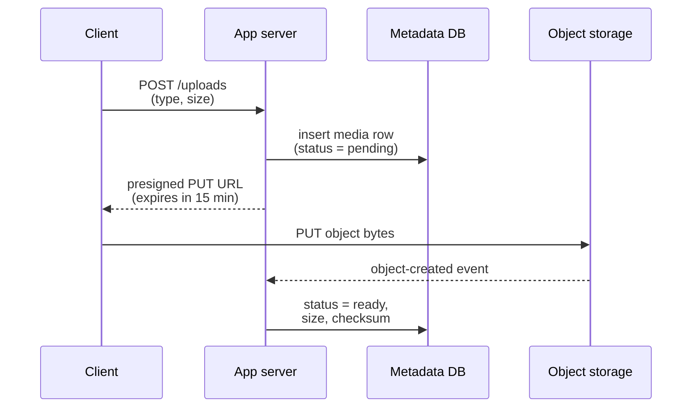
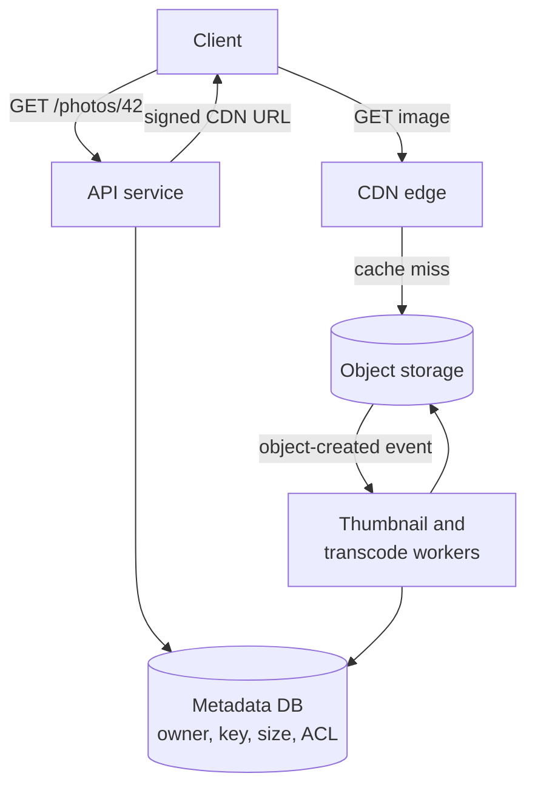

import { Aside } from '@astrojs/starlight/components';

Object storage — Amazon S3, Google Cloud Storage, Azure Blob Storage, Cloudflare R2 and their self-hosted cousins — is where most of the world's bytes live: images, videos, backups, logs, model weights and analytics tables. It is cheap, practically unlimited and extremely durable, but it is not a file system and not a database. Knowing its semantics lets you design upload flows, media pipelines and data lakes that are both simple and cheap.

<Aside type="tip" title="TL;DR">
- Object storage is a flat namespace of **immutable objects** addressed by key, accessed over HTTP. You replace objects whole; you do not edit them in place.
- Amazon S3 has offered **strong read-after-write consistency** for object writes, deletes and listings since December 2020, at no extra cost.
- **Durability** (will my data survive?) and **availability** (can I read it right now?) are different promises: S3 Standard is designed for 11 nines of durability but 99.99% availability.
- Standard pattern: **metadata in a database, blobs in object storage, a CDN in front**; clients upload and download directly with presigned URLs.
- Data lakes store columnar files (Parquet) in object storage and use an open table format (Apache Iceberg) to get tables with transactions and schema evolution.
</Aside>

## Block, file and object storage

| | Block storage | File storage | Object storage |
|---|---|---|---|
| Unit | Fixed-size blocks on a volume | Files in a directory tree | Objects (bytes + metadata) under a key |
| Interface | Disk device (SCSI, NVMe); a file system on top | POSIX via NFS or SMB | HTTP API (`PUT`, `GET`, `DELETE`, `LIST`) |
| Updates | In place, any byte range | In place, with locks | Replace the whole object |
| Shared access | One host at a time (usually) | Many hosts | Any number of clients over the network |
| Latency | Tens of µs (local NVMe) to ~1 ms (network volume) | Around a millisecond | ~10–200 ms to first byte (S3 median ~30 ms) |
| Scale | Up to tens of TiB per volume | Up to petabytes per file system | Effectively unlimited |
| Typical cost | Highest | Middle | Lowest per GB |
| Examples | Amazon EBS, Persistent Disk, local NVMe | Amazon EFS, Filestore, Azure Files | S3, GCS, Azure Blob, R2, Ceph RGW |
| Use for | Databases, boot volumes | Shared home directories, legacy apps | Media, backups, logs, data lakes |

Databases need block storage: they update pages in place and depend on low latency and `fsync`. Everything that is written once and read many times belongs in object storage.

## Object semantics

- **Buckets and keys.** A bucket is a container with a globally or regionally unique name; inside it, the namespace is flat. `photos/2026/10/cat.jpg` is one key; the slashes only look like folders, and listing by prefix emulates directories.
- **Immutable objects.** A `PUT` writes a complete object, and a later `PUT` to the same key replaces it atomically: readers see the old or the new version, never a mix. There is no partial update; to change one byte you rewrite the object. Appends are the narrow exception: S3 Express One Zone (since late 2024) and Azure append blobs can add data to the end of an object.
- **Metadata.** Each object carries system metadata (size, `Content-Type`, `ETag`, last-modified) and user-defined key-value metadata. Tags drive lifecycle and access rules.
- **Versioning.** With versioning on, overwrites and deletes keep previous versions, which protects against accidental deletion and ransomware (add object lock for write-once-read-many retention).
- **Range reads.** `GET` with a `Range` header fetches part of an object; this is how video players seek and how analytics engines read one column of a Parquet file.
- **Throughput scales by prefix.** S3 supports at least 3,500 writes and 5,500 reads per second per partitioned key prefix and adds capacity gradually, returning `503 Slow Down` while it scales. Spread hot traffic across prefixes and retry with backoff.

### Consistency

Until late 2020, S3 offered only eventual consistency for overwrites and listings, which forced data platforms to run extra metadata services. In **December 2020** AWS made S3 strongly consistent for all applications at no extra cost: after a successful `PUT` or `DELETE`, every subsequent `GET`, `HEAD` and `LIST` reflects it. Google Cloud Storage is also strongly consistent for object reads, writes and listings.

What object storage still does **not** give you:

- **No multi-object transactions.** Updates are per key; there is no way to change two objects atomically.
- **No coordination of concurrent writers by default.** Two simultaneous `PUT`s to one key: the last one wins. Since 2024 S3 supports **conditional writes** — `If-None-Match: *` to create only if absent, and `If-Match: <etag>` for compare-and-swap — which lets you build locks and optimistic concurrency without a separate database.
- **Bucket configuration is eventually consistent.** For example, AWS advises waiting about 15 minutes after first enabling versioning before writing to the bucket.

## Durability vs availability

**Durability** is the probability that a stored object is not lost over a year. **Availability** is the share of time requests succeed. Object stores invest far more in the first: losing data is unrecoverable, while a few minutes of errors can be retried.

| Amazon S3 storage class | Designed durability | Designed availability | Copies across | Minimum storage duration |
|---|---|---|---|---|
| S3 Standard | 99.999999999% | 99.99% | ≥ 3 AZs | — |
| S3 Standard-IA | 99.999999999% | 99.9% | ≥ 3 AZs | 30 days |
| S3 One Zone-IA | 99.999999999% | 99.5% | 1 AZ | 30 days |
| S3 Express One Zone | 99.999999999% | 99.95% | 1 AZ | 1 hour |
| S3 Glacier Instant Retrieval | 99.999999999% | 99.9% | ≥ 3 AZs | 90 days |
| S3 Glacier Deep Archive | 99.999999999% | 99.99% | ≥ 3 AZs | 180 days |

To make the nines concrete: with 11 nines of annual durability, if you store 10 million objects you can expect to lose one object about once every 10,000 years. Availability is far lower: 99.99% still allows about 53 minutes of errors per year, and 99.9% about 8.8 hours. Note that durability figures are design targets and that single-zone classes keep data in one availability zone, so losing that zone can lose the data. Google Cloud Storage also designs for 11 nines; Azure quotes 11 nines for locally redundant storage, 12 for zone-redundant and 16 for geo-redundant storage.

The biggest durability risk is not hardware but people and software: a bug or a compromised credential that deletes data. Versioning, object lock, cross-region replication to a separate account and least-privilege access matter more than the extra nines.

## Working with objects

### Presigned URLs

A presigned URL embeds a signature that grants one operation on one key for a limited time. The application server never proxies the bytes: it authorises the request and hands the client a URL; the client talks to the object store directly.



```python title="presign.py"
import uuid

import boto3

s3 = boto3.client("s3", region_name="eu-central-1")


def create_upload(user_id: int, content_type: str) -> dict[str, str]:
    """Reserve a key and return a short-lived URL the client can PUT to directly."""
    key = f"uploads/{user_id}/{uuid.uuid4()}"
    url = s3.generate_presigned_url(
        "put_object",
        Params={"Bucket": "media-prod", "Key": key, "ContentType": content_type},
        ExpiresIn=900,  # 15 minutes
    )
    # Store (key, user_id, status="pending") in the metadata database here.
    return {"key": key, "upload_url": url}
```

Keep expiries short (S3 caps SigV4 presigned URLs at 7 days, and a URL stops working earlier if the credentials that signed it expire), generate keys on the server so clients cannot overwrite each other, and validate the uploaded object (size, type, malware scan) before marking it ready.

### Multipart upload

Large objects are uploaded in parts that can be sent in parallel and retried individually, then stitched together by a final "complete" call. In S3, parts are 5 MiB to 5 GiB, an upload can have up to 10,000 parts, a single `PUT` is limited to 5 GB, and objects can be up to 50 TB. AWS suggests multipart from about 100 MB. Incomplete uploads are billed until aborted, so add a lifecycle rule that aborts them after a few days.

### Lifecycle rules and storage classes

Storage classes trade storage price against retrieval cost, latency and minimum retention. Lifecycle rules move objects between classes or delete them automatically, by age, prefix or tag. A typical policy for user uploads:

| Age | Action |
|---|---|
| 0–30 days | S3 Standard (frequent reads, thumbnails generated) |
| 30–90 days | Standard-IA or Glacier Instant Retrieval |
| 1 year | Glacier Deep Archive, or delete if not required |
| 7 days after start | Abort incomplete multipart uploads |

Watch the fine print: minimum storage durations and per-request fees can make "cheaper" classes more expensive for small or short-lived objects. Intelligent-Tiering moves objects automatically when access patterns are unknown. Also budget for **egress**: transfer out of most clouds is billed per GB and often dominates the bill for media services; a CDN reduces it, and some providers (Cloudflare R2, for example) charge no egress fees at all.

## Metadata in a database, blobs in object storage, CDN in front

The most common storage architecture for user content splits responsibilities:



- The **database** holds what you query and transact on: owner, permissions, captions, the object key, processing status.
- **Object storage** holds the immutable bytes, under keys the application generates.
- The **CDN** serves bytes from edge caches; the origin sees only misses. Signed CDN URLs or cookies protect private content.
- **Events** from the bucket trigger workers that create thumbnails, transcode video or extract text.

Two details make this pattern robust. First, treat objects as immutable and give each version a new key (`photos/42/v3.jpg` or a content hash): CDN caches never need purging and can use long `Cache-Control` lifetimes. Second, reconcile the two stores: a periodic job removes objects with no metadata row (orphans from failed uploads) and flags rows whose object is missing.

## Data lakes and open table formats

A **data lake** keeps raw and processed data as files in object storage and lets many engines (Spark, Trino, Flink, DuckDB, warehouse engines) query them. Two layers make that practical:

- **Apache Parquet** — a columnar file format with compression and per-column statistics. A query that reads 3 of 100 columns fetches only those byte ranges and skips row groups whose min/max cannot match.
- **Apache Iceberg** — an open **table format**: metadata files that list which Parquet files form each table snapshot. Commits swap one metadata pointer atomically, which gives serializable isolation for readers and writers, schema evolution without rewriting data, hidden partitioning, and time travel to earlier snapshots. Version 2 of the spec added row-level deletes, and version 3 added types such as variant and geospatial, deletion vectors and row lineage. Delta Lake and Apache Hudi solve the same problem with different trade-offs.

Managed offerings now bundle this layer, for example Amazon S3 Tables (S3 storage with built-in Iceberg tables and maintenance). Data lakes need compaction: thousands of tiny files mean thousands of requests and slow queries, so engines periodically rewrite small files into larger ones.

## Trade-offs

| Choice | Benefit | Cost |
|---|---|---|
| Object storage vs a file system | Unlimited scale, 11-nines durability, low price | No in-place edits, higher latency, no POSIX locks |
| Direct upload via presigned URLs | App servers handle no bytes; scales with the store | Must validate uploads asynchronously and clean up orphans |
| Colder storage classes | Much lower price per GB | Retrieval fees, minimum durations, slower access |
| Single-zone classes | Lower price or lower latency | Data loss if the zone is lost |
| Iceberg on object storage | Open format, many engines, cheap storage | Compaction, catalog and file-layout work |

<Aside type="note" title="In the interview">
- When a design involves media or files, say early: "metadata in the database, bytes in object storage, CDN in front, direct uploads with presigned URLs." Then discuss upload validation and processing.
- Be ready to distinguish durability from availability and to explain where the nines come from (replication across zones, erasure coding, background repair).
- Expect questions about very large files (multipart, resumable uploads), hot objects (CDN, request-rate limits per prefix) and deleting user data (versions, backups, lifecycle).
- Common mistakes: storing large blobs in the primary database, streaming uploads through app servers, and forgetting egress costs.
</Aside>

## Further reading

- [What is Amazon S3?](https://docs.aws.amazon.com/AmazonS3/latest/userguide/Welcome.html) (see its data consistency model section) and Werner Vogels' [Diving Deep on S3 Consistency](https://www.allthingsdistributed.com/2021/04/s3-strong-consistency.html).
- [Amazon S3 storage classes](https://aws.amazon.com/s3/storage-classes/) — current durability, availability and retrieval figures.
- [Uploading objects using multipart upload](https://docs.aws.amazon.com/AmazonS3/latest/userguide/mpuoverview.html) and [Managing the lifecycle of objects](https://docs.aws.amazon.com/AmazonS3/latest/userguide/object-lifecycle-mgmt.html).
- [Finding a Needle in Haystack: Facebook's Photo Storage](https://www.usenix.org/conference/osdi10/finding-needle-haystack-facebooks-photo-storage) — why billions of small objects need special storage, OSDI 2010.
- [Apache Iceberg table spec](https://iceberg.apache.org/spec/) and the [Parquet overview](https://parquet.apache.org/docs/overview/).

## Related topics

- [Content delivery networks](/traffic/cdn/) — the cache layer in front of object storage.
- [SQL or NoSQL](/data/sql-or-nosql/) — choosing the database that holds the metadata.
- [Caching layers](/caching/caching-layers/) — HTTP caching and cache keys for immutable objects.
- [Queues and back pressure](/async/queues-and-back-pressure/) — processing object-created events with workers.
- [Security](/reliability/security/) — access control, encryption at rest and envelope encryption with KMS.
