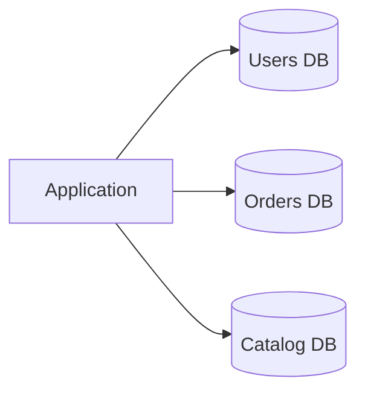
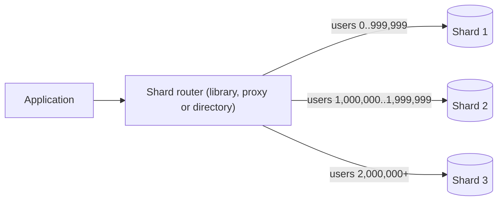
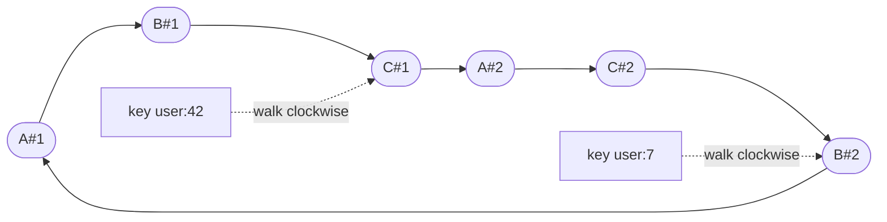

import { Aside } from '@astrojs/starlight/components';

Replication copies all the data to every node, so it cannot help once **writes** or **data size** outgrow one machine. Partitioning splits the data so that each node owns only a part. Done well, capacity grows almost linearly with nodes. Done badly, you get hot shards, scatter-gather queries and cross-shard transactions that are slower and more fragile than the single database you started with.

<Aside type="tip" title="TL;DR">
- **Federation** splits by function (users, orders, catalogue). **Sharding** splits one dataset by key (user 1–1M here, the rest there).
- The **shard key** is the most important decision. It must spread load evenly and keep each common query on a single shard.
- **Hash** sharding spreads load but loses range scans. **Range** sharding keeps ranges but invites hot spots. **Directory** sharding is flexible but adds a lookup service.
- **Consistent hashing** with virtual nodes moves only about 1/N of keys when a node joins. Plain `hash % N` moves most of them.
- Before building it yourself, consider **Vitess** or **Citus**, or a distributed SQL database (**CockroachDB**, **Spanner**, **YugabyteDB**). They automate routing, splitting and rebalancing.
</Aside>

## Vocabulary

The words overlap in practice, so this page uses them like this:

- **Partitioning** is the general idea of splitting data. *Table partitioning* splits one table into pieces **on the same server** (see [SQL tuning](/data/denormalization-and-tuning/)).
- **Sharding** is horizontal partitioning **across servers**: each shard is a separate database with its own CPU, memory and disk. Each shard is usually replicated for availability (see [Replication](/data/replication/)).
- **Federation**, or functional partitioning, puts different *tables or domains* on different servers.

## Federation: split by function

Instead of one database for everything, give each domain its own database: `users`, `orders`, `catalog`. Each database gets less traffic, a smaller working set that fits in memory, and its own write leader, so writes proceed in parallel.



In 2026 this is usually a side effect of **service ownership**: each service owns its schema, and nobody else connects to it. The costs are the same as in 2010:

- **No joins across databases.** "Orders with the buyer's name" becomes two queries joined in code, or a denormalised copy of the name.
- **No transactions across databases.** Use sagas, or the outbox pattern with idempotent consumers.
- It stops helping when **one domain** outgrows a server. Then that domain needs sharding.

## Sharding strategies



| Strategy | How a key finds its shard | Strengths | Weaknesses | Seen in |
|---|---|---|---|---|
| **Range** | Sorted key ranges: `A–F`, `G–M`, or by date | Efficient range scans and ordered reads. Easy to split a range. | Sequential keys (timestamps, auto-increment IDs) send all new writes to the last shard | Spanner splits, CockroachDB ranges, HBase, Bigtable |
| **Hash** | `hash(key)` mapped to a shard or slot | Even spread, even with sequential keys | Range queries hit every shard. Naive `hash % N` reshuffles almost everything when N changes. | Cassandra, DynamoDB, Redis Cluster (16,384 slots), Citus, Vitess |
| **Directory (lookup)** | A table maps key, or tenant, to shard | Any placement you like. Move one tenant at a time. Isolate big customers. | The lookup service must be fast, cached and highly available | Multi-tenant SaaS, Vitess lookup vindexes |
| **Geographic** | User's region or country decides | Low latency for local users. Data-residency compliance (GDPR and similar). | Uneven region sizes. Users who travel or move need migration. | Multi-region SaaS, Spanner and CockroachDB row placement |

Production systems often combine them. A common design hashes the key into a fixed set of **logical shards** (buckets), then keeps a small directory that maps buckets to physical servers. Notion did this in 2021: 480 logical shards on 32 physical PostgreSQL databases, 15 per machine, keyed by workspace ID. Growing the fleet then means moving whole logical shards between machines, not rehashing rows.

## Choosing a shard key

A good shard key:

1. **Has high cardinality.** Millions of distinct values, not a `status` with four.
2. **Spreads load evenly**, for both data and traffic. "Users" is even in count but may be skewed in activity.
3. **Matches the dominant queries.** If 95% of queries are scoped to one tenant, `tenant_id` keeps them on one shard, along with their joins and transactions.
4. **Is stable.** Changing a row's shard key means moving the row.

Common choices are user ID for consumer apps, tenant or organisation ID for B2B SaaS, and device or entity ID for telemetry. Avoid using a raw timestamp as the whole key. Citus's documentation advises partitioning by time *within* each shard instead.

<Aside type="caution" title="Sequential IDs and range sharding">
Monotonic keys such as auto-increment IDs, timestamps or UUIDv7 are great for B-tree locality in a single database. In a **range**-partitioned cluster, they put every insert on the last range. Spanner's docs recommend UUIDv4, bit-reversed sequences, or a hash prefix there. In a **hash**-sharded system they are fine.
</Aside>

## Hot spots and the celebrity problem

Even with a perfect hash, **one key can be hot**. A celebrity's posts, a viral product or a big tenant can send more traffic to one shard than it can handle. Options:

- **Split the hot key.** Append a suffix 0–9 to the key (`post:123#7`), so writes spread over ten shards: 50,000 writes/s becomes about 5,000 per shard. Reads must now gather all ten pieces and combine them. Do this only for keys you know are hot.
- **Cache it.** Most celebrity traffic is reads. A cache or CDN in front of the shard absorbs them.
- **Give it its own shard.** A directory lets you place the biggest tenant on dedicated hardware.
- **Handle it on read.** Twitter-style timelines push most posts to followers' feeds at write time, but merge celebrity posts in at read time. See the [Twitter timeline case study](/practice/twitter-timeline/).

Managed systems split hot ranges automatically. Spanner, for example, adds split boundaries between busy rows. But no automatic splitting can divide a single row's traffic.

## Resharding

Sooner or later a shard is too big or too busy, and data must move. Online resharding typically follows these steps:

1. **Copy** a consistent snapshot of the data to the new shard(s).
2. **Stream** changes made since the snapshot (CDC from the WAL or binlog) until the new shard is nearly caught up.
3. **Verify** that row counts and checksums match.
4. **Cut over.** Briefly block writes, let the target catch up, switch routing, and unblock. Vitess's `Reshard` workflow does exactly this. The source goes read-only while the target catches up (the wait times out after 30 seconds by default), and the VTGate proxy can buffer queries during that window so users barely notice.
5. **Keep a way back.** Reverse replication lets you undo the cutover until you delete the old shard.

Two design choices make this far easier: **many more logical shards than servers** (move buckets, never rehash rows) and **routing that is data, not code** (a directory or ring that can change without a deploy).

## Consistent hashing

With `shard = hash(key) % N`, adding one server changes N, and almost every key moves. Going from 4 to 5 servers moves about 80% of keys. **Consistent hashing**, introduced by Karger et al. in 1997 for web caches, avoids this.

Picture the hash space as a ring. Each server is hashed to positions on the ring. A key belongs to the first server position found by walking **clockwise** from the key's hash. When a server joins, it takes over only the keys between its positions and their predecessors: about 1/N of all keys. When a server leaves, only its keys move, to its clockwise neighbours.

With one position per server, the arcs are very uneven. In our test with four servers, the busiest server got 2.2 times its fair share in a typical run. The fix is **virtual nodes**: each physical server is placed at many positions, say 100 to 256, so its total share averages out to about 1/N. Virtual nodes also let a bigger machine take more positions, and spread a failed server's load over all the survivors instead of one neighbour.



The diagram shows three servers (A, B, C) with two virtual nodes each. Arrows go clockwise around the ring. A key is stored on the first virtual node after its hash position.

```python title="consistent_hash.py"
import bisect
import hashlib
from collections import Counter
from dataclasses import dataclass, field


def stable_hash(key: str) -> int:
    """64-bit hash that is the same in every process (built-in hash() is salted)."""
    return int.from_bytes(hashlib.blake2b(key.encode(), digest_size=8).digest(), "big")


@dataclass
class HashRing:
    vnodes: int = 100                                    # ring positions per physical node
    _points: list[int] = field(default_factory=list)     # sorted positions on the ring
    _owner: dict[int, str] = field(default_factory=dict)  # position -> physical node

    def add_node(self, node: str) -> None:
        for i in range(self.vnodes):
            point = stable_hash(f"{node}#{i}")
            bisect.insort(self._points, point)
            self._owner[point] = node

    def remove_node(self, node: str) -> None:
        for i in range(self.vnodes):
            point = stable_hash(f"{node}#{i}")
            self._points.remove(point)
            del self._owner[point]

    def node_for(self, key: str) -> str:
        # Walk clockwise to the first position at or after the key's hash; wrap at the end.
        idx = bisect.bisect_right(self._points, stable_hash(key)) % len(self._points)
        return self._owner[self._points[idx]]


if __name__ == "__main__":
    ring = HashRing(vnodes=100)
    for name in ("db-a", "db-b", "db-c", "db-d"):
        ring.add_node(name)

    keys = [f"user:{i}" for i in range(100_000)]
    before = {k: ring.node_for(k) for k in keys}
    print("keys per node:", sorted(Counter(before.values()).items()))

    ring.add_node("db-e")
    moved = [k for k in keys if before[k] != ring.node_for(k)]
    assert all(ring.node_for(k) == "db-e" for k in moved)  # keys only move to the new node
    print(f"ring, 4 -> 5 nodes: {len(moved) / len(keys):.1%} of keys move")

    naive = sum(stable_hash(k) % 4 != stable_hash(k) % 5 for k in keys)
    print(f"hash % N, 4 -> 5:   {naive / len(keys):.1%} of keys move")
```

Output (Python 3.13):

```text
keys per node: [('db-a', 24258), ('db-b', 25567), ('db-c', 24441), ('db-d', 25734)]
ring, 4 -> 5 nodes: 19.9% of keys move
hash % N, 4 -> 5:   80.2% of keys move
```

Where you will meet it: Dynamo-style stores (Cassandra places 16 tokens per node by default since version 4.0, down from 256), distributed caches such as memcached clients, and load balancers that need sticky routing. Variants trade memory for speed. **Jump consistent hash** (Lamping and Veach, 2014) needs no ring at all but requires numbered buckets. **Fixed hash slots**, as in Redis Cluster, use a static 16,384-slot table that is moved slot by slot. **Rendezvous hashing** picks the server with the highest `hash(key, server)` score.

## Cross-shard queries and transactions

Sharding is cheap only for queries that carry the shard key. Everything else costs more:

- **Scatter-gather.** A query without the shard key goes to every shard, and the router merges results. Latency is set by the slowest shard. If each shard has a 1% chance of a slow response, a 32-shard fan-out hits at least one slow shard 27.5% of the time, and a 100-shard fan-out 63% of the time.
- **Secondary lookups.** To find a user by email when you shard by user ID, keep a **global index** (email → user ID) as its own sharded table, or a lookup vindex in Vitess. Updating it on every write is itself a cross-shard write.
- **Co-location.** Shard related tables by the same key (orders and order items by customer ID) so that their joins stay local. Citus calls this co-location, Spanner uses interleaved tables, and Figma calls such groups "colos".
- **Reference tables.** Copy small, rarely changing tables (countries, plans) to every shard.
- **Cross-shard transactions.** Two-phase commit (2PC) gives atomicity but blocks if the coordinator fails mid-protocol, and it adds round trips. Many teams avoid it by design: keep invariants within one shard, and use sagas with compensating actions for workflows that span shards.

## Let the database do it: distributed SQL and sharding middleware

Hand-rolled sharding means owning routing, resharding, cross-shard queries and failover yourself. Mature options do this for you:

| System | What it is | How it shards | Notes (2026) |
|---|---|---|---|
| **Vitess** | Sharding layer over MySQL. Created at YouTube in 2010; CNCF graduated project. | Keyspace IDs from "vindexes" (hash, lookup and others); VTGate proxy routes queries | Apache 2.0. Online resharding with VReplication. PlanetScale is built on it. |
| **Citus** | PostgreSQL extension, not a fork | Hash-distributed tables plus reference tables; co-location by distribution column; schema-based sharding | Open source (AGPL-3.0); maintained by Microsoft. Coordinator plus worker nodes. |
| **CockroachDB** | Distributed SQL, PostgreSQL wire-compatible | Range splitting (ranges split at 512 MiB by default), three Raft replicas per range, automatic rebalancing | Serializable by default. Since version 24.3 (late 2024) source-available under an enterprise licence that is free for small companies. |
| **Google Spanner** | Managed, globally distributed SQL | Key-range "splits", load-based splitting, interleaved tables | External consistency via TrueTime; GoogleSQL and PostgreSQL dialects |
| **YugabyteDB** | Distributed SQL reusing PostgreSQL's query layer | Hash or range sharding into tablets, Raft per tablet, DocDB storage on RocksDB | Apache 2.0. Also offers a Cassandra-compatible API. |
| **TiDB** | Distributed SQL, MySQL-compatible | Key ranges replicated with Multi-Raft | Open source; TiKV row store plus TiFlash columnar replicas for analytics |

These systems still need a good key design. A monotonic primary key creates a hot range in Spanner or CockroachDB just as surely as in a hand-built system. Cross-region transactions still pay the speed of light.

## Trade-offs

| Approach | Gains | Costs |
|---|---|---|
| Federation | Simple, matches service boundaries | No cross-domain joins or transactions; one big domain still will not fit |
| Application-level sharding | Full control, any database | You own routing, resharding, global indexes and tooling |
| Middleware (Vitess, Citus) | Keeps a familiar engine, automates routing and resharding | Some SQL is restricted across shards; another layer to operate |
| Distributed SQL | Transactions and SQL across nodes; automatic splitting | Higher per-query latency than a single node; licence and cost considerations; key design still matters |

<Aside type="note" title="In the interview">
- Shard only after estimating: show that writes or data size exceed one well-tuned primary, plus replicas.
- Name the shard key and justify it against the top three queries. Then say what happens to the queries that do not include it.
- Expect "one user is 1000× bigger than the rest" (hot key) and "we need to add shards" (resharding). Answer with logical shards, a directory, and online migration with a cutover.
- Explain consistent hashing with numbers: about 1/N of keys move versus about 80% for `hash % N` going from 4 to 5 nodes, and why virtual nodes even out the load.
- Common mistakes: sharding by timestamp; forgetting global secondary indexes; promising cross-shard ACID without mentioning 2PC's cost.
</Aside>

## Further reading

- [Consistent Hashing and Random Trees](https://www.cs.princeton.edu/courses/archive/fall09/cos518/papers/chash.pdf) — Karger et al. (1997). The original consistent hashing paper.
- [A Fast, Minimal Memory, Consistent Hash Algorithm](https://arxiv.org/abs/1406.2294) — Lamping and Veach (2014). Jump consistent hash.
- [Herding elephants: lessons learned from sharding Postgres at Notion](https://www.notion.com/blog/sharding-postgres-at-notion) — logical vs physical shards, migration in practice.
- [How Figma's databases team lived to tell the scale](https://www.figma.com/blog/how-figmas-databases-team-lived-to-tell-the-scale/) — horizontal sharding of RDS PostgreSQL with a query-parsing proxy.
- [Vitess: What is Vitess](https://vitess.io/docs/overview/whatisvitess/) — architecture of MySQL sharding middleware.
- [Citus: choosing a distribution column](https://docs.citusdata.com/en/stable/sharding/data_modeling.html) — shard-key guidance for multi-tenant and analytics workloads.

## Related topics

- [Replication](/data/replication/) — each shard is usually a replicated group.
- [Relational databases](/data/relational-databases/) — the single-node guarantees that sharding gives up across shards.
- [Denormalization and SQL tuning](/data/denormalization-and-tuning/) — avoiding joins that would cross shards, and partitioning tables on one server.
- [NoSQL databases](/data/nosql/) — stores with partitioning built in.
- [Caching layers](/caching/caching-layers/) — absorbing hot keys before they reach a shard.
- [Twitter timeline case study](/practice/twitter-timeline/) — fan-out and the celebrity problem in a full design.
