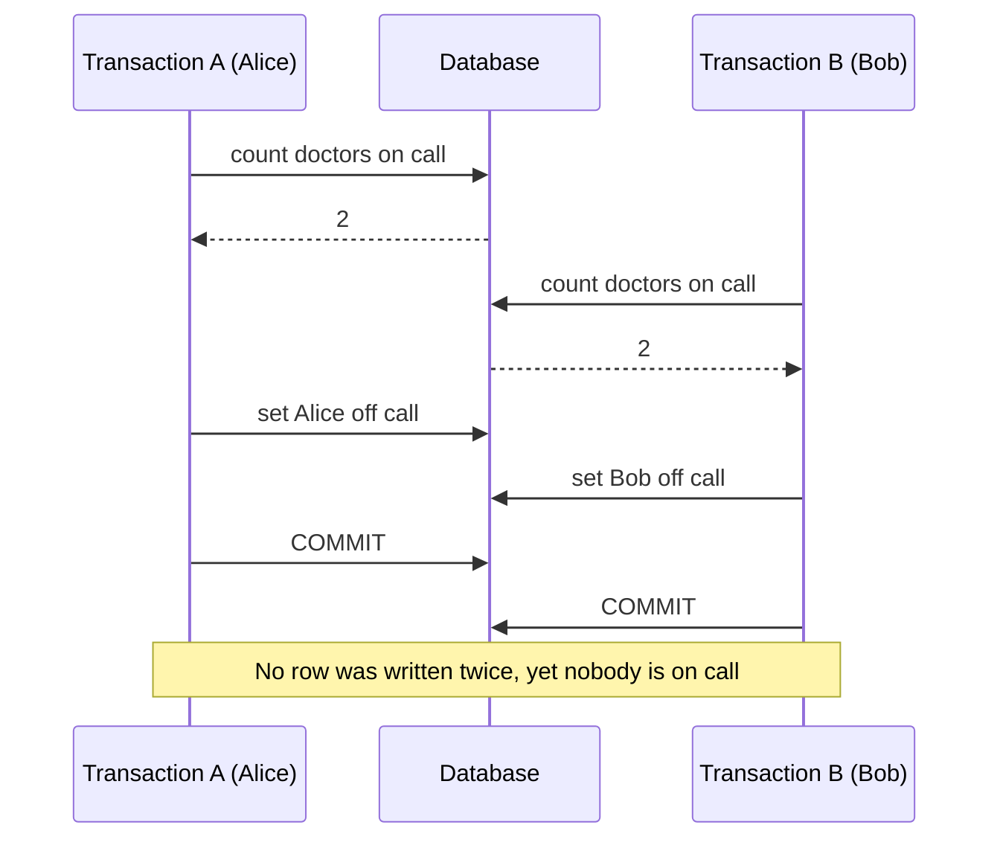
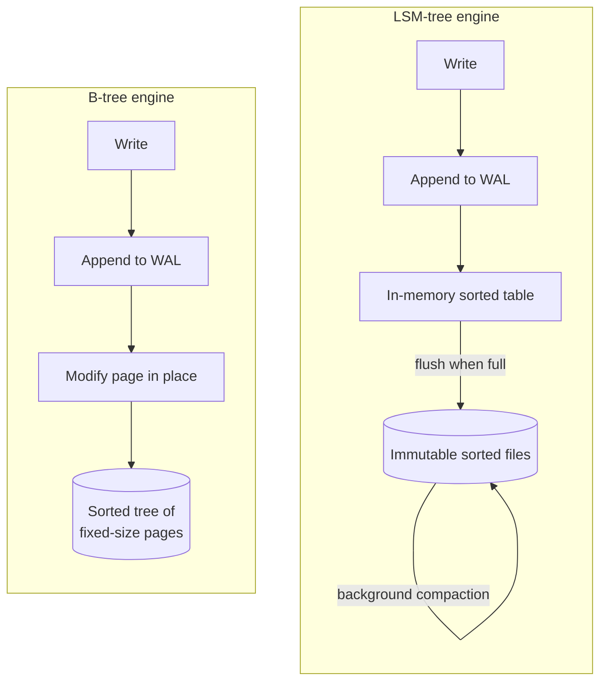
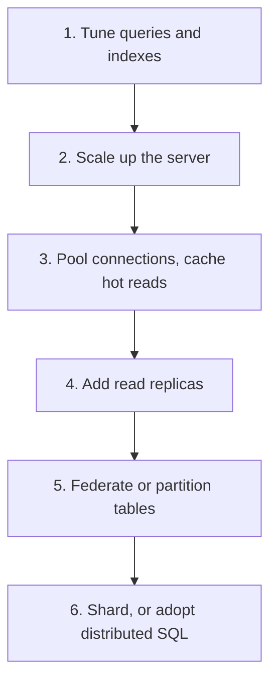

import { Aside } from '@astrojs/starlight/components';

A relational database (RDBMS) stores data as tables of typed rows, enforces rules about that data, and lets many clients change it concurrently through transactions. PostgreSQL, MySQL, SQL Server and Oracle still hold the system of record for most companies. To design around one, you need to know three things: what its guarantees actually promise, where they quietly stop, and how far a single node will take you.

<Aside type="tip" title="TL;DR">
- **ACID**: a transaction applies all of its changes or none (atomicity), keeps your invariants intact (consistency), is shielded from concurrent transactions to a chosen degree (isolation), and survives a crash once committed (durability).
- **Isolation is a menu, not a switch.** The defaults are weak: PostgreSQL uses *read committed* and MySQL InnoDB uses *repeatable read*. Neither prevents write skew.
- Most engines use **MVCC**: readers see a snapshot and never block writers. The price is old row versions that must be cleaned up.
- **B-trees** (most RDBMSs) favour reads and range scans. **LSM-trees** (RocksDB, Cassandra, several distributed SQL engines) favour write throughput.
- Scale in this order: tune queries and indexes, scale up, pool connections and cache, add read replicas, then partition or shard.
</Aside>

## The relational model in one minute

Data lives in **tables** (relations) made of **rows** (tuples) with typed **columns**. A **primary key** identifies each row. **Foreign keys** link rows across tables. **Normalisation** means each fact is stored once: a customer's address lives in `customers`, and every order points to it. You do not copy the address into each order.

Two properties make the model durable after 50 years:

- **Declarative queries.** SQL says *what* you want. The optimiser picks *how*: which index, which join algorithm, which order. When the data grows, the plan can change without touching application code.
- **Constraints in one place.** `NOT NULL`, `UNIQUE`, `CHECK` and foreign keys are enforced by the database for every client. An application bug cannot slip past them.

The line between relational and document stores has blurred. PostgreSQL's `jsonb` columns can be indexed, and many document databases now offer multi-document transactions. The deciding questions are about access patterns and guarantees, not labels. See [SQL or NoSQL](/data/sql-or-nosql/).

## ACID, stated precisely

| Property | What it guarantees | How engines implement it | Common misreading |
|---|---|---|---|
| Atomicity | All writes in a transaction take effect, or none do: on crash, abort or a constraint error | Write-ahead log (WAL) plus undo information | It says nothing about concurrent access |
| Consistency | Each transaction moves the data from one valid state to another | Constraints, triggers, and *your* code | Not the "C" in CAP. That one means linearizability. |
| Isolation | Concurrent transactions do not see each other's partial work | Locks, MVCC snapshots, conflict detection | Rarely full serializability by default |
| Durability | Once `COMMIT` returns, the change survives a process or OS crash | WAL flushed to disk before the acknowledgement | One disk survives a crash, not machine loss. That needs [replication](/data/replication/). |

Two practical notes. First, the "C" belongs mostly to the application: the database guarantees only the rules you declared. Second, durability is often traded for latency on purpose. Examples are `synchronous_commit = off` in PostgreSQL or asynchronous replicas that may lose the last few transactions on failover.

## Transactions in practice

- **Keep them short.** A transaction holds locks and pins old row versions until it ends. Never wait on a user, an HTTP call or a message queue inside one.
- **Prefer atomic statements to read-modify-write.** `UPDATE accounts SET balance = balance - 10 WHERE id = 1 AND balance >= 10` cannot lose an update. Reading the balance into the application, subtracting there and writing it back can.
- **Lock explicitly when you must.** `SELECT ... FOR UPDATE` locks the rows you read, so a concurrent writer waits.
- **Use optimistic concurrency for long edits.** Add a `version` column and write `UPDATE ... SET version = version + 1 WHERE id = ? AND version = ?`. If zero rows changed, someone else won, so reload and retry.
- **Retry on serialisation failures and deadlocks.** At stricter levels the database aborts a transaction instead of corrupting data (SQLSTATE `40001`). Make transactions safe to re-run.

## Isolation levels and their anomalies

Isolation levels are defined by the **anomalies** they allow:

- **Dirty read:** you see another transaction's uncommitted write, which may later roll back.
- **Non-repeatable read:** you read a row twice and get different values, because another transaction committed in between.
- **Phantom:** you re-run a range query (`WHERE room = 7 AND day = '2026-10-08'`) and rows have appeared or vanished.
- **Lost update:** two transactions read the same value, both modify it, and the second write silently overwrites the first.
- **Write skew:** two transactions read the same data, each decides based on it, and they write *different* rows. Each write is fine alone, but together they break an invariant.

The textbook matrix below follows the 1995 Berenson et al. critique, which added lost update, write skew and snapshot isolation to the ANSI definitions:

| Level | Dirty read | Non-repeatable read | Phantom | Lost update | Write skew |
|---|---|---|---|---|---|
| Read uncommitted | Possible | Possible | Possible | Possible | Possible |
| Read committed | Prevented | Possible | Possible | Possible | Possible |
| Repeatable read (lock-based) | Prevented | Prevented | Possible | Prevented | Possible via phantoms |
| Snapshot isolation | Prevented | Prevented | Prevented in reads | Prevented¹ | **Possible** |
| Serializable | Prevented | Prevented | Prevented | Prevented | Prevented |

¹ Only if the engine aborts the second of two concurrent writers to the same row ("first committer wins"). PostgreSQL does this. MySQL's repeatable read does not.

### Write skew, step by step

The classic example is a hospital rule: at least one doctor must be on call. Alice and Bob are both on call, and both ask to go off duty at the same moment.

We ran exactly this against PostgreSQL 16. Under read committed and repeatable read, both transactions commit and zero doctors remain on call. Under serializable, the second commit fails with `could not serialize access due to read/write dependencies among transactions`. The application retries, sees one doctor on call, and refuses the request. Without serializable isolation, the fix is to lock the rows you based the decision on (`SELECT ... FOR UPDATE`) or to turn the invariant into a constraint.

### What real engines do

The names of the levels are shared, but the behaviour is not:

| Engine | Default level | What the levels really mean |
|---|---|---|
| PostgreSQL | Read committed | Read uncommitted behaves as read committed. Repeatable read is snapshot isolation: a concurrent update to the same row aborts with `could not serialize access due to concurrent update`. Serializable is Serializable Snapshot Isolation (SSI). |
| MySQL (InnoDB) | Repeatable read | Plain `SELECT`s read a snapshot. `UPDATE`, `DELETE` and locking reads see the latest committed row and take next-key locks. Lost updates in read-modify-write code are *not* detected. |
| Oracle | Read committed | Its "serializable" is snapshot isolation, so write skew is possible. |
| SQL Server | Read committed (locking) | Row-versioned read committed (RCSI) is the default on Azure SQL Database. A separate `SNAPSHOT` level exists. |
| CockroachDB, Spanner | Serializable | Weaker levels are opt-in (read committed in CockroachDB, repeatable read in Spanner). |
| Aurora DSQL | Repeatable read (fixed) | Snapshot isolation with optimistic concurrency: conflicts surface at commit as SQLSTATE `40001`, so clients must retry. |

<Aside type="caution" title="Do not trust level names">
The same name can mean different guarantees in different engines. The open-source Hermitage test suite documents what each engine actually prevents. Check your engine before relying on a level for correctness.
</Aside>

## MVCC in brief

**Multi-version concurrency control** keeps several versions of a row. A write creates a new version stamped with its transaction ID. A reader picks the newest version that was committed before its snapshot was taken. Readers therefore never block writers, and writers never block readers. Two writers to the same row still conflict.

Engines differ in where the old versions live:

- **PostgreSQL** writes each new version as a new tuple in the table itself. The old tuple stays until `VACUUM` removes it once no snapshot can see it.
- **InnoDB** updates the row in place and keeps the previous version in an **undo log**. A background **purge** discards undo records nobody needs.

The operational catch is the same in both. A transaction left open for hours pins every version created since it started. In PostgreSQL the tables bloat. In InnoDB the undo history grows. Monitor the age of the oldest open transaction and kill forgotten sessions.

## Storage engines: B-tree vs LSM-tree

| | B-tree | LSM-tree |
|---|---|---|
| Write path | Find the page, change it, log the change | Append to log and memory buffer, flush sorted files, merge them later |
| Point reads | One descent of a shallow tree: predictable | May check the buffer plus several files. Bloom filters skip most of them. |
| Write amplification | A small change rewrites a whole page | Compaction rewrites data several times, but sequentially |
| Space | Free space inside pages | Obsolete versions linger until compaction. Compresses well. |
| Typical fit | Read-heavy OLTP, range scans | Write-heavy ingestion, large datasets on SSDs |
| Examples | PostgreSQL, InnoDB, SQL Server, Oracle | RocksDB, Cassandra, CockroachDB (Pebble), YugabyteDB (DocDB, built on RocksDB) |

You rarely choose a storage engine directly. You choose a database, and the engine decides which workloads are cheap. A system that ingests millions of small events per second is a natural LSM workload. A system that serves complex joins over a stable dataset is a natural B-tree workload.

## When a relational database is the right choice

Reach for an RDBMS first when:

- The data is a **system of record**: money, orders, inventory, identity, permissions.
- **Invariants span rows or tables**: "a seat is sold once", "debits equal credits". Transactions and constraints enforce them in one place.
- You need **ad-hoc queries and joins**, and you do not know every access pattern up front.
- The working set **fits one primary**. Most do. A single modern server with tens of cores, hundreds of gigabytes of RAM and NVMe storage handles a large share of real products, and managed services handle backups, failover and patching.

Look elsewhere, or alongside, for very high-volume key-value access with simple queries ([NoSQL](/data/nosql/)), large binary objects ([object storage](/data/object-storage/)), heavy analytics over billions of rows (a columnar warehouse), or deep graph traversals.

## Scaling a relational database

Each step costs more complexity than the one before it, so climb only when measurements say the current step is exhausted:

- **Query and schema tuning, denormalisation:** often a 10× to 1000× win for one query, at almost no architectural cost. See [Denormalisation and SQL tuning](/data/denormalization-and-tuning/).
- **Caching:** takes repeated reads off the database. See [Caching layers](/caching/caching-layers/).
- **Read replicas:** scale reads and add failover targets, but bring replication lag. See [Replication](/data/replication/).
- **Federation and sharding:** scale writes and storage beyond one node, at the cost of cross-shard queries and transactions. See [Partitioning and sharding](/data/partitioning-and-sharding/).

## Trade-offs

| Isolation level | Cost | Good for |
|---|---|---|
| Read committed | Cheapest. Few aborts. | Most CRUD work, with atomic `UPDATE`s and explicit locks where invariants matter |
| Repeatable read / snapshot | Consistent view for the whole transaction. PostgreSQL may abort concurrent writers. | Reports, exports, multi-step reads that must agree with each other |
| Serializable | More aborts and retries, some tracking overhead | Invariants across rows (bookings, balances, quotas) when you would rather not reason about locks |

<Aside type="note" title="In the interview">
- Define each ACID letter precisely. Many candidates mix up the "C" with CAP consistency.
- Expect "what can go wrong at read committed?" Answer with a concrete lost update or write skew, then the fix: an atomic update, `SELECT ... FOR UPDATE`, a constraint, or serializable plus retries.
- Know the defaults: PostgreSQL read committed, MySQL InnoDB repeatable read.
- Do not open with sharding. Show the scaling ladder and the numbers that justify each step.
- A common mistake is claiming "SQL doesn't scale". Single nodes go far, and distributed SQL exists when they do not.
</Aside>

## Further reading

- [PostgreSQL: Transaction Isolation](https://www.postgresql.org/docs/current/transaction-iso.html) — the anomaly table and exactly what each PostgreSQL level does.
- [MySQL: InnoDB transaction isolation levels](https://dev.mysql.com/doc/refman/8.4/en/innodb-transaction-isolation-levels.html) — consistent reads, locking reads and next-key locks.
- [A Critique of ANSI SQL Isolation Levels](https://www.microsoft.com/en-us/research/publication/a-critique-of-ansi-sql-isolation-levels/) — Berenson, Bernstein, Gray et al. (1995). The paper that defined snapshot isolation.
- [Hermitage](https://github.com/ept/hermitage) — tests of which anomalies real databases prevent at each level.
- [Architecture of a Database System](https://dsf.berkeley.edu/papers/fntdb07-architecture.pdf) — Hellerstein, Stonebraker and Hamilton (2007). How an RDBMS is built inside.
- [Designing Data-Intensive Applications, 2nd edition](https://www.oreilly.com/library/view/designing-data-intensive-applications/9781098119058/) — Kleppmann and Riccomini (2026). Chapters on storage engines and transactions.

## Related topics

- [Replication](/data/replication/) — the first step beyond one node, and where durability meets availability.
- [Partitioning and sharding](/data/partitioning-and-sharding/) — scaling writes and storage horizontally.
- [Denormalisation and SQL tuning](/data/denormalization-and-tuning/) — getting the most out of one database first.
- [SQL or NoSQL](/data/sql-or-nosql/) — choosing a data model for a workload.
- [Consistency patterns](/fundamentals/consistency-patterns/) — consistency across replicas, as opposed to the "C" in ACID.
- [CAP theorem and PACELC](/fundamentals/cap-theorem/) — why distributed databases must trade consistency against availability.
