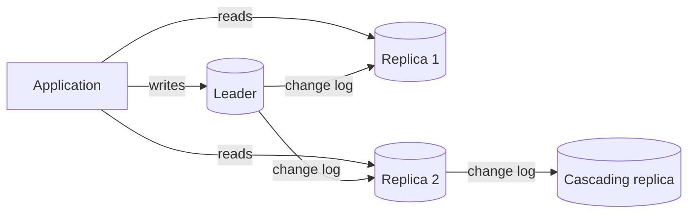
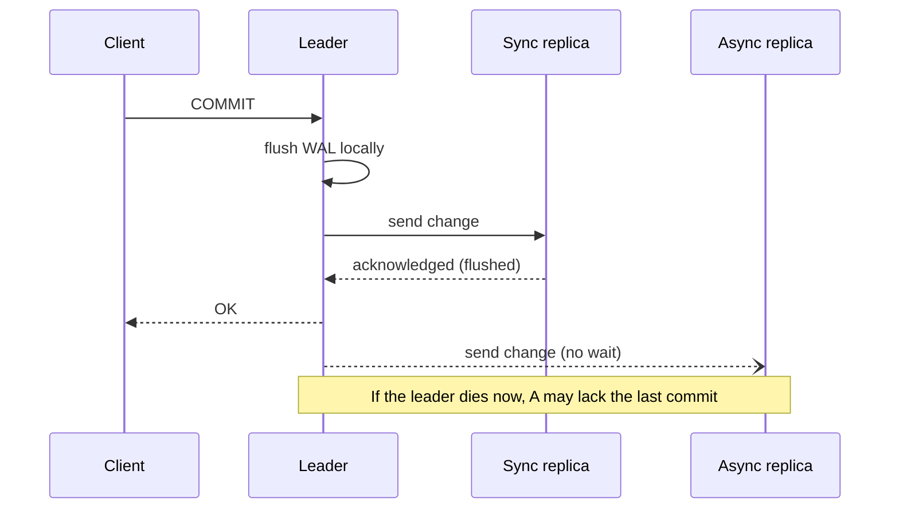
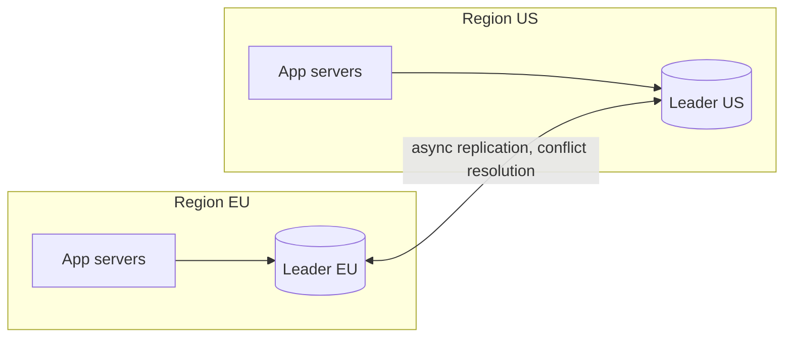
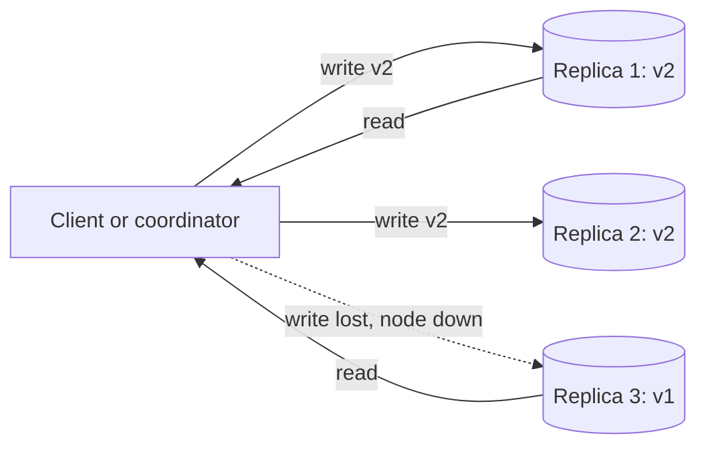

import { Aside } from '@astrojs/starlight/components';

Replication keeps a copy of the same data on several machines. It serves three goals: survive the loss of a node (availability and durability), spread reads over more servers (read throughput), and put data close to users (latency). Every replication scheme answers the same two questions. When is a write acknowledged? And who is allowed to accept writes?

<Aside type="tip" title="TL;DR">
- **Leader–follower** (primary–replica) is the default: one node takes writes, the others copy its log and serve reads. Simple, but writes do not scale and failover needs care.
- **Asynchronous** replication is fast but can lose the last writes on failover. **Synchronous** loses nothing but each commit waits for a replica. **Semi-synchronous** or quorum commit is the usual middle ground.
- Replication lag breaks **read-your-writes** and **monotonic reads**. Fix them with routing rules or by waiting until the replica catches up to a known log position.
- **Multi-leader** and **leaderless** designs accept writes in several places. They gain availability and locality but must resolve conflicts (LWW, merge, CRDTs).
- Leaderless quorums: with `R + W > N`, every read set overlaps every write set. That is necessary for fresh reads, but it does not make the system linearizable.
</Aside>

## Leader–follower replication

One node, the **leader** (primary), accepts all writes. It records each change in a log: the WAL in PostgreSQL, the binary log in MySQL. **Followers** (replicas) stream that log and apply it in the same order. Clients may read from any replica. Older documentation calls this **master–slave** replication. The industry has moved to leader/follower and primary/replica.

Typical uses:

- **Read scaling.** Product pages, feeds and reports go to replicas. This works when reads far outnumber writes.
- **High availability.** A replica is a warm standby that can be promoted if the leader fails.
- **Isolation of heavy work.** Analytics, backups and exports run on a replica, so they do not slow down production writes.
- **Locality.** A replica in another region serves local reads.

Replicas can feed further replicas (**cascading**). This takes load off the leader, but each hop adds lag.

The log comes in two flavours. **Physical** replication ships byte-level WAL: the whole cluster is copied, and the replica is read-only. **Logical** replication ships row changes: you can pick tables and even run different major versions. Logical replication also powers change data capture (CDC) tools that stream database changes into Kafka and search indexes.

## Synchronous, asynchronous, semi-synchronous

| Mode | Commit returns when | Data loss on leader failure | Latency cost | Availability risk |
|---|---|---|---|---|
| Asynchronous | Leader has flushed its log | Last few transactions can be lost | None | None from replicas |
| Synchronous | Leader **and** chosen replica(s) have the change | None, if a sync replica is promoted | One round trip to the replica on every commit | Writes stall if the sync replica is unreachable |
| Semi-synchronous / quorum | At least *k* of the replicas acknowledge | None while *k* replicas confirm | Round trip to the fastest *k* | Tolerates slow or failed replicas, up to a point |

How the big engines do it:

- **PostgreSQL** streams WAL asynchronously by default. The docs note visibility lag is typically under a second. Setting `synchronous_standby_names` makes commits wait, either for named standbys in priority order (`FIRST 2 (s1, s2, s3)`) or for any quorum (`ANY 2 (s1, s2, s3)`). The `synchronous_commit` setting chooses how far the standby must get: `remote_write` (in OS memory), `on` (flushed to disk) or `remote_apply` (replayed, so visible to readers). If no synchronous standby answers, commits wait indefinitely.
- **MySQL** semi-synchronous replication makes the source wait until at least one replica confirms the transaction is in its relay log on disk. After `rpl_semi_sync_source_timeout` (10 seconds by default) with no acknowledgement, it **silently falls back to asynchronous** and returns to semi-sync when a replica catches up. Monitor that switch: during it, you have no zero-loss guarantee.
- **Managed cloud databases** often replicate at the storage layer. Amazon Aurora writes six copies across three availability zones and considers a write durable when four acknowledge. Compute replicas then read from that shared storage.

A common production setup is one synchronous or quorum replica in another availability zone for zero data loss, plus asynchronous replicas for reads and remote regions.

## Replication lag and the anomalies it causes

With asynchronous replicas, a follower is always slightly behind. Lag is usually milliseconds. It can grow to minutes during heavy batch writes, long-running queries on the replica, or network trouble. Lag shows up as user-visible bugs:

| Anomaly | What the user sees | Fixes |
|---|---|---|
| **Read-your-writes** violated | Edits a profile, refreshes, sees the old one | Read "own" data from the leader. Or read from the leader for a few seconds after a write. Or remember the write's log position and read only from a replica that has replayed it. |
| **Monotonic reads** violated | A comment appears, then disappears on the next refresh (second read hit a more-lagged replica) | Pin each user or session to one replica (for example, hash the user ID). Or have the client send the last position it saw. |
| **Consistent prefix** violated | Sees an answer before the question it replies to | Keep causally related writes on the same leader or partition. Or track dependencies. |

The position-based fix is precise and cheap. After a write, the application stores the leader's log position: in PostgreSQL the LSN from `pg_current_wal_lsn()`, in MySQL the GTID set. On the next read, it picks a replica whose replayed position (`pg_last_wal_replay_lsn()`) is at least that value. MySQL can also block until a replica catches up with `WAIT_FOR_EXECUTED_GTID_SET()`. PostgreSQL's `synchronous_commit = remote_apply` gives the same effect at commit time, at the cost of slower commits.

Also expose lag as a metric and alert on it. Take a replica out of the read pool when its lag exceeds what the product tolerates.

## Failover, promotion and split brain

When the leader dies, a follower must be promoted:

1. **Detect** the failure. Usually this is missed heartbeats for some seconds. Too short a timeout causes needless failovers. Too long a timeout extends the outage.
2. **Choose** the new leader. Pick the most up-to-date replica to minimise lost writes. A synchronous replica is ideal.
3. **Reconfigure.** Point clients at the new leader (DNS, a virtual IP, a proxy or service discovery) and point the other replicas at it.
4. **Fence** the old leader so it cannot accept writes if it comes back.

Tools such as **Patroni** for PostgreSQL use a consistent store (etcd, Consul, ZooKeeper or the Kubernetes API) to hold a leader lease. Only the lease holder may act as primary. Managed services such as RDS, Cloud SQL and Azure Database run this loop for you.

**Split brain** happens when two nodes both believe they are the leader and both accept writes. The data then diverges, and merging it is manual, painful and sometimes impossible. Defences:

- **Majority quorum** for leader election: a node that cannot reach a majority must step down.
- **Fencing tokens**: each new leader gets a higher epoch number, and storage rejects writes carrying an older epoch.
- **STONITH** ("shoot the other node in the head"): power off or isolate the old leader before promoting a new one.

A real incident shows the stakes. In October 2018, a 43-second network partition at GitHub triggered automatic failover of MySQL primaries to another coast. Both sites ended up holding writes the other lacked. Reconciling them left the site degraded for 24 hours and 11 minutes.

## Multi-leader (master–master) replication

Several nodes accept writes and replicate to each other asynchronously. The usual reason is **one leader per region**: users write locally with low latency, and a region can keep accepting writes if another is cut off. Offline-capable apps are the extreme case: every device is a leader.

The price is **write conflicts**: two leaders change the same record concurrently. Strategies, from crude to careful:

- **Avoid them.** Route all writes for a given record (a user, a tenant) to one "home" leader. This is the most common and most effective approach.
- **Last-writer-wins (LWW).** Keep the version with the highest timestamp. Simple, but it **silently drops** the losing writes, and clock skew decides who "wins". DynamoDB global tables in their default multi-region eventual consistency mode resolve conflicts this way.
- **Merge.** Keep both versions (siblings, tracked by version vectors) and let the application or user merge them, like a shopping cart that unions items.
- **CRDTs.** Conflict-free replicated data types (counters, sets, maps, text sequences) are designed so that concurrent updates always merge to the same result, with no coordination. They are used in collaborative editors, Redis Software's Active-Active databases and local-first apps.
- **Detect and abort.** MySQL Group Replication in multi-primary mode certifies each transaction against concurrent ones. The first to be ordered commits everywhere, and the conflicting one rolls back. The result is consistent, but you get aborts under contention.

Multi-leader setups also need loop prevention, so that a change does not bounce between leaders forever. PostgreSQL 16 added `origin = none` subscriptions for this. Schema changes, auto-increment keys (use UUIDs or per-node ranges) and constraints such as uniqueness become much harder. Prefer single-leader unless locality or regional autonomy truly requires more.

## Leaderless (Dynamo-style) replication

The 2007 Amazon Dynamo paper popularised a design with no leader. The client, or a coordinator node acting for it, sends each write to **all N replicas** of a key. The write succeeds once **W** acknowledge. A read asks replicas and waits for **R** answers, then returns the newest version. Cassandra, ScyllaDB and Riak follow this model.

With N = 3, W = 2 and R = 2 in the diagram, the write reached replicas 1 and 2. A read that hears from replicas 1 and 3 still sees `v2`, because any two of three nodes overlap. That is the **quorum condition**: `R + W > N`.

| N, W, R | Reads see latest write? | Tolerates down nodes for writes / reads | Use |
|---|---|---|---|
| 3, 2, 2 | Yes (overlap) | 1 / 1 | Balanced default ("QUORUM") |
| 3, 3, 1 | Yes | 0 / 2 | Read-heavy, rare writes |
| 3, 1, 3 | Yes | 2 / 0 | Fast writes, reads must reach all |
| 3, 1, 1 | No guarantee | 2 / 2 | Lowest latency, eventual consistency |

Cassandra exposes this per query as **consistency levels**: `ONE`, `QUORUM`, `LOCAL_QUORUM` (a majority in the local datacenter) and `ALL`.

Mechanisms that keep replicas converging:

- **Read repair.** When a read sees a stale replica, it writes the newer value back to it.
- **Anti-entropy.** A background process compares replicas using **Merkle trees** (hashes of key ranges), so only differing ranges are transferred.
- **Hinted handoff.** If a replica is down, another node stores the write with a "hint" and delivers it when the replica returns. Cassandra keeps hints for up to three hours by default.
- **Sloppy quorums.** If the designated N nodes are unreachable, the write is accepted by any W healthy nodes. Writes stay available during partitions, but a read quorum may not overlap them until handoff completes. `R + W > N` then no longer guarantees fresh reads.

<Aside type="caution" title="Quorums are not linearizability">
Even with `R + W > N`, readers can see anomalies. A write may succeed on fewer than W nodes, fail, and not be rolled back. Concurrent writes resolved by LWW can lose data. Clock skew can reorder updates. Use leaderless stores for availability and write throughput. Use consensus-based systems when you need compare-and-set semantics.
</Aside>

Note that the managed **Amazon DynamoDB** service shares the name but not this design. Its 2022 USENIX paper describes a Multi-Paxos leader per partition that handles writes and strongly consistent reads.

## Disadvantages of replication

- **Writes do not scale.** Every replica applies every write. Adding replicas adds read capacity, never write capacity. For that, see [partitioning and sharding](/data/partitioning-and-sharding/).
- **Possible data loss** on asynchronous failover, and **stalls** with synchronous replication.
- **Lag grows with load.** A replica must keep up with the leader's write rate while also serving reads. Long queries on a replica can delay or conflict with replay. PostgreSQL cancels conflicting standby queries after `max_standby_streaming_delay`. Turning on `hot_standby_feedback` avoids most of these cancellations, but dead rows then pile up on the primary. Parallel apply helps: MySQL replicas have used four applier threads by default since 8.0.27.
- **Replicas are not backups.** A bad migration or `DROP TABLE` replicates within milliseconds. Keep point-in-time backups and delayed replicas as well.
- **More moving parts.** You get more servers, failover automation to test regularly, connection routing, lag monitoring and runbooks.

## Trade-offs

| | Leader–follower | Multi-leader | Leaderless |
|---|---|---|---|
| Write availability | Leader is a single point until failover | High: each leader writes independently | High: any W nodes |
| Write latency | One region | Local in every region | Wait for the fastest W |
| Consistency | Strong on the leader, stale on replicas | Conflicts must be resolved | Tunable, eventual by default |
| Complexity | Lowest | Highest (conflicts, loops, schema) | Medium (repair, tombstones, tuning) |
| Typical systems | PostgreSQL, MySQL, SQL Server, MongoDB replica sets | Multi-region active-active, collaborative apps | Cassandra, ScyllaDB, Riak |

<Aside type="note" title="In the interview">
- State the write path explicitly: who accepts writes, when the client gets "OK", and what is lost if that node dies right after.
- Expect "a user updates their profile and does not see the change". Answer: replication lag, then read-your-writes via leader reads or log-position tracking.
- Explain failover end to end: detection, choosing the most caught-up replica, fencing, client redirection. Name split brain and how a majority quorum prevents it.
- For quorums, do the arithmetic (N = 3, W = 2, R = 2) and mention why sloppy quorums and LWW weaken the guarantee.
- Common mistake: proposing read replicas to fix a **write** bottleneck.
</Aside>

## Further reading

- [PostgreSQL: Log-Shipping Standby Servers](https://www.postgresql.org/docs/current/warm-standby.html) — streaming and synchronous replication, quorum commit.
- [MySQL: Semisynchronous Replication](https://dev.mysql.com/doc/refman/8.4/en/replication-semisync.html) — acknowledgement rules and the fallback to async.
- [Dynamo: Amazon's Highly Available Key-value Store](https://www.allthingsdistributed.com/2007/10/amazons_dynamo.html) — the 2007 paper behind leaderless replication, hinted handoff and Merkle-tree repair.
- [Amazon Aurora under the hood: quorums and correlated failure](https://aws.amazon.com/blogs/database/amazon-aurora-under-the-hood-quorum-and-correlated-failure/) — why six copies with a write quorum of four.
- [GitHub: October 21 post-incident analysis](https://github.blog/news-insights/company-news/oct21-post-incident-analysis/) — a real cross-region failover and its aftermath.
- [CRDT.tech](https://crdt.tech/) — papers and implementations of conflict-free replicated data types.

## Related topics

- [Relational databases](/data/relational-databases/) — the single-node guarantees that replication extends.
- [Partitioning and sharding](/data/partitioning-and-sharding/) — scaling writes, usually combined with replication of each shard.
- [Consistency patterns](/fundamentals/consistency-patterns/) — read-your-writes, monotonic reads and linearizability in depth.
- [Availability patterns](/fundamentals/availability-patterns/) — active-passive and active-active failover in general.
- [CAP theorem and PACELC](/fundamentals/cap-theorem/) — the latency vs consistency trade-off behind sync and async replication.
- [NoSQL databases](/data/nosql/) — wide-column and key-value stores built on leaderless replication.
