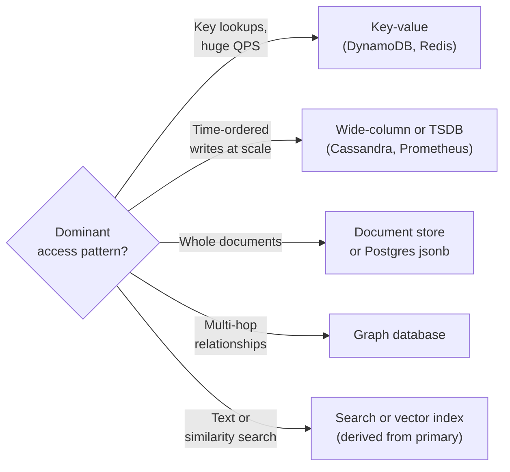
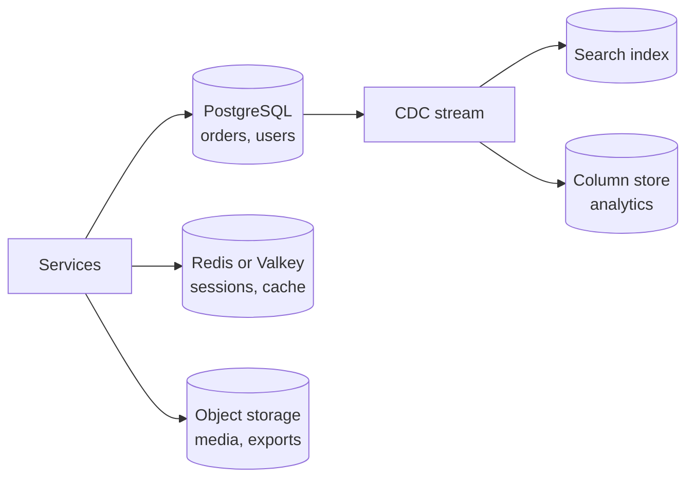

import { Aside } from '@astrojs/starlight/components';

Picking a database is one of the few early decisions that is expensive to reverse, because data outlives code. This page turns the choice into a short series of questions about your data and access patterns, and explains why in 2026 the default answer for a new product is usually "a relational database, until a specific workload proves otherwise".

<Aside type="tip" title="TL;DR">
- Start with a relational database (usually PostgreSQL) unless a clear requirement rules it out: write volume beyond one primary, single-digit-millisecond latency at huge scale, or a data model it handles badly.
- Choose NoSQL for a **specific workload** with known access patterns: key lookups at very high QPS, time-ordered writes at scale, documents read as whole aggregates, graph traversals.
- PostgreSQL with `jsonb`, full-text search and extensions such as `pgvector` covers many "NoSQL" needs for small and medium datasets.
- Distributed SQL (Spanner, CockroachDB, YugabyteDB, TiDB, Aurora DSQL) offers SQL and transactions with horizontal scale, at the price of higher write latency.
- Every additional datastore adds operations, consistency and on-call cost. Add one only when it pays for itself.
</Aside>

## A decision flowchart

```mermaid
flowchart TD
  start["New dataset or workload"] --> q1{"Need multi-row<br/>transactions<br/>or joins?"}
  q1 -->|"Yes"| q2{"Fits on<br/>one primary<br/>(writes, size)?"}
  q2 -->|"Yes"| rdb["Relational DB<br/>(PostgreSQL, MySQL)"]
  q2 -->|"No"| q3{"Can you shard<br/>by tenant or<br/>another key?"}
  q3 -->|"Yes"| shard["Sharded SQL<br/>(Vitess, Citus)"]
  q3 -->|"No"| dsql["Distributed SQL<br/>(Spanner, CockroachDB, TiDB)"]
  q1 -->|"No"| q4["Choose by access pattern<br/>(next chart)"]
```



If the data needs no multi-row transactions or joins, the dominant access pattern decides:



The two charts are a starting point, not an algorithm. Two refinements matter in practice:

- **Decide per dataset, not per company.** Orders may live in PostgreSQL, sessions in Redis, and click events in a column store, all within one product.
- **Size it.** "Fits on one primary" is a number. A single modern PostgreSQL server comfortably handles thousands of write transactions per second and many terabytes of data; read replicas and caching take reads off it. Do the [back-of-the-envelope estimate](/start/estimation/) before reaching for a distributed store.

## Reasons for each side

| Reasons to choose SQL | Reasons to choose NoSQL |
|---|---|
| Data is relational, with many-to-many links | Data is a set of independent aggregates or key-value pairs |
| Invariants span rows (balances, inventory, uniqueness) | Invariants live inside one item or partition |
| Queries are not all known up front; ad-hoc reporting | Access patterns are few, known and stable |
| Need joins, aggregations, window functions | Lookups by key or key range dominate |
| Mature tooling, ORMs, migrations, hiring pool | Need predictable latency at very high QPS |
| Schema enforced by the database | Schema varies by record or changes often |
| Size and write rate fit one primary (plus replicas) | Write rate or data size exceeds one machine by a wide margin |
| Strong consistency is the default | Multi-region active-active writes with tunable consistency |

A handy test: if you cannot list the queries yet, you need the flexibility of SQL. If you can list them all and they are simple but enormous in volume, NoSQL may fit.

## Workloads that suit NoSQL

- **High-rate ingest of append-only data** — clickstreams, logs, IoT telemetry, metrics (wide-column stores, time-series databases, or a log such as Kafka plus a column store).
- **Ephemeral or rapidly changing state** — sessions, shopping carts, rate-limit counters, presence (key-value, often in memory with a TTL).
- **Leaderboards and counters** — Redis or Valkey sorted sets give ranked reads in logarithmic time.
- **Hot lookup tables** — feature flags, user preferences, URL mappings read millions of times per second.
- **Catalogue and content** — product or article documents with varying attributes, read as a whole.
- **Relationship-heavy queries** — fraud rings, recommendations, permission graphs.
- **Search and similarity** — full-text, faceted and vector search, kept as indexes derived from the source of truth.

## PostgreSQL can do a lot

Before adding a new datastore, check whether the database you already run can do the job. PostgreSQL in particular covers several "NoSQL" niches:

| Need | PostgreSQL feature | Good enough until… |
|---|---|---|
| Flexible documents | `jsonb` type with GIN indexes and JSON path queries | Documents are large and rewritten often, or writes outgrow one primary |
| Full-text search | `tsvector`, `tsquery`, GIN indexes, ranking | You need typo tolerance, rich relevance tuning, facets at scale |
| Vector search | `pgvector` extension: HNSW and IVFFlat indexes; L2, inner-product, cosine, L1, Hamming and Jaccard distance; half-precision and sparse vectors | Hundreds of millions of vectors, or heavy filtered ANN load |
| Time-series | Declarative partitioning; the TimescaleDB extension | Very high cardinality or ingest rates that need a dedicated TSDB |
| Queues | `SELECT … FOR UPDATE SKIP LOCKED` | Thousands of messages per second or fan-out to many consumers |
| Key-value cache | Unlogged tables | Sub-millisecond latency or very high QPS (use Redis or Valkey) |
| Geospatial | PostGIS extension | Rarely outgrown for typical product needs |

A semi-structured product catalogue in plain PostgreSQL:

```sql title="catalog.sql"
CREATE TABLE products (
  id    bigint PRIMARY KEY,
  name  text NOT NULL,
  price numeric(10,2) NOT NULL,
  attrs jsonb NOT NULL DEFAULT '{}'
);
CREATE INDEX products_attrs_gin ON products USING gin (attrs jsonb_path_ops);

INSERT INTO products VALUES
  (1, 'Trail shoe', 129.00, '{"size": 42, "color": "red", "waterproof": true}'),
  (2, 'Rain jacket', 189.00, '{"color": "red", "sizes": ["S","M","L"]}');

-- Containment query served by the GIN index
SELECT id, name, price
FROM products
WHERE attrs @> '{"color": "red", "waterproof": true}';
```

Typed columns hold what every row has and what you join or constrain on; `jsonb` holds the long tail of optional attributes. Similarly, `pgvector` adds a `vector(n)` column type and nearest-neighbour operators (`<->` for L2, `<=>` for cosine distance), so an embedding can sit next to the row it describes and be filtered with ordinary `WHERE` clauses in the same transaction. Since version 0.8, iterative index scans keep reading the ANN index until enough rows pass the filter, so a selective `WHERE` no longer returns too few results.

The limits are real: one primary takes all writes, large `jsonb` values are rewritten in full on every update, and vacuum, connection limits and replication lag need attention at scale. But "one well-run PostgreSQL plus a cache" carries a surprising number of products a long way.

## NewSQL and distributed SQL

Distributed SQL databases keep the relational model and ACID transactions but split data into ranges that are replicated with a consensus protocol (Raft or Paxos) and spread across nodes and regions.

| System | Compatibility | Notes |
|---|---|---|
| Google Spanner | GoogleSQL and PostgreSQL dialects | TrueTime clocks give external consistency; the 2012 paper started the category |
| CockroachDB | PostgreSQL wire protocol | Serializable by default; source-available, with a free tier for small companies |
| YugabyteDB | PostgreSQL (reuses its query layer) | Apache 2.0 core |
| TiDB | MySQL | Apache 2.0; row store plus TiFlash column store for analytics |
| Amazon Aurora DSQL | PostgreSQL | Serverless, active-active across regions, snapshot isolation; GA in May 2025 |

**What you gain:** horizontal write scaling, automatic rebalancing, survival of node or zone (and with multi-region set-ups, region) failures without manual failover, and SQL with transactions.

**What you pay:** each commit needs a consensus round-trip, so write latency is a few milliseconds within a region and tens to hundreds of milliseconds across regions; cross-range transactions cost more than local ones; some PostgreSQL features and extensions are missing; and costs are higher than a single node. Contention on hot rows still serialises. Distributed SQL fits when you truly need both relational semantics and scale or geo-distribution, for example a global ledger or a multi-region SaaS control plane.

A middle path is **sharded SQL**: Vitess (for MySQL) or Citus (for PostgreSQL) route queries by a shard key, usually the tenant ID. Single-tenant queries stay fast and fully featured; cross-shard queries are limited.

## Polyglot persistence and its cost

**Polyglot persistence** means using several datastores, each for the workload it fits best. A typical 2026 product might run:



Each extra store multiplies costs that never show up in a benchmark:

- **Operations:** backups, restore drills, upgrades, capacity planning, security patches, monitoring and on-call expertise for every engine.
- **Consistency:** data copied between stores is eventually consistent. You need CDC or an outbox pattern, idempotent consumers and a way to rebuild a derived store from scratch.
- **Dual writes:** writing to two stores from application code without a transaction will eventually leave them disagreeing. Write once to the source of truth and derive the rest.
- **Security and compliance:** more places holding personal data, more access policies, more deletion paths for privacy requests.
- **Cognitive load:** more query languages and failure modes for the team.

Managed services shrink the operational part but not the consistency or compliance part. A good rule: one **system of record** per piece of data, and every other copy treated as a rebuildable cache or index.

## Trade-offs

| Option | Gains | Costs |
|---|---|---|
| Single relational DB | Transactions, joins, flexible queries, simple operations | Write scaling limited to one primary |
| Relational DB + cache + replicas | Read scale, low latency for hot data | Cache invalidation, replica lag |
| Sharded SQL | Write scale for tenant-shaped data | Cross-shard queries, resharding work |
| Distributed SQL | SQL and ACID at scale, multi-region survival | Higher write latency, cost, partial compatibility |
| Purpose-built NoSQL | Best fit for one access pattern at extreme scale | Rigid data model, application-side joins, another system to run |

<Aside type="note" title="In the interview">
- Justify the choice with numbers: read and write QPS, data size, latency target, consistency needs. "We picked Cassandra because it's web-scale" is a red flag.
- Interviewers often ask "why not just PostgreSQL?" Have an answer: which limit you expect to hit and when.
- If you pick several stores, name the system of record and explain how the others are kept in sync (CDC, outbox, events) and how stale they may be.
- Know one distributed SQL system well enough to explain the latency cost of consensus and why cross-region writes are slow.
- Mistake to avoid: designing a NoSQL schema before listing the access patterns.
</Aside>

## Further reading

- [Designing Data-Intensive Applications, 2nd edition](https://www.oreilly.com/library/view/designing-data-intensive-applications/9781098119058/) — Kleppmann and Riccomini (O'Reilly, 2026), chapters on data models and storage.
- [PostgreSQL: JSON types](https://www.postgresql.org/docs/current/datatype-json.html) — `json` vs `jsonb`, operators and GIN indexing.
- [pgvector](https://github.com/pgvector/pgvector) — vector similarity search for PostgreSQL.
- [Spanner: Google's Globally-Distributed Database](https://research.google/pubs/spanner-googles-globally-distributed-database-2/) — the paper that launched distributed SQL.
- [What is Amazon Aurora DSQL?](https://docs.aws.amazon.com/aurora-dsql/latest/userguide/what-is-aurora-dsql.html) — a current serverless distributed SQL design.
- [Polyglot Persistence](https://martinfowler.com/bliki/PolyglotPersistence.html) — Martin Fowler's original framing of the idea.

## Related topics

- [NoSQL databases](/data/nosql/) — the families and data models behind the NoSQL column of this guide.
- [Relational databases](/data/relational-databases/) — what you get from the default choice.
- [Partitioning and sharding](/data/partitioning-and-sharding/) — what "doesn't fit on one primary" leads to.
- [Caching layers](/caching/caching-layers/) — often the cheapest way to postpone a database change.
- [Event streaming](/async/event-streaming/) — CDC and logs that keep polyglot stores in sync.
