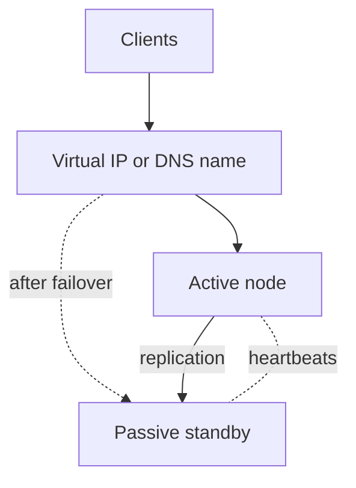
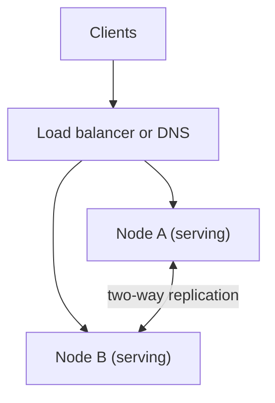

import { Aside } from '@astrojs/starlight/components';

Availability is the fraction of time, or of requests, for which a system does its job. Every component eventually fails, so high availability comes from **redundancy** plus a fast, reliable way to **switch to the redundant copy**. Then you measure the result against a target the business agreed to. This page covers the patterns, the arithmetic and the operating practices.

<Aside type="tip" title="TL;DR">
- Two building blocks: **failover** (a standby takes over, or all copies serve at once) and **replication** (keep the standby's data current).
- Components **in series multiply** availabilities, so each dependency lowers the total. Redundant components **in parallel multiply failure probabilities**, which raises the total, but only if failures are independent.
- Each extra nine cuts allowed downtime tenfold: 99.9% is about 8.8 hours a year, 99.99% is about 53 minutes.
- Set an **SLO**, treat the gap to 100% as an **error budget**, and spend it on releases. Stop when it is gone.
- Spread across **Availability Zones** by default. Go multi-Region only when the requirement justifies the cost and the consistency trade-offs.
</Aside>

## Failover

### Active-passive

One node serves traffic. A standby receives replicated data and watches the active node through heartbeats or a health check. When the active node fails, the standby takes over its virtual IP, DNS name or leader role and starts serving.



How fast the standby can take over depends on how "warm" it is:

| Standby | State while waiting | Recovery time (RTO) | Data loss (RPO) | Cost |
|---|---|---|---|---|
| Hot | Running, fully provisioned, data replicated continuously | Seconds to a minute | Zero with synchronous replication, seconds with asynchronous | About 2× the active node |
| Warm | Running at reduced size, data replicated | Minutes (must scale up) | Seconds | Moderate |
| Cold | Not running; rebuilt from images and backups | Hours | Everything since the last backup | Lowest |

**RTO** (recovery time objective) is how long you may be down. **RPO** (recovery point objective) is how much recent data you may lose. AWS's disaster-recovery guidance names the same ladder: *backup and restore*, *pilot light*, *warm standby* and *multi-site active/active*.

Managed databases mostly use the hot active-passive pattern. Examples are a primary with a synchronous standby in another zone, or a Raft group that elects a new leader.

### Active-active

All nodes serve traffic at once. A load balancer or DNS spreads requests between them, and a failed node is simply removed from rotation.



For stateless tiers, active-active is the default: there is nothing to replicate. For stateful tiers it means multi-leader or leaderless writes, so you must decide how concurrent writes to the same data are resolved. See [consistency patterns](/fundamentals/consistency-patterns/).

### Downsides of failover

- **Lost writes.** With asynchronous replication, writes acknowledged by the old primary but not yet copied are lost or must be reconciled later.
- **Split brain.** If the standby wrongly decides the active node is dead, for example during a network partition, both may accept writes. Prevent it with a quorum or witness that decides who leads, leases that expire, and **fencing** that cuts off the old leader's access to storage.
- **Detection is a trade-off.** Short timeouts cause false failovers and flapping. Long timeouts mean longer outages. Detection time is roughly check interval × failure threshold: 10 s × 3 = 30 s before failover even starts.
- **Clients must follow.** DNS changes take effect only after cached TTLs expire, connection pools hold dead connections, and some clients cache IP addresses forever.
- **Idle or reserved capacity.** A passive node does no useful work. Active-active nodes need headroom: two nodes must each run below 50% so that one can carry the full load.
- **Failover paths rot.** A path used once a year often fails when needed. Exercise it regularly (game days, planned switchovers).

## Replication

Failover is only as good as the standby's copy of the data. Leader-follower (primary-replica), multi-leader and leaderless replication each trade data-loss risk, write latency and complexity differently. The legacy names "master-slave" and "master-master" appear in older material. Details are on the [replication](/data/replication/) page.

## Availability in numbers

Availability is usually written as a number of nines. The table uses a 365.25-day year; a month is one twelfth of that.

| Availability | Per year | Per month | Per week | Per day |
|---|---|---|---|---|
| 99% ("two nines") | 3 d 15 h 40 min | 7 h 18 min | 1 h 41 min | 14 min 24 s |
| 99.9% ("three nines") | 8 h 46 min | 43 min 50 s | 10 min 5 s | 1 min 26 s |
| 99.95% | 4 h 23 min | 21 min 55 s | 5 min 2 s | 43 s |
| 99.99% ("four nines") | 52 min 36 s | 4 min 23 s | 1 min 0.5 s | 8.6 s |
| 99.999% ("five nines") | 5 min 16 s | 26 s | 6 s | 0.9 s |

At four nines, a single failover that takes two minutes uses almost half of a month's budget. A human cannot be paged and respond within that budget, so higher nines require **automated** detection and recovery. The [availability calculator](/reference/availability-numbers/) converts between targets and downtime.

Availability can be measured by time ("minutes in which the service was healthy") or by requests ("successful requests ÷ valid requests"). Request-based measurement reflects what users experienced and is the usual choice for SLOs.

## Components in series and in parallel

**In series**, a request needs every component, so availabilities multiply:

```text
A_total = A1 × A2 × … × An
```

- Load balancer 99.99% → app tier 99.95% → database 99.95%: `0.9999 × 0.9995 × 0.9995 ≈ 99.89%`, about 9.6 hours of downtime a year. That is worse than any single part.
- Ten critical dependencies at 99.99% each give `0.9999^10 ≈ 99.90%`. Ten four-nines services make a three-nines product.

**In parallel**, the request fails only if every redundant copy fails, so the probabilities of *failure* multiply:

```text
A_total = 1 − (1 − A1) × (1 − A2) × … × (1 − An)
```

- Two app servers at 99.5% each: `1 − 0.005² = 99.9975%`, about 13 minutes a year.
- Put that pair between the 99.99% load balancer and the 99.95% database: `0.9999 × 0.999975 × 0.9995 ≈ 99.94%`. The un-replicated database now dominates. Find the weakest series link and make it redundant.

Two caveats:

- **Parallel maths assumes independent failures.** Two replicas in the same rack, behind the same switch, running the same bad deploy or reading the same broken config fail together. Correlated failures are why real systems rarely reach the theoretical numbers. Spread replicas across failure domains and roll out changes gradually.
- **The rule of the extra nine.** Google SRE authors suggest that each critical dependency should be about ten times more reliable than the service that depends on it. A 99.99% service needs 99.999% dependencies, or must be designed to survive their failure.

## SLIs, SLOs, SLAs and error budgets

- **SLI** (service level indicator): a measured quantity. Examples: fraction of requests that succeed, fraction served under 300 ms.
- **SLO** (service level objective): the internal target for an SLI over a window, e.g. "99.9% of requests succeed, measured over 30 days".
- **SLA** (service level agreement): a contract with customers that attaches consequences, usually service credits, to missing a target. SLAs are set looser than internal SLOs so that the team reacts before the contract is breached. Cloud SLAs often depend on your architecture. AWS's EC2 Region-level SLA of 99.99% applies only to workloads running across two or more Availability Zones; a single instance is covered at 99.5%.

The **error budget** is `1 − SLO`. With a 99.9% SLO over 30 days the budget is 43.2 minutes of full outage. In request terms, it is 100,000 failed requests out of 100 million. The budget turns reliability into a shared decision:

- While budget remains, ship features, run experiments and take risks.
- When it is spent, an agreed **error budget policy** applies: freeze risky releases and spend engineering time on reliability until the service is back within its SLO.
- Alert on **burn rate** rather than on single errors. Burning 2% of a 30-day budget in one hour (a burn rate of 14.4) is worth a page. A slow burn becomes a ticket.

100% is the wrong target. Users cannot tell 99.999% from 100% through their own networks and devices, and each extra nine costs much more than the last.

## Multi-AZ and multi-Region

An **Availability Zone** (AZ) is one or more data centres with independent power, cooling and networking, close enough to its sibling zones for low-latency links. A **Region** is a group of AZs in one geographic area.

| | Multi-AZ | Multi-Region |
|---|---|---|
| Protects against | Data-centre failures: power, cooling, network, local disasters | Region-wide outages, large disasters, some control-plane failures |
| Replication | Synchronous is practical (about 1 ms round trip) | Usually asynchronous (tens to hundreds of ms); synchronous costs write latency |
| Typical RPO / RTO | Zero / seconds to minutes | Seconds or more / minutes, unless designed active-active |
| Cost and complexity | Moderate; most managed services do it for you | High: data residency, conflict handling, global routing, testing |

**Static stability** is a key idea from AWS. Pre-provision enough capacity that losing a zone needs **no** emergency scaling, because the control plane you would call may be impaired too. With three AZs, run each at no more than about two thirds of its tested capacity. Losing one zone then leaves the other two at full but safe load. That means roughly 50% over-provisioning. The October 2025 us-east-1 outage showed why: a DNS fault in DynamoDB left new EC2 launches failing for hours, while instances that were already running kept working.

## Health checks

Failover and load balancing depend on knowing which instances are healthy.

- **Liveness**: is the process up and responding? On failure, restart it. In Kubernetes a failed liveness probe restarts the container.
- **Readiness**: can it serve traffic right now (warmed up, connected to its dependencies)? On failure, remove it from rotation but do not restart it. In Kubernetes a failed readiness probe removes the pod from service endpoints.
- **Shallow vs deep checks.** A check that also tests the database catches more problems. But when the shared database blips, every instance fails at once, and the load balancer removes the whole fleet. Keep load-balancer checks mostly local. Many load balancers **fail open**: when every instance reports unhealthy, they send traffic to all of them, so a bad check does not cause a total outage.
- Check from outside too. Synthetic probes from several locations catch DNS, certificate and routing failures that internal checks miss.

## Graceful degradation

Availability is not all-or-nothing. A system that loses part of its function should still serve the rest:

- **Serve stale data** from cache when the source of truth is down, and mark it as possibly outdated.
- **Turn off non-critical features** with feature flags: recommendations, personalisation, search suggestions. Keep checkout and login running.
- **Shed load** before overload spreads. Reject low-priority requests early with `429` or `503`, so high-priority ones still succeed. See [rate limiting](/reliability/rate-limiting/).
- **Fall back to read-only mode** when writes are impossible, for example during a database failover.
- **Bound every dependency** with timeouts and circuit breakers so that one slow service does not tie up all threads. See [resilience patterns](/reliability/resilience-patterns/).

## Trade-offs

| Pattern | Gains | Costs |
|---|---|---|
| Active-passive (hot) | Simple model, one writer, fast failover | Idle capacity, split-brain risk, data loss with async replication |
| Active-passive (cold) | Cheapest | Hours of downtime, data loss since last backup |
| Active-active | No failover step, all capacity used | Must keep headroom; write conflicts for stateful data |
| Multi-AZ | Survives data-centre loss with little latency cost | Cross-AZ traffic charges, roughly 50% extra capacity for static stability |
| Multi-Region | Survives Region loss, serves users closer | Cost, complexity, consistency vs latency trade-offs, harder testing |
| Graceful degradation | Partial service instead of outage | Product decisions about what to drop, more code paths to test |

<Aside type="note" title="In the interview">
- Turn "highly available" into numbers: ask for the SLO, then derive the downtime budget and whether a human can respond in time.
- Walk the request path and multiply availabilities. Name the weakest series component and make it redundant.
- When you add a standby, state RPO and RTO and how split brain is prevented (quorum, leases, fencing).
- Expect "what happens if an AZ or Region goes down?" Explain capacity headroom (static stability), DNS or global load-balancer failover, and replication lag.
- Common mistakes: assuming replicas fail independently, deep health checks that take down the whole fleet, and promising five nines with a manual failover.
</Aside>

## Further reading

- [Embracing Risk](https://sre.google/sre-book/embracing-risk/) — Google SRE book chapter that introduces error budgets.
- [Alerting on SLOs](https://sre.google/workbook/alerting-on-slos/) — the SRE workbook's guide to burn-rate alerts.
- [The Calculus of Service Availability](https://cacm.acm.org/practice/the-calculus-of-service-availability/) — how dependencies limit availability, and the "extra nine" rule.
- [Static stability using Availability Zones](https://builder.aws.com/content/3K9SiqiJ369TGkkGzqPM95BuYWI/static-stability-using-availability-zones) — Amazon Builders' Library on surviving a zone loss without reacting.
- [Implementing health checks](https://builder.aws.com/content/3Ev53O39izHCtWLzp4XU6t8PC1O/implementing-health-checks) — liveness, local and dependency checks, and why load balancers fail open.
- [Disaster recovery options in the cloud](https://docs.aws.amazon.com/whitepapers/latest/disaster-recovery-workloads-on-aws/disaster-recovery-options-in-the-cloud.html) — backup and restore, pilot light, warm standby and active/active compared.

## Related topics

- [Availability numbers](/reference/availability-numbers/) — calculator for nines, downtime and composed availability.
- [Replication](/data/replication/) — how the standby's data stays current.
- [Load balancers](/traffic/load-balancers/) — health checks and active-active traffic distribution.
- [DNS](/traffic/dns/) — DNS-based failover and the TTL caveat.
- [Resilience patterns](/reliability/resilience-patterns/) — timeouts, retries and circuit breakers that keep partial failures partial.
- [Observability](/reliability/observability/) — measuring SLIs and alerting on burn rate.
