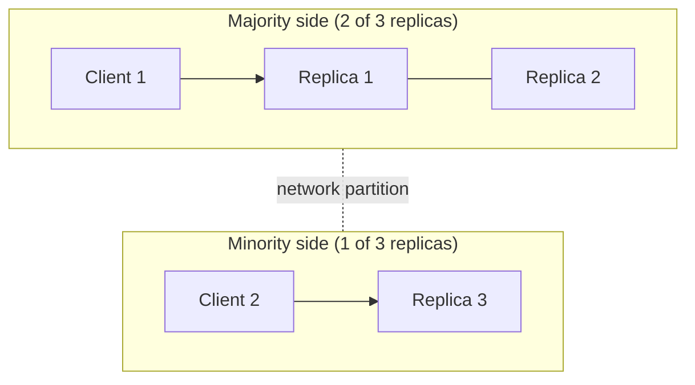

import { Aside } from '@astrojs/starlight/components';

The CAP theorem is the most quoted and most misquoted result in distributed systems. Stated precisely, it is narrow: **when the network partitions, a replicated system must either refuse some requests or risk returning stale or conflicting data.** PACELC adds the trade-off that matters the rest of the time: even with a healthy network, stronger consistency costs latency.

<Aside type="tip" title="TL;DR">
- CAP applies **only during a network partition**. Then each operation either stays consistent (some requests fail or time out) or stays available (some answers may be stale or conflict).
- Partitions are not optional in a distributed system, so "pick 2 of 3" is misleading. The real choice is **C or A when P happens**, and it can differ per operation.
- **CP-style**: etcd, CockroachDB, Spanner — the minority side of a partition stops serving consistent requests. **AP-style**: Cassandra at low consistency levels, DynamoDB global tables in their default mode — every side keeps answering and reconciles later.
- **PACELC**: if **P**artitioned, choose **A** or **C**; **E**lse, choose **L**atency or **C**onsistency. The "else" half drives everyday design.
- Quorums with `R + W > N` make reads overlap the latest write. They are the usual tuning knob between the two.
</Aside>

## What the theorem actually says

Eric Brewer stated CAP as a conjecture in 2000; Seth Gilbert and Nancy Lynch proved a formal version in 2002. The definitions are stricter than the everyday words:

- **Consistency (C)** means **linearizability**: the system behaves as if there were one copy of the data. Every read returns the latest completed write, or something newer. It is *not* the C in ACID.
- **Availability (A)** means **every request to a non-failing node gets a non-error response**, eventually. "Most requests succeed" is not enough.
- **Partition tolerance (P)** means the system keeps its guarantees even if the network drops or delays messages between groups of nodes for any length of time.

The theorem: in a network that can lose messages, no system can provide both C and A for all requests. The proof is short. Put two replicas on opposite sides of a partition and send a write to one and a read to the other. The second replica must either answer, possibly with stale data (giving up C), or wait or fail until the partition heals (giving up A).

So the trade-off is **forced only while a partition is happening**. When the network is healthy, a system can be both consistent and available.

## CP and AP behaviour

What the minority side does with Client 2's request is the CP/AP choice:

| | CP behaviour | AP behaviour |
|---|---|---|
| Write on minority side | Rejected or times out (no quorum) | Accepted locally, replicated after healing |
| Read on minority side | Error, or redirect to the majority | Answered from local data, possibly stale |
| After the partition heals | Nothing to reconcile | Conflicting writes must be merged: last-writer-wins, application merge, or CRDTs |
| Good fit | Locks, leader election, configuration, money movement, uniqueness checks | Shopping carts, likes and counters, session data, caches, DNS |

### CP examples

- **etcd** runs Raft and serves **linearizable** reads and writes by default. Only a side holding a majority can commit. A client cut off with a minority gets errors, unless it explicitly asks for a *serializable* (possibly stale) read. This is why Kubernetes keeps its cluster state in etcd.
- **ZooKeeper** needs a quorum for every write. Reads, though, are served by whichever server the client is connected to and can be stale. A client calls `sync()` first to catch up with the leader, and even that is not strictly linearizable, because `sync` is not a quorum operation. So ZooKeeper is consistent for writes but not linearizable for reads by default. This is a good example of why the CP label is too coarse.
- **CockroachDB** describes itself as CP. Writes need a majority of replicas, reads are served by a leaseholder, and a range that loses its majority becomes unavailable rather than inconsistent.
- **Google Spanner** is CP: a Paxos group that cannot form a quorum stops accepting writes. Brewer argues it is "effectively CA": Google's private network makes partitions rare, and he reports better than five nines of availability internally.

### AP and tunable examples

- **Apache Cassandra** (and the original Dynamo design it borrows from) lets each request choose a consistency level. With `ONE`, any reachable replica can serve a read or write, so the system stays available and may return stale data. With `QUORUM` on both reads and writes, a majority of replicas must answer, so a minority partition cannot serve that request.
- **Amazon DynamoDB** within one Region replicates each partition to three Availability Zones. A leader elected with Multi-Paxos handles writes and strongly consistent reads, and a write needs two of three replicas. Default reads are eventually consistent and can come from any replica. **Global tables** offer two modes. **Multi-Region eventual consistency** (the default) accepts writes in every Region and resolves conflicts with last-writer-wins — AP across Regions. **Multi-Region strong consistency** (generally available since June 2025) replicates each write synchronously to another Region before acknowledging it. It runs in exactly three Regions: three replicas, or two plus a DynamoDB-managed witness. That makes it CP across Regions.

## Common misconceptions

- **"Pick two of three."** You cannot pick "CA" for a system that spans a network, because you cannot choose to have no partitions. A system that is "CA" simply breaks in undefined ways when a partition happens. Only a single-node system is truly CA.
- **"Our database is CP" (or AP).** Most systems make different choices per operation, per table or per consistency setting. Many fit neither label exactly, like ZooKeeper's reads above. Describe the behaviour of the specific operation instead.
- **"AP means it is always up."** CAP availability is about partitions, not about crashes, bugs, overload or bad deploys. A CP system with a quorum on the majority side is still *highly* available in practice: only clients stuck on the minority side see errors.
- **"Consistency" means ACID consistency.** In CAP it means linearizability of single operations. It says nothing about transactions, invariants or isolation levels.
- **"Partitions are rare, so CAP is irrelevant."** Partitions include switch failures, misconfigured firewalls, long GC pauses and overloaded links. They happen often enough at scale. More important, the latency cost of coordination is paid on *every* request, not only during partitions. That is what PACELC captures.

## PACELC: the trade-off when nothing is broken

Daniel Abadi's **PACELC** extends CAP: *if there is a Partition, choose Availability or Consistency; Else, choose Latency or Consistency.* Keeping replicas strictly in sync means waiting for a quorum or a remote Region on each write, and sometimes on each read. Serving from the nearest replica without waiting is faster but may be stale.

| System (default configuration) | If partitioned | Else | Notes |
|---|---|---|---|
| Cassandra, Riak, original Dynamo | PA | EL | Low consistency levels by default; quorum levels move toward C |
| DynamoDB, single Region | PC | EL | Writes need the leader and a quorum; default reads are eventually consistent. Strongly consistent reads → EC |
| DynamoDB global tables, multi-Region eventual | PA | EL | Every Region accepts writes; last-writer-wins |
| DynamoDB global tables, multi-Region strong | PC | EC | Writes wait for a second Region |
| Google Spanner | PC | EC | Externally consistent by default; stale reads are an opt-in EL path |
| CockroachDB | PC | EC | Serializable by default; follower reads are an opt-in EL path |
| etcd | PC | EC | Linearizable by default; serializable reads are an opt-in EL path |
| HBase, Bigtable (one cluster) | PC | EC | Each key range is served by one server at a time. Bigtable replication across clusters is eventually consistent by default |

The pattern in modern databases is **consistent by default, latency on request**. You get strong guarantees unless you explicitly ask for a stale read from a nearby replica (Spanner stale reads, CockroachDB follower reads, DynamoDB eventually consistent reads).

## Quorums in brief

With `N` replicas, a write waits for `W` acknowledgements and a read queries `R` replicas. If `R + W > N`, every read set overlaps every write set in at least one replica, so a read can see the latest acknowledged write.

| N | W | R | Overlap? | Behaviour |
|---|---|---|---|---|
| 3 | 2 | 2 | Yes | Classic majority quorum; tolerates one slow or failed replica |
| 3 | 3 | 1 | Yes | Fast reads; any replica failure blocks writes |
| 3 | 1 | 1 | No | Fastest and most available; reads may be stale |
| 5 | 3 | 3 | Yes | Tolerates two failed replicas |

Overlap alone is not full linearizability. Concurrent writes, partially failed writes and "sloppy" quorums (writing to substitute nodes during failures) can still produce anomalies. Systems add read repair, consensus (Raft, Paxos) or compare-and-set operations when they need the strict guarantee. The mechanics are covered in [replication](/data/replication/).

## Trade-offs

| | Favour consistency (CP / EC) | Favour availability and latency (AP / EL) |
|---|---|---|
| During a partition | Minority side returns errors | All sides keep serving |
| Normal-case latency | Quorum or cross-Region round trips on writes (often reads too) | Local replica answers immediately |
| Application complexity | Simple: behaves like one copy | Must handle stale reads and merge conflicts |
| Typical use | Ledgers, inventory reservation, locks, metadata, uniqueness | Feeds, carts, counters, telemetry, caches |

<Aside type="note" title="In the interview">
- Do not open with "I'll pick AP". Ask which operations need which guarantee. Example: "Checking out must not oversell, so inventory reservation is CP. The product page can show a slightly stale stock count."
- Expect "what happens during a partition?" Describe what the minority side does for reads and for writes, and how conflicts are resolved afterwards.
- Mention PACELC when cross-Region latency comes up: synchronous replication across continents adds tens to hundreds of milliseconds to every write.
- Common mistakes: calling a system "CA", confusing CAP consistency with ACID, and treating CP as "frequently down".
</Aside>

## Further reading

- [CAP Twelve Years Later: How the "Rules" Have Changed](https://www.infoq.com/articles/cap-twelve-years-later-how-the-rules-have-changed/) — Eric Brewer (2012) on why "2 of 3" misleads.
- [Perspectives on the CAP Theorem](https://groups.csail.mit.edu/tds/papers/Gilbert/Brewer2.pdf) — Gilbert and Lynch revisit their formal proof and its definitions.
- [Consistency Tradeoffs in Modern Distributed Database System Design](https://www.cs.umd.edu/~abadi/papers/abadi-pacelc.pdf) — Daniel Abadi's PACELC paper (IEEE Computer, 2012).
- [Please stop calling databases CP or AP](https://martin.kleppmann.com/2015/05/11/please-stop-calling-databases-cp-or-ap.html) — Martin Kleppmann on why the labels hide what matters.
- [Spanner, TrueTime and the CAP Theorem](https://research.google/pubs/spanner-truetime-and-the-cap-theorem/) — Brewer (2017) on how a CP system can be "effectively CA".
- [CAP FAQ](https://github.com/henryr/cap-faq) — short answers to the questions people actually ask.

## Related topics

- [Consistency patterns](/fundamentals/consistency-patterns/) — the models between "eventual" and "linearizable".
- [Replication](/data/replication/) — leader-based, multi-leader and leaderless replication, and how quorums are implemented.
- [Availability patterns](/fundamentals/availability-patterns/) — fail-over and redundancy, which CAP says nothing about.
- [NoSQL](/data/nosql/) — the stores that made tunable consistency mainstream.
- [SQL or NoSQL](/data/sql-or-nosql/) — choosing a datastore with these trade-offs in mind.
- [Consensus and coordination](/fundamentals/consensus-and-coordination/) — how CP systems actually agree: majority quorums, Raft and what a partition costs the minority side.
