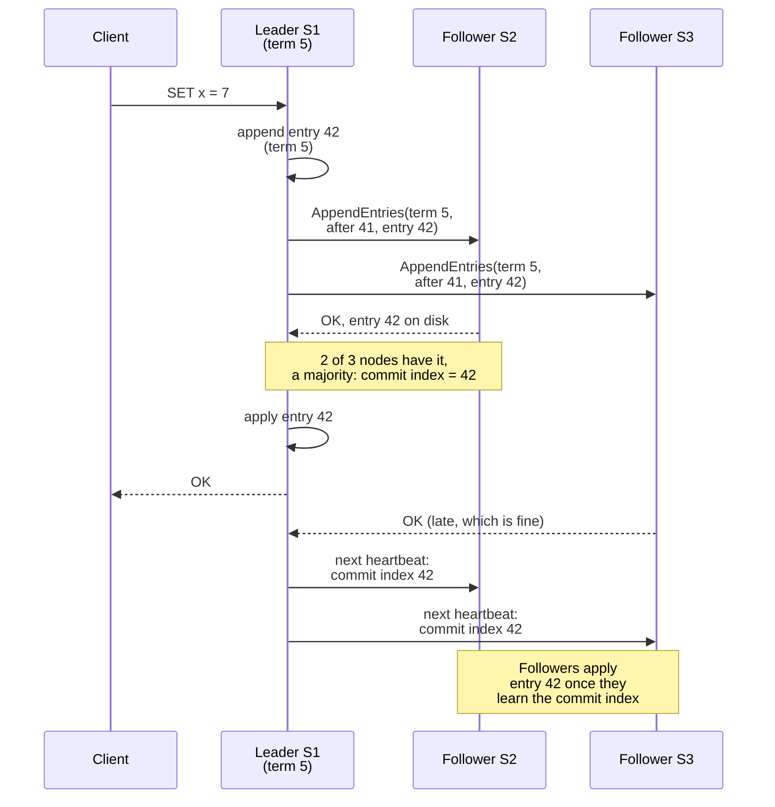
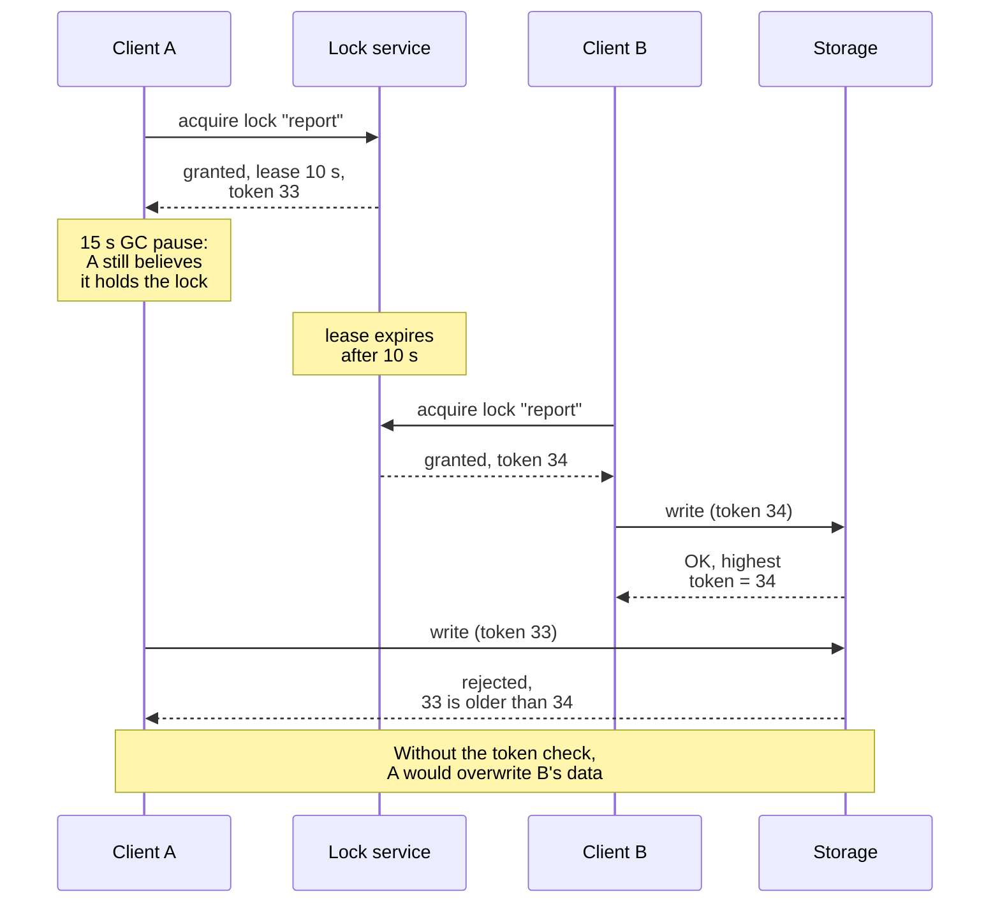

import { Aside } from '@astrojs/starlight/components';

Some decisions in a distributed system must be made once and seen the same way by every node: who the leader is, which nodes are in the cluster, where a shard lives, who holds a lock. **Consensus** makes a group of unreliable machines agree on such a decision and never take it back. You will rarely implement it, but most designs depend on it somewhere, and interviewers probe its costs and failure modes.

<Aside type="tip" title="TL;DR">
- Consensus lets nodes agree on a value, or an ordered log, while some of them crash. It needs a **majority**: `2f + 1` nodes tolerate `f` failures, so 3 nodes survive 1 and 5 survive 2.
- **Raft** (etcd, Consul, CockroachDB, Kafka's KRaft) and **Multi-Paxos** (Chubby, Spanner, DynamoDB) behave alike in steady state: a leader appends to a log and commits once a majority has stored the entry.
- Each write costs at least one round trip to a majority: 1–2 ms inside a cloud region, 80 ms or more across an ocean.
- A lock that expires (a **lease**) cannot stop a paused client from writing after it lost the lock. The resource must check **fencing tokens** or use conditional writes.
- Most "exactly once" problems need **idempotency**, not a lock. When you do need agreement, use your database or a coordination service; do not build your own.
</Aside>

## Why distributed systems need agreement

- **Leader election.** Exactly one node may accept writes for a shard or run a singleton job. Two leaders mean **split brain** and diverging data.
- **Membership.** Which nodes are in the cluster, and which replicas are in sync and may become leader.
- **Configuration and metadata.** Shard placement, schema versions, routing tables, feature flags.
- **Locks and leases.** Only one worker may process a job or own a resource at a time.

All of this is easy on one machine. On several, messages are delayed or lost, nodes crash and return, and a slow node looks exactly like a dead one.

## The consensus problem in one paragraph

Nodes propose values and must all **decide the same one** (agreement); it must be a value someone proposed (validity); and every node that keeps running must eventually decide (termination). Repeat this for every slot of a log and you get **state machine replication**: replicas apply the same commands in the same order and end in the same state. The **FLP result** (Fischer, Lynch and Paterson, 1985) proves that in a fully asynchronous network, no deterministic algorithm can guarantee termination if even one process may crash. Practical algorithms therefore keep **safety** (never decide two values) unconditionally and reach **liveness** (eventually decide) only when the network behaves for long enough, using timeouts and randomisation. Under a bad partition a consensus system stalls rather than diverges: the CP choice from [CAP theorem and PACELC](/fundamentals/cap-theorem/).

## Quorums and majority math

A decision counts once a **majority** of voting nodes has accepted it. Any two majorities share at least one node, so a new leader always meets someone who knows every committed decision, and two leaders can never both commit conflicting entries.

| Voting nodes | Majority | Failures tolerated | Follower acks per write | Typical use |
|---|---|---|---|---|
| 3 | 2 | 1 | 1 | The default: etcd, Consul servers, KRaft controllers, a CockroachDB range |
| 5 | 3 | 2 | 2 | Survives a planned upgrade plus one surprise failure; the Raft paper's "typical" size |
| 7 | 4 | 3 | 3 | Practical ceiling: the etcd FAQ advises no more than seven members |

- **Use odd sizes.** Four nodes need 3 votes and still tolerate only one failure. The fourth node adds cost and latency, not resilience.
- **More voters, slower writes.** Each write waits for more acknowledgements. To scale reads, add **non-voting members**: etcd learners, ZooKeeper observers, Spanner read-only replicas.
- **Spread voters across failure domains.** Three voters in three zones survive a zone outage; three voters in two zones may not.

## Raft in plain words

Raft (Ongaro and Ousterhout, 2014) was designed to be understandable. It splits consensus into leader election, log replication and safety rules.

- **Terms.** Time is divided into numbered terms, each starting with an election and having at most one leader. Every message carries the sender's term. A node that sees a higher term becomes a follower, and requests with an older term are rejected. This is what makes a deposed leader harmless.
- **Leader election.** The leader sends heartbeats. A follower that hears nothing for an **election timeout** becomes a candidate: it increments the term, votes for itself and requests votes. Each node votes once per term, and only for a candidate whose log is at least as up to date as its own. A majority of votes makes a leader. Timeouts are randomised (150–300 ms in the paper's example) so split votes are rare.
- **Log replication.** The leader appends each client command to its log and sends it to followers with `AppendEntries`, together with the index and term of the preceding entry. A follower whose log differs rejects the message, and the leader walks back and repairs that follower's log.
- **Commit index.** An entry is **committed** once it is stored on a majority. The leader applies it, answers the client and advertises the new commit index so followers apply it too. A new leader commits older-term entries only indirectly, by committing an entry from its own term after them.



Three practical details:

- **Reads.** A leader cut off by a partition may not know it was replaced. A linearizable read either confirms leadership with a heartbeat round to a majority (*ReadIndex*) or relies on a time-based **leader lease** (see below). In etcd a linearizable read goes through a quorum, so it costs at least one round trip between members.
- **Membership changes** go through the log too, with rules that stop the old and new configurations from forming separate majorities. Add a node as a non-voting learner first and promote it once it has caught up.
- **Pre-vote.** A node returning from a partition has inflated its term and would force a needless election. With pre-vote, a candidate first checks that it could win. etcd enables it by default; Kafka 4.0 added it to KRaft.

## Paxos and Multi-Paxos in brief

Lamport's **Paxos**, explained in prose in *Paxos Made Simple* (2001), agrees on a single value. **Proposers**, **acceptors** and **learners** run two phases:

1. **Prepare / promise.** A proposer picks a unique, increasing number and asks a majority of acceptors to ignore lower numbers. They report any value they have already accepted.
2. **Accept / accepted.** The proposer asks the majority to accept a value, reusing the highest-numbered value reported in phase 1 if there is one. A value is chosen once a majority accepts it.

Safety holds however many proposers compete; progress needs one distinguished proposer, a leader. **Multi-Paxos** runs an instance per log slot, and a stable leader runs phase 1 once for all future slots. Each command then costs one round trip to a majority, as in Raft. Raft is essentially Multi-Paxos with stricter rules (only up-to-date candidates win, logs have no holes) that make it easier to implement. ZooKeeper's **Zab** and **Viewstamped Replication** (1988) are close relatives.

## Where consensus lives in practice

| System | Protocol | What the group agrees on | Notes |
|---|---|---|---|
| etcd (Kubernetes' backing store) | Raft | All Kubernetes API objects, including Leases | Schedulers and controller managers elect leaders via Leases. Not sharded; meant for metadata up to several GB |
| ZooKeeper | Zab | A tree of small znodes, sessions, watches | Writes go through the leader and a quorum; a zxid is leader epoch plus counter |
| Consul | Raft among 3 or 5 servers per datacenter | Catalog, key-value store, sessions | Client agents do not vote; gossip handles membership and failure detection |
| Kafka (KRaft) | Pull-based Raft variant (KIP-595) | Cluster metadata: topics, partitions, leaders | 3 or 5 controllers; ZooKeeper removed in Kafka 4.0 (March 2025) |
| Google Spanner | Paxos groups over key-range splits | Writes to those splits | Witness replicas vote but hold no full copy and serve no reads |
| CockroachDB | Raft per range, 3 replicas by default | Writes to that range | The leaseholder serves reads and is normally also the Raft leader |
| TiKV (TiDB) | Raft per Region (Multi-Raft) | Writes to that Region (256 MiB by default) | Many small groups instead of one big one |

Coordination services run **one** group over a little critical data. Distributed SQL databases run **thousands** of small groups, one per range, so write capacity grows with the number of ranges. Kafka shows a third option: Raft for metadata, but in-sync replicas (ISR) for partition data. A majority needs `2f + 1` copies to survive `f` failures; ISR needs only `f + 1`, but each write waits for every in-sync replica.

## Leases and why clocks matter

A **lease** is a lock with an expiry: "you are leader for 10 seconds unless you renew". If the holder dies, the lease runs out and someone else takes over, with no human involved. A **leader lease** also lets a leader serve linearizable reads locally, without a quorum round, because no other leader can exist while the lease is valid. The 2012 Spanner paper used 10-second Paxos leader leases; CockroachDB serves reads from its leaseholder.

Leases depend on time, and time is unreliable:

- **Clock drift and steps.** Quartz clocks drift, and NTP may step the wall clock backwards or forwards. Measure lease durations with a **monotonic** clock and leave a margin for drift between holder and grantor.
- **Process pauses.** A garbage-collection pause or VM migration can freeze a process for seconds. When it resumes, it does not know its lease expired. No clock fixes this; only the resource can protect itself (next section).
- **Timeouts set failover time.** etcd defaults to a 100 ms heartbeat and a 1 s election timeout, and advises an election timeout of at least ten round-trip times. Kubernetes' scheduler and controller manager use 15-second leases, so a crashed leader is replaced within about 15 seconds.

Systems that need globally ordered timestamps treat uncertainty explicitly:

- **TrueTime** (Spanner) returns an interval `[earliest, latest]`, backed by GPS receivers and atomic clocks. The 2012 paper reports about 1–7 ms of uncertainty. A transaction waits it out (**commit wait**) before its timestamp becomes visible, so commit order matches real time.
- **Hybrid logical clocks** (HLC, 2014) pair physical time with a logical counter: close to wall-clock time, yet respecting causality. CockroachDB uses HLC with a 500 ms maximum clock offset by default; a node whose clock is off from at least half the others by 80% of that limit shuts itself down.
- **Cloud clocks improved.** Amazon Time Sync reports error bounds typically under 100 µs over NTP and under 40 µs from the PTP hardware clock. The open-source ClockBound daemon exposes them as TrueTime-style intervals.

## Distributed locks and fencing tokens

Kleppmann separates two uses of a distributed lock. An **efficiency** lock avoids duplicate work; a rare double run only wastes money. A **correctness** lock stops concurrent writes from corrupting data. For the second kind, a lease alone fails:



A **fencing token** increases every time the lock is granted. The client attaches it to each write, and the storage atomically rejects any token lower than the highest it has accepted. Coordination services hand out such numbers: an etcd key's revision, a ZooKeeper zxid or znode version, Chubby's *sequencer*. Kafka fences "zombie" producers the same way, with an epoch number. etcd's documentation says plainly that its lock API cannot provide mutual exclusion on its own, and Jepsen's 2020 analysis of etcd 3.4.3 saw lock holders overlap, even in healthy clusters, and recommended the lock key's revision as a fencing token.

### The Redlock debate

**Redlock** takes a lock on a majority (3 of 5) of independent Redis nodes and treats it as valid for the TTL minus the time spent acquiring it. In 2016 Kleppmann argued it is unsafe for correctness: it depends on bounded pauses, network delays and clock behaviour, and it issues no monotonic fencing token. Redis creator Salvatore Sanfilippo [replied](https://antirez.com/news/101) that Redlock assumes only that clocks advance at roughly the same *rate*, not that they are synchronised; that a pause after acquisition hurts every lease-based lock equally; and that a store able to check tokens could check a random unique value with compare-and-set instead.

The two sides agree on more than the debate suggests. No lease-based lock, from Redis, etcd or anywhere else, stops a paused client by itself. Today's Redis documentation also recommends fencing tokens and warns that Redis expiry does not use a monotonic clock. In practice: a single Redis node with `SET key value NX PX ttl` is fine for efficiency locks; for correctness, make the resource reject stale writers.

## Often you need idempotency, not a lock

Many "only one worker may do this" problems are really "this must take effect once" problems. Exactly-once *delivery* over an unreliable network is impossible; exactly-once *side effects* are not. Deliver at least once and make processing idempotent:

- **Idempotency keys with a unique constraint**, stored in the same transaction as the effect, so retries and duplicate workers become harmless (see [resilience patterns](/reliability/resilience-patterns/)).
- **Conditional writes.** `UPDATE ... SET status = 'shipped', version = 8 WHERE id = 42 AND version = 7` succeeds only if nobody changed the row first. DynamoDB condition expressions work alike, and Amazon S3 added `If-None-Match` (August 2024) and `If-Match` (November 2024) conditional writes.
- **Deduplicating consumers** that record processed message IDs with the result. Kafka transactions cover only loops that stay inside Kafka (see [event streaming](/async/event-streaming/)).
- **Idempotency keys passed downstream** to payment and email APIs, because an email cannot be rolled back.

```sql
-- Safe to run any number of times: later runs insert nothing.
INSERT INTO payments (idempotency_key, order_id, amount_cents)
VALUES ('9b2e4c1a', 1001, 4999)
ON CONFLICT (idempotency_key) DO NOTHING;
```

These use the consistency your database already has, add no moving parts and survive pauses. A best-effort lock can still sit in front of them to save work.

## What consensus costs

A commit needs the entry durably stored on a majority. With three voters, that is roughly **one round trip to the nearest follower plus one log `fsync`**; the leader writes its own copy in parallel. Using the site's [latency numbers](/reference/latency-numbers/) and about 1 ms for a durable write to a network-attached cloud volume:

| Three voters placed in | Round trip to nearest follower | Commit latency | Dependent commits per second |
|---|---|---|---|
| One availability zone | ~0.2 ms | ≈ 1.2 ms | ≈ 830 |
| Three zones in one region | ~1 ms | ≈ 2 ms | ≈ 500 |
| Three regions: leader in Western Europe, followers in US East and California | ~80 ms (US East) | ≈ 81 ms | ≈ 12 |
| Same, client in California | +145 ms to reach the leader | ≈ 226 ms | ≈ 4 |

- **Across regions, distance dominates.** If US East fails, the nearest follower is California and commits slow to about 146 ms. Keep the leader and a majority near the writers; distributed SQL databases let you pin a range's leaseholder to its home region.
- **Throughput is not latency.** Leaders batch and pipeline many entries per round trip, so a cross-region cluster commits far more than 12 writes per second in total. A chain of dependent steps (lock, write, unlock) still pays the full latency at each step.
- **Failover takes timeouts.** Election timeouts span several round trips; across regions that means seconds.
- **Disks matter.** etcd warns that slow `fsync` on the leader can cost it leadership. Give coordination services fast, dedicated disks.

## When not to run your own consensus

Implementing Raft or Paxos correctly takes years, and testing it is harder. Prefer, in order:

1. **Your database.** A unique constraint, a transaction or a conditional write in PostgreSQL, DynamoDB, Spanner or CockroachDB already gives agreement on a row. Most job claims and "only once" checks belong here.
2. **Your platform.** On Kubernetes, use Lease objects and a leader-election library. Managed Kubernetes runs etcd for you; cloud databases run their consensus groups for you.
3. **A coordination service you already operate** (etcd, ZooKeeper, Consul), with 3 or 5 voters across zones. Keep only small, critical metadata there, and keep it off the per-request hot path.
4. **An embedded Raft library** (etcd's `raft`, HashiCorp's `raft`) only if you are building a database or infrastructure product, with fault-injection testing to match.

## Trade-offs

| Approach | Good for | Costs and risks |
|---|---|---|
| Conditional write or unique constraint in your database | One-time effects, inventory, job claims | Bound to one database; hot rows serialise |
| Coordination service (etcd, ZooKeeper, Consul) | Leader election, membership, configuration, fenced locks | Another critical system; small data only; quorum round trip per write |
| Consensus inside the datastore (Spanner, CockroachDB, KRaft) | Strongly consistent data and metadata at scale | Commit latency is the majority round trip; cross-region writes are slow |
| Redis lock (single node or Redlock) | Efficiency locks that avoid duplicate work | No fencing token; timing assumptions; unsafe alone for correctness |
| Idempotency plus at-least-once delivery | Payments, messages, retries, exactly-once side effects | Key storage and expiry; every consumer must cooperate |

<Aside type="note" title="In the interview">
- When a design needs a leader, a lock or shared configuration, name the mechanism: "the scheduler elects a leader through an etcd lease", not "we'll use consensus". Never offer to implement Paxos.
- Do the majority math aloud: five voters tolerate two failures, four tolerate one, and a cross-region commit costs a round trip to the nearest majority.
- Expect "what if the lock holder pauses or is partitioned?" Answer with fencing tokens or conditional writes.
- For leader election, expect split brain and stale reads from a deposed leader. Terms, quorum reads and leader leases are the answers.
- For "exactly once", answer with at-least-once delivery plus idempotency, not a distributed lock.
- Common mistakes: even-sized quorums, trusting wall-clock time, treating a Redis lock as a correctness guarantee, and putting the coordination service on every request path.
</Aside>

## Further reading

- [In Search of an Understandable Consensus Algorithm](https://raft.github.io/raft.pdf) — the extended Raft paper by Ongaro and Ousterhout. The [Raft site](https://raft.github.io/) adds an interactive visualisation, talks and the PhD dissertation.
- [Paxos Made Simple](https://lamport.azurewebsites.net/pubs/paxos-simple.pdf) — Leslie Lamport's short prose explanation of Paxos and replicated state machines.
- [How to do distributed locking](https://martin.kleppmann.com/2016/02/08/how-to-do-distributed-locking.html) — Martin Kleppmann on leases, pauses, fencing tokens and Redlock.
- [etcd: why etcd, and notes on lock and lease usage](https://etcd.io/docs/v3.7/learning/why/) — what a coordination service is for, and why its locks need revision checks.
- [Jepsen: etcd 3.4.3](https://jepsen.io/analyses/etcd-3.4.3) — strictly serializable key-value operations, unsafe locks, and the fencing fix.
- [Designing Data-Intensive Applications, 2nd edition](https://www.oreilly.com/library/view/designing-data-intensive-applications/9781098119058/) — Kleppmann and Riccomini (2026); chapter 9 covers clocks and pauses, chapter 10 consistency and consensus.

## Related topics

- [CAP theorem and PACELC](/fundamentals/cap-theorem/) — why a consensus system stops on the minority side and pays latency the rest of the time.
- [Consistency patterns](/fundamentals/consistency-patterns/) — linearizability, the guarantee consensus provides.
- [Replication](/data/replication/) — failover and split brain, which consensus makes safe.
- [Service discovery and service mesh](/architecture/service-discovery-and-mesh/) — registries built on etcd, ZooKeeper and Consul.
- [Resilience patterns](/reliability/resilience-patterns/) — idempotency keys and retries, the practical alternative to locks.
- [Foundational papers](/real-world/foundational-papers/) — Paxos, Chubby, ZooKeeper, Spanner and Raft in context.
