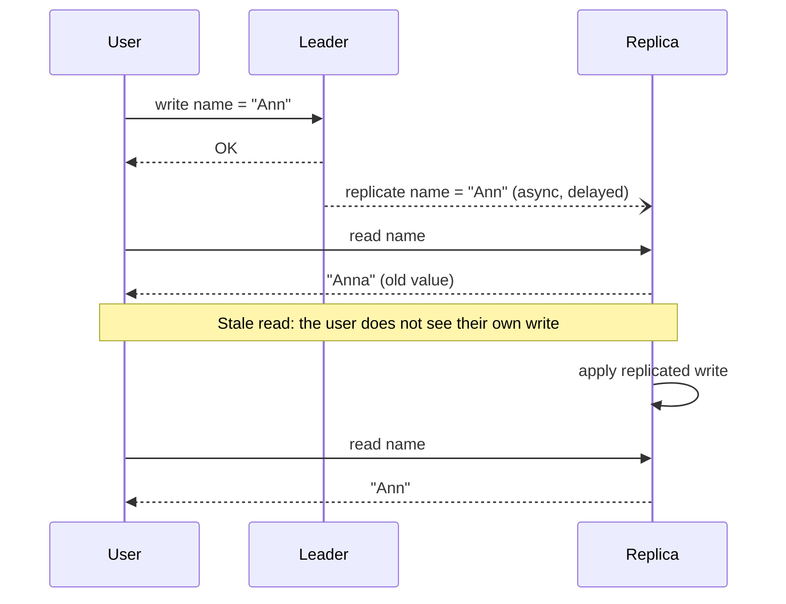

import { Aside } from '@astrojs/starlight/components';

As soon as data has more than one copy — replicas, caches, Regions, a phone working offline — the copies can disagree for a while. A **consistency model** is the contract that says which disagreements a reader may observe. Choosing a model is a choice about latency, availability and how much the application code must cope with.

<Aside type="tip" title="TL;DR">
- The classic three: **weak** (a read may never see a write), **eventual** (it will, once updates stop), **strong** (it does immediately).
- Between eventual and strong sits a useful middle: **read-your-writes**, **monotonic reads**, **causal** and **bounded staleness**. These fix most user-visible anomalies at a fraction of the cost of strong consistency.
- **Linearizability** behaves like a single copy in real time. It needs synchronous coordination (consensus or quorums) and cannot stay available on the minority side of a partition.
- Session guarantees are cheap: sticky routing, or a version token the client sends back with each request.
- Pick per operation. A bank balance and a like counter do not need the same guarantee.
</Aside>

## The classic three

### Weak consistency

After a write, a read may or may not return it. No effort is made to converge.

- **Example:** real-time media and games. If a video call drops packets for two seconds, nobody wants the lost audio replayed later — the stream moves on. Best-effort caches are similar: a cache node that restarts empty simply loses what it held.
- **Implementation:** fire-and-forget updates, UDP streams, caches with no invalidation guarantees.

### Eventual consistency

If writes stop, all replicas converge to the same value after some time. In the meantime a read may return an old value. "Eventually" has no upper bound in the definition. In practice the lag is milliseconds to seconds on a healthy system, and much longer during failures.

- **Example:** DNS, social media counters, product catalogues, DynamoDB's default reads, cross-Region replicas.
- **Implementation:** asynchronous replication from a leader, or leaderless replication with anti-entropy (read repair, background Merkle-tree sync). Concurrent writes need a conflict rule: last-writer-wins, version vectors with application merge, or CRDTs.

### Strong consistency

After a write completes, every later read sees it. Usually this means **linearizability** (below).

- **Example:** account balances, inventory reservation, uniqueness constraints (usernames), leader election and locks.
- **Implementation:** a single leader that handles all reads and writes for a key, synchronous replication to a quorum, or consensus (Raft, Paxos).

## A stale read under eventual consistency

The write succeeded and nothing is broken. The user still sees their change "disappear", which feels like a bug. Most of the models below exist to remove exactly this kind of surprise without paying for full strong consistency.

## The wider spectrum

From strongest to weakest:

| Model | Guarantee | Where it matters | Typical implementation |
|---|---|---|---|
| Strict serializability | Transactions appear in one order that respects real time | Multi-row money movement, global uniqueness | Consensus plus synchronised clocks (Spanner's TrueTime) or a single sequencer |
| Linearizability | Single-object operations appear atomic and in real-time order | Locks, leader election, compare-and-set, config | Leader with quorum commit (Raft, Paxos) and leader or quorum reads |
| Sequential | Everyone sees the same order of operations, and each client's operations in program order, but possibly lagging real time | Replicated logs, coordination services | Total-order broadcast; reads from a lagging but ordered replica |
| Causal | If A could have influenced B, everyone sees A before B; unrelated writes may appear in any order | Comments and replies, chat, collaborative editing | Dependency tracking with vector clocks or causal tokens |
| Bounded staleness | Reads are at most K versions or T seconds behind | Dashboards, leaderboards, geo-replicated reads | Replica tracks its lag; serves only if within bound, else redirects or blocks |
| Read-your-writes | A client always sees its own writes | Profile edits, posting a comment, settings | Sticky routing, read from leader after a write, or wait for replica to reach the client's last write position |
| Monotonic reads | A client never sees data go backwards | Pagination, timelines, inboxes | Stick a client to one replica, or carry a "read at least version V" token |
| Eventual | Replicas converge if writes stop | Counters, catalogues, DNS, caches | Async replication, anti-entropy, conflict resolution |

### Linearizability

The system behaves as if there were one copy of each object, and every operation takes effect at one instant between its start and its end. Once any client has seen a new value, no client can later see the old one.

- **Why it matters:** "check then act" logic is only safe on a linearizable store. Examples: acquiring a lock, claiming a username, decrementing stock.
- **How:** route all operations for a key through a leader that commits with a majority (etcd, Spanner, CockroachDB). Reads must also be linearizable: they go through the leader with a valid lease, or confirm with a quorum. Otherwise a deposed leader can serve stale data.
- **Cost:** at least one quorum round trip per write. The minority side of a [partition](/fundamentals/cap-theorem/) cannot serve requests.

Do not confuse it with **serializability**, an isolation level for transactions. Serializability says transactions appear in *some* serial order, not necessarily the real-time one. **Strict serializability** combines both. Spanner's "external consistency" is this combination.

### Sequential consistency

All clients observe the same order of operations, and each client's own operations appear in the order it issued them. Unlike linearizability, that order may lag behind real time. A client can read a value that was already overwritten elsewhere, as long as everyone sees the overwrite in the same position later. ZooKeeper is close to this model. Writes go through a leader in one global order, and each client's updates are applied in the order sent. A follower may serve a read that is a little behind; `sync()` forces it to catch up first.

### Causal consistency

Writes that are causally related are seen in the same order by everyone. A reply is never visible before the post it answers. Concurrent, unrelated writes may appear in different orders on different replicas.

- **Why it matters:** it rules out the anomalies people notice: answers before questions, a "permission removed" followed by a photo that was meant to be hidden.
- **How:** each write carries its dependencies, as a vector clock or a token naming the versions the writer had seen. A replica delays making a write visible until its dependencies are visible. MongoDB's causally consistent sessions do this with cluster-time tokens. They need majority read and write concerns to get all guarantees.
- **Cost:** metadata per write, and some waiting for dependencies. Causal consistency is about the strongest model that can stay available during a partition, provided each client keeps talking to the same replicas.

### Session guarantees: read-your-writes and monotonic reads

These are guarantees for **one client's session**, and they are cheap.

- **Read-your-writes:** after you post a comment, you see it, even if other users see it a second later. Implementations:
  - route the user's reads to the leader for a short window after they write;
  - pin the session to one replica (sticky routing);
  - return the write's log position (an LSN or version) to the client and have replicas wait until they have applied it before answering.
- **Monotonic reads:** if you saw version 5, you never then see version 4. Refreshing a page must not make a new message vanish. The usual fix is to keep the client on the same replica, or send an "at least version V" token with each read.
- Related guarantees: **monotonic writes** (a client's writes apply in order) and **writes-follow-reads** (a write is ordered after the data it was based on). Azure Cosmos DB's default **Session** level bundles these for a client.

### Bounded staleness

Reads may be stale, but by no more than a stated amount: K versions or T seconds. Examples: Cosmos DB's *bounded staleness* level, Spanner's bounded-staleness reads, CockroachDB's `with_max_staleness()` follower reads.

- **Why it matters:** it turns "eventually" into a number you can reason about and put in an SLO. A leaderboard that is at most 5 s old is fine. One that is "eventually" correct may be hours behind during an incident.
- **How:** replicas track how far behind they are (replication timestamps, closed timestamps). A replica outside the bound redirects the read to a fresher replica or blocks it. Cosmos DB instead throttles writes when a Region falls too far behind.

## Converging without coordination: CRDTs

When several replicas accept writes independently (multi-leader, offline-first apps, multi-Region active-active), concurrent updates must be merged. **Last-writer-wins** is simple but silently drops one of the writes. **Version vectors** detect concurrent versions and hand them to the application to merge; Amazon's original Dynamo shopping cart worked this way. **CRDTs** (conflict-free replicated data types) are data structures whose merge is mathematically guaranteed to converge regardless of delivery order. Examples are grow-only counters, observed-remove sets and sequence types for collaborative text. They give strong eventual consistency without coordination. The price is restricted operations and metadata overhead.

## Trade-offs

| Model | Latency cost | Available in a partition? | Application burden |
|---|---|---|---|
| Linearizable / strict serializable | Quorum round trip per write (often per read); cross-Region if replicas span Regions | No, on the minority side | Lowest: behaves like one copy |
| Sequential | Quorum on writes; local reads | No, for writes | Low; reads may lag |
| Causal | Small metadata; occasional wait for dependencies | Yes, if the client sticks to its replicas | Moderate: concurrent writes still conflict |
| Session guarantees | Near zero (routing or tokens) | Yes, while the session's replica is reachable | Low for the user's own view |
| Bounded staleness | Local reads while within bound | Degrades to blocking or redirecting when the bound is exceeded | Must accept K versions or T seconds of staleness |
| Eventual | Lowest | Yes | Highest: stale reads, conflict resolution |

<Aside type="note" title="In the interview">
- Name the model per feature: "Payments are strongly consistent; the feed is eventually consistent with read-your-writes for the author."
- When you add read replicas or a cache, expect "a user updates their profile and refreshes — what do they see?" Answer with a concrete read-your-writes mechanism.
- Know the difference between linearizability and serializability. Interviewers use it to separate memorised answers from real understanding.
- For multi-Region active-active, say how conflicts are resolved (last-writer-wins, merge, CRDT) and what data can be lost.
- Common mistake: saying "strong consistency" without explaining how reads avoid stale replicas.
</Aside>

## Further reading

- [Consistency Models](https://jepsen.io/consistency/models) — Jepsen's map of models, with precise definitions and which ones can stay available.
- [Replicated Data Consistency Explained Through Baseball](https://www.microsoft.com/en-us/research/publication/replicated-data-consistency-explained-through-baseball/) — Doug Terry's six guarantees, illustrated with one baseball game.
- [Eventually Consistent — Revisited](https://www.allthingsdistributed.com/2008/12/eventually_consistent.html) — Werner Vogels on client-side variants and N/W/R quorums.
- [Causal consistency and read and write concerns](https://www.mongodb.com/docs/manual/core/causal-consistency-read-write-concerns/) — how a production database exposes session guarantees.
- [Consistency levels in Azure Cosmos DB](https://learn.microsoft.com/en-us/azure/cosmos-db/consistency-levels) — five levels from strong to eventual, with clear definitions of bounded staleness and session.
- [About CRDTs](https://crdt.tech/) — the community hub for conflict-free replicated data types.

## Related topics

- [CAP theorem and PACELC](/fundamentals/cap-theorem/) — why strong models cost availability and latency.
- [Replication](/data/replication/) — the replication schemes that produce each model.
- [Cache strategies](/caching/cache-strategies/) — caches are replicas too, with their own staleness.
- [Event streaming](/async/event-streaming/) — ordered logs as a way to get consistent derived views.
- [Availability patterns](/fundamentals/availability-patterns/) — what consistency you keep during fail-over.
