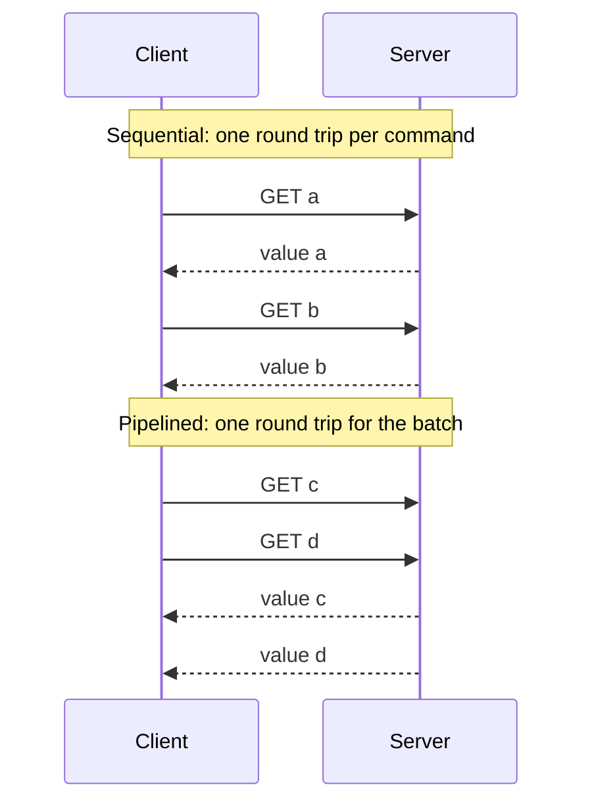

import { Aside } from '@astrojs/starlight/components';

**Latency** is how long one operation takes. **Throughput** is how many operations finish per unit of time. They are linked by queueing. As throughput approaches capacity, requests start waiting for each other and latency climbs, slowly at first and then very steeply. Most performance targets come down to getting the most throughput your latency budget allows.

<Aside type="tip" title="TL;DR">
- Report latency as **percentiles** (p50, p99, p99.9), never as an average. The average hides exactly the requests users complain about.
- **Fan-out amplifies the tail**: if 1% of servers are slow at any moment, a request touching 100 servers hits at least one slow server 63% of the time.
- **Little's law**: requests in flight = arrival rate × time in system (`L = λW`). Use it to size thread pools, connection pools and queues.
- Latency explodes as **utilisation approaches 100%**. A single queue at 90% busy has 10× the response time of an idle one. Plan headroom.
- **Batching and pipelining** buy throughput by paying per-batch costs once. Batching can add latency; pipelining usually lowers it.
</Aside>

## Definitions

- **Latency** — time from sending a request to receiving the response, measured where the user feels it. It includes network time, waiting in queues and the actual work. **Service time** is the work alone, without the waiting.
- **Throughput** — completed operations per second (requests/s, messages/s, MB/s).
- **Bandwidth** — the maximum rate a link or device can carry. Throughput is what you actually achieve; bandwidth is the ceiling.

A water pipe is the usual picture: latency is how long one drop takes to travel the pipe, throughput is litres per second. A long, wide pipe has high latency *and* high throughput. Shipping a crate of disks across a country moves petabytes per day with a latency of days. The [latency numbers](/reference/latency-numbers/) page lists typical costs of memory, disk and network operations.

## Percentiles, not averages

Latency distributions are skewed: most requests are fast, and a few are very slow because of garbage collection pauses, cache misses, retries, noisy neighbours or lock waits. An average mixes the two groups into a number that describes no real request.

Take 1,000 requests: 940 take 20 ms, 45 take 80 ms, 10 take 400 ms and 5 take 2.5 s.

| Statistic | Value | What it tells you |
|---|---|---|
| Mean | 38.9 ms | Nearly twice the typical request; describes nobody |
| p50 (median) | 20 ms | The typical experience |
| p95 | 80 ms | One request in 20 is at least this slow |
| p99 | 400 ms | One in 100 — a user making 100 calls per session sees it in most sessions (63%) |
| p99.9 | 2,500 ms | The tail that timeouts and retries are built around |

Practical rules:

- Set targets on percentiles: "p99 under 300 ms for 99.9% of minutes" is something you can test.
- **Do not average percentiles** across servers or time windows. The mean of ten servers' p99 values is not the fleet's p99. Store histograms (HDR histograms, Prometheus histograms, t-digests) and compute percentiles from the merged data.
- Your heaviest users tend to see the tail most often, because they make the most requests and have the largest data.
- Load generators that wait for each response before sending the next one under-report the tail. When the server stalls, they stop sending, so the stall barely shows in the results. This is called **coordinated omission**. Use open-model load generators that keep a fixed arrival rate.

## Tail latency amplification under fan-out

A page often fans out to many backends in parallel, for example a search that queries 100 index shards. The response is only as fast as the **slowest** shard. If each server is independently slow with probability `p`, the chance that a request touching `N` servers meets at least one slow one is `1 − (1 − p)^N`.

| Servers touched (N) | p = 1% slow | p = 0.1% slow |
|---|---|---|
| 1 | 1.0% | 0.1% |
| 10 | 9.6% | 1.0% |
| 100 | 63.4% | 9.5% |

So a backend's p99 becomes the frontend's *median* at a fan-out of about 70. Dean and Barroso's *The Tail at Scale* describes how Google copes:

- **Hedged requests**: send the request to a second replica if the first has not answered within, say, the p95 latency. This costs only a few percent extra load and cuts the tail sharply.
- **Tied requests**: enqueue on two servers and let the first one that starts cancel the other.
- **Fewer, smaller hops**: lower the fan-out, return partial results ("good enough" search), and keep slow background work off serving machines.
- **Budget per hop**: give each downstream call a deadline derived from the end-to-end target, and propagate it.

## Little's law

For any stable system, averaged over a long enough period:

```text
L = λ × W
L = average number of requests in the system (in flight)
λ = average arrival rate (= throughput when the system keeps up)
W = average time a request spends in the system (latency)
```

It holds regardless of arrival pattern or scheduling, which makes it the most useful formula in capacity planning.

**Worked example.** An API receives 2,000 requests/s and each request spends on average 150 ms in the service. Then `L = 2,000 × 0.15 = 300` requests are in flight at any moment.

- A worker pool of 200 threads (one request per thread) can sustain at most `200 / 0.15 ≈ 1,333` requests/s at that latency. To serve 2,000/s you need at least 300 threads plus headroom, or less time per request.
- If each request holds a database connection for 5 ms, a pool of 40 connections caps the service at `40 / 0.005 = 8,000` queries/s.
- Read it backwards during an incident: if in-flight requests jump from 300 to 3,000 while traffic is flat, latency has grown roughly tenfold somewhere downstream.

## Queueing: why latency explodes near 100% utilisation

**Utilisation** `ρ` is the fraction of time a server is busy: arrival rate × service time. The classic single-server model (M/M/1: random arrivals, random service times, one worker) gives a mean response time of `W = S / (1 − ρ)`, where `S` is the service time. With `S` = 10 ms:

| Utilisation ρ | Mean response time | × service time | Avg. requests in system | Approx. p99 |
|---|---|---|---|---|
| 50% | 20 ms | 2× | 1 | 92 ms |
| 80% | 50 ms | 5× | 4 | 230 ms |
| 90% | 100 ms | 10× | 9 | 461 ms |
| 95% | 200 ms | 20× | 19 | 921 ms |
| 99% | 1,000 ms | 100× | 99 | 4.6 s |

The curve is a hockey stick. Going from 50% to 80% busy costs 30 ms on average. Going from 95% to 99% costs 800 ms. Real systems are not exactly M/M/1, but the shape holds. A pool of many workers sharing one queue stays flat for longer: with 10 workers the mean is still about 17 ms at 90% busy. It still turns sharply near 100%.

Consequences for design:

- **Keep headroom.** Run latency-sensitive services at moderate average utilisation, so that peaks, failovers and noisy neighbours do not push them up the curve.
- **Variability hurts as much as load.** Bursty arrivals and a mix of tiny and huge requests both lengthen queues. Isolate expensive request types in their own pools.
- **Bound every queue.** An unbounded queue turns overload into minutes of latency and memory exhaustion. Reject or shed load early instead. See [queues and back pressure](/async/queues-and-back-pressure/).
- **Rising p99 is an early warning.** Tail latency climbs before averages move, so alert on it.

## Batching and pipelining

Both techniques raise throughput by amortising fixed per-operation costs: a network round trip, a disk flush, a system call.

**Batching** groups many items into one operation. If a disk flush costs 2 ms, flushing every message caps a writer at 500 messages/s. Flushing batches of 100 reaches 50,000 messages/s with the same disk. The price is latency: an item may wait for the batch to fill or for a timer to fire. Kafka producers expose this trade directly as `linger.ms` (how long to wait for more records) and `batch.size`. Kafka 4.0 raised the default `linger.ms` from 0 to 5 ms: a few milliseconds of waiting usually buys much larger, cheaper batches.

**Pipelining** sends the next request without waiting for the previous response. With a 1 ms round trip, 1,000 sequential commands take at least 1 s. Pipelined, they cost roughly one round trip plus server time. This reduces latency *and* raises throughput, as long as each request does not depend on the previous answer. Redis pipelining, HTTP/2 and HTTP/3 multiplexing, and database protocol pipelining all apply this idea.



## Trade-offs

| Lever | Throughput | Latency | Watch out for |
|---|---|---|---|
| Larger batches | Up | Up (waiting to fill) | Memory, all-or-nothing failures |
| Pipelining / multiplexing | Up | Down | Head-of-line blocking, ordering assumptions |
| Higher utilisation | Up (per dollar) | Up sharply near 100% | No headroom for spikes or failover |
| Parallel fan-out | Up (work split) | Tail amplified | Slowest shard sets the pace |
| Hedged requests | Slightly down | Tail down | Extra load; requests must be idempotent |
| Caching | Up | Down for hits | Staleness, cold-start misses |

<Aside type="note" title="In the interview">
- State latency targets as percentiles ("p99 under 200 ms"), and say where they are measured.
- When you add a fan-out (scatter-gather search, feed assembly), mention tail amplification and one mitigation: hedging, partial results or per-hop deadlines.
- Use Little's law to size pools and to sanity-check estimates aloud. Interviewers like the "in-flight = rate × latency" step.
- If asked to "just run servers at 90% to save money", explain the queueing curve and the need for failover headroom.
- Common mistake: treating throughput and latency as independent knobs. They are coupled through queueing.
</Aside>

## Further reading

- [The Tail at Scale](https://cacm.acm.org/research/the-tail-at-scale/) — Dean and Barroso (CACM, 2013) on fan-out, hedged and tied requests.
- [Service Level Objectives](https://sre.google/sre-book/service-level-objectives/) — Google SRE book chapter on choosing latency indicators and why percentiles beat means.
- [Latency Sneaks Up On You](https://brooker.co.za/blog/2021/08/05/utilization.html) — Marc Brooker on utilisation, queueing and why p99 is an overload early-warning signal.
- [Tail Latency Might Matter More Than You Think](https://brooker.co.za/blog/2021/04/19/latency.html) — how chained and fanned-out calls make rare slow responses common.
- [Redis pipelining](https://redis.io/docs/latest/develop/using-commands/pipelining/) — a concrete, measured example of round-trip amortisation.

## Related topics

- [Latency numbers](/reference/latency-numbers/) — the orders of magnitude to keep in your head.
- [Performance vs scalability](/fundamentals/performance-vs-scalability/) — why adding servers stops helping.
- [Queues and back pressure](/async/queues-and-back-pressure/) — bounding queues and shedding load.
- [Resilience patterns](/reliability/resilience-patterns/) — timeouts, retries and hedging in practice.
- [Observability](/reliability/observability/) — histograms, percentiles and SLO alerting.
