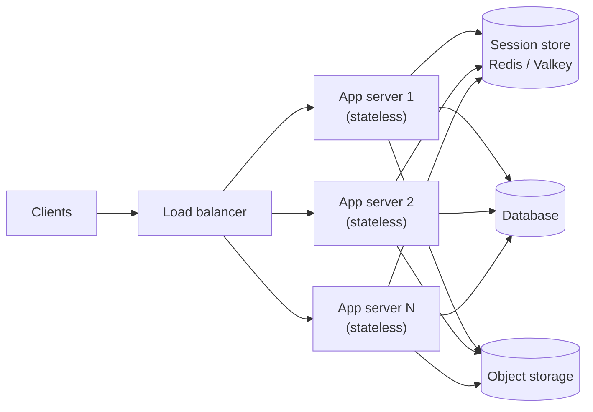

import { Aside } from '@astrojs/starlight/components';

Performance and scalability are related but different questions. **Performance** asks how quickly the system handles one unit of work. **Scalability** asks what happens to that speed, and to the bill, as the amount of work grows. Most design discussions are really about the second question, so it helps to keep the two apart from the first minute.

<Aside type="tip" title="TL;DR">
- A **performance problem** shows up with one user: every request is slow. A **scalability problem** shows up under load: one user is fine, ten thousand are not.
- A system scales well when adding resources adds capacity roughly in proportion, and the cost per request stays flat or falls.
- **Scale up** (bigger machine) first while it is cheap. **Scale out** (more machines) when you hit the ceiling or need redundancy. Scaling out only works for **stateless** tiers or for data you can split.
- **Amdahl's law**: the serial part of the work caps the speed-up. The **Universal Scalability Law** adds coordination cost, which can make throughput *fall* as you add nodes.
- The classic path: clone stateless app servers, scale the database, add caches, move slow work to queues.
</Aside>

## Two kinds of slow

A quick diagnostic separates the two problems:

| Symptom | Likely problem | Typical fixes |
|---|---|---|
| A single request on an idle system takes 2 s | Performance | Profile, fix the N+1 query, add an index, use a better algorithm |
| p99 latency is fine at 100 RPS and terrible at 5,000 RPS | Scalability | Add capacity, remove the shared bottleneck, cache, partition |
| Throughput stops growing when you add servers | Scalability (contention) | Find the shared resource: a lock, a primary database, a hot key |
| Throughput *drops* when you add servers | Scalability (coherency cost) | Reduce cross-node chatter, partition the data, avoid global locks |

A system scales well when adding resources raises capacity in proportion. The capacity can mean more requests per second, bigger datasets or more tenants. Adding redundancy should not make it slower either. Performance work and scalability work feed each other. A request that takes half the CPU time also halves the number of servers you need.

## Scaling up vs scaling out

**Vertical scaling** (scale up) means a bigger machine: more cores, RAM, faster disks. **Horizontal scaling** (scale out) means more machines behind a [load balancer](/traffic/load-balancers/).

| | Scale up | Scale out |
|---|---|---|
| Code changes | None | Service must be stateless, or the data must be partitioned |
| Ceiling | The largest machine you can buy or rent | Very high, limited by coordination and shared dependencies |
| Failure | One box is a single point of failure | Losing one node removes `1/N` of capacity |
| Cost curve | Rises steeply at the top end | Roughly linear, plus the cost of the coordination layer |
| Operations | Simple | Deployment, discovery, monitoring of many nodes |

In 2026 the vertical ceiling is far higher than when the original primer was written. Cloud providers rent single machines with hundreds of cores and multiple terabytes of RAM; the largest AWS high-memory instance (`u7inh-32tb.480xlarge`) has 1,920 vCPUs and 32 TiB. A single well-tuned PostgreSQL primary with read replicas carries many products further than people expect. So a reasonable default is to scale up until it becomes expensive or risky, and to design for scale-out where you know you will need it. The [load balancers](/traffic/load-balancers/) page covers the mechanics of scale-out.

## Stateless services: the precondition for cloning

A service is **stateless** when any instance can serve any request, because nothing a request needs lives only in one instance's memory or local disk. State still exists — it just lives in a shared place:

- Sessions and short-lived user state go to a shared cache (Redis or Valkey) or into a signed token the client carries.
- Uploaded files go to [object storage](/data/object-storage/), not the local disk.
- Durable data stays in the database; work in progress goes to a [queue](/async/queues-and-back-pressure/).



Once the app tier is stateless you can add or remove instances freely, use autoscaling, and deploy by replacing instances built from the same image. The hard part of scaling moves to the stateful tier, which is why most of this site is about data.

## Why adding machines stops helping

### Amdahl's law

If a fraction `p` of the work can run in parallel and the rest is serial, the best speed-up on `N` workers is `1 / ((1 − p) + p / N)`. The serial part sets a hard limit of `1 / (1 − p)`, no matter how many machines you add.

| Parallel fraction | 8 workers | 32 workers | 128 workers | Limit |
|---|---|---|---|---|
| 95% | 5.9× | 12.5× | 17.4× | 20× |
| 99% | 7.5× | 24.4× | 56.4× | 100× |

In a web system the "serial part" is anything every request must pass through one at a time: a single primary database, a global lock, a sequence generator, a hot row.

### The Universal Scalability Law

Neil Gunther's **Universal Scalability Law (USL)** adds a second penalty. Besides **contention** (waiting for a shared resource, the Amdahl term), nodes pay a **coherency** cost to keep each other's data in sync. Coherency cost grows with the number of node pairs, roughly `N²`. Relative capacity is:

```text
C(N) = N / (1 + α(N − 1) + βN(N − 1))
α = contention (queueing for shared resources)
β = coherency  (cross-node coordination)
```

With α = 0.05 and β = 0.001, capacity is 5.7× at 8 nodes and peaks at about 9× around 31 nodes. Past that point it falls: 7.8× at 64 nodes and 5.4× at 128. Adding servers then makes the system *slower*. The practical lessons:

- Measure throughput at several cluster sizes and fit the curve before buying hardware.
- Reduce α by removing shared bottlenecks: partition data, avoid global locks.
- Reduce β by avoiding all-to-all communication: gossip, chatty cache invalidation and cluster-wide transactions all add to it.

## The four classic moves

The *Scalability for Dummies* series (see Further reading) describes a path most web products follow. Here it is in short, with links to the detailed pages:

1. **Clones.** Make the app tier stateless and run identical instances behind a load balancer. Build every instance from the same image so they never drift. See [load balancers](/traffic/load-balancers/) and [monolith and microservices](/architecture/monolith-and-microservices/).
2. **Database.** The single database becomes the bottleneck next. Options are read replicas, [partitioning and sharding](/data/partitioning-and-sharding/), denormalising the hot paths ([denormalization and tuning](/data/denormalization-and-tuning/)), or a store built to scale out ([SQL or NoSQL](/data/sql-or-nosql/)). In practice, add read replicas and a cache before you shard. See also [replication](/data/replication/).
3. **Cache.** Keep hot, expensive-to-compute objects in memory so most reads never reach the database. Cache whole objects rather than raw query results, so invalidation stays simple. See [caching layers](/caching/caching-layers/) and [cache strategies](/caching/cache-strategies/).
4. **Asynchronism.** Do slow work ahead of time (pre-render, pre-compute) or after the response (queue it and notify later). This keeps request latency flat while total work grows. See [queues and back pressure](/async/queues-and-back-pressure/) and [event streaming](/async/event-streaming/).

The order still holds in 2026. Managed services now handle much of each step: managed load balancers, managed databases with replicas, managed caches and queues.

## Cost is a scalability dimension

A system that handles ten times the load at forty times the cost does not scale in any useful sense. Track **cost per unit of work**: per request, per active user, per GB stored. Watch how it changes with load.

- **Sub-linear is the goal.** Caches, batching and economies of scale should make the thousandth customer cheaper than the first.
- **Idle capacity is a cost.** Autoscaling, serverless functions and scale-to-zero databases trade some cold-start latency for paying only for use. Redundancy you keep for availability is a deliberate cost; size it on purpose.
- **Distributed is not automatically efficient.** McSherry, Isard and Murray found that many published big-data systems needed hundreds of cores to match one well-written single-threaded program, and some never matched it at all. Their **COST** metric is the hardware needed before a platform beats that single thread. A simpler design on one big machine is often both faster and cheaper.
- **People cost too.** Every extra moving part needs on-call, upgrades and expertise. Count that before splitting a service or adding a datastore.

## Trade-offs

| Choice | You gain | You pay |
|---|---|---|
| Scale up | No code change, strong consistency for free, simple operations | Hard ceiling, steep price at the top, single point of failure |
| Scale out (stateless tier) | Near-linear capacity, rolling deploys, redundancy | Shared state must move out of the process; more infrastructure |
| Scale out (data tier) | Capacity beyond one machine | Cross-partition queries, rebalancing, weaker guarantees or costly coordination |
| Cache | Large read capacity cheaply | Stale data, invalidation bugs, cold-start stampedes |
| Asynchronous processing | Flat request latency, smoothing of spikes | Eventual results, retries, idempotency, harder debugging |

<Aside type="note" title="In the interview">
- Interviewers expect you to ask about scale before designing: requests per second, data size, growth. Then to say where the first bottleneck will be. A [back-of-the-envelope estimate](/start/estimation/) is the usual tool.
- Do not jump to sharding or microservices for a load that one database handles. Saying "one primary plus replicas is enough until about X writes per second" scores better than over-engineering.
- Expect "what happens at 10× traffic?" Walk the classic order: stateless app tier, then a cache and read replicas for reads, then queues for slow work, and only then partitioning for writes.
- A common mistake is a design that claims horizontal scaling but keeps sessions or files on local disks.
- Mention cost and operational load, not only throughput.
</Aside>

## Further reading

- [CS75 Lecture 9: Scalability (Harvard, David Malan)](https://www.youtube.com/watch?v=-W9F__D3oY4) — a classic one-hour lecture: vertical and horizontal scaling, caching, load balancing, replication, partitioning.
- *Scalability for Dummies* (Le Cloud blog): [Part 1 — Clones](https://www.lecloud.net/post/7295452622/scalability-for-dummies-part-1-clones), [Part 2 — Database](https://www.lecloud.net/post/7994751381/scalability-for-dummies-part-2-database), [Part 3 — Cache](https://www.lecloud.net/post/9246290032/scalability-for-dummies-part-3-cache), [Part 4 — Asynchronism (archived copy)](https://web.archive.org/web/20260208184538/http://www.lecloud.net/post/9699762917/scalability-for-dummies-part-4-asynchronism).
- [A Word on Scalability](https://www.allthingsdistributed.com/2006/03/a_word_on_scalability.html) — Werner Vogels' short definition of what "scalable" should mean.
- [How to Quantify Scalability](https://www.perfdynamics.com/Manifesto/USLscalability.html) — Neil Gunther on the Universal Scalability Law, with the formula and its derivation.
- [Scalability! But at what COST?](https://www.usenix.org/conference/hotos15/workshop-program/presentation/mcsherry) — McSherry, Isard and Murray (HotOS 2015) on measuring scalability against a single-threaded baseline.

## Related topics

- [Latency vs throughput](/fundamentals/latency-vs-throughput/) — how to measure "fast" and why queues make load hurt.
- [Load balancers](/traffic/load-balancers/) — the mechanics of horizontal scaling.
- [Partitioning and sharding](/data/partitioning-and-sharding/) — scaling the stateful tier.
- [Caching layers](/caching/caching-layers/) — the cheapest capacity for read-heavy systems.
- [Scaling to millions of users](/practice/scaling-to-millions/) — the classic moves applied step by step.
