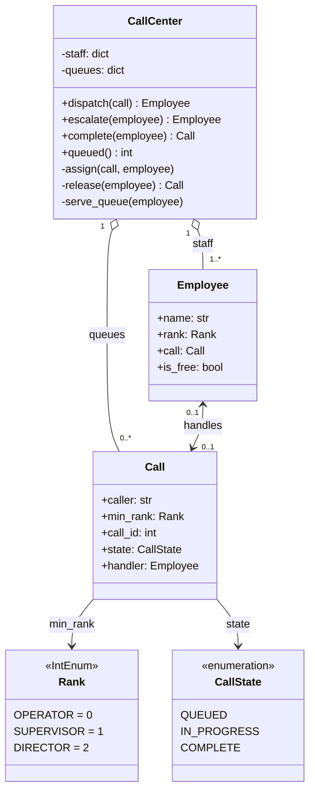

import { Aside } from '@astrojs/starlight/components';

A call center has three levels of staff. An incoming call goes to the most junior free person who may handle it. If nobody is free, it waits in a queue, and anyone who cannot resolve a call passes it up a level. The question checks how you model a hierarchy, where you put routing logic, and whether you handle the moment an employee becomes free.

<Aside type="tip" title="TL;DR">
- `Employee` has a `Rank` (`OPERATOR < SUPERVISOR < DIRECTOR`) and at most one active `Call`. `Call` records the **minimum rank** allowed to take it.
- `CallCenter` is the only class that routes. Employees do not know about each other or about queues.
- The idea that makes it work: **escalation just raises the call's minimum rank and dispatches it again**. The same routing code handles new calls, escalated calls and queued calls.
- One FIFO queue per rank. A freed employee takes the waiting call that needs the **highest rank they have**, so senior staff are not wasted on calls an operator could take.
</Aside>

## Problem and constraints

Design classes for a call center that can route incoming calls, escalate them and queue them. Questions to ask:

- **What levels exist?** Operator, supervisor, director. Directors can handle any call.
- **Who gets a new call?** An operator if one is free, otherwise a supervisor, otherwise a director.
- **What is escalation?** An employee who cannot resolve a call hands it to the next level and becomes free. The call is routed again, now only to higher ranks.
- **What if everyone is busy?** The call is queued in FIFO order. No VIP priority in the base version.
- **Can one person hold several calls?** No, one at a time.

## Design

- **`Rank`**: an `IntEnum`, so ranks can be compared (`rank >= call.min_rank`).
- **`Call`**: caller, minimum rank, state (`QUEUED`, `IN_PROGRESS`, `COMPLETE`) and current handler.
- **`Employee`**: name, rank, current call. One class is enough: the three roles differ only in data, not behaviour. If they had different behaviour (directors can issue refunds, for example), subclasses or a capability set would earn their place.
- **`CallCenter`**: staff grouped by rank, per-rank queues, and the operations `dispatch`, `escalate` and `complete`.



Putting routing in `CallCenter` is a deliberate choice. In some designs the employee calls back into the center (`employee.escalate()` → `center.notify_escalated()`). That creates a cycle between the classes and spreads the queue logic. Here employees are plain data, and every state change goes through one object that sees all staff and all queues.

## Implementation

```python title="call_center.py"
from collections import deque
from dataclasses import dataclass, field
from enum import Enum, IntEnum, auto
from itertools import count


class Rank(IntEnum):
    OPERATOR = 0
    SUPERVISOR = 1
    DIRECTOR = 2


class CallState(Enum):
    QUEUED = auto()
    IN_PROGRESS = auto()
    COMPLETE = auto()


_call_ids = count(1)


@dataclass(eq=False)
class Call:
    caller: str
    min_rank: Rank = Rank.OPERATOR  # lowest rank allowed to handle the call
    call_id: int = field(default_factory=lambda: next(_call_ids))
    state: CallState = CallState.QUEUED
    handler: "Employee | None" = None


@dataclass(eq=False)
class Employee:
    name: str
    rank: Rank
    call: Call | None = None

    @property
    def is_free(self) -> bool:
        return self.call is None


class CallCenter:
    def __init__(self, employees: list[Employee]) -> None:
        if not any(e.rank is Rank.DIRECTOR for e in employees):
            raise ValueError("at least one director is required: directors handle any call")
        self._staff: dict[Rank, list[Employee]] = {rank: [] for rank in Rank}
        for employee in employees:
            self._staff[employee.rank].append(employee)
        # One FIFO queue per rank: a call waits for someone of at least that rank.
        self._queues: dict[Rank, deque[Call]] = {rank: deque() for rank in Rank}

    def dispatch(self, call: Call) -> Employee | None:
        """Give the call to the most junior free employee who may handle it, else queue it."""
        for rank in Rank:
            if rank < call.min_rank:
                continue
            for employee in self._staff[rank]:
                if employee.is_free:
                    self._assign(call, employee)
                    return employee
        call.state = CallState.QUEUED
        self._queues[call.min_rank].append(call)
        return None

    def escalate(self, employee: Employee) -> Employee | None:
        """The employee cannot resolve the call: pass it to the next rank up."""
        if employee.rank is Rank.DIRECTOR:
            raise RuntimeError("directors resolve every call; nobody to escalate to")
        call = self._release(employee)
        call.min_rank = Rank(employee.rank + 1)
        handler = self.dispatch(call)
        self._serve_queue(employee)
        return handler

    def complete(self, employee: Employee) -> Call:
        call = self._release(employee)
        call.state = CallState.COMPLETE
        self._serve_queue(employee)
        return call

    def queued(self) -> int:
        return sum(len(q) for q in self._queues.values())

    def _assign(self, call: Call, employee: Employee) -> None:
        employee.call, call.handler, call.state = call, employee, CallState.IN_PROGRESS

    def _release(self, employee: Employee) -> Call:
        if employee.call is None:
            raise ValueError(f"{employee.name} has no active call")
        call, employee.call = employee.call, None
        call.handler = None
        return call

    def _serve_queue(self, employee: Employee) -> None:
        """A freed employee takes the waiting call that needs the highest rank they have."""
        for rank in sorted(Rank, reverse=True):
            if rank <= employee.rank and self._queues[rank]:
                self._assign(self._queues[rank].popleft(), employee)
                return


if __name__ == "__main__":
    ann, bob = Employee("Ann", Rank.OPERATOR), Employee("Bob", Rank.SUPERVISOR)
    dee = Employee("Dee", Rank.DIRECTOR)
    center = CallCenter([ann, bob, dee])

    c1, c2, c3, c4 = (Call(f"caller-{i}") for i in range(1, 5))
    assert center.dispatch(c1) is ann
    assert center.dispatch(c2) is bob          # no free operator: goes up a rank
    assert center.dispatch(c3) is dee
    assert center.dispatch(c4) is None and center.queued() == 1

    center.escalate(ann)                       # c1 needs a supervisor+, all busy -> queued
    assert c1.state is CallState.QUEUED and ann.call is c4  # Ann picked up the waiting c4
    center.complete(bob)                       # Bob frees up and takes the escalated c1
    assert bob.call is c1 and c2.state is CallState.COMPLETE
    assert center.queued() == 0
    print("ok")
```

## Complexity and trade-offs

With `E` employees and `R` ranks (3 here):

| Operation | Time | Notes |
|---|---|---|
| `dispatch` | `O(E)` | Linear scan for a free employee |
| `escalate`, `complete` | `O(E + R)` | Release, re-dispatch, serve one queued call |
| `queued` | `O(R)` | Sum of queue lengths |

- **Scanning vs free lists.** A scan is fine for tens of agents. For thousands, keep a set (or deque) of free employees per rank. Then dispatch is `O(R)`, and "longest-idle agent first" comes for free from the deque order.
- **Who serves the queue.** A freed operator can only take operator-level calls. A freed director takes the most senior waiting call first. This keeps escalated calls from starving behind new ones, but a flood of escalations can keep directors away from the operator queue. A real system would add waiting-time limits.
- **No preemption.** A busy director is never interrupted to take an escalated call; the call waits. That is simpler and matches how phones work.

## Extensions

1. **VIP or priority callers.** Replace each FIFO deque with a heap keyed by `(priority, arrival_time)`. Keep the arrival time so that callers with equal priority stay in order.
2. **Skills-based routing.** Real contact centers route by language, product and skill, not only by rank. Give employees a set of skills and calls a set of required skills, then match on the subset. This is where a strategy interface for routing pays off.
3. **Concurrency.** Calls arrive on many threads. Guard `CallCenter` state with one lock, or run routing as a single event loop that consumes a message queue. The single-writer design avoids two agents grabbing the same call.
4. **Persistence and metrics.** Store each state change as an event (`queued`, `assigned`, `escalated`, `completed`) with timestamps. Wait times, handling times and abandonment rates fall out of the event log, and the router can be rebuilt after a crash.
5. **Distributed call center.** Many sites share one queue. The queue moves to a durable broker, and agents pull work instead of having it pushed to them. See [queues and back pressure](/async/queues-and-back-pressure/).

<Aside type="note" title="In the interview">
- Clarify the escalation rule and what "nobody free" means before drawing classes.
- Interviewers like to see that you handle the **moment an employee becomes free**: the original solution left this as an empty method.
- Expect "how do you add VIP calls?" and "what if there are 10,000 agents?". Answer with a priority queue and per-rank free lists.
- Common mistakes: subclasses per role with copy-pasted escalation code, escalation that forgets to free the employee, and directors who can "escalate" with nowhere to go.
</Aside>

## Related topics

- [Queues and back pressure](/async/queues-and-back-pressure/): bounded queues and load shedding when callers outnumber staff.
- [Design a parking lot](/ood/parking-lot/): another "find a free resource of the right size" problem.
- [Latency vs throughput](/fundamentals/latency-vs-throughput/): why waiting times explode as agents approach 100% utilisation.
