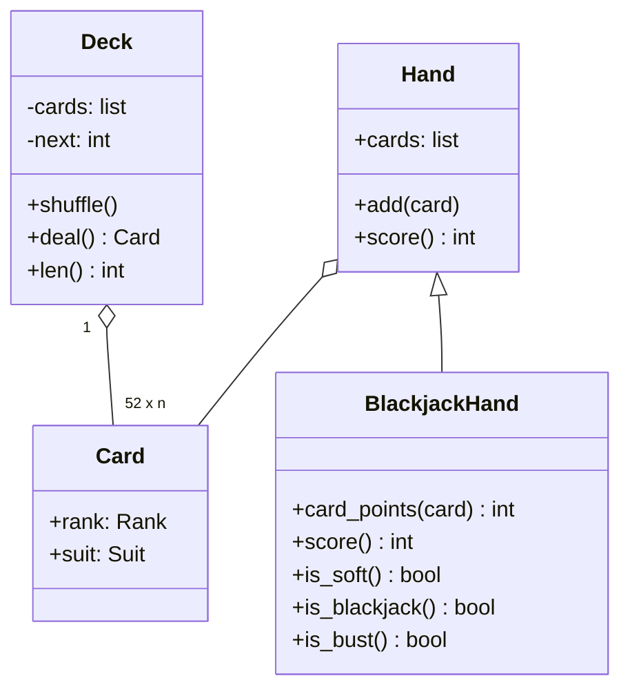

import { Aside } from '@astrojs/starlight/components';

"Design a deck of cards, then use it for Blackjack" tests one skill above all: separating what is generic (cards, suits, dealing) from what belongs to a game (how a hand scores). Done well, adding poker later means writing a new `Hand` subclass and touching nothing else.

<Aside type="tip" title="TL;DR">
- `Card` is an **immutable value** (`rank`, `suit`), not an object with game logic. `Suit` and `Rank` are enums.
- `Deck` builds 52 cards (or a multi-deck shoe), shuffles and deals. It knows no game rules.
- `Hand` holds cards and has a `score()`. `BlackjackHand` overrides only the scoring.
- The idea that makes scoring simple: count every ace as 1, then add 10 **once** if that does not bust. Two aces as 11 would be 22, so at most one ace can ever count high.
</Aside>

## Problem and constraints

Design a generic deck of cards and show how a game such as Blackjack builds on it. Questions to ask:

- **Which deck?** A standard 52-card French deck: 13 ranks × 4 suits, no jokers. Casinos deal Blackjack from a shoe of 6–8 decks, so allow more than one deck.
- **Who owns game rules?** The deck should not. Card values differ between games: an ace is high in poker and 1 or 11 in Blackjack.
- **How random must shuffling be?** Uniform. For tests, the random generator should be injectable.
- **What happens when the deck runs out?** Raise an error. Reshuffling is a game decision.

## Design

- **`Suit`, `Rank`**: enums. `Rank` is an `IntEnum` with ace = 1 and king = 13, so face cards are `rank > 10`.
- **`Card`**: a frozen dataclass. Being immutable and hashable, a card can go into sets, and two decks can never share a mutable card object by accident.
- **`Deck`**: the list of cards plus a "next card" index. `deal()` advances the index; `shuffle()` collects every card and shuffles in place.
- **`Hand`**: a list of cards and a default `score()` (sum of ranks).
- **`BlackjackHand`**: Blackjack points per card, the ace rule, and helpers `is_soft`, `is_blackjack`, `is_bust`.



The game-specific part lives in `Hand` subclasses, not in `Card` subclasses. A "Blackjack card" would put game logic into what is really a value, and the same physical card would need a different class per game.

## Implementation

```python title="deck_of_cards.py"
import random
from dataclasses import dataclass, field
from enum import Enum, IntEnum


class Suit(Enum):
    CLUBS = "♣"
    DIAMONDS = "♦"
    HEARTS = "♥"
    SPADES = "♠"


class Rank(IntEnum):
    ACE = 1
    TWO = 2
    THREE = 3
    FOUR = 4
    FIVE = 5
    SIX = 6
    SEVEN = 7
    EIGHT = 8
    NINE = 9
    TEN = 10
    JACK = 11
    QUEEN = 12
    KING = 13


@dataclass(frozen=True, slots=True)
class Card:
    rank: Rank
    suit: Suit

    def __str__(self) -> str:
        return f"{self.rank.name.title()}{self.suit.value}"


class Deck:
    """A shoe of one or more standard 52-card decks. Game rules live elsewhere."""

    def __init__(self, num_decks: int = 1, rng: random.Random | None = None) -> None:
        self._rng = rng or random.Random()
        self._cards = [Card(r, s) for _ in range(num_decks) for s in Suit for r in Rank]
        self._next = 0  # cards before this index have been dealt

    def __len__(self) -> int:
        return len(self._cards) - self._next

    def shuffle(self) -> None:
        """Collect all cards back and shuffle (Fisher-Yates inside random.shuffle)."""
        self._rng.shuffle(self._cards)
        self._next = 0

    def deal(self) -> Card:
        if self._next == len(self._cards):
            raise IndexError("the deck is empty")
        card = self._cards[self._next]
        self._next += 1
        return card


@dataclass
class Hand:
    cards: list[Card] = field(default_factory=list)

    def add(self, card: Card) -> None:
        self.cards.append(card)

    def score(self) -> int:
        return sum(card.rank for card in self.cards)


class BlackjackHand(Hand):
    TARGET = 21

    @staticmethod
    def card_points(card: Card) -> int:
        return min(card.rank, 10)  # J, Q, K count as 10; an ace counts as 1 here

    def score(self) -> int:
        """Best total not above 21, or the smallest bust total if every option busts."""
        total = sum(self.card_points(c) for c in self.cards)
        has_ace = any(c.rank is Rank.ACE for c in self.cards)
        # At most one ace can count as 11: two would add 20 and always bust.
        if has_ace and total + 10 <= self.TARGET:
            total += 10
        return total

    def is_soft(self) -> bool:
        """True when an ace is currently counted as 11."""
        hard = sum(self.card_points(c) for c in self.cards)
        return self.score() != hard

    def is_blackjack(self) -> bool:
        return len(self.cards) == 2 and self.score() == self.TARGET

    def is_bust(self) -> bool:
        return self.score() > self.TARGET


if __name__ == "__main__":
    deck = Deck(rng=random.Random(42))
    assert len({deck.deal() for _ in range(52)}) == 52     # 52 distinct cards
    deck.shuffle()                                          # collect and reshuffle
    hand = BlackjackHand()
    hand.add(deck.deal())
    hand.add(deck.deal())
    assert len(deck) == 50
    print(", ".join(map(str, hand.cards)), "->", hand.score())

    ace, king, five = Card(Rank.ACE, Suit.SPADES), Card(Rank.KING, Suit.HEARTS), Card(Rank.FIVE, Suit.CLUBS)
    assert BlackjackHand([ace, king]).is_blackjack()
    assert BlackjackHand([ace, ace]).score() == 12              # 11 + 1
    assert BlackjackHand([ace, five]).is_soft()                 # soft 16
    assert BlackjackHand([ace, five, king]).score() == 16       # ace drops back to 1
    assert BlackjackHand([king, king, five]).is_bust()
    print("ok")
```

## Complexity and trade-offs

| Operation | Time | Notes |
|---|---|---|
| Build a deck | `O(52 · d)` | `d` decks in the shoe |
| `shuffle` | `O(n)` | Fisher–Yates, uniform if the RNG is good |
| `deal` | `O(1)` | Moves an index; no list copying |
| `BlackjackHand.score` | `O(k)` | `k` cards in the hand, usually 2–5 |

- **Index vs pop.** Dealing by index keeps the full deck for a reshuffle and makes `len()` trivial. `cards.pop()` would also be `O(1)`, but then the dealt cards must be collected back from the hands.
- **Randomness.** Python's `random` (Mersenne Twister) is fine for a game and for tests with a seed. A real-money casino must use a certified generator. In Python that means `random.SystemRandom` or the `secrets` module, since the Mersenne Twister state can be reconstructed from its output.
- **Rules in the hand.** Putting scoring in `BlackjackHand` keeps `Card` reusable. A full game also needs dealer rules, betting and splitting. Those belong in a separate `BlackjackGame` class, not in the hand.

## Extensions

1. **Other games.** Poker adds a `PokerHand` that ranks five-card combinations. Jokers add a `Rank.JOKER` or a separate `Joker` card type. The deck takes a card factory so games can choose their set of cards.
2. **The full Blackjack game.** A `BlackjackGame` has a shoe, a dealer hand and player hands. It holds the dealer rule (hit below 17, and decide whether the dealer hits soft 17) and the round as a state machine: betting → dealing → player turns → dealer turn → settlement.
3. **Reshuffle point.** Casinos insert a cut card and reshuffle after roughly two-thirds to three-quarters of the shoe has been dealt. Model it as a threshold that the game checks between rounds.
4. **Multiplayer online.** The game state moves to a server, and clients only send actions. The server must be the only source of shuffles, so clients can neither predict nor choose the cards.

<Aside type="note" title="In the interview">
- Ask whether it is a generic deck first. The interviewer usually wants to see the generic/specific split.
- Get the ace rule right without enumerating every combination. The original solution left `possible_scores` empty and used a non-existent `sys.MAXSIZE`, so `score()` crashed.
- Expect "how would you add poker?". Point to a new `Hand` subclass and no changes to `Card` or `Deck`.
- Common mistakes: game logic inside `Card`, a mutable `is_available` flag on each card instead of deck state, and `shuffle()` left as a stub.
</Aside>

## Related topics

- [Design a call center](/ood/call-center/): another small class hierarchy with a clear owner of state.
- [Design a parking lot](/ood/parking-lot/): enums and inheritance used for sizes and vehicle types.
