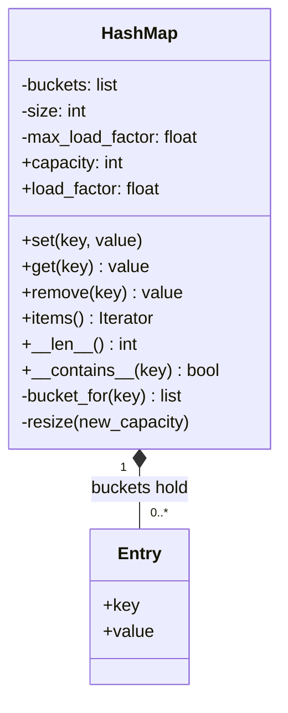

import { Aside } from '@astrojs/starlight/components';

Writing a hash map from scratch is a common warm-up question. It is short enough to code in 20 minutes, and it shows whether you understand hashing, collisions and amortised cost. The same ideas come back at system scale in [partitioning and sharding](/data/partitioning-and-sharding/) and in every cache.

<Aside type="tip" title="TL;DR">
- `HashMap` keeps an array of **buckets**. Each bucket is a short list of `Entry(key, value)` pairs: this is **separate chaining**.
- The bucket index is `hash(key) % capacity`. Keys that are equal must have equal hashes.
- The idea that makes it fast: keep the **load factor** (`size / capacity`) under a limit (0.75 here). When it goes over, **double** the bucket array and rehash every entry.
- Doubling means each entry moves only a constant number of times on average, so inserts stay amortised `O(1)`.
</Aside>

## Problem and constraints

Implement a map with `set(key, value)`, `get(key)` and `remove(key)`. Before coding, ask:

- **What types are the keys?** The original version allowed only integers. We accept any hashable key and use Python's `hash()`.
- **How do we handle collisions?** Chaining (a list per bucket) or open addressing (probe for the next free slot). Chaining is easier to get right on a whiteboard.
- **Do we care about the load factor?** The original said no and used a fixed-size table. That is the main gap: with 10 buckets and a million keys, every lookup scans a 100,000-entry list. We add resizing.
- **What happens for a missing key?** Raise `KeyError`, like `dict`, rather than return `None`, which could also be a stored value.
- **Concurrency, persistence?** Single-threaded, in memory.

## Design

- **`Entry`** holds one key and its value. The value is mutable so `set` on an existing key updates it in place.
- **`HashMap`** owns the buckets, the entry count and the maximum load factor. It exposes `set`, `get`, `remove`, `len`, `in` and `items`. Two private helpers do the real work: `_bucket_for` maps a key to its bucket, and `_resize` builds a bigger array and rehashes into it.



The map **composes** its entries: they have no life outside it. The index depends on the capacity, so a resize cannot just copy the old buckets into a longer list. Every entry has to be hashed again into its new position.

Why chaining? Deleting an entry is a plain list removal. You need no "tombstone" markers, and the table still works, only slower, if the load factor goes above 1. Open addressing stores entries in the array itself, which is friendlier to CPU caches. That is why CPython's `dict`, Rust's `HashMap` and Go maps since Go 1.24 (Swiss tables) all use it. Java's `HashMap` uses chaining and turns very long chains into balanced trees.

## Implementation

```python title="hash_map.py"
from collections.abc import Hashable, Iterator
from dataclasses import dataclass


@dataclass(slots=True)
class Entry[K, V]:
    key: K
    value: V


class HashMap[K: Hashable, V]:
    """Hash table with separate chaining that grows when it gets too full."""

    def __init__(self, capacity: int = 8, max_load_factor: float = 0.75) -> None:
        if capacity < 1 or max_load_factor <= 0:
            raise ValueError("capacity and max_load_factor must be positive")
        self._buckets: list[list[Entry[K, V]]] = [[] for _ in range(capacity)]
        self._size = 0
        self._max_load_factor = max_load_factor

    def __len__(self) -> int:
        return self._size

    def __contains__(self, key: K) -> bool:
        return any(entry.key == key for entry in self._bucket_for(key))

    @property
    def capacity(self) -> int:
        return len(self._buckets)

    @property
    def load_factor(self) -> float:
        return self._size / self.capacity

    def set(self, key: K, value: V) -> None:
        bucket = self._bucket_for(key)
        for entry in bucket:
            if entry.key == key:  # existing key: overwrite in place
                entry.value = value
                return
        bucket.append(Entry(key, value))
        self._size += 1
        if self.load_factor > self._max_load_factor:
            self._resize(self.capacity * 2)

    def get(self, key: K) -> V:
        for entry in self._bucket_for(key):
            if entry.key == key:
                return entry.value
        raise KeyError(key)

    def remove(self, key: K) -> V:
        bucket = self._bucket_for(key)
        for i, entry in enumerate(bucket):
            if entry.key == key:
                del bucket[i]
                self._size -= 1
                return entry.value
        raise KeyError(key)

    def items(self) -> Iterator[tuple[K, V]]:
        for bucket in self._buckets:
            for entry in bucket:
                yield entry.key, entry.value

    def _bucket_for(self, key: K) -> list[Entry[K, V]]:
        # hash() works for any hashable key; % keeps the index in range (also for negative hashes).
        return self._buckets[hash(key) % self.capacity]

    def _resize(self, new_capacity: int) -> None:
        old_buckets = self._buckets
        self._buckets = [[] for _ in range(new_capacity)]
        for bucket in old_buckets:
            for entry in bucket:  # rehash: the index depends on the capacity
                self._buckets[hash(entry.key) % new_capacity].append(entry)


if __name__ == "__main__":
    m: HashMap[str, int] = HashMap(capacity=4)
    for i, word in enumerate("abcdef"):
        m.set(word, i)
    m.set("a", 100)                       # overwrite, size unchanged
    assert m.get("a") == 100 and len(m) == 6
    assert m.capacity == 8                # grew 4 -> 8 when the 4th key arrived
    assert m.remove("c") == 2 and "c" not in m and len(m) == 5
    print(sorted(m.items()))
```

## Complexity and trade-offs

| Operation | Average | Worst case |
|---|---|---|
| `get`, `set`, `remove` | `O(1)` | `O(n)`: all keys in one bucket |
| Resize | Amortised `O(1)` per insert | `O(n)` for the insert that triggers it |
| Memory | `O(n + capacity)` | — |

The average case assumes the hash spreads keys evenly. Then the expected chain length equals the load factor, which stays below 0.75. Two things break that assumption:

- **Weak hash plus modulo.** In Python, small integers hash to themselves, so keys `0, 8, 16, …` all land in bucket 0 of an 8-bucket table. Production tables scramble the hash bits before taking the index, or use a prime capacity.
- **Hash flooding.** An attacker who knows the hash function can send thousands of colliding keys and turn every request into an `O(n)` scan. Python defends against this with a keyed, randomised hash for `str` and `bytes` (SipHash). Java defends by turning long chains into trees.

| | Separate chaining | Open addressing |
|---|---|---|
| Delete | Simple list removal | Needs tombstones or back-shifting |
| Load factor above 1 | Still works, only slower | Impossible; resize before ~0.9 |
| CPU cache behaviour | Pointer chasing | Contiguous probes, faster |
| Implementation risk | Low | Probe sequence and clustering bugs |

## Extensions

1. **Shrinking.** Halve the capacity when the load factor drops below 0.25. Use a gap between the grow and shrink thresholds so a map hovering at one size does not resize on every call.
2. **Latency spikes during resize.** A resize of 10 million entries blocks one unlucky insert. Redis avoids this with *incremental rehashing*: it keeps the old and new tables side by side and moves a few buckets on every operation.
3. **Thread safety.** One lock around the map is simplest. *Lock striping* (a lock per group of buckets) lets writers to different buckets proceed in parallel. Java's `ConcurrentHashMap` goes further: compare-and-swap for empty bins and a lock per bin otherwise.
4. **Ordered iteration.** If callers need insertion order, keep a separate array of entries and store indices in the buckets. CPython's `dict` has done this since 3.6.
5. **Beyond one machine.** Choosing a server for a key is the same `hash % n` problem. Adding a server would move almost every key, which is why distributed caches use [consistent hashing](/data/partitioning-and-sharding/).

<Aside type="note" title="In the interview">
- State the collision strategy and the missing-key behaviour before writing code.
- Interviewers almost always ask "what happens when it fills up?". Have the load factor, doubling and amortised-cost argument ready.
- Common mistakes: forgetting to rehash on resize (copying buckets in order), not updating an existing key (adding a duplicate entry), and getting `size` wrong (counting an overwrite as a new key, or not decrementing on delete).
- Know the worst case and how real implementations defend against it: randomised hashing or tree-ified buckets.
</Aside>

## Related topics

- [Design an LRU cache](/ood/lru-cache/): a hash map plus a linked list.
- [Partitioning and sharding](/data/partitioning-and-sharding/): hashing keys across machines and consistent hashing.
- [Cache strategies](/caching/cache-strategies/): where in-memory maps sit in a real system.
