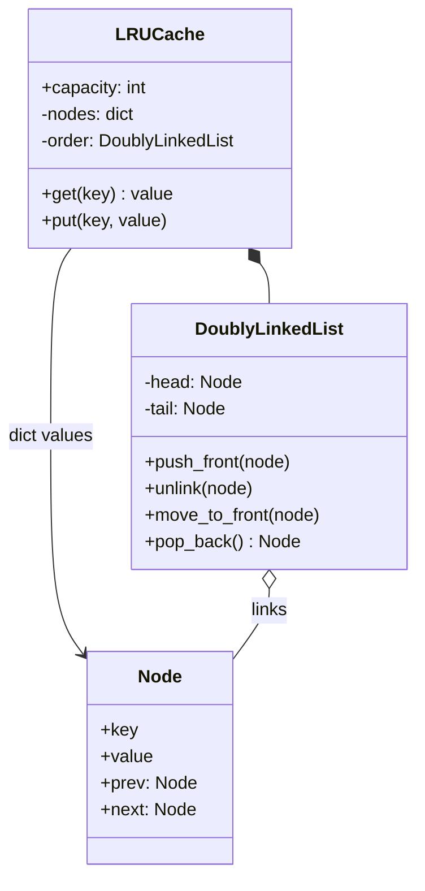

import { Aside } from '@astrojs/starlight/components';

A least-recently-used (LRU) cache holds a fixed number of entries. When it is full, it evicts the entry that has gone longest without being read or written. The question tests whether you can combine two data structures so that every operation is `O(1)`. It is also the in-process version of the [query cache case study](/practice/search-query-cache/).

<Aside type="tip" title="TL;DR">
- `LRUCache` combines a **dict** (key → node) for `O(1)` lookup with a **doubly linked list** that keeps entries in recency order.
- `get` and `put` move the touched node to the **head**. Eviction removes the node at the **tail**.
- The idea that makes it work: the list node stores its **own key**, so after unlinking the tail we can delete it from the dict in `O(1)`.
- **Sentinel** head and tail nodes remove every empty-list special case.
- In real Python code use `OrderedDict` or `functools.lru_cache`. Write the linked list yourself when the interviewer asks for it.
</Aside>

## Problem and constraints

Design a cache for web search results: given a query, return cached results or nothing; store new results; never exceed `capacity` entries. Questions to ask:

- **What counts as a "use"?** Both reads and writes refresh an entry. A miss does not.
- **What does a miss return?** `None` here. If `None` could be a valid cached value, use a sentinel or raise.
- **Fixed entry count or a memory budget?** Count, for now. A byte budget is a natural follow-up.
- **Do entries expire?** No TTL in the base version.
- **Threads?** Single-threaded first. Concurrency is a classic follow-up.

## Design

- **`Node`**: key, value, and `prev`/`next` pointers.
- **`DoublyLinkedList`**: recency order. `push_front`, `unlink`, `move_to_front` and `pop_back` are each a few pointer assignments, so all of them are `O(1)`.
- **`LRUCache`**: owns the dict and the list. It enforces capacity and decides when to evict.



Why both structures? A dict alone finds a key in `O(1)` but cannot tell which key is oldest without a scan. A list alone keeps the order but needs `O(n)` to find a key. The dict points straight at list nodes, so we can unlink a node from the middle of the list without walking it. A doubly linked list is needed because unlinking requires the previous node too.

## Implementation

```python title="lru_cache.py"
from collections.abc import Hashable
from dataclasses import dataclass, field


@dataclass(eq=False, slots=True)
class Node[K, V]:
    key: K  # kept in the node so eviction can delete the dict entry
    value: V
    prev: "Node[K, V] | None" = field(default=None, repr=False)
    next: "Node[K, V] | None" = field(default=None, repr=False)


class DoublyLinkedList[K, V]:
    """Most recently used at the head, least recently used at the tail.

    Two sentinel nodes remove every "is the list empty?" special case.
    """

    def __init__(self) -> None:
        self._head: Node = Node(None, None)
        self._tail: Node = Node(None, None)
        self._head.next, self._tail.prev = self._tail, self._head

    def push_front(self, node: Node[K, V]) -> None:
        first = self._head.next
        node.prev, node.next = self._head, first
        self._head.next = first.prev = node

    def unlink(self, node: Node[K, V]) -> None:
        node.prev.next, node.next.prev = node.next, node.prev
        node.prev = node.next = None

    def move_to_front(self, node: Node[K, V]) -> None:
        self.unlink(node)
        self.push_front(node)

    def pop_back(self) -> Node[K, V]:
        last = self._tail.prev
        if last is self._head:
            raise IndexError("pop from empty list")
        self.unlink(last)
        return last


class LRUCache[K: Hashable, V]:
    def __init__(self, capacity: int) -> None:
        if capacity < 1:
            raise ValueError("capacity must be at least 1")
        self.capacity = capacity
        self._nodes: dict[K, Node[K, V]] = {}
        self._order: DoublyLinkedList[K, V] = DoublyLinkedList()

    def __len__(self) -> int:
        return len(self._nodes)

    def get(self, key: K) -> V | None:
        node = self._nodes.get(key)
        if node is None:
            return None  # cache miss
        self._order.move_to_front(node)  # a read counts as a use
        return node.value

    def put(self, key: K, value: V) -> None:
        node = self._nodes.get(key)
        if node is not None:
            node.value = value
            self._order.move_to_front(node)
            return
        if len(self._nodes) == self.capacity:
            evicted = self._order.pop_back()
            del self._nodes[evicted.key]
        node = Node(key, value)
        self._order.push_front(node)
        self._nodes[key] = node


if __name__ == "__main__":
    cache: LRUCache[str, str] = LRUCache(capacity=2)
    cache.put("q:python", "results-1")
    cache.put("q:rust", "results-2")
    assert cache.get("q:python") == "results-1"  # python is now the most recent
    cache.put("q:go", "results-3")               # evicts rust, the LRU entry
    assert cache.get("q:rust") is None
    cache.put("q:python", "results-1b")          # update keeps size at 2
    assert len(cache) == 2 and cache.get("q:python") == "results-1b"
    assert cache.get("q:go") == "results-3"
    print("ok")
```

### The standard-library way

Python's `OrderedDict` is itself a dict plus a doubly linked list. `move_to_end` and `popitem(last=False)` give the same operations in a few lines. For memoising a pure function, `functools.lru_cache` is the tool: it is thread-safe and reports hits and misses through `cache_info()`.

```python title="lru_stdlib.py"
from collections import OrderedDict
from functools import lru_cache


class OrderedDictLRU[K, V]:
    def __init__(self, capacity: int) -> None:
        self.capacity = capacity
        self._data: OrderedDict[K, V] = OrderedDict()

    def get(self, key: K) -> V | None:
        if key not in self._data:
            return None
        self._data.move_to_end(key)  # most recent at the end
        return self._data[key]

    def put(self, key: K, value: V) -> None:
        self._data[key] = value
        self._data.move_to_end(key)
        if len(self._data) > self.capacity:
            self._data.popitem(last=False)  # drop the oldest


@lru_cache(maxsize=1024)  # memoise a pure function
def search(query: str) -> tuple[str, ...]:
    return (f"result for {query}",)
```

## Complexity and trade-offs

| Operation | Time | Notes |
|---|---|---|
| `get` (hit or miss) | `O(1)` | Dict lookup and pointer updates |
| `put` (new, update, evict) | `O(1)` | At most one eviction per insert |
| Memory | `O(capacity)` | Two pointers and a key copy per entry |

- **Per-entry overhead.** Each node costs two pointers plus a second reference to the key. For small values this can exceed the size of the data.
- **LRU is not always the best policy.** A single large scan (a batch job reading every key once) flushes the whole hot set. LFU, 2Q, ARC or W-TinyLFU (used by Caffeine) resist scans better. See [cache strategies](/caching/cache-strategies/).
- **Exact vs approximate.** Redis does not keep a global LRU list. It samples a few keys (`maxmemory-samples`, default 5) and evicts the oldest among them. That uses less memory per key and avoids a contended list, at the cost of sometimes evicting a key that is not quite the oldest.

## Extensions

1. **Thread safety.** Wrap `get` and `put` in one `threading.Lock`. Even `get` must take the lock, because it changes the list. For high contention, **shard** the cache: N independent LRUs, chosen by `hash(key) % N`, each with its own lock.
2. **TTL.** Store an expiry time in each node. On `get`, treat an expired entry as a miss and remove it. Optionally run a background sweep, or keep a heap ordered by expiry.
3. **Memory budget instead of count.** Track `size_bytes` per entry and evict from the tail until the new entry fits. One large insert may evict many small ones.
4. **Distributed cache.** Put the LRU in front of the search service on many nodes, or move it to Redis or Valkey with `maxmemory-policy allkeys-lru`. The [search query cache case study](/practice/search-query-cache/) covers partitioning and invalidation.
5. **Stampede protection.** When a hot key expires, many callers miss at once and all hit the backend. Let only one caller recompute it (a per-key lock or "single flight") while the others wait or receive the stale value.

<Aside type="note" title="In the interview">
- Say "hash map plus doubly linked list" in the first minute, then explain why each is needed.
- Draw the list with sentinels and walk through `put` on a full cache: unlink tail → delete from dict → push new node to head.
- Common mistakes: not storing the key in the node (eviction cannot clean the dict), forgetting that `get` changes order, updating an existing key without moving it, and off-by-one capacity checks.
- If you use `OrderedDict`, say so up front and offer to implement the list by hand.
</Aside>

## Related topics

- [Design a hash map](/ood/hash-map/): the lookup half of this design.
- [Cache strategies](/caching/cache-strategies/): eviction policies, write strategies and invalidation.
- [Caching layers](/caching/caching-layers/): where an in-process cache fits among CDN, Redis and database caches.
- [Search query cache](/practice/search-query-cache/): the same idea scaled across machines.
