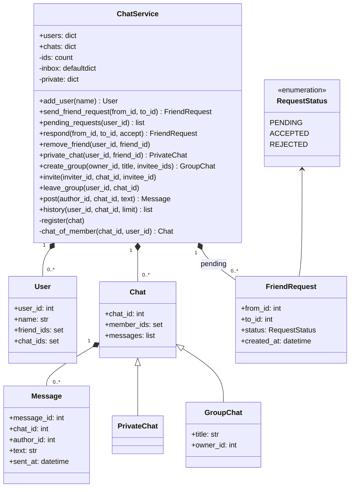

import { Aside } from '@astrojs/starlight/components';

"Design an online chat" can mean two very different questions. In an **object-oriented** round, the interviewer wants clean classes for users, friendships, chats and messages, with the rules enforced in the right place. In a **system design** round, the same words mean WebSockets, fan-out, storage and delivery guarantees for millions of users. This page answers the first and shows where the second begins.

<Aside type="tip" title="TL;DR">
- Entities: `User`, `FriendRequest`, `Chat` (base) with `PrivateChat` and `GroupChat`, and immutable `Message`.
- One `ChatService` owns all of them and enforces cross-user rules: who can befriend, message or invite whom.
- The idea that keeps it consistent: entities refer to each other by **id**, not by object. A friendship or membership changes in one place, and the model maps directly to database tables later.
- A private chat is keyed by the **unordered pair** of users (`frozenset`), so A→B and B→A always find the same chat.
</Aside>

## Problem and constraints

Design the classes for a text chat. Use cases in scope:

- Add users; send, accept and reject friend requests; remove friends.
- Open a private 1:1 chat with a friend; post messages.
- Create a group chat, invite friends, leave a group; read history.

Questions to ask:

- **Must private chat partners be friends?** Yes here. Group invitations also require friendship with the inviter.
- **What if both users send a request to each other?** Treat the second one as acceptance.
- **Is there one private chat per pair, or many?** One. Reopening returns the existing chat.
- **Media, read receipts, typing indicators, online presence?** Out of scope. Text only.
- **Scale?** One process, in memory. Scaling is a different question (see below).

## Design

- **`User`**: id, name, and sets of friend ids and chat ids. No methods that reach into other users.
- **`FriendRequest`**: sender, recipient, status (`PENDING`, `ACCEPTED`, `REJECTED`), timestamp.
- **`Chat`**: id, member ids, list of messages. **`PrivateChat`** has exactly two fixed members. **`GroupChat`** adds a title and an owner, and its membership can change.
- **`Message`**: frozen; id, chat id, author id, text, timestamp. A message never changes after it is sent (edits would be new events).
- **`ChatService`**: the registry of users and chats, friend-request inboxes, and the private-chat index. Every operation that involves two users or a membership check goes through it.



The original design put methods like `message_user` and `approve_friend_request` on `User` and also on a `UserService`, with each user holding other `User` objects. That duplicates the logic, and accepting a request then means updating two objects from inside one of them. With ids and a single service, each rule lives in one method, and permission checks (`_chat_of_member`) are shared by every operation.

## Implementation

```python title="online_chat.py"
from collections import defaultdict
from dataclasses import dataclass, field
from datetime import UTC, datetime
from enum import Enum, auto
from itertools import count


def _now() -> datetime:
    return datetime.now(UTC)


class RequestStatus(Enum):
    PENDING = auto()
    ACCEPTED = auto()
    REJECTED = auto()


@dataclass(eq=False)
class User:
    user_id: int
    name: str
    friend_ids: set[int] = field(default_factory=set)
    chat_ids: set[int] = field(default_factory=set)


@dataclass
class FriendRequest:
    from_id: int
    to_id: int
    status: RequestStatus = RequestStatus.PENDING
    created_at: datetime = field(default_factory=_now)


@dataclass(frozen=True)
class Message:
    message_id: int
    chat_id: int
    author_id: int
    text: str
    sent_at: datetime = field(default_factory=_now)


@dataclass(eq=False)
class Chat:
    chat_id: int
    member_ids: set[int]
    messages: list[Message] = field(default_factory=list)


class PrivateChat(Chat):
    """Exactly two members, fixed for the life of the chat."""


@dataclass(eq=False)
class GroupChat(Chat):
    title: str = ""
    owner_id: int = 0


class ChatService:
    """Owns users, requests and chats, so cross-user rules live in one place."""

    def __init__(self) -> None:
        self._ids = count(1)
        self.users: dict[int, User] = {}
        self.chats: dict[int, Chat] = {}
        # Pending requests by recipient, then sender: an O(1) inbox per user.
        self._inbox: defaultdict[int, dict[int, FriendRequest]] = defaultdict(dict)
        self._private: dict[frozenset[int], PrivateChat] = {}  # pair of users -> chat

    # --- users and friends -------------------------------------------------
    def add_user(self, name: str) -> User:
        user = User(next(self._ids), name)
        self.users[user.user_id] = user
        return user

    def send_friend_request(self, from_id: int, to_id: int) -> FriendRequest:
        if from_id == to_id or to_id in self.users[from_id].friend_ids:
            raise ValueError("cannot befriend yourself or an existing friend")
        if to_id in self._inbox[from_id]:  # they already asked us: accept
            return self.respond(to_id, from_id, accept=True)
        return self._inbox[to_id].setdefault(from_id, FriendRequest(from_id, to_id))

    def pending_requests(self, user_id: int) -> list[FriendRequest]:
        return list(self._inbox[user_id].values())

    def respond(self, from_id: int, to_id: int, *, accept: bool) -> FriendRequest:
        request = self._inbox[to_id].pop(from_id)  # KeyError if there is none
        request.status = RequestStatus.ACCEPTED if accept else RequestStatus.REJECTED
        if accept:
            self.users[from_id].friend_ids.add(to_id)
            self.users[to_id].friend_ids.add(from_id)
        return request

    def remove_friend(self, user_id: int, friend_id: int) -> None:
        self.users[user_id].friend_ids.discard(friend_id)
        self.users[friend_id].friend_ids.discard(user_id)

    # --- chats ---------------------------------------------------------------
    def private_chat(self, user_id: int, friend_id: int) -> PrivateChat:
        """Return the one private chat between two friends, creating it on first use."""
        if friend_id not in self.users[user_id].friend_ids:
            raise PermissionError("private chats are between friends only")
        pair = frozenset((user_id, friend_id))
        if pair not in self._private:
            chat = PrivateChat(next(self._ids), set(pair))
            self._register(chat)
            self._private[pair] = chat
        return self._private[pair]

    def create_group(self, owner_id: int, title: str, invitee_ids: set[int]) -> GroupChat:
        chat = GroupChat(next(self._ids), {owner_id}, title=title, owner_id=owner_id)
        self._register(chat)
        for invitee in invitee_ids:
            self.invite(owner_id, chat.chat_id, invitee)
        return chat

    def invite(self, inviter_id: int, chat_id: int, invitee_id: int) -> None:
        chat = self._chat_of_member(chat_id, inviter_id)
        if not isinstance(chat, GroupChat):
            raise ValueError("members can only be added to group chats")
        if invitee_id not in self.users[inviter_id].friend_ids:
            raise PermissionError("you can only invite your friends")
        chat.member_ids.add(invitee_id)
        self.users[invitee_id].chat_ids.add(chat_id)

    def leave_group(self, user_id: int, chat_id: int) -> None:
        chat = self._chat_of_member(chat_id, user_id)
        if not isinstance(chat, GroupChat):
            raise ValueError("cannot leave a private chat")
        chat.member_ids.discard(user_id)
        self.users[user_id].chat_ids.discard(chat_id)

    def post(self, author_id: int, chat_id: int, text: str) -> Message:
        chat = self._chat_of_member(chat_id, author_id)
        message = Message(next(self._ids), chat_id, author_id, text)
        chat.messages.append(message)
        return message

    def history(self, user_id: int, chat_id: int, limit: int = 50) -> list[Message]:
        return self._chat_of_member(chat_id, user_id).messages[-limit:]

    def _register(self, chat: Chat) -> None:
        self.chats[chat.chat_id] = chat
        for member in chat.member_ids:
            self.users[member].chat_ids.add(chat.chat_id)

    def _chat_of_member(self, chat_id: int, user_id: int) -> Chat:
        chat = self.chats[chat_id]
        if user_id not in chat.member_ids:
            raise PermissionError(f"user {user_id} is not in chat {chat_id}")
        return chat


if __name__ == "__main__":
    svc = ChatService()
    ann, bob, cat = (svc.add_user(n) for n in ("Ann", "Bob", "Cat"))
    svc.send_friend_request(ann.user_id, bob.user_id)
    assert svc.pending_requests(bob.user_id)[0].from_id == ann.user_id
    svc.respond(ann.user_id, bob.user_id, accept=True)
    svc.send_friend_request(cat.user_id, ann.user_id)
    svc.send_friend_request(ann.user_id, cat.user_id)  # mutual request = accepted
    assert cat.user_id in ann.friend_ids

    dm = svc.private_chat(ann.user_id, bob.user_id)
    assert svc.private_chat(bob.user_id, ann.user_id) is dm  # same chat both ways
    svc.post(bob.user_id, dm.chat_id, "hi Ann")

    group = svc.create_group(ann.user_id, "Trip", {bob.user_id, cat.user_id})
    svc.post(cat.user_id, group.chat_id, "I'm in")
    try:
        svc.private_chat(bob.user_id, cat.user_id)  # Bob and Cat are not friends
    except PermissionError:
        pass
    else:
        raise AssertionError("expected PermissionError")
    svc.leave_group(cat.user_id, group.chat_id)
    assert [m.text for m in svc.history(ann.user_id, group.chat_id)] == ["I'm in"]
    print("ok")
```

## Complexity and trade-offs

| Operation | Time | Notes |
|---|---|---|
| Send, accept, reject a request | `O(1)` | Inbox dict per recipient |
| Open a private chat | `O(1)` | `frozenset` pair index |
| Post a message | `O(1)` | Append to the chat's list |
| History, last `k` messages | `O(k)` | Slice from the end |
| Invite to a group | `O(1)` | Set insert |

- **Ids vs object references.** Ids add a dict lookup, but the model stays acyclic and serialisable, and it maps to tables later: `users`, `friendships`, `chat_members`, `messages`.
- **Messages inside the chat object.** Simple and fast in memory, but history grows without bound. Any real version pages history from storage and keeps only recent messages hot.
- **Global id counter.** Fine for one process. A distributed system needs ids that are unique without coordination and roughly time-ordered, such as Snowflake-style ids or UUIDv7.

## Extensions

1. **Delivery to online users.** Add an observer: `ChatService.post` notifies a `Notifier` with the member ids, and the notifier pushes to each user's open connection. The domain model stays unaware of the transport.
2. **Read receipts and unread counts.** Store a "last read message id" per (user, chat). Unread count = messages after that id. No per-message flags are needed.
3. **Blocking and privacy.** Add a `blocked_ids` set per user and check it in `send_friend_request`, `private_chat` and `invite`. All three already go through the service, so the rule lands in one helper.
4. **Thread safety.** Many connections post at once. Use a lock per chat for appends and a service-level lock for friendship changes, or process all commands for a chat on one worker (actor style). The second is how large chat systems avoid lock contention.
5. **Moving to a real system.** That is the [system design](/practice/more-questions/) version of the question. Clients hold persistent WebSocket (or HTTP/3) connections to gateway servers; a presence service tracks which gateway each user is on; messages are written to a partitioned log or wide-column store keyed by chat id; large groups fan out via a [message queue](/async/queues-and-back-pressure/). Delivery is at-least-once, so clients deduplicate by message id. The classes on this page become the domain layer behind that API.

### OOD question vs system design question

| | This page (OOD) | Distributed chat (system design) |
|---|---|---|
| Focus | Classes, responsibilities, invariants | Connections, storage, fan-out, delivery |
| State | In-memory dicts | Partitioned DB or log, caches, presence store |
| Hard part | Who enforces "friends only" | Ordering, offline delivery, millions of sockets |
| Typical follow-up | Add read receipts, blocking | Group of 100,000, multi-device sync, end-to-end encryption |

<Aside type="note" title="In the interview">
- Ask which kind of chat question it is. If it is OOD, say you will skip networking and keep scale for the end.
- List use cases first and draw the class diagram before writing code. Interviewers check that each rule lives in exactly one place.
- Expect: "what if both send a request?", "how do you find the private chat for two users?" and "where would you add notifications?".
- Common mistakes: users holding references to other users (cycles, duplicated state), a private chat stored twice (A→B and B→A), and no membership check before posting.
</Aside>

## Related topics

- [Social graph](/practice/social-graph/): friendships and graph queries at scale.
- [Event streaming](/async/event-streaming/): logs for chat history and fan-out.
- [API styles](/communication/api-styles/): WebSockets, SSE and long polling for delivering messages.
- [More practice questions](/practice/more-questions/): the distributed chat system design question.
