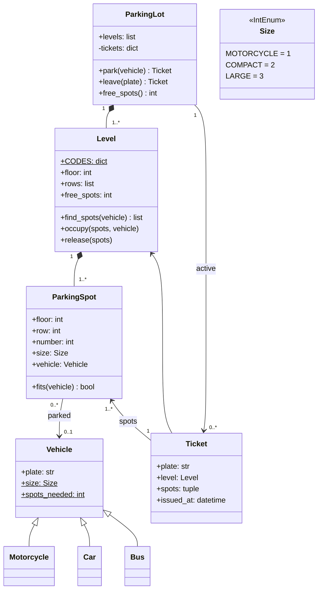

import { Aside } from '@astrojs/starlight/components';

The parking lot is probably the most-asked object-oriented design question. It is small enough to finish, yet it has real decisions: how to model sizes, who decides whether a vehicle fits, how to find a spot, and how to free it again. The original solution left the spot search empty; this one implements it.

<Aside type="tip" title="TL;DR">
- `ParkingLot` → `Level` → rows of `ParkingSpot`. `Vehicle` subclasses (`Motorcycle`, `Car`, `Bus`) carry only a **size** and the **number of spots** they need.
- Make `Size` an **ordered** enum. Then "does it fit?" is one comparison, `spot.size >= vehicle.size`, and no vehicle class needs custom fit logic.
- Single-spot vehicles take the **smallest** spot that fits (best fit), which keeps large spots for buses. A bus needs **5 adjacent** large spots in one row.
- `park` returns a `Ticket` that remembers the level and spots. `leave(plate)` uses it to free them in `O(spots)`.
</Aside>

## Problem and constraints

Design a parking lot that can park and remove vehicles. Questions to ask:

- **Which vehicles?** Motorcycle, car, bus.
- **Which spot sizes?** Motorcycle, compact, large. A motorcycle fits anywhere, a car fits compact or large, a bus needs five large spots in a row.
- **Multiple levels?** Yes. Fill the lowest level first.
- **Do we need payment, entry gates, displays?** Not in the base version, but a ticket with a timestamp leaves room for billing.
- **How is a vehicle identified on exit?** By licence plate (or by ticket).

## Design

- **`Size`**: `IntEnum` `MOTORCYCLE < COMPACT < LARGE`. Spots and vehicles share it.
- **`Vehicle`** and subclasses: a plate, plus class-level `size` and `spots_needed`. Adding a truck is a three-line class.
- **`ParkingSpot`**: floor, row, number, size, and the parked vehicle if any. `fits(vehicle)` checks free and big enough.
- **`Level`**: rows of spots, a free-spot counter, and the search (`find_spots`). It also occupies and releases spots, so the counter stays correct.
- **`Ticket`**: plate, level, the spots taken, time of entry.
- **`ParkingLot`**: the levels and a `plate → Ticket` index. It routes `park` to the first level with room and `leave` straight to the right level.



Two choices matter most. First, the fit rule lives in **one place** (`ParkingSpot.fits`), driven by data, instead of an abstract `can_fit_in_spot` repeated in every vehicle subclass. Second, the **ticket** is the link back from a vehicle to its spots. The vehicle object stays a plain value and does not hold pointers into the lot's internals.

## Implementation

```python title="parking_lot.py"
from dataclasses import dataclass, field
from datetime import UTC, datetime
from enum import IntEnum
from typing import ClassVar


class Size(IntEnum):
    """Ordered: a vehicle fits any spot at least as large as itself."""

    MOTORCYCLE = 1
    COMPACT = 2
    LARGE = 3


@dataclass(frozen=True)
class Vehicle:
    plate: str
    size: ClassVar[Size]
    spots_needed: ClassVar[int] = 1


class Motorcycle(Vehicle):
    size = Size.MOTORCYCLE


class Car(Vehicle):
    size = Size.COMPACT


class Bus(Vehicle):
    size = Size.LARGE
    spots_needed = 5  # five adjacent large spots in one row


@dataclass(eq=False)
class ParkingSpot:
    floor: int
    row: int
    number: int
    size: Size
    vehicle: Vehicle | None = None

    def fits(self, vehicle: Vehicle) -> bool:
        return self.vehicle is None and self.size >= vehicle.size


class Level:
    CODES: ClassVar[dict[str, Size]] = {"M": Size.MOTORCYCLE, "C": Size.COMPACT, "L": Size.LARGE}

    def __init__(self, floor: int, layout: list[str]) -> None:
        """layout: one string per row, e.g. "MMCCCLLLLL"."""
        self.floor = floor
        self.rows = [
            [ParkingSpot(floor, r, n, self.CODES[code]) for n, code in enumerate(row)]
            for r, row in enumerate(layout)
        ]
        self.free_spots = sum(len(row) for row in self.rows)

    def find_spots(self, vehicle: Vehicle) -> list[ParkingSpot] | None:
        if vehicle.spots_needed == 1:
            # Best fit: the smallest free spot that works keeps large spots for buses.
            candidates = (s for row in self.rows for s in row if s.fits(vehicle))
            best = min(candidates, key=lambda s: s.size, default=None)
            return [best] if best is not None else None
        for row in self.rows:  # multi-spot vehicles need a run of adjacent spots
            run: list[ParkingSpot] = []
            for spot in row:
                if not spot.fits(vehicle):
                    run = []
                    continue
                run.append(spot)
                if len(run) == vehicle.spots_needed:
                    return run
        return None

    def occupy(self, spots: list[ParkingSpot], vehicle: Vehicle) -> None:
        for spot in spots:
            spot.vehicle = vehicle
        self.free_spots -= len(spots)

    def release(self, spots: tuple[ParkingSpot, ...]) -> None:
        for spot in spots:
            spot.vehicle = None
        self.free_spots += len(spots)


@dataclass(frozen=True)
class Ticket:
    plate: str
    level: Level
    spots: tuple[ParkingSpot, ...]
    issued_at: datetime = field(default_factory=lambda: datetime.now(UTC))


class ParkingLot:
    def __init__(self, levels: list[Level]) -> None:
        self.levels = levels
        self._tickets: dict[str, Ticket] = {}  # plate -> active ticket

    def park(self, vehicle: Vehicle) -> Ticket | None:
        if vehicle.plate in self._tickets:
            raise ValueError(f"{vehicle.plate} is already parked")
        for level in self.levels:
            if level.free_spots < vehicle.spots_needed:
                continue  # cheap skip of full levels
            spots = level.find_spots(vehicle)
            if spots:
                level.occupy(spots, vehicle)
                ticket = Ticket(vehicle.plate, level, tuple(spots))
                self._tickets[vehicle.plate] = ticket
                return ticket
        return None  # lot is full for this vehicle size

    def leave(self, plate: str) -> Ticket:
        ticket = self._tickets.pop(plate)  # KeyError if the car is not here
        ticket.level.release(ticket.spots)
        return ticket

    def free_spots(self) -> int:
        return sum(level.free_spots for level in self.levels)


if __name__ == "__main__":
    lot = ParkingLot([Level(0, ["MCCLLLLL"]), Level(1, ["CCLLLLLL"])])
    t_car = lot.park(Car("CAR-1"))
    assert t_car and t_car.spots[0].size is Size.COMPACT        # best fit, not a large spot
    t_bus = lot.park(Bus("BUS-1"))
    assert t_bus and [s.number for s in t_bus.spots] == [3, 4, 5, 6, 7]
    t_bus2 = lot.park(Bus("BUS-2"))
    assert t_bus2 and t_bus2.level.floor == 1                   # level 0 has no 5-run left
    assert lot.park(Bus("BUS-3")) is None
    lot.park(Motorcycle("MOTO-1"))
    lot.leave("BUS-1")
    assert lot.park(Bus("BUS-3")) is not None                     # freed run is reused
    assert lot.free_spots() == 16 - 1 - 5 - 5 - 1
    print("ok")
```

## Complexity and trade-offs

With `L` levels and `S` spots per level:

| Operation | Time | Notes |
|---|---|---|
| `park` | `O(L · S)` worst case | Full levels are skipped by the counter |
| `leave` | `O(k)` | `k` spots of that vehicle, via the ticket |
| `free_spots` | `O(L)` | Counters per level |

- **Linear scan vs free lists.** Scanning a few hundred spots per level is instant. A 10,000-spot garage would keep a free set per size per level, so single-spot parking becomes `O(1)`. Buses still need a contiguous run, which is easiest to find by scanning large-spot rows (or keeping an interval structure of free runs).
- **Best fit vs first fit.** Best fit protects large spots, but it scans the whole level. First fit is faster and can strand buses. Since a bus needs five adjacent large spots, best fit is worth the cost here.
- **Lowest level first** is simple. A real garage might prefer the level nearest the entrance, or spread cars evenly to cut queues at the ramps. Make it a strategy if the interviewer goes there.

## Extensions

1. **Payment.** `Ticket.issued_at` plus a `Rate` per vehicle size gives the fee on exit. Model payment as a separate service that consumes closed tickets.
2. **Entry and exit gates, displays.** Gates call `park`/`leave`. Displays read per-level free counts by size. Keep counters per size so a display does not have to scan.
3. **Concurrency.** Several gates park at once. Lock per level and do "find + occupy" under the same lock, or two cars will be given the same spot. A database-backed version uses a transaction with `SELECT … FOR UPDATE SKIP LOCKED`.
4. **Reservations and EV charging.** Add a spot attribute (`reserved_for`, `has_charger`) and filter on it in `fits`. If the rules grow, move them into a matching policy object.
5. **A city-wide parking app.** Many lots, live availability and booking turn this into a system design question: lots publish occupancy events, a central service aggregates them, and bookings need [idempotent](/reliability/resilience-patterns/) APIs.

<Aside type="note" title="In the interview">
- Clarify vehicle types, spot sizes and the bus rule first. Write them down as a small table.
- Show the ordered-enum trick. It replaces a page of `if` statements and makes new sizes easy to add.
- Interviewers usually probe: "How do you find a spot quickly in a big garage?", "Two cars arrive at once?" and "How would you add payment?".
- Common mistakes: forgetting to free spots or update counters on exit, and letting a bus take five large spots that are not adjacent.
</Aside>

## Related topics

- [Design a call center](/ood/call-center/): routing work to the right free resource.
- [Design a hash map](/ood/hash-map/): the plate-to-ticket index is a hash map lookup.
- [Resilience patterns](/reliability/resilience-patterns/): idempotency and retries once parking becomes a networked service.
