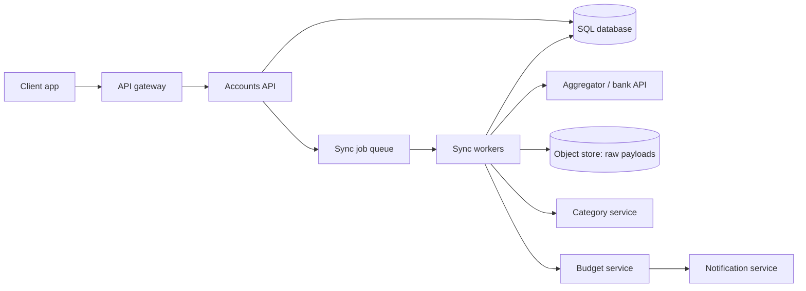
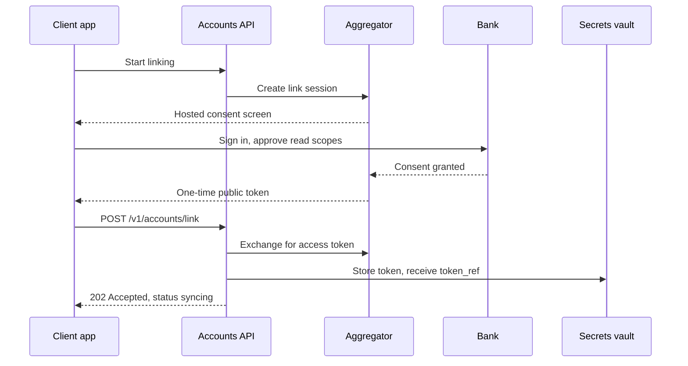
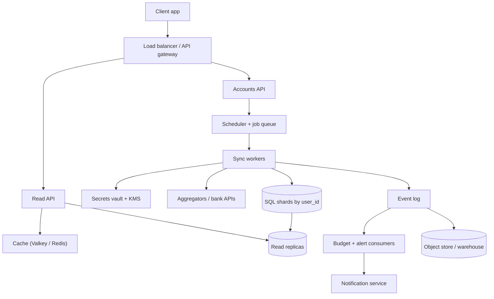

import { Aside } from '@astrojs/starlight/components';

A personal finance tracker pulls transactions from every bank, card and brokerage account
a user owns, sorts them into categories and warns the user before a budget runs out. Mint.com
was the best-known example; Intuit closed it in March 2024 and moved users to Credit Karma, but
the same problem now sits inside budgeting apps and bank apps. It is a good interview
question because most of the data comes from systems you do not control. The hard parts are
asynchronous ingestion, idempotency, categorisation, and keeping one user's financial data
away from everyone else.

<Aside type="tip" title="TL;DR">
- Users link accounts through an aggregator or a bank's open-banking API with OAuth-style consent. We store a **vault reference** to the access token and never the bank password.
- Ingestion is an **async pipeline**. A scheduler and provider webhooks feed a job queue. Sync workers pull incremental changes by cursor and upsert them idempotently.
- Categorisation tries **user rule, then merchant table, then MCC, then an ML model**. Budgets are running aggregates, and an alert fires only when a threshold is crossed.
- OLTP data lives in **SQL sharded by `user_id`**, with row-level security as a backstop. Raw payloads and history go to object storage and a warehouse, and dashboards are read through a cache.
</Aside>

## Step 1 — Requirements and constraints

### Use cases

In scope:

- **User** links a financial account (bank, credit card, brokerage) through the provider's consent flow.
- **Service** pulls transactions when an account is first linked (with history backfill), when the user asks for a refresh, and once a day for users active in the last 30 days.
- **Service** categorises every transaction. The user can override a category, and the service never re-categorises an overridden transaction.
- **Service** computes monthly spending per category.
- **Service** suggests a budget. The user can set their own, and the service notifies them when they approach or exceed it. Notifications do not need to be instant.
- **User** views dashboards and recent transactions.

Out of scope: moving money, bill pay, credit scores, investment advice, product analytics.

### Non-functional requirements

- **Availability:** dashboards stay readable even when a bank or aggregator is down. Ingestion may lag by minutes or hours.
- **Correctness:** no duplicate and no lost transactions. Money is stored as integer minor units (cents), never as floats.
- **Security and privacy:** regulated financial data. Tokens are protected, tenants are strictly isolated, and access is audited.
- **Resilience to upstreams:** providers rate-limit, fail, change data after the fact and ask users to re-consent.

### Assumptions

- 10 million users with 30 million linked accounts.
- 5 billion transactions per month. That is 500 per user per month, which is generous, so we treat it as a stress figure.
- 500 million read requests per month, so writes outnumber reads 10:1. People spend every day but rarely open the app.
- Traffic is uneven. Adding or removing accounts is rare.
- 10 budget categories per user (100 million budget items) and 50,000 well-known merchants for seeding.

### Back-of-the-envelope

| Quantity | Calculation | Result |
|---|---|---|
| Transaction writes | 5 B ÷ 2.592 M s per month | ≈ 1,930/s average, plan for ≈ 10,000/s peak |
| Read requests | 500 M ÷ 2.592 M s | ≈ 190/s average, ≈ 1,000/s peak |
| Daily background syncs | 30 M accounts × ~50 % active | 15 M/day ≈ 175/s, or ≈ 700/s in a 6-hour window |
| Transaction row | ids, amount, currency, merchant, category, flags | ≈ 175 B, ≈ 350 B with indexes |
| New transaction data | 5 B × 350 B | ≈ 1.75 TB/month, ≈ 63 TB in 3 years |
| Monthly aggregates | 10 M users × 10 categories | ≤ 100 M rows/month (≈ 4.6 GB) |
| Merchant dictionary | 50,000 × 255 B | ≈ 12.8 MB, fits in every worker's memory |

<Aside type="note" title="About the classic numbers">
The often-quoted "2,000 writes/s" comes from rounding a month to 2.5 M seconds. A 30-day
month gives about 1,930/s, which is close enough. The bigger gap is row size. A 50-byte row
(250 GB/month, 9 TB in 3 years) leaves out ids, currency, category and index overhead. A
realistic row with indexes is about 7× larger, and that changes how much history we can keep
hot in the database.
</Aside>

## Step 2 — High-level design



1. The **Accounts API** handles linking. It stores the account metadata and a reference to the access token, then enqueues a backfill job.
2. **Sync workers** take jobs from the queue and call the provider for new, changed and removed transactions. Each raw response goes to the **object store** for replay and audit.
3. Each transaction gets a category from the **Category service** and is upserted into the **SQL database**.
4. The **Budget service** updates monthly totals. When a threshold is crossed, the **Notification service** sends an alert, queued and batched, never inline.

Ingestion is asynchronous because a single sync can take seconds to minutes. Banks are slow,
paginate deeply and sometimes time out. The user gets `202 Accepted` and sees the data
appear as it arrives.

## Step 3 — Core components

### Linking an account

We never collect the user's bank password. The user signs in at the bank or the aggregator's
hosted page and approves read scopes. Our backend then receives a short-lived one-time token
and exchanges it for a long-lived access token.



```http title="Link request"
POST /v1/accounts/link
Content-Type: application/json

{"public_token": "public-7f3c...", "institution_id": "ins_1042"}
```

```json title="Response: 202 Accepted"
{"accounts": [{"account_id": "acc_9f2", "mask": "4821", "status": "syncing"}]}
```

### Data model

The OLTP tables are keyed by user, because every query a user makes is about their own data.

```sql title="schema.sql"
CREATE TABLE linked_accounts (
  account_id      bigint PRIMARY KEY,
  user_id         bigint NOT NULL REFERENCES users(user_id),
  provider        text   NOT NULL,          -- aggregator or bank API
  provider_item   text   NOT NULL,          -- provider's connection id
  token_ref       text   NOT NULL,          -- pointer into the vault, never the token
  sync_cursor     text,                     -- last cursor returned by the provider
  status          text   NOT NULL,          -- active | reauth_required | revoked
  consent_expires timestamptz,
  last_synced_at  timestamptz
);

CREATE TABLE transactions (
  user_id         bigint  NOT NULL,
  txn_id          bigint  NOT NULL,
  account_id      bigint  NOT NULL,
  provider_txn_id text    NOT NULL,
  posted_on       date    NOT NULL,
  amount_minor    bigint  NOT NULL,         -- cents; never floats for money
  currency        char(3) NOT NULL,
  merchant_raw    text    NOT NULL,
  merchant_id     bigint,
  category        text    NOT NULL,
  category_source text    NOT NULL,         -- user | rule | mcc | model
  pending         boolean NOT NULL,
  PRIMARY KEY (user_id, txn_id),
  UNIQUE (account_id, provider_txn_id)      -- makes re-ingestion idempotent
);
CREATE INDEX ON transactions (user_id, posted_on DESC);

CREATE TABLE monthly_spending (
  user_id      bigint NOT NULL,
  month        date   NOT NULL,             -- first day of the month
  category     text   NOT NULL,
  amount_minor bigint NOT NULL,
  PRIMARY KEY (user_id, month, category)
);
```

Older designs stored the bank login and a password hash. A hash cannot log anyone into a
bank, and a plaintext password is exactly what open-banking consent exists to replace. Here
the database holds only `token_ref`.

### The ingestion pipeline

Four things create a sync job: a new link (backfill, often up to 24 months), a manual refresh,
the daily scheduler, and a provider webhook saying updates are available. A sync worker then:

1. **Deduplicates.** Only one sync per account runs at a time, enforced by a lease keyed by `account_id`. Extra triggers collapse into the running job.
2. **Fetches the token** from the vault. Only sync workers can decrypt it.
3. **Pulls changes incrementally** with the stored cursor. Modern aggregator APIs return pages of *added*, *modified* and *removed* transactions plus a next cursor, so we never re-download history.
4. **Writes the raw page** to object storage. When a parsing bug ships, we can replay from it.
5. **Normalises and categorises.** It cleans merchant strings and maps them to a `merchant_id`.
6. **Upserts** on `(account_id, provider_txn_id)`, saves the new cursor **in the same transaction**, and writes a `TransactionChanged` event to an outbox table. A relay later publishes it to the event log.

Two details make or break correctness:

- **Pending → posted.** Card transactions usually appear as *pending* and settle days later. Some providers then delete the pending record and add a new posted one. Budgets must therefore be reversible: a removal subtracts what an addition added.
- **Retries.** Upstreams fail often. Use exponential backoff with jitter, a circuit breaker per institution, and per-institution concurrency limits. If consent has expired, mark the account `reauth_required` and ask the user to reconnect. Retrying will not fix it.

### Categorisation

Categorisation tries the cheapest, most trustworthy signal first:

1. **User rule.** "Costco is groceries for me" always wins.
2. **Merchant dictionary.** Seeded with the top 50,000 merchants and grown from user overrides. When at least 70 % of 50+ distinct users relabel a merchant the same way, the relabel is promoted to the dictionary.
3. **MCC.** The card network's merchant category code, when the provider passes it on.
4. **ML model.** A classifier over the merchant string, amount and MCC. Below a confidence threshold the transaction stays *Uncategorised* and the user is asked.

```python title="categorize.py"
from dataclasses import dataclass
from decimal import Decimal
from enum import StrEnum
from typing import Protocol


class Category(StrEnum):
    HOUSING = "housing"
    GROCERIES = "groceries"
    FUEL = "fuel"
    SHOPPING = "shopping"
    UNCATEGORIZED = "uncategorized"


@dataclass(frozen=True)
class Transaction:
    user_id: int
    merchant: str          # normalised merchant name, e.g. "shell"
    mcc: str | None        # card network merchant category code, if present
    amount: Decimal        # positive = money out


class Model(Protocol):
    def predict(self, txn: Transaction) -> tuple[Category, float]: ...


class Categorizer:
    """Resolution order: user rule > merchant table > MCC > ML model."""

    def __init__(self, user_rules: dict[tuple[int, str], Category],
                 merchants: dict[str, Category], mcc_map: dict[str, Category],
                 model: Model, min_confidence: float = 0.7) -> None:
        self.user_rules = user_rules
        self.merchants = merchants
        self.mcc_map = mcc_map
        self.model = model
        self.min_confidence = min_confidence

    def categorize(self, txn: Transaction) -> Category:
        if (rule := self.user_rules.get((txn.user_id, txn.merchant))) is not None:
            return rule
        if (cat := self.merchants.get(txn.merchant)) is not None:
            return cat
        if txn.mcc and (cat := self.mcc_map.get(txn.mcc)) is not None:
            return cat
        cat, confidence = self.model.predict(txn)
        return cat if confidence >= self.min_confidence else Category.UNCATEGORIZED
```

Many aggregators now return their own category with a confidence level. Treat it as one more
signal in the chain, not as the final answer.

### Budgets and notifications

A default budget is a template: shares of income per category. We store only the categories a
user overrides, not all 100 M budget items. Monthly spend is kept **incrementally**. Each
`TransactionChanged` event adds or subtracts its amount from `monthly_spending`, and a nightly
job recomputes totals from `transactions` to repair any drift. This is the classic
"MapReduce over transaction logs" idea, split into a streaming part and a batch part.

```python title="budget.py"
from collections import defaultdict
from dataclasses import dataclass
from decimal import Decimal
from enum import StrEnum


class Alert(StrEnum):
    NEARING = "nearing"
    EXCEEDED = "exceeded"


@dataclass(frozen=True)
class Spend:
    user_id: int
    month: str        # "2026-10"
    category: str
    amount: Decimal


def monthly_totals(events: list[Spend]) -> dict[tuple[int, str, str], Decimal]:
    """The 'reduce' step: sum spend per (user, month, category)."""
    totals: dict[tuple[int, str, str], Decimal] = defaultdict(Decimal)
    for e in events:
        totals[(e.user_id, e.month, e.category)] += e.amount
    return totals


def check_budget(before: Decimal, after: Decimal, limit: Decimal,
                 threshold: Decimal = Decimal("0.8")) -> Alert | None:
    """Fire only when a threshold is crossed, so each alert is sent once."""
    if before <= limit < after:
        return Alert.EXCEEDED
    if before < limit * threshold <= after <= limit:
        return Alert.NEARING
    return None
```

Every alert carries an idempotency key `(user, category, month, level)`, so a retried event
cannot send it twice. Alerts go through a queue and can be grouped into a daily digest.

### Security and tenant isolation

- **Tokens:** keep them in a secrets vault with envelope encryption. A KMS key wraps the per-record data keys. Only the sync workers' identity may decrypt, and every decrypt is logged.
- **Tenant isolation:** every query is scoped by `user_id` in the data-access layer. PostgreSQL row-level security (`CREATE POLICY ... USING (user_id = current_setting('app.user_id')::bigint)`) catches the query someone forgot to scope.
- **Least data:** never store card numbers or bank credentials. Encrypt merchant strings and amounts at rest. Delete everything, including raw payloads, when the user unlinks or closes the account.
- **Webhooks:** verify the provider's signature, and treat a webhook as a hint to sync, never as data to trust.
- **User login:** passkeys or MFA, short-lived sessions, and step-up authentication before linking new accounts.

## Step 4 — Scaling the design

Benchmark first, then fix bottlenecks one at a time.

1. **Dashboard reads (≈ 1,000/s at peak).** Put monthly aggregates and the latest page of transactions in a cache such as Valkey or Redis, keyed by user (cache-aside). Invalidate on `TransactionChanged`. Read replicas absorb the misses.
2. **Transaction writes (≈ 10,000 rows/s at peak plus index maintenance).** This is too much for one primary at comfortable headroom. Shard by `user_id` so each user's accounts, transactions and aggregates live on one shard and every query stays single-shard. Inside a shard, range-partitioning `transactions` by month lets old months be detached cheaply. In PostgreSQL the month must then be part of the primary and unique keys.
3. **Storage growth (≈ 63 TB in 3 years).** Keep about 13 months hot in OLTP, roughly 23 TB across all shards. Export older months as Parquet to object storage and query them through a warehouse. Raw payloads move to colder storage tiers by lifecycle rule.
4. **Upstream limits, the real bottleneck.** Providers throttle per client and per institution. The scheduler spreads daily syncs over the whole day by hashing `user_id`, applies a token bucket per institution, and prefers webhooks over polling.
5. **Aggregation.** Replace nightly MapReduce over log files with a stream: an event log feeds budget consumers within seconds. A batch job in the warehouse handles reconciliation and analytics.



| Added component | What it buys | What it costs |
|---|---|---|
| Cache | Fast dashboards, absorbs peaks | Invalidation logic, brief staleness |
| Sharding by `user_id` | Linear write scaling, small blast radius | Resharding, no cheap cross-user queries |
| Event log + consumers | Near-real-time budgets, decoupled services | At-least-once delivery, so idempotent consumers |
| Warehouse / lakehouse | Cheap history, analytics off the OLTP path | A second copy of sensitive data to secure |
| Per-institution scheduler | Stays within provider limits | More scheduling logic to build and run |

## What's different in 2026

- **APIs instead of screen scraping.** Mint-era aggregators logged into bank websites with the user's stored password. Account access now increasingly goes through consent-based APIs:
  - **EU:** PSD2 made bank APIs mandatory, and the PSD3 and Payment Services Regulation package reached a provisional deal in November 2025.
  - **UK:** an open-banking regime that is moving onto a statutory footing.
  - **US:** the industry-led FDX API standard. The CFPB's Section 1033 rule was finalised in October 2024, then put under reconsideration and blocked by a court in late 2025. A revised proposal went to OIRA review in August 2026.

  Design for **re-consent**, **consent expiry** and **per-call fees**, which some big US banks now negotiate with aggregators.
- **Buy the connectivity.** Few teams integrate thousands of institutions themselves. They use one or two aggregators behind an internal provider interface, so they can fail over or switch between them.
- **Cursor sync and webhooks** replace "download the last 30 days every night". Providers report additions, changes and removals, so pending-to-posted churn is explicit.
- **Streaming plus a lakehouse** replaces nightly MapReduce. A typical stack is Kafka or a managed log, simple consumers or Flink, and Iceberg or Delta tables queried from BigQuery, Snowflake or Redshift.
- **Managed or distributed SQL.** Aurora, AlloyDB, Citus, CockroachDB or Spanner handle sharding and failover that teams used to build by hand.
- **Categorisation models** are small classifiers or embedding models in the hot path. Large language models help offline: they label the long tail of merchants and suggest dictionary entries, but they are too slow and costly for every transaction.
- **Security baselines:** the FAPI 2.0 Security Profile (final in 2025) requires PAR, PKCE and sender-constrained tokens. OAuth security best practice is published as RFC 9700.
- **What still holds:** asynchronous ingestion behind a queue, per-user partitioning, idempotent upserts, pre-aggregated monthly tables and cache-aside reads.

<Aside type="note" title="In the interview">
- **How do you avoid duplicate transactions?** Use a unique key on the provider's transaction id per account, upsert, and save the cursor in the same database transaction.
- **A bank is down for 6 hours. What happens?** A circuit breaker opens for that institution and jobs back off. Dashboards show "last updated at …" and nothing else is affected.
- **The user re-categorises a transaction.** Write a user rule, adjust both affected monthly totals, and possibly re-evaluate alerts. Never overwrite the user's choice automatically.
- **Why not compute budgets with a nightly batch only?** Alerts would arrive a day late. Streaming makes them timely, and the batch still repairs drift.
- **Where are the credentials?** Nowhere. Only consented tokens exist, encrypted in a vault, decryptable by one service.
- **Common mistakes:** floats for money, scanning all transactions on every page view, synchronous calls to banks inside the user's request, and treating webhooks as trusted data.
</Aside>

## Further reading

- [FAPI 2.0 Security Profile](https://openid.net/specs/fapi-security-profile-2_0-final.html): the security profile behind modern open-banking APIs.
- [RFC 9700: Best Current Practice for OAuth 2.0 Security](https://www.rfc-editor.org/rfc/rfc9700.html)
- [CFPB: Personal financial data rights (Section 1033)](https://www.consumerfinance.gov/personal-financial-data-rights/)
- [Financial Data Exchange (FDX)](https://financialdataexchange.org/): the US industry API standard.
- [Plaid: transactions webhooks and sync](https://plaid.com/docs/transactions/webhooks/): a concrete example of cursor-based incremental sync.
- [PostgreSQL: row security policies](https://www.postgresql.org/docs/current/ddl-rowsecurity.html)

## Related topics

- [Queues and back pressure](/async/queues-and-back-pressure/): the sync job queue and its retry behaviour.
- [Event streaming](/async/event-streaming/): the transaction event log that feeds budgets.
- [Partitioning and sharding](/data/partitioning-and-sharding/): sharding by `user_id`.
- [Cache strategies](/caching/cache-strategies/): cache-aside dashboards and invalidation.
- [Security](/reliability/security/): secrets, encryption and tenant isolation.
- [Resilience patterns](/reliability/resilience-patterns/): backoff, circuit breakers per institution.
