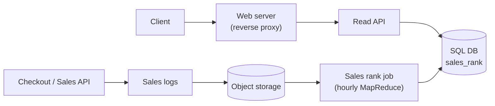
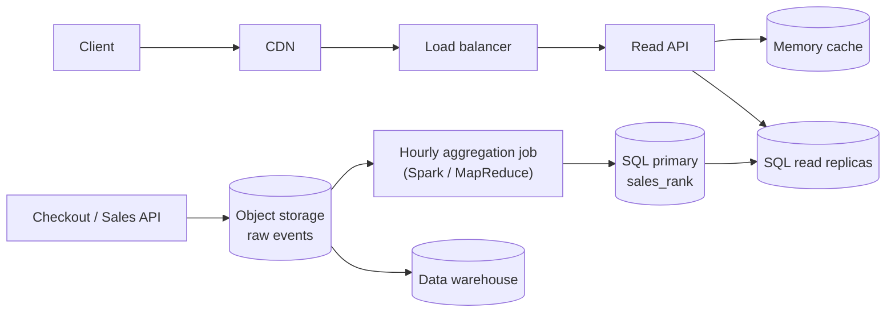
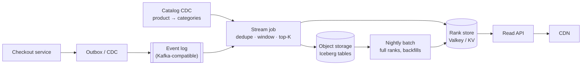

import { Aside } from '@astrojs/starlight/components';

A "Best Sellers in Books" list looks like a simple `ORDER BY units DESC LIMIT 100`. At marketplace scale it is two different systems glued together: a **write-heavy aggregation pipeline** that turns a billion order lines a month into per-category counts, and a **read-heavy serving layer** that answers hundreds of thousands of requests per second from a dataset that fits in a few megabytes. This case study builds the classic batch version first, then shows how a team would do it with streaming in 2026.

<Aside type="tip" title="TL;DR">
- Sales events land in a durable log and in object storage; nothing on the checkout path waits for ranking.
- An aggregation job counts units per `(category, product)` over a sliding 7-day window: an hourly batch job (MapReduce/Spark) in the classic design, a windowed streaming job (Flink/Kafka Streams) with hourly panes today.
- Top-N per category is a bounded heap per key, not a global sort. Approximate sketches (Count-Min, Space-Saving) are for unbounded key spaces, not for 25 million product–category pairs.
- The read side is tiny (top 100 × 1,000 categories ≈ 1.6 MB): publish versioned snapshots to a key-value store, cache them in memory and at the CDN.
</Aside>

## Step 1 — Requirements and constraints

### Use cases

**In scope**

- The service computes the **most popular products per category over the past week**, ranked by units sold.
- A user views the best-seller list of a category (paged, top 100).
- A product page shows the product's rank in each of its categories ("#1,234 in Kitchen").
- The service is highly available: a stale list is acceptable, an error page is not.

**Out of scope**

- The rest of the store: catalog, checkout, payments, search.
- Personalised rankings and recommendations.

### Non-functional requirements

- **Freshness:** lists updated at least hourly; the head of popular categories ideally within minutes.
- **Read latency:** p99 under 50 ms at the API, most requests served from a cache or CDN.
- **Correctness:** duplicate or replayed events must not inflate counts; cancellations and refunds must be subtracted.
- **Availability:** reads keep working when the aggregation pipeline is down; they just get older.

### Assumptions

- 10 million products, 1,000 flat categories (no sub-categories in the base problem).
- A product can belong to several categories (2.5 on average) and does not change category.
- 1 billion order lines per month; 100 billion rank reads per month (100:1 read-to-write).
- Traffic is uneven: assume peak = 5× average (holiday sales, Prime-Day-style events).

### Back-of-the-envelope

One order-line event: line id (16 B), timestamp (8 B), product, seller and buyer ids (8 B each), quantity (4 B), price in cents (8 B), currency (4 B) — **64 bytes** before compression. A month has 30 × 86,400 = 2,592,000 seconds.

| Quantity | Calculation | Result |
|---|---|---|
| Order lines per second | 10⁹ / 2.592 M s | ≈ 386 avg, ≈ 1,900 peak |
| Rank reads per second | 10¹¹ / 2.592 M s | ≈ 38,600 avg, ≈ 193,000 peak |
| New raw events per month | 10⁹ × 64 B | 64 GB |
| Raw events over 3 years | 64 GB × 36 | ≈ 2.3 TB |
| Events in a 7-day window | 10⁹ × 7 / 30 | ≈ 233 million |
| Rescanning a full week every hour | 233 M × 64 B | ≈ 15 GB per run, ≈ 358 GB/day |
| Exact counters for all pairs | 10 M × 2.5 × 24 B | ≈ 600 MB |
| Published top-100 lists | 1,000 × 100 × 16 B | ≈ 1.6 MB |

Two conclusions shape the design. First, **exact counting fits in memory** — 600 MB of counters is nothing for a modern stream processor, so approximation is an option, not a necessity. Second, **the read set is tiny and the read rate is huge**, which is the textbook case for caching and CDN.

<Aside type="note" title="Arithmetic fixes vs. the original">
The original primer listed field sizes that add up to 42 bytes but called the total "~40 bytes", and its "2.5 million seconds per month" rule of thumb rounds 386 writes/s up to 400 and 38,580 reads/s up to 40,000. The rounding is fine for an interview; just say which side you rounded to.
</Aside>

## Step 2 — High-level design



- The **Sales API** writes every order line to its log. Logs are shipped to **object storage** (S3, GCS, Azure Blob) in hourly folders; the store keeps them for years at low cost.
- Every hour the **sales rank job** reads the last 7 days of logs, totals units per `(category, product)`, keeps the top N per category plus full ranks, and writes a new snapshot to the **`sales_rank` table**.
- The **Read API** answers list and product-rank queries from that table. Nothing on the checkout path depends on the ranking pipeline.

## Step 3 — Core components

### The batch job

The original solution used a two-step MapReduce: map each log line to `((category, product), quantity)`, reduce by summing, then re-key by `(category, quantity)` so the framework's distributed sort orders the output. Two details are worth improving:

- A global sort is wasted work: we only need the top N of each category, which a **bounded heap per category** gives in `O(n log N)`.
- Logs are delivered **at least once**, so the job must drop duplicate order lines first, and a product in several categories must be counted in each of them.

The version below runs on a tiny sample with plain Python; the three functions are exactly what a Spark or Beam job would distribute across workers.

```python title="sales_rank_batch.py"
from collections import defaultdict
from collections.abc import Iterable, Iterator
from dataclasses import dataclass
from datetime import datetime, timedelta
import heapq

# order_line_id, timestamp, product_id, quantity (tab-separated, like the raw log)
SAMPLE = """\
ol-1\t2026-10-06T09:12:00\tp1\t2
ol-2\t2026-10-06T10:40:00\tp2\t3
ol-3\t2026-10-07T11:05:00\tp1\t1
ol-3\t2026-10-07T11:05:00\tp1\t1
ol-4\t2026-10-07T15:00:00\tp3\t7
ol-5\t2026-10-08T08:45:00\tp4\t1
ol-6\t2026-09-20T08:00:00\tp4\t50"""  # ol-3 arrived twice; ol-6 is older than a week

CATALOG: dict[str, tuple[str, ...]] = {  # product -> its categories (can be several)
    "p1": ("books", "gifts"), "p2": ("books",), "p3": ("toys", "gifts"), "p4": ("books",),
}


@dataclass(frozen=True)
class Sale:
    line_id: str
    ts: datetime
    product: str
    qty: int


def parse(lines: Iterable[str]) -> Iterator[Sale]:
    for line in lines:
        line_id, ts, product, qty = line.split("\t")
        yield Sale(line_id, datetime.fromisoformat(ts), product, int(qty))


def distinct(sales: Iterable[Sale]) -> Iterator[Sale]:
    """Stage 0: logs are at-least-once, so drop repeated order lines."""
    seen: set[str] = set()
    for sale in sales:
        if sale.line_id not in seen:
            seen.add(sale.line_id)
            yield sale


def map_sales(sales: Iterable[Sale], since: datetime) -> Iterator[tuple[tuple[str, str], int]]:
    """Map: keep last week's sales, fan out to every category of the product."""
    for sale in sales:
        if sale.ts >= since:
            for category in CATALOG.get(sale.product, ()):
                yield (category, sale.product), sale.qty


def shuffle[K, V](pairs: Iterable[tuple[K, V]]) -> dict[K, list[V]]:
    """What the framework does between map and reduce: group values by key."""
    groups: dict[K, list[V]] = defaultdict(list)
    for key, value in pairs:
        groups[key].append(value)
    return groups


def reduce_sum(groups: dict[tuple[str, str], list[int]]) -> Iterator[tuple[str, tuple[int, str]]]:
    """Reduce 1: units per (category, product), re-keyed by category."""
    for (category, product), quantities in groups.items():
        yield category, (sum(quantities), product)


def reduce_top_n(groups: dict[str, list[tuple[int, str]]], n: int) -> dict[str, list[tuple[int, str]]]:
    """Reduce 2: a bounded heap per category instead of a global sort."""
    return {category: heapq.nlargest(n, items) for category, items in groups.items()}


if __name__ == "__main__":
    week_ago = datetime(2026, 10, 8, 12, 0) - timedelta(days=7)
    pairs = map_sales(distinct(parse(SAMPLE.splitlines())), since=week_ago)
    ranking = reduce_top_n(shuffle(reduce_sum(shuffle(pairs))), n=2)
    for category, top in sorted(ranking.items()):
        print(category, top)
    # books [(3, 'p2'), (3, 'p1')]
    # gifts [(7, 'p3'), (3, 'p1')]
    # toys [(7, 'p3')]
```

Note the tie in `books`: two products sold three units each. Pick a deterministic tie-breaker (higher revenue, then product id) so the list does not flicker between runs.

Rescanning the whole week every hour reads about 15 GB per run. A cheaper variant aggregates **one hour at a time** into an `sales_hourly` table and computes the week as the sum of the last 168 hourly rows — the same idea that streaming engines call *panes*.

### Data model

Keep hourly aggregates as the source of truth and publish rankings as **immutable snapshots**, so readers never see a half-written list:

```sql
CREATE TABLE sales_hourly (            -- one row per product, category and hour
  hour_start   TIMESTAMP NOT NULL,
  category_id  INTEGER   NOT NULL,
  product_id   BIGINT    NOT NULL,
  units        INTEGER   NOT NULL,     -- net of cancellations and refunds
  PRIMARY KEY (hour_start, category_id, product_id)
);

CREATE TABLE rank_snapshot (
  snapshot_id  BIGINT PRIMARY KEY,
  window_start TIMESTAMP NOT NULL,
  window_end   TIMESTAMP NOT NULL,
  published_at TIMESTAMP              -- NULL until the snapshot is complete
);

CREATE TABLE sales_rank (
  snapshot_id  BIGINT  NOT NULL REFERENCES rank_snapshot (snapshot_id),
  category_id  INTEGER NOT NULL,
  rank         INTEGER NOT NULL,
  product_id   BIGINT  NOT NULL,
  units_sold   INTEGER NOT NULL,
  PRIMARY KEY (snapshot_id, category_id, rank)
);
CREATE INDEX sales_rank_by_product ON sales_rank (snapshot_id, product_id);
```

The weekly ranking is one window-function query over the hourly table:

```sql
SELECT category_id, product_id, units, rnk
FROM (
  SELECT category_id, product_id, SUM(units) AS units,
         ROW_NUMBER() OVER (PARTITION BY category_id
                            ORDER BY SUM(units) DESC, product_id) AS rnk
  FROM sales_hourly
  WHERE hour_start >= :window_start
  GROUP BY category_id, product_id
) AS ranked
WHERE rnk <= :top_n;
```

Publishing is a pointer flip: write all rows for the new `snapshot_id`, then set `published_at`. Readers always use the latest published snapshot, and a bad run is rolled back by un-publishing it.

### Read API

```http
GET /v1/categories/1234/best-sellers?limit=3
```

```json
{
  "category_id": 1234,
  "snapshot_id": 88231,
  "window": {"start": "2026-10-01T12:00:00Z", "end": "2026-10-08T12:00:00Z"},
  "items": [
    {"rank": 1, "product_id": 50,  "units_sold": 100000, "rank_change": 0},
    {"rank": 2, "product_id": 200, "units_sold": 90000,  "rank_change": 3},
    {"rank": 3, "product_id": 3,   "units_sold": 80000,  "rank_change": -1}
  ],
  "next_cursor": "eyJyYW5rIjozfQ"
}
```

```http
GET /v1/products/50/sales-rank
→ {"snapshot_id": 88231, "ranks": [{"category_id": 1234, "rank": 1}, {"category_id": 77, "rank": 412}]}
```

Responses carry the `snapshot_id`, so they are cacheable with `Cache-Control: max-age=60, stale-while-revalidate=300`. Internal services can call the same operations over gRPC.

## Step 4 — Scaling the design

Benchmark, find the bottleneck, fix it, repeat. In order of appearance:

1. **Reads (≈ 193,000/s at peak).** The working set is the top pages of a few hundred popular categories. Put the lists in an in-memory cache (Redis/Valkey or a local in-process cache refreshed on each snapshot) and cache API responses at the **CDN**. At a 99 % hit ratio the origin sees about 1,900 requests per second. Product-page ranks are read with the product and can be embedded in the product document.
2. **The ranking database.** With caching it mostly serves misses and the publishing job. Add read replicas for failover and misses; the writes are hourly bulk loads, not a stream of small updates.
3. **Raw data growth (2.3 TB over 3 years).** Keep only recent hourly aggregates in the SQL database; raw events stay in object storage as compressed columnar files (Parquet), queried by a warehouse (BigQuery, Redshift, Snowflake) for analysis and backfills.
4. **Job runtime.** Incremental hourly aggregation removes the 358 GB/day rescan. If the job is still slow, the skew is usually a few giant categories: pre-aggregate per `(category, product)` before grouping by category (a *combiner*), and compute heaps per partition, then merge.
5. **Write path.** 1,900 events/s at peak is small for a log; the risk is coupling. Checkout writes an event (outbox table or change data capture) and never calls the ranking service synchronously.



| Component | What it buys | What it costs |
|---|---|---|
| CDN + memory cache | Absorbs > 99 % of reads, survives spikes | Up to a minute of extra staleness, invalidation per snapshot |
| Read replicas | Failover, capacity for cache misses | Replication lag, more machines |
| Hourly aggregates | Job cost proportional to one hour, not one week | One more table, late-data handling |
| Object storage + warehouse | Cheap retention, ad-hoc analysis, backfills | A second copy of the data to govern |

## What's different in 2026

The batch design still works and is easy to reason about. What changed is that **streaming is now the default for "top N over a sliding window"**: every major cloud sells a managed Kafka-compatible log, and managed Flink is available from AWS and from several Flink vendors, so the "updated hourly" constraint can become "updated every minute" without a bigger team.



### Windows in event time

The stream job works in **event time** (when the sale happened), not processing time, and uses **watermarks** to decide when an hour is complete. A sliding 7-day window that advances every hour would put each event into 168 overlapping windows if implemented naively. Engines avoid that copy by storing **hourly panes** and combining them: the weekly total is the sum of 168 pane totals, updated by adding the newest pane and retracting the oldest.

```python title="sliding_topk.py"
from collections import Counter, defaultdict
from dataclasses import dataclass, field
import heapq

PANES = 7 * 24  # a 7-day window made of 168 hourly panes


@dataclass
class CategoryWindow:
    """Sliding 7-day totals for one category, built from hourly panes."""
    panes: dict[int, Counter[str]] = field(default_factory=dict)  # hour -> units by product
    totals: Counter[str] = field(default_factory=Counter)         # sum of the live panes

    def add(self, hour: int, product: str, qty: int) -> None:
        self.panes.setdefault(hour, Counter())[product] += qty     # a late event lands in its own hour
        self.totals[product] += qty

    def advance(self, now_hour: int) -> None:
        """On each watermark tick, retract whole panes that slid out of the window."""
        for hour in [h for h in self.panes if h <= now_hour - PANES]:
            self.totals.subtract(self.panes.pop(hour))
        self.totals = +self.totals                                  # drop products that fell to zero

    def top(self, n: int) -> list[tuple[str, int]]:
        return heapq.nlargest(n, self.totals.items(), key=lambda kv: kv[1])


windows: defaultdict[str, CategoryWindow] = defaultdict(CategoryWindow)
events = [(0, "books", "p1", 5), (1, "books", "p2", 3),      # (event hour, category, product, qty)
          (100, "books", "p2", 4), (169, "books", "p3", 1)]
for hour, category, product, qty in events:
    windows[category].add(hour, product, qty)
windows["books"].advance(now_hour=169)                        # hours 0 and 1 leave the window
print(windows["books"].top(2))                                # [('p2', 4), ('p3', 1)]
```

Cancellations and refunds arrive as negative quantities in the same stream, so the counts stay net. Late events within the allowed lateness update their own pane; anything later goes to a correction path (the nightly batch).

### Top-K per category, at scale

- **Exact, partitioned.** Partition the stream by `product_id`, keep exact totals, and let each partition emit its local top N per category. Because every product lives in exactly one partition, the global top N is contained in the union of local top-N lists, so a small merge step is exact. This also defuses hot categories: "Books" is spread over all partitions instead of one.
- **Approximate, bounded memory.** When the key space is unbounded — search queries, URLs, hashtags, or every product × every region × every window — exact counters stop fitting. A **Count-Min Sketch** estimates any item's count with a one-sided error of at most `ε × N` (N = total count), using `⌈e/ε⌉ × ⌈ln(1/δ)⌉` counters. Pair it with a small heap of candidates to get **heavy hitters**. Sketches with the same width, depth and hash functions merge by adding cells, so per-partition sketches combine cleanly. **Space-Saving** and the frequent-items sketch in Apache DataSketches solve the same problem with tighter guarantees for the top items.

```python title="cms_topk.py"
import hashlib
import heapq
import math
import random


class CountMinTopK:
    """Count-Min Sketch for frequencies plus a small candidate set for the top k."""

    def __init__(self, epsilon: float, delta: float, k: int) -> None:
        self.width = math.ceil(math.e / epsilon)     # overestimate <= epsilon * total ...
        self.depth = math.ceil(math.log(1 / delta))  # ... with probability >= 1 - delta
        self.rows = [[0] * self.width for _ in range(self.depth)]
        self.k = k
        self.candidates: dict[str, int] = {}         # at most k items with their estimates

    def _cells(self, item: str) -> list[int]:
        digest = hashlib.blake2b(item.encode(), digest_size=16).digest()
        h1, h2 = int.from_bytes(digest[:8]), int.from_bytes(digest[8:])
        return [(h1 + i * h2) % self.width for i in range(self.depth)]  # double hashing

    def add(self, item: str, count: int = 1) -> None:
        estimate = math.inf
        for row, col in zip(self.rows, self._cells(item)):
            row[col] += count
            estimate = min(estimate, row[col])       # the least-collided cell is the best guess
        self.candidates[item] = int(estimate)
        if len(self.candidates) > self.k:            # evict the weakest candidate
            del self.candidates[min(self.candidates, key=self.candidates.__getitem__)]

    def top(self) -> list[tuple[str, int]]:
        return heapq.nlargest(self.k, self.candidates.items(), key=lambda kv: kv[1])


random.seed(7)
sketch = CountMinTopK(epsilon=0.001, delta=0.01, k=3)
products = [f"p{i}" for i in range(5_000)]
popularity = [1 / (rank + 1) for rank in range(len(products))]  # Zipf-like demand
for product in random.choices(products, popularity, k=200_000):
    sketch.add(product)
print(sketch.width, sketch.depth, sketch.top())
# 2719 5 [('p0', 21958), ('p1', 11208), ('p2', 7338)]
```

With `ε = 0.001` and `δ = 0.01` the sketch has 2,719 × 5 = 13,595 counters, about 54 KB per category. On this skewed sample the estimates for the top three match the exact counts; the guarantee is only that no estimate exceeds the truth by more than 0.1 % of all sales. Two limits matter: a plain sketch cannot subtract expired windows cleanly (keep one sketch per pane), and its error is relative to the *total*, so it is precise for best-sellers and useless for the long tail.

### Serving

- The stream job writes each category's top 100 as one small document, keyed `rank:{category}:{snapshot}`, and flips a `rank:{category}:latest` pointer. Readers get a consistent list in one key lookup.
- A Redis/Valkey **sorted set** per category (`ZINCRBY` on each sale, `ZRANGE key 0 99 REV` to read) is tempting for a live leaderboard. It suits all-time or tumbling windows; a sliding window needs one set per hour plus a `ZUNIONSTORE` over 168 keys, which is the pane trick again, done less efficiently.
- **Full ranks for every product** ("#48,210 in Books") are the long tail that a top-K stream does not produce. A nightly or hourly batch job over the lakehouse tables computes them and writes them into the product read model. The result is a **hybrid**: streaming for the fresh head, batch for the complete tail and for corrections.

### What still holds

- Decouple checkout from ranking with a durable log; recompute from raw events when logic changes.
- Precompute the answer and serve it from memory; the read path should never aggregate.
- Rank manipulation is a real threat. Count only paid, non-refunded orders, cap per-buyer contributions, and feed fraud signals into the job.

<Aside type="note" title="In the interview">
- Start by asking **what "popular" means**: units or revenue, gross or net of returns, a hard 7-day window or a decayed score (`score × e^(−λ·age)` keeps one counter per product and favours recent sales).
- Do the arithmetic that shows the read set is tiny. It justifies the CDN-and-snapshot design in one sentence.
- Expect follow-ups on **late and duplicate events**, **hot categories**, **products in several categories**, **sub-categories** (roll counts up the category tree, or rank only leaves), and **how a product page gets its rank** when it is not in anyone's top 100.
- Common mistakes: a global sort where a per-key heap suffices; reaching for Count-Min Sketch when exact counters fit in 600 MB; computing rankings on the read path.
</Aside>

## Further reading

- [MapReduce: Simplified Data Processing on Large Clusters](https://static.googleusercontent.com/media/research.google.com/en//archive/mapreduce-osdi04.pdf) — Dean and Ghemawat, OSDI 2004: the model behind the batch job.
- [The Dataflow Model](https://research.google/pubs/the-dataflow-model-a-practical-approach-to-balancing-correctness-latency-and-cost-in-massive-scale-unbounded-out-of-order-data-processing/) — Akidau et al., VLDB 2015: event time, windows, watermarks and triggers.
- [Streaming 101: The world beyond batch](https://www.oreilly.com/radar/the-world-beyond-batch-streaming-101/) — Tyler Akidau's readable introduction to the same ideas.
- [An Improved Data Stream Summary: The Count-Min Sketch](https://dsf.berkeley.edu/cs286/papers/countmin-latin2004.pdf) — Cormode and Muthukrishnan, the original paper.
- [Efficient Computation of Frequent and Top-k Elements in Data Streams](https://www.cs.ucsb.edu/sites/default/files/documents/2005-23.pdf) — Metwally, Agrawal and El Abbadi: the Space-Saving algorithm.
- [Apache DataSketches: frequency sketches](https://datasketches.apache.org/docs/Frequency/FrequencySketches.html) — production-grade heavy-hitter sketches.

## Related topics

- [Event streaming](/async/event-streaming/) — logs, partitions and stream processors used by the 2026 design.
- [Queues and back pressure](/async/queues-and-back-pressure/) — keeping checkout independent of slow consumers.
- [Caching layers](/caching/caching-layers/) — CDN, in-process and distributed caches on the read path.
- [Object storage](/data/object-storage/) — cheap retention for raw events and lakehouse tables.
- [Partitioning and sharding](/data/partitioning-and-sharding/) — keying by product to spread hot categories.
- [Back-of-the-envelope estimation](/start/estimation/) — the method behind the table in Step 1.
