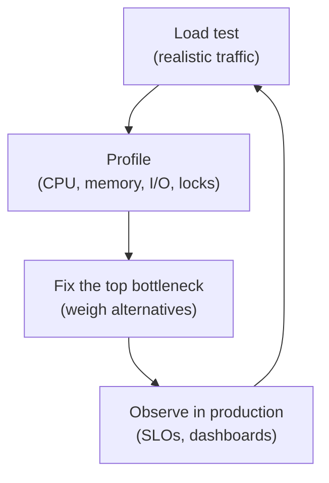
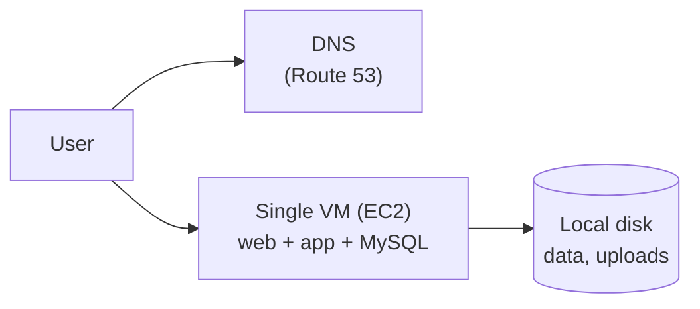
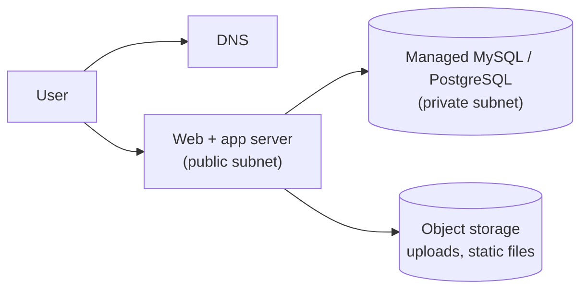
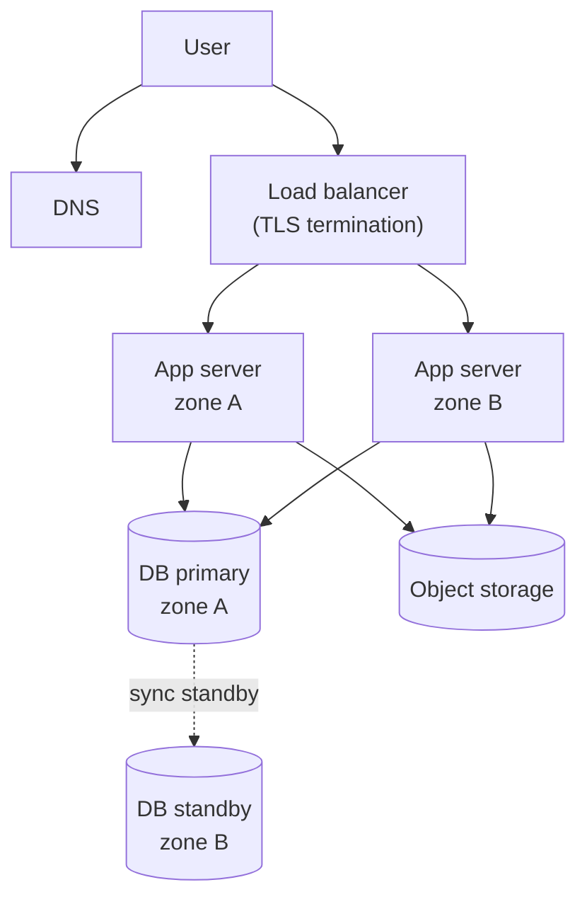
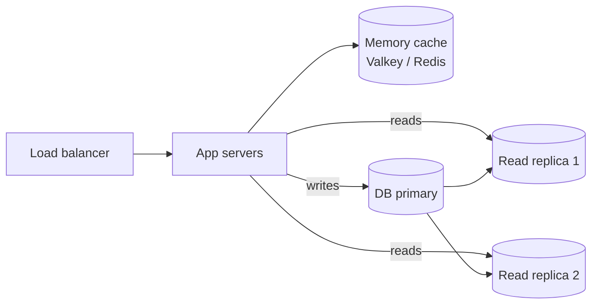
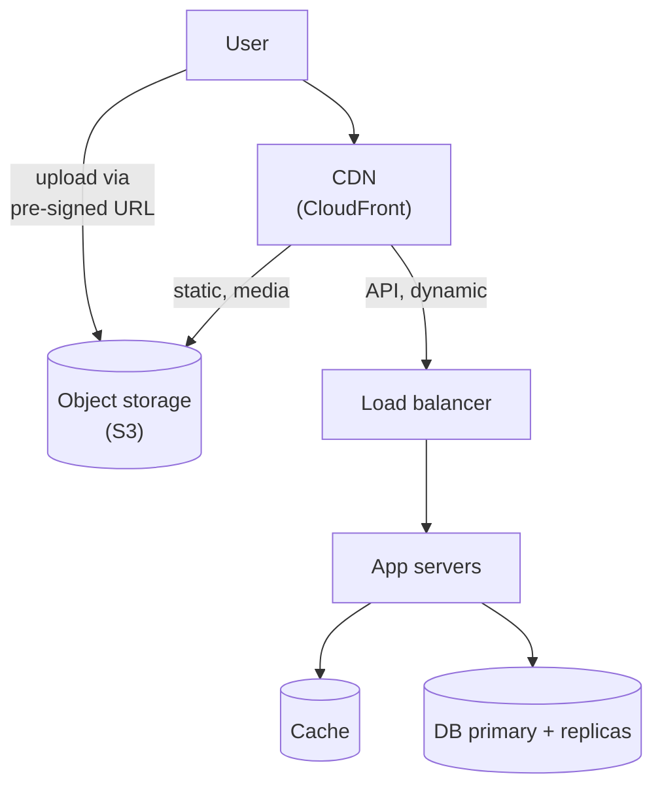
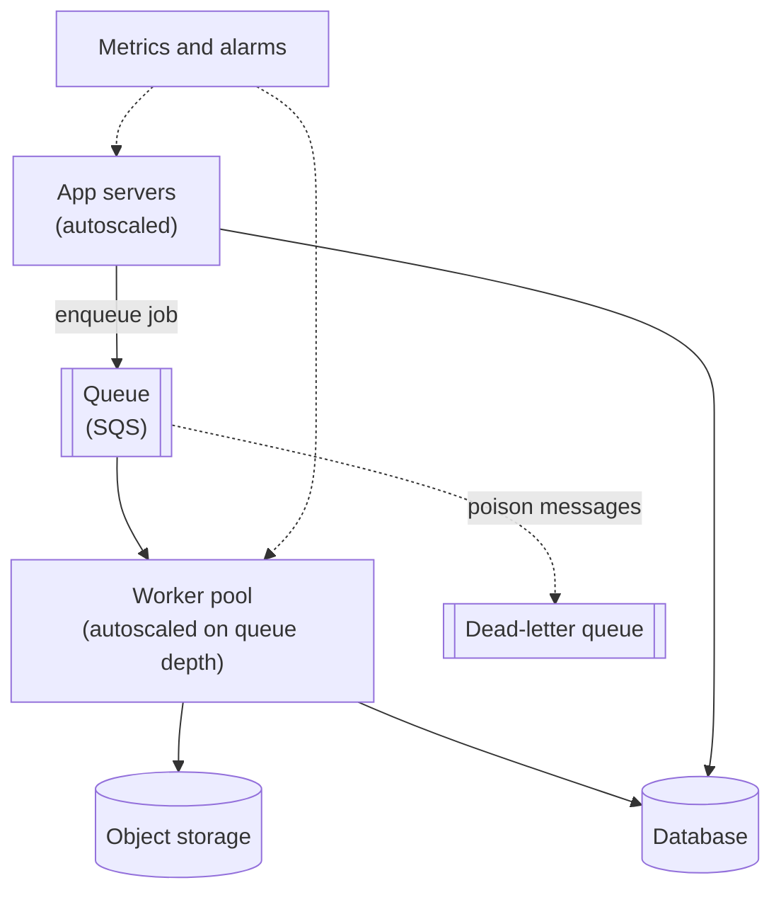
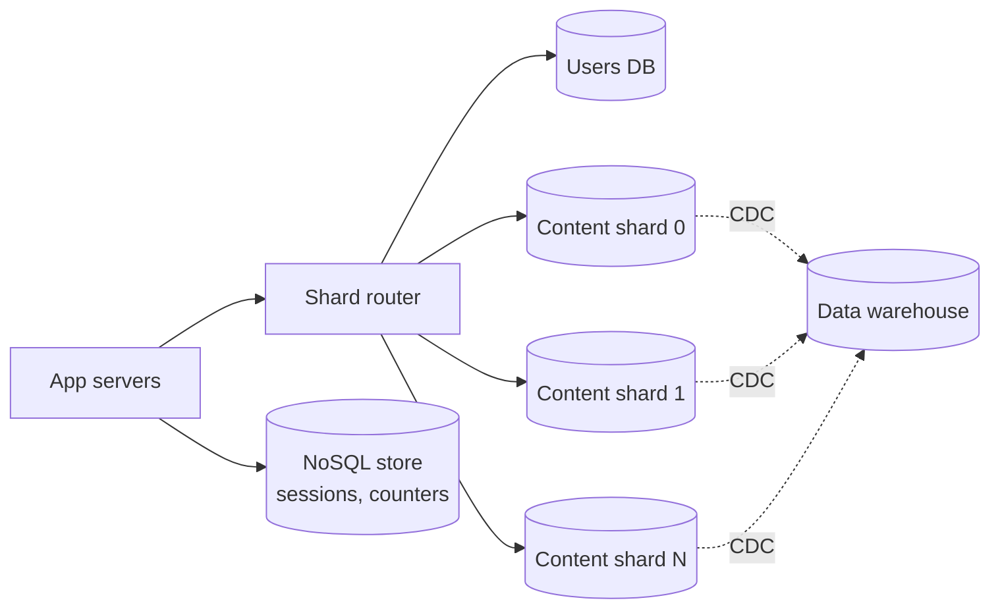
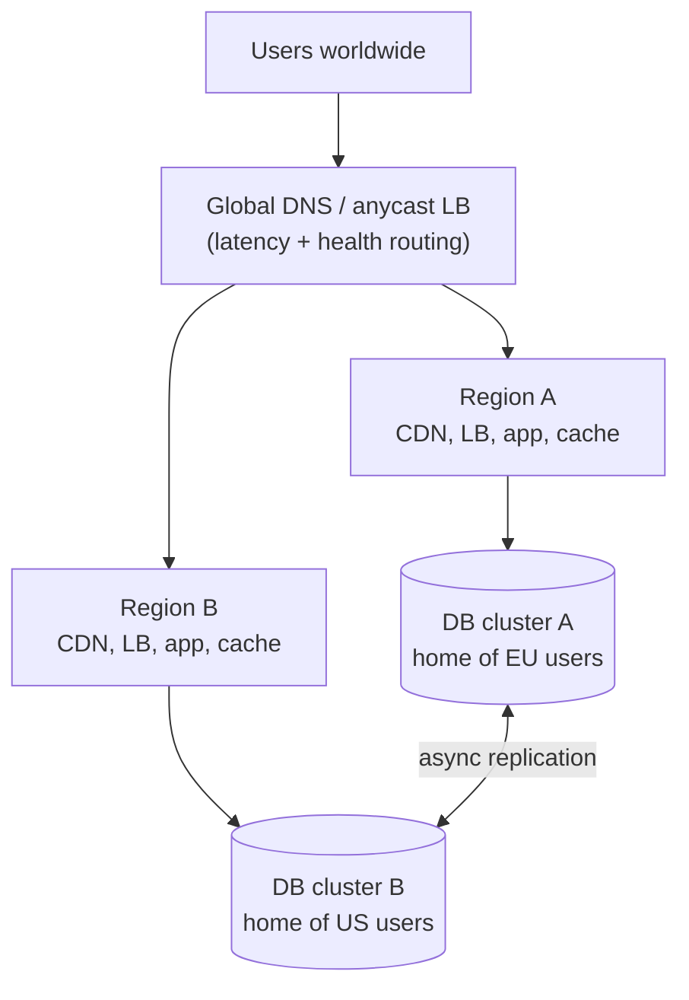

import { Aside } from '@astrojs/starlight/components';

Few systems are designed for ten million users on day one, and the ones that try usually ship late. This case study tells the more realistic story: start with one server, measure, find the component that breaks first, fix exactly that, and repeat. Each stage below names the **bottleneck that triggers it**, the change, and the price you pay. The examples use AWS service names because the original primer did, but every building block has an equivalent on other clouds or on your own hardware (see the table in Step 3).

<Aside type="tip" title="TL;DR">
- Scaling is a loop: **load test → profile → fix the top bottleneck → repeat.** Never jump straight to the final diagram.
- The usual order: separate the database, make the app tier stateless and put it behind a load balancer, add a cache and read replicas, offload static content to object storage and a CDN, move slow work to queues, and only then partition data and go multi-region.
- Each step buys capacity or availability and costs consistency, money or operational complexity. Name both.
- In 2026 managed databases, containers and serverless push the hard steps (sharding, multi-region) much later than they were in 2016, but they do not remove them.
</Aside>

## Step 1 — Requirements and constraints

### Use cases

**In scope**

- A user makes a read or write request; the service processes it, stores user data and returns the result.
- The service grows from a handful of users to tens of millions, and we discuss the general patterns used along the way.
- The service must become highly available as it grows.

**Out of scope**

- The product's business logic; the patterns here apply to most CRUD-style web and mobile backends.

### Non-functional requirements

- Read-heavy traffic (100 reads per write), concentrated in a few busy hours.
- Relational data with transactions (accounts, orders, posts).
- p99 latency for API reads under ~200 ms in the main market.
- Availability that grows with the business: one region with several zones first, several regions later.

### Assumptions (at the end of the journey)

- 10 million users.
- 1 billion writes and 100 billion reads per month.
- 1 KB of new content per write; most writes create content rather than update it.
- Peak traffic is about 3× the average.

### Back-of-the-envelope

A month has 30 × 86,400 = 2,592,000 seconds.

| Quantity | Calculation | Result |
|---|---|---|
| Writes per second | 10⁹ / 2.592 M s | ≈ 386 avg, ≈ 1,160 peak |
| Reads per second | 10¹¹ / 2.592 M s | ≈ 38,600 avg, ≈ 116,000 peak |
| New content per month | 10⁹ × 1 KB | ≈ 1 TB |
| New content over 3 years | 1 TB × 36 | ≈ 36 TB |
| Per user per day | 10⁹ / 30 / 10⁷ writes; 10¹¹ / 30 / 10⁷ reads | ≈ 3 writes, ≈ 333 reads |
| DB reads at peak with a 90 % cache hit ratio | 0.1 × 116,000 | ≈ 11,600/s |
| DB reads at peak with a 99 % cache hit ratio | 0.01 × 116,000 | ≈ 1,160/s |

The numbers say where the pressure will come from: **reads** dominate the request rate, the **cache hit ratio** decides how big the database tier must be, and **36 TB** of data in three years is what eventually pushes us toward partitioning. A write rate of about 1,200 per second at peak, by contrast, is well within what one modern relational primary handles.

<Aside type="note" title="Arithmetic note">
The original primer used "2.5 million seconds per month", which rounds 386 writes/s to 400 and 38,580 reads/s to 40,000. That rounding is fine; the true month is 2.592 million seconds.
</Aside>

## Step 2 — High-level design

### The scaling loop



Every stage below is one turn of this loop. The order is typical, not mandatory; your profiler decides what comes next.

### Stage 1 — One box



- **Setup.** One virtual machine runs the web server, the application and the database. A static public address (an Elastic IP on AWS) keeps the endpoint stable across reboots, and DNS maps the domain to it.
- **Security baseline.** Open only 443 (and 80 to redirect to HTTPS) to the world, and SSH only from an allow-list or, better, through the cloud's session manager with no open port at all. Restrict outbound traffic to what the app needs.
- **Monitoring from day one.** CPU, memory, disk, network, request latency and error rate. Without numbers you cannot tell which stage comes next.
- **Scaling.** Vertical: pick a bigger instance. It is quick and needs no code change, but the price climbs steeply at the top, and the box remains a single point of failure.

## Step 3 — Core components

### The stateless app server

Most of the stages depend on one property: **any app server can handle any request.** That means nothing lives only in one server's memory or disk:

- Sessions go into a signed cookie or a shared store (the database at first, an in-memory cache later).
- Uploaded files go to object storage, never to the local disk.
- Configuration comes from the environment, and deploys replace servers instead of patching them.

### Read/write routing

Once read replicas appear (Stage 4), the data access layer must send writes to the primary and most reads to replicas — without showing users stale copies of what they just wrote:

```python title="db_router.py"
import random
import time
from dataclasses import dataclass


@dataclass(frozen=True)
class DbRouter:
    """Writes go to the primary; reads go to replicas unless the user just wrote."""
    primary: str
    replicas: tuple[str, ...]
    stickiness_s: float = 5.0  # comfortably above normal replication lag

    def for_write(self) -> str:
        return self.primary

    def for_read(self, last_write_at: float | None, now: float | None = None) -> str:
        # last_write_at comes from the user's session, not from server memory:
        # the app tier is stateless, so any instance must make the same choice.
        now = time.time() if now is None else now
        if last_write_at is not None and now - last_write_at < self.stickiness_s:
            return self.primary  # read-your-writes for a few seconds
        return random.choice(self.replicas)


router = DbRouter(primary="db-primary", replicas=("db-replica-1", "db-replica-2"))
assert router.for_read(last_write_at=100.0, now=102.0) == "db-primary"
assert router.for_read(last_write_at=100.0, now=110.0).startswith("db-replica")
assert router.for_read(last_write_at=None).startswith("db-replica")
```

Monitor replica lag and take a replica out of rotation when it falls too far behind.

### Building blocks on each cloud

The design is cloud-agnostic. Service names as of October 2026:

| Component | AWS | Google Cloud | Azure | Self-hosted |
|---|---|---|---|---|
| Virtual machines | EC2 | Compute Engine | Virtual Machines | KVM, Proxmox, bare metal |
| DNS | Route 53 | Cloud DNS | Azure DNS | PowerDNS, BIND |
| Load balancer | Elastic Load Balancing (ALB, NLB) | Cloud Load Balancing | Load Balancer, Application Gateway | HAProxy, NGINX, Envoy |
| Relational database | RDS, Aurora | Cloud SQL, AlloyDB | Azure Database for PostgreSQL / MySQL | PostgreSQL + Patroni, MySQL |
| In-memory cache | ElastiCache (Valkey, Redis OSS, Memcached) | Memorystore (Valkey, Redis) | Azure Managed Redis | Valkey, Redis, Memcached |
| Object storage | S3 | Cloud Storage | Blob Storage | Ceph RGW, SeaweedFS |
| CDN | CloudFront | Cloud CDN | Front Door | Varnish, NGINX cache |
| Queue | SQS | Pub/Sub | Service Bus | RabbitMQ |
| Event log | Kinesis Data Streams, MSK | Pub/Sub, Managed Service for Apache Kafka | Event Hubs | Apache Kafka, Redpanda |
| Containers | ECS, EKS, Fargate | GKE, Cloud Run | AKS, Container Apps | Kubernetes, Nomad |
| Functions | Lambda | Cloud Run functions | Azure Functions | Knative, OpenFaaS |
| NoSQL key-value | DynamoDB | Bigtable, Firestore | Cosmos DB | Cassandra, ScyllaDB |
| Distributed SQL, sharding | Aurora DSQL | Spanner | Elastic clusters (Citus) in Azure Database for PostgreSQL | CockroachDB, YugabyteDB, Vitess |
| Data warehouse | Redshift | BigQuery | Microsoft Fabric, Synapse | ClickHouse, Trino on Iceberg |
| Metrics and logs | CloudWatch | Cloud Monitoring, Cloud Logging | Azure Monitor | Prometheus, Grafana, OpenTelemetry |

Names drift: Google renamed Cloud Functions to Cloud Run functions in 2024; Azure is retiring Azure Cache for Redis (by September 2028) in favour of Azure Managed Redis and the classic Azure CDN (by September 2027) in favour of Front Door; Microsoft puts new analytics work into Fabric but has not retired Synapse; and AWS closed App Runner to new customers in April 2026, pointing them to ECS Express Mode. Design with the generic component, then pick the product.

## Step 4 — Scaling the design

### Stage 2 — Separate the database

**Trigger.** The database and the web server compete for memory and CPU on the same box; uploads fill the disk; scaling the box for one tier pays for both.



- Move the database to a **managed service** (RDS, Cloud SQL, Azure Database for PostgreSQL): automated backups, patching, encryption at rest, and a standby in another availability zone with one setting.
- Move user uploads and static assets to **object storage**. The web server is now disposable.
- Put everything in a private network (VPC). Only the web tier sits in a public subnet; the database accepts connections only from the app's security group. Encrypt in transit and at rest.

**Cost.** More moving parts, network hops between tiers, and a managed-service bill that should be weighed against the hours you would spend operating the database yourself.

### Stage 3 — Horizontal app tier behind a load balancer

**Trigger.** The single web server saturates at peak hours, latency spikes, and every deploy or crash is an outage.



- Make the app **stateless** (Step 3) and run several copies across **availability zones** behind a managed **load balancer** with health checks. Terminate TLS at the load balancer to simplify certificate management.
- Run the database as primary plus synchronous standby in another zone with automatic **failover**.
- Optionally split **web servers** (reverse proxies serving static responses and buffering slow clients) from **application servers**, and split read and write API pools so they scale independently.

**Cost.** The load balancer bill, more servers, and deploys that must handle mixed versions during a rolling update.

### Stage 4 — Cache and read replicas

**Trigger.** Profiling shows the database CPU is mostly spent on reads (100:1), and the same rows are read over and over.



- First tune the database: indexes, query plans, buffer pool size. Then add a **memory cache** with cache-aside for hot objects (assembled objects rather than raw query results; see [caching layers](/caching/caching-layers/)), and move sessions into it. A cache hit skips the query and any disk read, but a remote cache still costs a network round trip (about 0.25 ms in one zone), so the main win is taking load off the database rather than raw latency (see [latency numbers](/reference/latency-numbers/)).
- Add **read replicas** for traffic the cache misses. At peak, a 90 % hit ratio leaves about 11,600 reads per second for the database tier; at 99 %, about 1,160. That gap is the difference between several replicas and none.
- Route reads and writes in the data access layer (see `db_router.py`), with read-your-writes for the user who just wrote.

**Cost.** Cache invalidation bugs, stale reads from lagging replicas, and new failure modes: a cold or flushed cache can send a thundering herd to the database.

### Stage 5 — Object storage and CDN

**Trigger.** App servers still pass images, scripts and video between users and object storage, spending bandwidth and CPU on them; users far from the region see slow page loads.



- Serve all static assets and user media from **object storage through a CDN**. Version file names (`app.3f9c2.js`) so they can be cached for a year.
- Let clients upload directly to object storage with short-lived **pre-signed URLs**; the app server only records metadata.
- Cache some dynamic responses at the edge for a few seconds (public feeds, product pages).

**Cost.** Cache-purge logic, egress pricing, and one more vendor in the request path.

### Stage 6 — Asynchronous workers and autoscaling

**Trigger.** Some requests do slow work inline (thumbnails, emails, reports, third-party calls) and tie up app servers. Traffic follows the business day, so fixed capacity is either too small at noon or wasted at night.



- Return as soon as the durable part is done and push the rest to a **queue**. Example: the client uploads a photo, the app records it and enqueues a job; a worker creates thumbnails, stores them in object storage and updates the database.
- Make jobs **idempotent** and retries safe; queues deliver at least once. Send poison messages to a dead-letter queue.
- **Autoscale** app servers on CPU, latency or request count, and workers on queue depth or age of the oldest message. Keep minimums across zones and scale up faster than you scale down.
- Grow monitoring into **observability**: aggregate metrics, logs and traces, alert on SLOs, and keep error reporting and on-call paging.

**Cost.** Eventual consistency visible to users ("your video is processing"), more components to monitor, and scale-up lag during sudden spikes.

### Stage 7 — Federation, sharding and the right store for each job

**Trigger.** The primary database becomes the limit: the dataset heads toward tens of terabytes, writes and maintenance (vacuum, index builds, backups, restores) take too long, and a single failover has a large blast radius.



- **Archive.** Move cold data to a warehouse or to columnar files in object storage; often the hot set is a fraction of the 36 TB.
- **Federation** (functional partitioning): give each domain its own database — users, content, billing. Simple, but cross-domain joins move into the application.
- **Sharding**: split the biggest tables by a key such as `user_id`. Create many **logical shards** up front and map them onto fewer physical databases, so growth moves whole shards and never re-hashes rows:

```python title="shard_router.py"
import hashlib
from dataclasses import dataclass

LOGICAL_SHARDS = 480  # fixed forever: the hash space is cut once


@dataclass(frozen=True)
class ShardMap:
    """Many logical shards live on fewer physical databases; the map can change."""
    hosts: tuple[str, ...]

    def logical_shard(self, user_id: int) -> int:
        digest = hashlib.sha256(user_id.to_bytes(8, "big")).digest()
        return int.from_bytes(digest[:8]) % LOGICAL_SHARDS

    def host_for(self, user_id: int) -> str:
        per_host = LOGICAL_SHARDS // len(self.hosts)  # 480 / 32 = 15 logical shards per host
        return self.hosts[self.logical_shard(user_id) // per_host]


shards = ShardMap(hosts=tuple(f"pg-{i:02d}" for i in range(32)))
print(shards.logical_shard(42), shards.host_for(42))   # 458 pg-30
# Growing to 48 hosts moves whole logical shards (10 per host); no row is re-hashed.
bigger = ShardMap(hosts=tuple(f"pg-{i:02d}" for i in range(48)))
print(bigger.logical_shard(42), bigger.host_for(42))   # 458 pg-45
```

- **Denormalize and tune** the queries that now cross shards. Move data that does not need relations or transactions — sessions, counters, activity feeds — to a **NoSQL** store such as DynamoDB.
- Or buy the partitioning: distributed SQL (Spanner, Aurora DSQL, CockroachDB, YugabyteDB) or a sharding layer (Vitess, Citus, Aurora PostgreSQL Limitless Database).

**Cost.** Cross-shard queries and transactions become hard or impossible, unique IDs need a scheme that works without a central counter, rebalancing is a project, and schema changes run N times.

### Stage 8 — Multiple regions

**Trigger.** Users on other continents see 80–300 ms round trips; the business can no longer accept a full regional outage; data residency laws require keeping some users' data in their region.



- **Active-passive**: one region takes writes, the other holds an asynchronous replica and warm capacity. Simple; failover loses the last seconds of writes (RPO above zero) and takes minutes.
- **Active-active with a home region**: each user's data lives in one region (a *cell*); requests are routed there. Reads can be served locally from replicas; writes go home.
- **Active-active with a global database**: Spanner, Aurora DSQL or CockroachDB provide strongly consistent multi-region writes at the price of cross-region latency on every commit. Multi-leader replication with conflict resolution is the alternative when eventual consistency is acceptable.
- Practise failover regularly; an untested runbook does not count.

**Cost.** Roughly double the infrastructure, cross-region data transfer fees, and the hardest consistency questions in the whole design.

### Summary

| Stage | Bottleneck that triggers it | Main change |
|---|---|---|
| 1 | — | One VM, DNS, monitoring |
| 2 | DB and web fight for one box | Managed DB, object storage, private network |
| 3 | One web server saturates; no redundancy | Stateless app tier, load balancer, multi-zone DB |
| 4 | DB CPU spent on repeated reads | Cache, read replicas, read/write routing |
| 5 | Static content and distance | CDN in front of object storage |
| 6 | Slow inline work, daily traffic swings | Queues, workers, autoscaling, observability |
| 7 | Primary DB size and write/maintenance load | Archive, federation, sharding, NoSQL or distributed SQL |
| 8 | Global latency, regional outages, residency | Multi-region with home regions or a global database |

## What's different in 2026

**Containers and Kubernetes.** The deployable unit is a container image, not a hand-configured VM, and configuration management tools (Chef, Puppet, Ansible) have largely given way to immutable images, infrastructure as code (Terraform/OpenTofu, Pulumi) and GitOps. Teams that need full control run Kubernetes (EKS, GKE, AKS); others use simpler container platforms such as ECS on Fargate, Cloud Run or Azure Container Apps. Autoscaling in Stage 6 becomes the Horizontal Pod Autoscaler for services, **KEDA** for scaling workers on queue depth (down to zero), and Cluster Autoscaler or **Karpenter** for nodes.

**Managed databases push Stage 7 out.** Instances with hundreds of cores and terabytes of RAM, storage that grows on its own (Aurora MySQL and PostgreSQL clusters have gone up to 256 TiB since 2025), serverless capacity, and connection poolers mean a single primary with replicas carries far more than it did in 2016. When you do outgrow it, partitioning can be bought: Aurora PostgreSQL Limitless Database (GA in 2024), Aurora DSQL (GA in 2025), Spanner, Vitess, Citus. Figma's and Notion's write-ups show that teams still choose and plan sharding carefully, and late.

**Serverless.** Functions (Lambda, Cloud Run functions, Azure Functions) and serverless containers fit Stage 6 workers, scheduled jobs and spiky or low-traffic APIs: they scale to zero and remove capacity planning. Watch for cold starts, execution-time limits, per-request pricing at sustained high load, and connection storms against relational databases (put a proxy such as RDS Proxy or PgBouncer in front).

**What still holds.** Measure before you change anything. Keep the app tier stateless. Cache reads, queue slow work, and partition data only when a specific bottleneck forces it. Managed services move the operational burden, not the design decisions.

<Aside type="note" title="In the interview">
- Do not draw the Stage 8 diagram first. Walk the stages and, for each, say **which metric told you to move** and what the change costs.
- Quote the numbers: about 400 writes and 40,000 reads per second on average, ×3 at peak; the cache hit ratio decides the size of the database tier.
- Likely follow-ups: how sessions work across servers, read-your-writes with replicas, cache stampedes, how you would pick a shard key and reshard later, zero-downtime schema migrations, and what happens when an availability zone or a whole region fails.
- Common mistakes: sharding before adding a cache or replicas; forgetting that autoscaling needs a stateless tier; treating multi-region as only a networking problem when it is mostly a data problem.
</Aside>

## Further reading

- [AWS Well-Architected Framework](https://docs.aws.amazon.com/wellarchitected/latest/framework/welcome.html) — AWS's checklist for reliable, secure, efficient and cost-effective designs.
- [Scaling to your first 10 million users (re:Invent 2016 notes)](https://blog.scottlowe.org/2016/11/29/scaling-first-10mil-users/) — a summary of the AWS talk that inspired this exercise.
- [The Twelve-Factor App](https://12factor.net/) — the stateless, disposable process model that horizontal scaling relies on.
- [Scaling Memcache at Facebook](https://www.usenix.org/conference/nsdi13/technical-sessions/presentation/nishtala) — NSDI 2013: caching at extreme scale, including stampedes and cross-region invalidation.
- [How Figma's databases team lived to tell the scale](https://www.figma.com/blog/how-figmas-databases-team-lived-to-tell-the-scale/) — vertical partitioning first, then horizontal sharding of PostgreSQL.
- [Herding elephants: sharding Postgres at Notion](https://www.notion.com/blog/sharding-postgres-at-notion) — 480 logical shards on 32 physical databases, and what triggered the move.

## Related topics

- [Performance vs scalability](/fundamentals/performance-vs-scalability/) — vertical vs horizontal scaling and why stateless matters.
- [Load balancers](/traffic/load-balancers/) — Stage 3 in depth.
- [Replication](/data/replication/) — replicas, failover and replication lag from Stages 3–4.
- [Caching layers](/caching/caching-layers/) — where to cache in Stage 4 and Stage 5.
- [CDN](/traffic/cdn/) — push vs pull CDNs and cache invalidation.
- [Queues and back pressure](/async/queues-and-back-pressure/) — the async workers of Stage 6.
- [Partitioning and sharding](/data/partitioning-and-sharding/) — shard keys and rebalancing for Stage 7.
- [Availability patterns](/fundamentals/availability-patterns/) — active-passive vs active-active for Stage 8.
