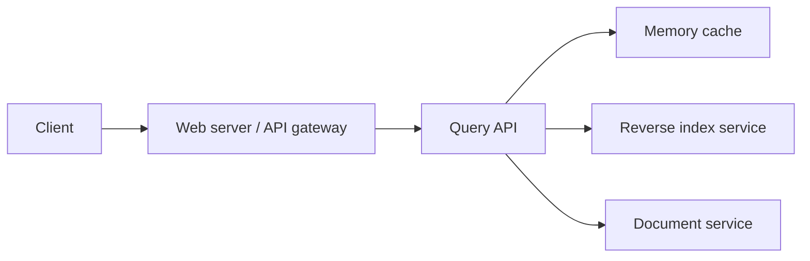
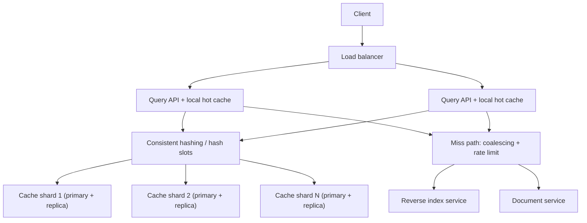

import { Aside } from '@astrojs/starlight/components';

Search traffic is very skewed. A small set of queries ("weather", "news", the name of
yesterday's big event) makes up a large share of all requests. Running each of them through
the full index-and-ranking pipeline wastes thousands of CPU-milliseconds per second. A
result cache in front of the search backend serves popular queries from memory in about a
millisecond. This case study designs that cache: the data structure, its size, how it is
spread across machines and how it stays fresh.

<Aside type="tip" title="TL;DR">
- The key is the **normalised query plus everything that changes the result page** (locale, safe-search, page, index version). The value is the serialised top-N results.
- Each node is an **LRU cache**: a hash map plus a doubly linked list, so `get`/`put` are `O(1)`. In practice, use a cache server with approximate LRU or LFU.
- **Shard** the keys across nodes with **consistent hashing** (or hash slots). Replicate for availability, and keep a small local cache in each API server for the very hottest queries.
- Freshness comes from a **TTL plus a version in the key**: a new index snapshot gives new keys, and old entries age out. **Request coalescing** and early refresh stop stampedes on hot keys.
</Aside>

## Step 1 — Requirements and constraints

### Use cases

In scope:

- **User** sends a search request that results in a **cache hit**: return cached results.
- **User** sends a search request that results in a **cache miss**: run the search, return the results, fill the cache.
- **Service** has high availability.

Out of scope: building the index, ranking, query understanding beyond basic normalisation,
and personalised results. Personalised pages are usually not cached as a whole; see the
2026 section.

### Non-functional requirements

- Hits should be fast: about 1 ms inside the data centre, a few ms end to end.
- Popular queries should almost always be hits.
- Memory is limited, so we need a clear policy for what to keep and what to evict.
- Results must not stay stale for long after the index changes.
- The cache is an optimisation. If it disappears, search must still work. It gets slower, but it must not collapse.

### Assumptions

- 10 million users, 10 billion queries per month.
- Traffic is uneven and roughly Zipf-like: a query's popularity is about inversely proportional to its rank.
- A meaningful share of queries are new every day. Google has long said about 15 % of its daily queries have never been seen before, and such queries can only be misses.
- Machines in one data centre talk to each other with low latency, around 0.5 ms.

### Back-of-the-envelope

| Quantity | Calculation | Result |
|---|---|---|
| Request rate | 10 B ÷ 2.592 M s per month | ≈ 3,860/s average (≈ 4,000 with the 2.5 M s rule), plan ≈ 12,000/s peak |
| Entry: key | normalised query | ≈ 50 B |
| Entry: value | 10 results × (URL 60 B + title 60 B + snippet 160 B) | ≈ 2,800 B |
| Entry: overhead | hash slot, LRU pointers, allocator | ≈ 80 B, so ≈ 2.9 KB per entry |
| Caching every query of a month | 10 B × 2.9 KB | ≈ 29 TB, not an option |
| Hot set of 100 M distinct queries | 100 M × 2.9 KB | ≈ 290 GB raw, ≈ 106 GB with values compressed about 3× |
| Network out of the cache | 3,860/s × 2.9 KB | ≈ 11 MB/s, negligible |

<Aside type="note" title="Correction to the classic estimate">
The original sizing used 270 bytes per entry: a 50-byte query, a 20-byte title and a 200-byte
snippet. That holds **one** result. A results page has about ten, so an entry is closer to
3 KB, and "all queries for a month" is about 29 TB, not 2.7 TB. The conclusion does not
change: we cannot cache everything, so we must choose.
</Aside>

How big must the hot set be? Under a Zipf distribution with about 1 billion distinct queries,
an ideal cache holding the top 1 M queries catches about 68 % of requests, the top 10 M about
78 % and the top 100 M about 89 %. Each tenfold increase in memory adds only about 10
percentage points, so **100 M entries (about 110–140 GB compressed, including overhead) is a
sensible target.** Real LRU does worse than this ideal. In a simulation it lost about 7–10
percentage points, because one-off queries keep pushing out useful entries.

## Step 2 — High-level design



1. The **Query API** normalises the query and builds the cache key.
2. On a **hit**, it returns the cached results.
3. On a **miss**, it calls the **reverse index service**, which finds and ranks matching documents. The **document service** supplies titles and snippets. The API then stores the page in the cache (**cache-aside**) and returns it.

## Step 3 — Core components

### Normalising the query and building the key

Different spellings of the same query must map to one key, or the hit rate collapses. Every
input that changes the result page must be part of the key, or users get the wrong results.

```python title="query_api.py"
import hashlib
import re
import unicodedata
from collections.abc import Callable
from dataclasses import dataclass

INDEX_VERSION = "idx-2026-10-08T06"     # bumped when a new index snapshot goes live


@dataclass(frozen=True)
class Result:
    url: str
    title: str
    snippet: str


def normalize(raw: str) -> str:
    """Make equivalent queries share one cache key."""
    text = unicodedata.normalize("NFKC", raw).casefold()
    text = re.sub(r"<[^>]+>", " ", text)          # strip markup
    terms = re.findall(r"\w+", text)
    return " ".join(terms)


def cache_key(query: str, locale: str, safe_search: bool, page: int) -> str:
    """Everything that changes the result page must be part of the key."""
    raw = f"{INDEX_VERSION}|{locale}|{int(safe_search)}|{page}|{query}"
    return hashlib.blake2b(raw.encode(), digest_size=16).hexdigest()


class QueryApi:
    def __init__(self, cache_get: Callable[[str], list[Result] | None],
                 cache_put: Callable[[str, list[Result]], None],
                 search: Callable[[str], list[Result]]) -> None:
        self.cache_get, self.cache_put, self.search = cache_get, cache_put, search

    def handle(self, raw: str, locale: str = "en-GB", safe: bool = True,
               page: int = 1) -> list[Result]:
        query = normalize(raw)
        key = cache_key(query, locale, safe, page)
        if (hit := self.cache_get(key)) is not None:
            return hit
        results = self.search(query)             # index + document services
        self.cache_put(key, results)              # cache-aside fill
        return results
```

Hashing the key gives a fixed size (16 bytes instead of an average of 50) and spreads keys
evenly across shards. The cost is that debugging needs a log of key to query. Real systems
normalise much more than this snippet: spelling correction, synonyms, stemming. Each extra
rule merges more spellings into one key and raises the hit rate, but every rule must keep
the results identical.

### The LRU cache

An LRU cache combines a **hash map** (key → node) with a **doubly linked list** ordered by
recency. A hit moves the node to the front. An insert into a full cache evicts the node at
the back. Both are `O(1)`.

```python title="lru_cache.py"
import time
from dataclasses import dataclass, field
from typing import Any


@dataclass(eq=False)
class _Node[K, V]:
    key: K
    value: V
    expires_at: float
    prev: "_Node[K, V] | None" = field(default=None, repr=False)
    next: "_Node[K, V] | None" = field(default=None, repr=False)


class LRUCache[K, V]:
    """Hash map + doubly linked list. get/put are O(1).

    Most recently used entries sit right after the head sentinel;
    the eviction victim is always right before the tail sentinel.
    """

    def __init__(self, capacity: int, ttl_seconds: float) -> None:
        if capacity <= 0:
            raise ValueError("capacity must be positive")
        self.capacity = capacity
        self.ttl = ttl_seconds
        self._map: dict[K, _Node[K, V]] = {}
        self._head: _Node[Any, Any] = _Node(None, None, 0.0)  # sentinels
        self._tail: _Node[Any, Any] = _Node(None, None, 0.0)
        self._head.next, self._tail.prev = self._tail, self._head

    def get(self, key: K) -> V | None:
        node = self._map.get(key)
        if node is None:
            return None
        if node.expires_at <= time.monotonic():      # lazy TTL expiry
            self._unlink(node)
            del self._map[key]
            return None
        self._unlink(node)
        self._push_front(node)
        return node.value

    def put(self, key: K, value: V) -> None:
        expires = time.monotonic() + self.ttl
        node = self._map.get(key)
        if node is not None:
            node.value, node.expires_at = value, expires
            self._unlink(node)
            self._push_front(node)
            return
        if len(self._map) >= self.capacity:
            victim = self._tail.prev
            assert victim is not None and victim is not self._head
            self._unlink(victim)
            del self._map[victim.key]
        node = _Node(key, value, expires)
        self._map[key] = node
        self._push_front(node)

    def invalidate(self, key: K) -> None:
        if (node := self._map.pop(key, None)) is not None:
            self._unlink(node)

    def __len__(self) -> int:
        return len(self._map)

    def _push_front(self, node: _Node[K, V]) -> None:
        first = self._head.next
        node.prev, node.next = self._head, first
        self._head.next = node
        assert first is not None
        first.prev = node

    @staticmethod
    def _unlink(node: _Node[K, V]) -> None:
        assert node.prev is not None and node.next is not None
        node.prev.next, node.next.prev = node.next, node.prev
        node.prev = node.next = None


if __name__ == "__main__":
    cache: LRUCache[str, list[str]] = LRUCache(capacity=2, ttl_seconds=60)
    cache.put("python lru", ["docs.python.org/..."])
    cache.put("rust traits", ["doc.rust-lang.org/..."])
    cache.get("python lru")                  # touch: now most recent
    cache.put("go generics", ["go.dev/..."])  # evicts "rust traits"
    print(cache.get("rust traits"))          # None
    print(cache.get("python lru"))           # ['docs.python.org/...']
```

The sentinel head and tail nodes remove every "is the list empty?" special case. The code was
checked against `collections.OrderedDict` with random operations. In production you would not
write this yourself. Python's `functools.lru_cache` covers in-process use, and Valkey, Redis
or Memcached implement eviction in C. Redis approximates LRU by sampling a few keys (5 by
default) instead of maintaining a global list, which saves memory and locking.

### Keeping results fresh

A cached page becomes wrong when a page's content changes, when pages are added or removed,
or when ranking changes. A cache cannot track every document. Three cheap tools, used
together, keep it fresh:

1. **TTL on every entry.** Minutes for news-like queries, hours for stable ones. Add a random ±10 % jitter so entries written together do not expire together.
2. **Index version in the key.** When the search tier switches to a new index snapshot, new requests use new keys. Old entries are never read again, and LRU or the TTL removes them. Roll the switch out gradually, or the hit rate drops to zero at once.
3. **Targeted invalidation** for rare, urgent cases such as a legal takedown: a "deny list" filter applied to results on the way out is simpler and safer than finding every cached page that contains the URL.

## Step 4 — Scaling the design

1. **More memory than one node, more requests than one node.** There are three options:
   - Each API server keeps its own cache. This is simple, but the hit rate is poor and memory holds N copies.
   - Every node holds a full copy. Memory is wasted and every write goes to every node.
   - **Shard keys across a cache cluster.** This is the usual choice: all memory adds up, and each key lives in one place.
2. **Which node owns a key?** `hash(key) % N` moves about 90 % of keys when one node is added to ten. With **consistent hashing** (a ring of virtual nodes) only about 1/(N+1) of keys move, about 9 %, so the hit rate survives scaling and node failures. Redis and Valkey Cluster use a variant: 16,384 hash slots that are moved between nodes explicitly.
3. **Node failure.** Give each shard a replica. A failed primary is replaced by its replica in seconds. Without replicas, a dead node turns its share of traffic into misses and sends them all to the search backend.
4. **Hot keys.** One viral query can overload the node that owns it. Keep a small **in-process LRU cache** (a few thousand entries, TTL of a few seconds) in each Query API server, so the hottest keys never cross the network. For the worst cases, copy a key to several nodes with suffixes such as `key#1..k`.
5. **Stampedes.** When a hot entry expires, thousands of requests miss at once. Use **request coalescing**: one request recomputes while the others wait, implemented with a short lock or Memcached-style leases. Also use **probabilistic early refresh**, where each reader may refresh a little before the TTL, with a probability that grows near expiry.
6. **Backend protection.** If the cache cluster is degraded, limit the miss traffic to the index (rate limits, load shedding) instead of letting a cache outage take down search as well.

```python title="hash_ring.py"
import bisect
import hashlib


def _h(key: str) -> int:
    return int.from_bytes(hashlib.blake2b(key.encode(), digest_size=8).digest())


class HashRing:
    """Consistent hashing with virtual nodes."""

    def __init__(self, nodes: list[str], vnodes: int = 200) -> None:
        self.vnodes = vnodes
        self._ring: list[tuple[int, str]] = []
        for n in nodes:
            self.add(n)

    def add(self, node: str) -> None:
        for i in range(self.vnodes):
            bisect.insort(self._ring, (_h(f"{node}#{i}"), node))

    def remove(self, node: str) -> None:
        self._ring = [(h, n) for h, n in self._ring if n != node]

    def node_for(self, key: str) -> str:
        i = bisect.bisect(self._ring, (_h(key), "")) % len(self._ring)
        return self._ring[i][1]


if __name__ == "__main__":
    keys = [f"query:{i}" for i in range(100_000)]
    ring = HashRing([f"cache-{i}" for i in range(10)])
    before = {k: ring.node_for(k) for k in keys}
    ring.add("cache-10")
    moved = sum(before[k] != ring.node_for(k) for k in keys)
    print(f"moved after adding 1 node to 10: {moved / len(keys):.1%}")  # ~9%
    naive = sum(_h(k) % 10 != _h(k) % 11 for k in keys)
    print(f"moved with hash % N:            {naive / len(keys):.1%}")   # ~91%
```



Sizing: about 140 GB of hot entries (100 M entries, compressed, plus about 30 % headroom for
fragmentation and replication buffers) fits on 6 primaries with about 24 GB each, or 12
primaries with 12 GB, plus one replica each. Throughput is not the problem. Even 12,000/s at
peak is a small load for one modern cache node. We shard for memory and failure isolation.

| Choice | Pros | Cons |
|---|---|---|
| Per-server private cache | No network hop | Low hit rate, N copies |
| Fully replicated cache | Any node can answer | Memory × N, writes to all |
| Sharded + consistent hashing | Memory adds up, minimal reshuffling | Extra hop, hot-key risk |
| Two tiers (local + shared) | Hot keys stay local, shared tier for the long tail | Two TTLs to reason about, brief inconsistency |

## What's different in 2026

- **Cache servers:** Valkey (the Linux Foundation fork of Redis, BSD-licensed) and Redis 8 (open source again since 2025, with AGPLv3 as one licence option) are the default choices, both available as managed services. Memcached is still a good fit for pure, multi-threaded key-value caching. Very large fleets use hybrid RAM-plus-flash caches such as Meta's CacheLib, which can hold far more entries per dollar.
- **Eviction beyond LRU:** LFU-style admission (W-TinyLFU in Caffeine) and new simple algorithms such as S3-FIFO (SOSP 2023) and SIEVE (NSDI 2024) beat LRU on web traces, mainly by quickly dropping keys that are seen only once. Search has many of those, so the effect is real here.
- **Two-level caching is standard:** an in-process cache in front of a shared cache, often with client-side caching in which the server tells the client when to drop a key.
- **What gets cached has shifted.** Results pages are personalised and assembled from parts, so engines cache **components** rather than whole pages: candidate document lists per query, per-document snippets and ranking features. The final ranking and personal touches are applied per request.
- **Edge and AI layers:** CDNs cache anonymous or autocomplete responses close to users. Generated answers from large language models (LLMs) are expensive, so some teams add a **semantic cache** keyed on embeddings. It needs strict similarity thresholds and still raises open questions about correctness and freshness.
- **What still holds:** cache-aside, LRU-like eviction with TTLs, sharding with consistent hashing, protection against stampedes, and the rule that the cache must be optional.

<Aside type="note" title="In the interview">
- **Implement LRU.** Hash map plus doubly linked list, both operations `O(1)`. Be ready to explain the sentinel nodes and the eviction order.
- **How big should the cache be?** Show the per-entry size, then argue from the skew in popularity (diminishing returns) instead of trying to "cache everything".
- **How do you keep results fresh?** TTL with jitter, the index version in the key, and a deny-list for urgent removals.
- **What happens when a node dies?** Replicas, consistent hashing, and backend protection from the burst of misses.
- **Hot keys and stampedes:** a local tier, request coalescing or leases, early refresh.
- **Common mistakes:** leaving locale or safe-search out of the key, `hash % N` sharding, no TTL, and a design where the backend falls over whenever the cache is cold.
</Aside>

## Further reading

- [Redis: key eviction](https://redis.io/docs/latest/develop/reference/eviction/): approximate LRU and LFU in practice.
- [Redis Cluster specification](https://redis.io/docs/latest/operate/oss_and_stack/reference/cluster-spec/): hash slots and hash tags.
- [Scaling Memcache at Facebook (NSDI 2013)](https://www.usenix.org/conference/nsdi13/technical-sessions/presentation/nishtala): leases, stampedes, regional pools.
- [Optimal probabilistic cache stampede prevention (VLDB 2015)](https://www.vldb.org/pvldb/vol8/p886-vattani.pdf)
- [SIEVE is simpler than LRU (NSDI 2024)](https://www.usenix.org/conference/nsdi24/presentation/zhang-yazhuo)
- [Consistent hashing and random trees (Karger et al., 1997)](https://www.cs.princeton.edu/courses/archive/fall09/cos518/papers/chash.pdf)

## Related topics

- [Partitioning and sharding](/data/partitioning-and-sharding/): consistent hashing and hash slots in depth.
- [Caching layers](/caching/caching-layers/): client, CDN, application and database caches.
- [Cache strategies](/caching/cache-strategies/): cache-aside, write-through and refresh-ahead.
- [LRU cache (OOD)](/ood/lru-cache/): the object-oriented version of the data structure.
- [Rate limiting](/reliability/rate-limiting/): protecting the backend when the cache misses.
