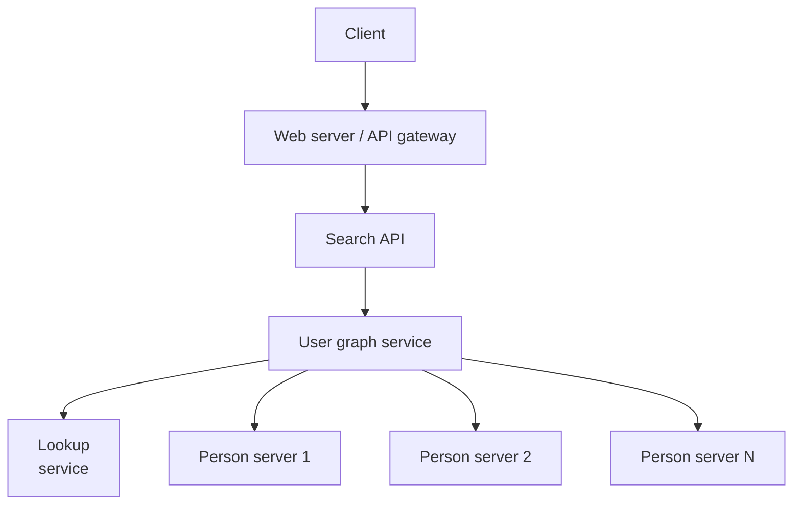
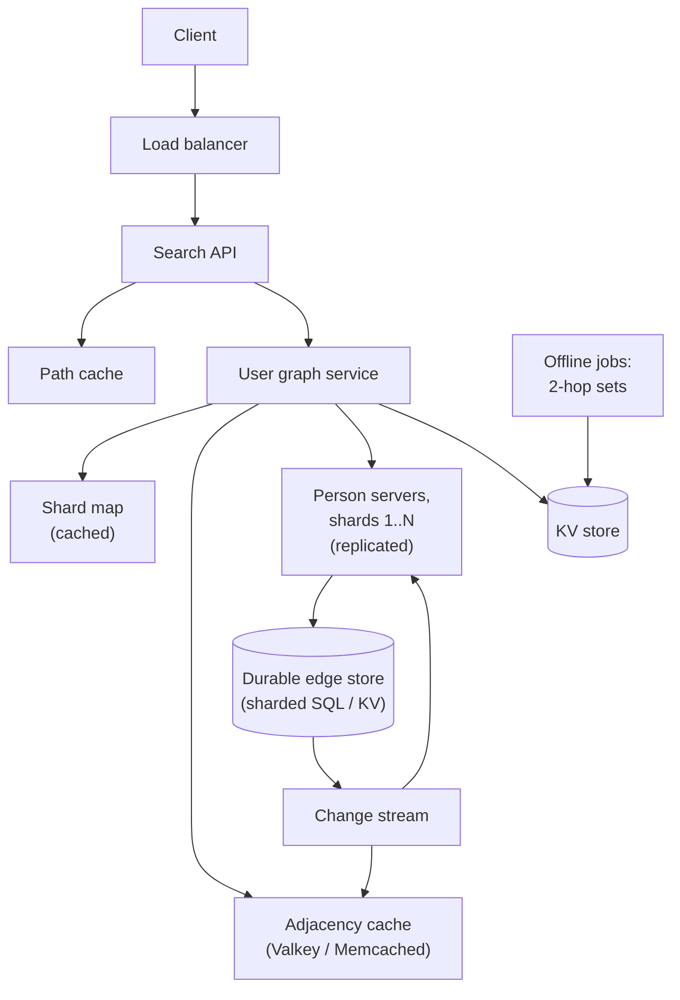

import { Aside } from '@astrojs/starlight/components';

"How am I connected to this person?" sounds like a textbook graph problem. Once the graph has
billions of edges spread across hundreds of machines, it becomes a distributed-systems problem.
Every hop of a breadth-first search turns into network calls, and a careless traversal can
touch millions of nodes for one request. This case study looks at how to store the graph, how
to search it, and how real social networks answer these queries quickly.

<Aside type="tip" title="TL;DR">
- Store the graph as **adjacency lists** (user id → friend ids) in memory on **person servers**, sharded by user id. A **lookup service** maps each id to its shard.
- Find the path with **bidirectional BFS**, always expanding the smaller frontier. For a path of length 4 with 50 friends per user, it touches about 5,000 nodes instead of about 6 million.
- Fetch each BFS level with **one batched call per shard**, in parallel. That means a few network round trips per search, not one per friend.
- **Cache** hot adjacency lists and precomputed results, and cap the search depth and time. At large scale, a sharded relational or key-value store with a graph API and caching in front of it, such as Facebook's TAO, beats a general-purpose graph database.
</Aside>

## Step 1 — Requirements and constraints

### Use cases

In scope:

- **User** searches for another person and sees the shortest chain of friends that connects them, for example "You → Ana → Ben → Chris".
- **Service** has high availability.

Out of scope: friend recommendations, news feed, privacy rules on who may see which edges (mention them, but do not design them), and weighted or directed edges such as "follows".

### Non-functional requirements

- Interactive latency. Aim for p99 under a few hundred milliseconds, or return "no path within N hops".
- The graph does not fit on one machine. That is an explicit constraint of the exercise.
- Reads dominate. Friendships change rarely compared with how often they are read.
- Traffic is uneven. Some people (celebrities, hubs) are searched far more often than others.

### Assumptions

- 100 million users with 50 friends each on average. Edges are undirected and unweighted.
- 1 billion searches per month.
- For the main design we use ordinary storage and services, not a graph database. Graph databases are discussed at the end.

### Back-of-the-envelope

| Quantity | Calculation | Result |
|---|---|---|
| Adjacency entries | 100 M users × 50 friends | 5 B entries (2.5 B undirected friendships, each stored twice) |
| Searches | 1 B ÷ 2.592 M s per month | ≈ 390/s average (≈ 400 with the 2.5 M s rule), plan ≈ 2,000/s peak |
| Adjacency lists in memory | 5 B × 8-byte ids | ≈ 40 GB (≈ 17 GB delta- and varint-encoded) |
| Adjacency matrix, for contrast | (10⁸)² bits | ≈ 1.25 PB, so a matrix is never an option |
| One-directional BFS, path length 4 | 50⁴ nodes in the last level | ≈ 6.25 M nodes touched |
| Bidirectional BFS, 2 + 2 levels | 2 × 50² | ≈ 5,000 nodes, about 1,250× fewer |
| Friend-list reads | 400/s × ~100 expansions × 50 ids | ≈ 2 M ids/s ≈ 16 MB/s, small |

Raw size is not what pushes us to shard. 40 GB fits in one large server's RAM. We shard
because of **headroom, availability and growth**, and because a real profile record (name,
photo URL, privacy settings) is far bigger than a list of ids. A network with 1 billion users
and 200 friends each needs about 1.6 TB just for adjacency.

## Step 2 — High-level design



1. The **Search API** receives `source` and `target` user ids and checks permissions.
2. The **user graph service** runs the search. To expand a node it must find that node's friend list.
3. The **lookup service** says which **person server** owns a given user id. Person servers hold user records and adjacency lists for their shard of users.
4. The search returns a list of user ids, and the API turns them into names and profile links.

## Step 3 — Core components

### API

```http title="Request"
GET /v1/connections/path?source=1234&target=98765&max_hops=6
```

```json title="Response: 200 OK"
{
  "hops": 3,
  "path": [
    {"user_id": 1234, "name": "You"},
    {"user_id": 53, "name": "Ana", "url": "https://social.example/ana"},
    {"user_id": 7710, "name": "Ben", "url": "https://social.example/ben"},
    {"user_id": 98765, "name": "Chris", "url": "https://social.example/chris"}
  ]
}
```

When nothing is found within the limit, return `200` with `"path": null` and
`"reason": "not_within_max_hops"`. This is a normal result, not a server error. Internally,
services talk over gRPC.

### Representing the graph

| Representation | Size for our graph | Good for | Bad for |
|---|---|---|---|
| Adjacency matrix | ≈ 1.25 PB | Dense graphs, "is A a friend of B" in `O(1)` | Sparse social graphs: almost all zeros |
| Adjacency list per user | ≈ 40 GB | Getting all friends of a user, which BFS needs | Edge checks are `O(degree)`, or `O(log degree)` if sorted |
| Edge table `(user_id, friend_id)` in SQL | Hundreds of GB with indexes | Durable source of truth, easy updates | Each hop is a query, so traversal is slow without a cache |

Use both: an **edge table** in a durable sharded store as the source of truth, and **in-memory
adjacency lists** on person servers (or in a cache) for traversal. Store each friendship in
both directions, on A's shard and on B's shard, so either user's friend list is a single-shard
read.

### Shortest path: BFS

The graph is unweighted, so breadth-first search finds a shortest path. Dijkstra's algorithm
is unnecessary. A one-directional BFS works, but its frontier grows like `degree^depth`. With
50 friends per user, the level at depth 4 holds about 6 million nodes.

**Bidirectional BFS** searches from both ends at once and stops when the two searches meet.
Each side only needs to go about half the depth, so the work drops from roughly `b^d` to
`2·b^(d/2)`. Always expanding the smaller frontier also helps when one side is a celebrity
with millions of friends.

```python title="bidirectional_bfs.py"
from collections.abc import Callable, Iterable

Neighbors = Callable[[int], Iterable[int]]


def bidirectional_path(source: int, target: int, neighbors: Neighbors,
                       max_hops: int = 6) -> list[int] | None:
    """Shortest path in an undirected, unweighted graph.

    Grows one BFS level at a time from each end, always expanding the
    smaller frontier, and stops when the two searches touch.
    """
    if source == target:
        return [source]
    parent_s: dict[int, int | None] = {source: None}
    parent_t: dict[int, int | None] = {target: None}
    frontier_s, frontier_t = [source], [target]
    hops = 0
    while frontier_s and frontier_t and hops < max_hops:
        # Expand the cheaper side; swap roles so the code below is one-sided.
        swapped = len(frontier_s) > len(frontier_t)
        if swapped:
            frontier_s, frontier_t = frontier_t, frontier_s
            parent_s, parent_t = parent_t, parent_s
        next_frontier: list[int] = []
        meet: int | None = None
        for node in frontier_s:
            for friend in neighbors(node):
                if friend in parent_s:
                    continue
                parent_s[friend] = node
                if friend in parent_t:
                    meet = friend
                    break
                next_frontier.append(friend)
            if meet is not None:
                break
        frontier_s = next_frontier
        hops += 1
        if swapped:  # restore orientation
            frontier_s, frontier_t = frontier_t, frontier_s
            parent_s, parent_t = parent_t, parent_s
        if meet is not None:
            return _join(meet, parent_s, parent_t)
    return None


def _join(meet: int, parent_s: dict[int, int | None],
          parent_t: dict[int, int | None]) -> list[int]:
    left: list[int] = []
    node: int | None = meet
    while node is not None:
        left.append(node)
        node = parent_s[node]
    right: list[int] = []
    node = parent_t[meet]
    while node is not None:
        right.append(node)
        node = parent_t[node]
    return left[::-1] + right


if __name__ == "__main__":
    friends: dict[int, list[int]] = {
        1: [2, 3], 2: [1, 4], 3: [1, 5], 4: [2, 6],
        5: [3, 6], 6: [4, 5, 7], 7: [6], 8: [],
    }
    print(bidirectional_path(1, 7, lambda u: friends[u]))  # [1, 2, 4, 6, 7]
    print(bidirectional_path(1, 8, lambda u: friends[u]))  # None
```

The search stops as soon as it finds any node already seen by the other side. That is still a
shortest path. The overlap check runs every time a node is first discovered, so the two
searches cannot have met earlier at a smaller combined depth. We checked this against plain
BFS on 20,000 random graphs. On a random graph with 200,000 nodes and 20 friends each, the
bidirectional version made about 190× fewer neighbour lookups.

### Distributed traversal: person servers and batching

`neighbors()` in the snippet is a local function call. In production it is a network call to
whichever person server owns that id. The original sketch calls the lookup service and a
person server **once per friend**. A four-hop one-directional search then makes at least
127,000 sequential round trips (one per expanded node), which is far too slow.

The fix is to **expand a whole level at once**: group the frontier's ids by shard and send one
batched call per shard, all in parallel. The number of round trips then equals the search
depth (about 4), not the number of nodes.

```python title="batched_lookup.py"
from collections import defaultdict
from dataclasses import dataclass, field


@dataclass
class PersonServer:
    """One shard: user id -> friend ids, held in memory."""
    friends: dict[int, list[int]] = field(default_factory=dict)
    calls: int = 0

    def get_friends(self, ids: list[int]) -> dict[int, list[int]]:
        self.calls += 1                        # one RPC, many ids
        return {i: self.friends.get(i, []) for i in ids}


class LookupService:
    """Maps a user id to its shard. Here: a fixed hash; in practice a
    directory (id range or virtual bucket -> server) cached by clients."""

    def __init__(self, num_shards: int) -> None:
        self.num_shards = num_shards

    def shard_of(self, user_id: int) -> int:
        return user_id % self.num_shards


def expand_level(frontier: list[int], lookup: LookupService,
                 servers: list[PersonServer]) -> dict[int, list[int]]:
    """Fetch friend lists for a whole BFS level: one batched call per shard."""
    by_shard: dict[int, list[int]] = defaultdict(list)
    for uid in frontier:
        by_shard[lookup.shard_of(uid)].append(uid)
    result: dict[int, list[int]] = {}
    for shard, ids in by_shard.items():        # issue these calls in parallel
        result.update(servers[shard].get_friends(ids))
    return result
```

The **lookup service** should not be a network hop on every call. It is a small directory
(id range or virtual bucket → server). Clients cache it and refresh it when it changes. The
`user_id % N` above is only for illustration. A real system uses many virtual buckets per
server, so a shard can move without rehashing everyone.

## Step 4 — Scaling the design

1. **Repeated and popular searches.** Cache person records and adjacency lists in Valkey, Redis or Memcached. Cache finished paths keyed by `(source, target)` with a short TTL. Hub users' friend lists are read constantly, so keep them in a small local cache on each graph-service instance as well.
2. **Too many network hops.** Batch each level per shard, as shown above. Place friends together: graph-partitioning tools such as Facebook's Social Hash place users so that most friend lists stay on few shards, which cuts multi-shard fan-out. Partitioning by region is a cheaper approximation, since friends tend to live near each other.
3. **Long or unlucky searches.** Cap hops (6 is plenty) and set a time budget. Return "not within N hops" instead of exploring half the graph. Expanding from the smaller frontier stops a celebrity on either end from blowing up the search.
4. **Precomputation.** For the common question "is this person within 2 hops of me?", store each user's friends-of-friends set, or a compact sketch of it, in a key-value store and refresh it offline. The full set costs about 2,500 ids per user, about 2 TB for 100 M users, so many systems compute it only for active users or keep a Bloom filter instead.
5. **Availability.** Replicate each person-server shard (a leader with followers, or three replicas). Edge writes go to the durable store and are then applied to the in-memory copies through a change stream.



| Optimisation | Gain | Cost |
|---|---|---|
| Bidirectional BFS | Orders of magnitude fewer nodes | Needs both ends known; slightly more complex code |
| Batching per shard | Round trips equal depth, not node count | Larger messages; the slowest shard sets each level's latency |
| Locality-aware sharding | Fewer shards per level | Rebalancing work; hot regions |
| Path and adjacency caches | Low latency for repeated searches | Staleness after unfriending, so use short TTLs and invalidation |
| Precomputed 2-hop sets | `O(1)` "within 2 hops" checks | Terabytes of storage; offline pipeline |

## What's different in 2026

- **TAO is still the reference design.** Facebook serves its social graph from TAO, described in the USENIX ATC 2013 paper. TAO stores *objects* and typed *associations* in sharded MySQL, puts a two-tier write-through cache in front, and reports 99.8 % reads. A friendship is stored as two directed edges on two shards, and an async job repairs pairs that end up half-written. The lesson still applies: at very large scale, a simple graph API over a sharded relational or key-value store plus heavy caching beats a general graph database.
- **Specialised in-memory graph services** exist at the largest companies. LinkedIn's LIquid, for example, serves its economic graph of about 270 billion edges at about 2 million queries per second, as LinkedIn reported in 2023.
- **Graph databases are mature for mid-size graphs.** Neo4j, Amazon Neptune, TigerGraph, Memgraph and others work well when the graph fits a cluster you are willing to run and queries are rich multi-hop patterns, as in fraud detection, knowledge graphs or recommendations. Neo4j's shortest-path planner itself uses bidirectional BFS. Query languages are standardising: **GQL** became ISO/IEC 39075 in 2024, and **SQL/PGQ** adds property-graph queries to SQL.
- **Batch graph analytics** (degrees of separation, communities, embeddings) run offline on Spark GraphFrames or similar engines, not on the serving path. Facebook's 2016 "3.57 degrees of separation" figure was an estimate computed offline, not a live BFS.
- **What still holds:** adjacency lists, BFS for unweighted shortest paths, the bidirectional trick, sharding by user id with a cached directory, and batching per shard.

<Aside type="note" title="In the interview">
- **Why not Dijkstra?** Edges are unweighted, so BFS already finds a shortest path, and with less overhead.
- **How many network calls does one search make?** Explain per-node calls versus per-level batched calls, and the role of a cached shard map.
- **What if one user has 5 million followers?** Expand the smaller frontier, cap fan-out, and treat hubs specially: cache their lists, or skip expanding them for "path" queries.
- **What happens when someone unfriends?** The durable store is updated first, then the change stream invalidates the caches. Cached paths may be briefly stale, so keep their TTL short.
- **Privacy:** edges a viewer is not allowed to see must not appear in the returned path. Filter on the server.
- **Common mistakes:** an adjacency matrix, a lookup-service round trip per friend, no depth or time limit, and claiming a graph database removes the need to shard.
</Aside>

## Further reading

- [TAO: Facebook's Distributed Data Store for the Social Graph (USENIX ATC 2013)](https://www.usenix.org/conference/atc13/technical-sessions/presentation/bronson)
- [TAO: The power of the graph (Engineering at Meta)](https://engineering.fb.com/2013/06/25/core-infra/tao-the-power-of-the-graph/)
- [Social Hash: optimising placement on social networks (NSDI 2016)](https://www.usenix.org/conference/nsdi16/technical-sessions/presentation/shalita)
- [How LIquid connects everything (LinkedIn Engineering)](https://www.linkedin.com/blog/engineering/graph-systems/how-liquid-connects-everything-so-our-members-can-do-anything)
- [Three and a half degrees of separation (Meta Research)](https://research.facebook.com/blog/2016/2/three-and-a-half-degrees-of-separation/)
- [Neo4j Cypher manual: shortest paths](https://neo4j.com/docs/cypher-manual/current/patterns/shortest-paths/)

## Related topics

- [Partitioning and sharding](/data/partitioning-and-sharding/): sharding users across person servers and the shard directory.
- [NoSQL](/data/nosql/): key-value and graph stores, and when each fits.
- [Caching layers](/caching/caching-layers/): where to cache adjacency lists and paths.
- [RPC and REST](/communication/rpc-and-rest/): gRPC for the internal calls between services.
- [Hash map](/ood/hash-map/): the data structure behind adjacency lists and visited sets.
