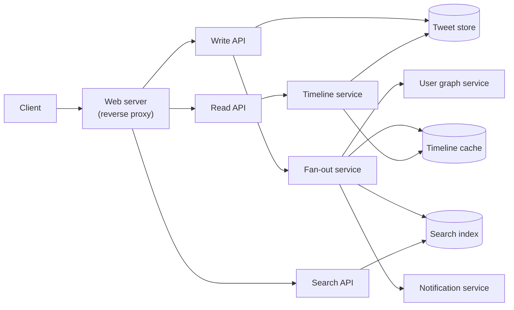
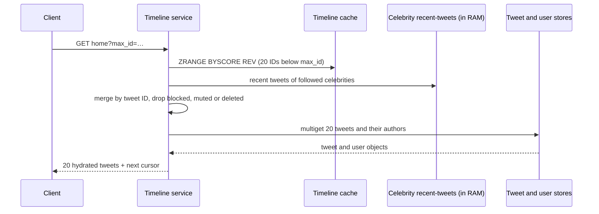
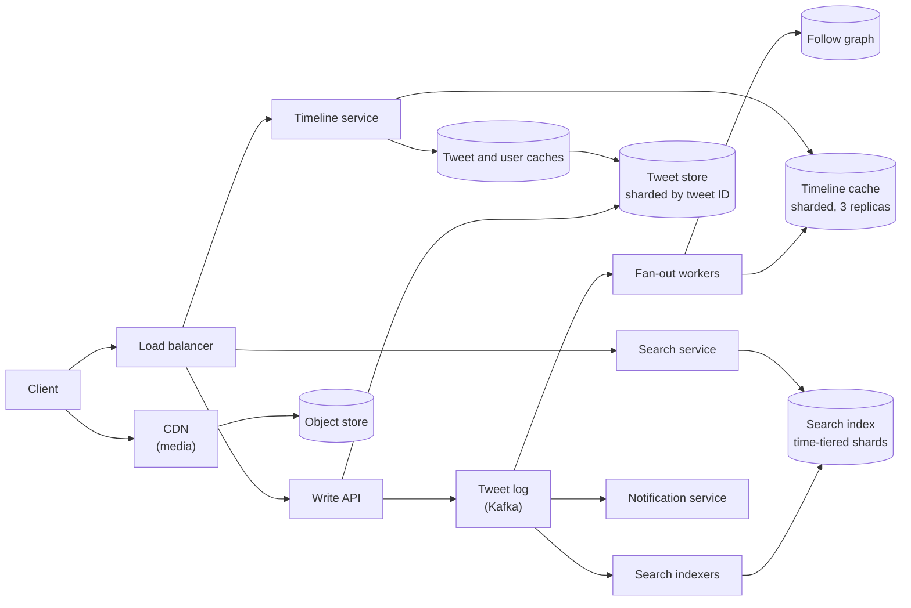

import { Aside } from '@astrojs/starlight/components';

A social feed looks simple: show me the latest posts from the people I follow. The hard part is the shape of the follow graph. Most accounts have a few hundred followers, and a handful have tens of millions. Reads outnumber posts more than 10:1 and must return in milliseconds. This case study designs the home timeline, the user timeline, keyword search and notifications for a Twitter-sized service. The same reasoning applies to the Facebook feed, Instagram, Mastodon and Bluesky.

<Aside type="tip" title="TL;DR">
- **Hybrid fan-out:** when an ordinary user posts, push the tweet ID into each active follower's cached timeline (fan-out on write). Tweets from accounts with millions of followers are **pulled and merged at read time** (fan-out on read).
- **Timeline cache:** each active user's home timeline is a bounded list of about 800 tweet IDs in an in-memory store, replicated. A timeline read is one list fetch plus a batched lookup (multiget) of the tweet and user objects.
- **Durable stores** are sharded by tweet ID and user ID. The cache is rebuilt from them when a user returns after a long absence.
- **Search** is a separately sharded inverted index fed by a stream, queried with scatter-gather. **Notifications** are another asynchronous consumer of the same tweet stream.
</Aside>

## Step 1 — Requirements and constraints

### Use cases

In scope:

- **User** posts a tweet. **Service** delivers it to followers' home timelines and sends push notifications to followers who asked for them.
- **User** views their **user timeline** (their own tweets) and **home timeline** (tweets from accounts they follow), newest first, with pagination.
- **User** searches tweets by keyword.
- **Service** is highly available.

Out of scope: the public firehose for partners, visibility rules (blocked users, hidden replies, "hide retweets"), ads, and ML ranking of the "For You" feed. We return to ranking in the 2026 section.

### Non-functional requirements

- **Fast reads:** home timeline p99 under about 200 ms. Reads dominate.
- **Fast enough delivery:** a tweet should reach most followers' timelines within about 5 seconds. Minutes are acceptable for accounts with millions of followers.
- **Availability over consistency:** a timeline that is a few seconds stale, or briefly missing a tweet, is fine. An error page is not.
- **Search freshness:** new tweets should be searchable within seconds.

### Assumptions

- 100 million active users. 500 million tweets per day.
- 250 billion timeline reads per month. 10 billion searches per month.
- An active user follows 200 accounts on average. The original primer assumed only 10 deliveries per tweet, which is very low for a follow graph (see the note below).
- Traffic is uneven: daily peaks and news events push writes to about 3× the average and reads to about 2×.

### Back-of-the-envelope

| Quantity | Calculation | Result |
|---|---|---|
| Tweets | 500 M ÷ 86,400 s | ≈ 5,800/s average, ≈ 17,000/s peak |
| Timeline reads | 250 B ÷ 2.592 M s | ≈ 96,000/s average, ≈ 190,000/s peak (≈ 83 per user per day) |
| Searches | 10 B ÷ 2.592 M s | ≈ 3,900/s |
| Tweet rows | 500 M × ~1 KB | 500 GB/day, 15 TB/month, 540 TB in 3 years |
| Media | 500 M × 10 KB amortised | 5 TB/day, 150 TB/month, 5.4 PB in 3 years |
| Timeline cache | 100 M users × 800 entries × 17 B | 1.36 TB raw, ≈ 8 TB with 2× overhead and 3 replicas |
| Search postings | 500 M × ~20 terms × 8 B | ≈ 80 GB/day, ≈ 560 GB for a 7-day in-memory tier |

<Aside type="note" title="Arithmetic vs. the original">
The original's rates (100,000 reads/s, 6,000 tweets/s, 60,000 deliveries/s, 4,000 searches/s) are the exact values (96,451, 5,787, 57,870 and 3,858) rounded up through the "2.5 M seconds per month" shortcut, and its 150 TB/month of content checks out. The weak spot is its assumption of **10 deliveries per tweet**. In a follow graph, the total number of followers equals the total number of follows, so with 200 follows per user an average tweet reaches about 200 timelines, not 10. That changes fan-out from about 60,000 to more than 1 million writes per second, as the math below shows.
</Aside>

## Step 2 — High-level design



**Post a tweet.** The Write API stores the tweet in the tweet store, which is also the source for the author's user timeline. It then hands the tweet to the fan-out service. Fan-out asks the user graph service for the author's followers and appends the tweet ID to each follower's timeline in the cache. It also sends the tweet to the search indexer and to the notification service. Media is uploaded separately to an object store before the tweet is posted, and the tweet only references media IDs.

**Read the home timeline.** The timeline service fetches the user's list of tweet IDs from the cache, then hydrates them with batched lookups of the tweet and user objects.

**Read the user timeline.** This is a range query on the tweet store by `(author_id, tweet_id DESC)`. No fan-out is involved.

**Search.** The search service parses the query, sends it to every index shard (scatter), merges and ranks the partial results (gather), and hydrates the top hits.

## Step 3 — Core components

### API

```http title="Post a tweet"
POST /api/v2/tweets
Authorization: Bearer <token>
Idempotency-Key: 0b9e7c52-4a8f-4c21-9d0e-7f3a6b1c2d4e

{"text": "hello world!", "media_ids": ["1840011223344556677"]}
```

```http title="Response"
HTTP/1.1 201 Created

{"id": "1843692012345678848", "author_id": "123", "created_at": "2026-10-08T12:00:00Z", "text": "hello world!"}
```

```http title="Home timeline, paginated by tweet ID"
GET /api/v2/users/123/home?max_id=1843692012345678848&limit=20

{"tweets": [{"id": "1843691900000000000", "author": {"id": "456", "handle": "ana"}, "text": "foo"}],
 "next_max_id": "1843691900000000000"}
```

Tweet IDs are Snowflake-style 64-bit integers: a millisecond timestamp in the high bits, then worker and sequence bits. Sorting by ID therefore gives roughly chronological order. Cursor pagination with `max_id` is stable even while new tweets arrive at the top. IDs are sent as strings because JavaScript numbers lose precision above 2⁵³.

### Data model

- **Tweets:** `tweet_id` (primary key), `author_id`, `text`, `media_ids`, `reply_to`, `created_at`, plus counters (likes, reposts) kept in a separate, frequently updated table. Shard by `tweet_id`. A secondary index on `(author_id, tweet_id)` serves the user timeline, or a second table sharded by `author_id` does the same job.
- **Follow graph:** two edge lists, `followers(user_id) → [ids]` and `following(user_id) → [ids]`, both sharded by `user_id`. Each `follow` writes both. A hot copy lives in memory because every fan-out reads it.
- **Home timeline cache:** for each user, a sorted set (Redis/Valkey `ZADD`) keyed by tweet ID. Each entry holds `tweet_id` (8 B), `author_id` (8 B) and a flags byte (retweet, reply). The set is trimmed to about 800 entries. Twitter's 2012 "Timelines at Scale" talk described 800 entries per timeline, each timeline replicated 3 times. Mastodon still caps home feeds at 800.

### Fan-out on write, fan-out on read, or both?

There are two pure strategies.

- **Fan-out on write (push):** at post time, insert the tweet ID into every follower's timeline. Reads are a single list fetch. The cost is paid per **follower**, at write time.
- **Fan-out on read (pull):** at read time, fetch recent tweets from every account the user follows and merge them. Writes are a single insert. The cost is paid per **followee**, on every read.

Over the whole system, push costs about `tweets/s × avg followers` and pull costs about `reads/s × avg follows`. Every edge has one follower and one followee, so the two averages are equal, and if posting is spread evenly the ratio is simply reads/s ÷ tweets/s ≈ 96,000 ÷ 5,800 ≈ **17**. Push does about 17× less work, which is why feeds precompute. The problem is the skew.

**A skewed model.** 100 M users follow 200 accounts each, which gives 20 B follow edges. Suppose 1,000 "celebrity" accounts own a quarter of those edges (about 5 M followers each) and post 20 times a day. Everyone else averages 150 followers.

| Strategy | Work per day | Rate | What hurts |
|---|---|---|---|
| Push everything | 499.98 M × 150 + 20,000 × 5 M = 75 B + 100 B inserts | ≈ 2.0 M inserts/s | One celebrity tweet means 5 M inserts. Celebrities are 0.004 % of tweets but 57 % of fan-out writes |
| Pull everything | 96,000 reads/s × 200 follows | ≈ 19 M author lookups/s | Every read fans in from about 200 shards, so tail latency explodes |
| Hybrid | Push for non-celebrities; pull about 50 celebrity accounts per read | ≈ 870,000 inserts/s plus ≈ 4.8 M in-memory list reads/s | Merge logic and a threshold to maintain |

In the hybrid, the "pull" side is cheap. All celebrity tweets from the last two days amount to 1,000 × 20 × 2 × 1 KB ≈ 40 MB, so every timeline-service instance can keep a copy in RAM. Merging 50 short in-memory lists costs CPU time, not network round trips.

The Feeding Frenzy paper (Silberstein et al., SIGMOD 2010) makes this precise. Decide **per producer–consumer pair**: push when the consumer reads more often than the producer posts, and pull otherwise. A celebrity who posts 20 times a day is pulled by fans who open the app 5 times a day, and pushed to fans who refresh 100 times a day. In practice, a single follower-count threshold, around 10⁵–10⁶, captures most of the benefit.

Why push hurts so much for celebrities: Bluesky measured about 600 µs per timeline write. Fanning out sequentially to 2 M followers would take about 20 minutes. The same Twitter talk reported delivery to 1 M followers at about 3.5 s at p50 and up to 5 minutes at p99.

```python title="timeline.py"
import bisect
import heapq
from collections import defaultdict
from dataclasses import dataclass

TIMELINE_CAP = 800              # entries kept per home timeline
CELEBRITY_FOLLOWERS = 1_000_000


@dataclass(frozen=True, order=True)
class Entry:
    tweet_id: int               # Snowflake ID: larger = newer
    author_id: int


class TimelineCache:
    """Stand-in for a Redis/Valkey sorted set per user (ZADD + ZREMRANGEBYRANK)."""

    def __init__(self) -> None:
        self.sets: dict[int, list[Entry]] = defaultdict(list)   # ascending by tweet_id

    def push(self, user_id: int, entry: Entry) -> None:
        items = self.sets[user_id]
        bisect.insort(items, entry)          # fan-out may arrive out of order
        if len(items) > TIMELINE_CAP:
            del items[0]                     # drop the oldest

    def page(self, user_id: int, max_id: int | None, n: int) -> list[Entry]:
        items = self.sets[user_id]
        hi = len(items) if max_id is None else bisect.bisect_left(items, Entry(max_id, -1))
        return items[max(0, hi - n):hi][::-1]   # newest first


def fan_out(author_id: int, tweet_id: int, followers: list[int],
            follower_count: int, active: set[int], cache: TimelineCache) -> int:
    """Push to active followers unless the author is a celebrity; return inserts done."""
    if follower_count >= CELEBRITY_FOLLOWERS:
        return 0                             # pulled at read time instead
    pushed = 0
    for f in followers:
        if f in active:                      # skip users who have not logged in lately
            cache.push(f, Entry(tweet_id, author_id))
            pushed += 1
    return pushed


def home_timeline(user_id: int, cache: TimelineCache,
                  celebrity_followees: list[int],
                  recent_by_author: dict[int, list[Entry]],
                  max_id: int | None = None, n: int = 20) -> list[Entry]:
    """Merge the pushed timeline with celebrity tweets pulled at read time."""
    streams = [cache.page(user_id, max_id, n)]
    for celeb in celebrity_followees:        # each list is newest first
        streams.append([e for e in recent_by_author.get(celeb, [])
                        if max_id is None or e.tweet_id < max_id][:n])
    merged = heapq.merge(*streams, key=lambda e: e.tweet_id, reverse=True)
    return [e for _, e in zip(range(n), merged)]


cache = TimelineCache()
fan_out(author_id=1, tweet_id=105, followers=[42, 43], follower_count=2, active={42}, cache=cache)
fan_out(author_id=2, tweet_id=101, followers=[42], follower_count=1, active={42}, cache=cache)
recent = {9: [Entry(107, 9), Entry(103, 9)]}   # celebrity 9, newest first
first = home_timeline(42, cache, [9], recent, n=3)
print([e.tweet_id for e in first])                                        # [107, 105, 103]
print([e.tweet_id for e in home_timeline(42, cache, [9], recent, max_id=first[-1].tweet_id)])  # [101]
```

### Reading the home timeline



Hydration is the expensive part of a read. 96,000 reads/s × 20 tweets ≈ 1.9 M tweet lookups per second, plus author lookups. Tweet and user objects therefore sit behind their own caches (Memcached or Valkey) with very high hit rates, because the same popular tweets appear in millions of timelines. Hydration also handles deletes cheaply. Deleting a tweet does not touch millions of timelines: the tweet object gets a tombstone, and hydration drops it.

**Edge cases worth naming:**

- **New follow:** backfill the followee's recent tweets into the follower's timeline asynchronously.
- **Unfollow:** filter at read time immediately, and clean up the list lazily.
- **A reply arrives before the tweet it answers:** fan-out runs in parallel and can deliver out of order. A sorted set keyed by Snowflake ID absorbs this, and the read path sorts anyway.
- **Inactive users:** skip them during fan-out, as Mastodon does for users who have not signed in recently. When they come back, rebuild the timeline from the follow graph and recent tweets. That rebuild is a one-time pull of about 200 authors, which is fine.

### Search

Search needs an **inverted index**: for each term, a posting list of the tweet IDs that contain it.

1. **Ingestion:** an indexer consumes the tweet stream. It tokenises the text (Unicode normalisation, lower-casing, hashtags and mentions as tokens, language detection), then appends postings.
2. **Partitioning:** shard by **document** (tweet ID), not by term. A term-sharded index sends every popular term to one hot shard and makes multi-term queries cross shards. Document-sharding sends each query to all shards, but each shard does an equal, small share of the work. Shards are grouped by **time**: a realtime tier in memory covers the last days, and older tiers sit on SSD.
3. **Query:** parse the query (terms, phrases, `from:`, boolean operators, spelling correction), scatter it to every shard in the relevant tiers, take the top K per shard by a cheap score (recency, engagement), merge, re-rank, and hydrate.
4. **Freshness:** Twitter's Earlybird engine indexed tweets about 15 seconds after posting until 2019. A 2020 redesign (skip-list postings, time-based document IDs) cut that to about one second.

At about 3,900 searches/s, with skew toward trending terms, a short-TTL cache of popular query results in front of the cluster removes much of the load.

### Notifications

Notifications are another consumer of the tweet stream, not part of fan-out:

- **Triggers:** mentions, replies, likes, new followers, and "notify me" subscriptions to specific accounts.
- **Pipeline:** event → rules (per-user preferences, mutes, quiet hours) → aggregation ("Ana and 41 others liked your post") → rate limiting per user → delivery through APNs, FCM, email or an in-app inbox.
- **Idempotency:** retries are inevitable, so dedupe on `(event_id, recipient)` before sending.
- **Volume:** if each user receives about 20 notifications per day, that is 2 B per day, or about 23,000/s. A celebrity post with "notify me" turned on by millions of fans is the same fan-out problem as the timeline, and is handled the same way: batched and spread over seconds to minutes.

## Step 4 — Scaling the design

Bottlenecks, one at a time:

1. **Fan-out throughput.** Put a durable log (Kafka or a managed equivalent) between the Write API and the fan-out workers. Posting stays fast, and a burst becomes queue depth instead of timeouts. Partition by author so one author's tweets are fanned out in order. Split very large follower lists into chunks of 1,000–10,000 handled by different workers. Skip inactive followers.
2. **Celebrities.** Use the hybrid above. Keep a small in-memory store of their recent tweets in every timeline-service instance. Bluesky's 2025 "lossy timelines" solve the mirror-image problem: users who follow tens of thousands of accounts. Above a reasonable follow count, fan-out writes to that user's timeline are dropped with a probability that grows with the count. This largely eliminated hot shards and cut p99 time for a full post fan-out by more than 96 %.
3. **Timeline cache size and availability.** About 8 TB across shards, keyed by `user_id`, with replicas in each zone. Keep only active users (for example, the last 30 days). A lost shard is rebuilt from the durable stores, so the cache does not need its own backup.
4. **Tweet store writes.** About 17,000 writes/s at peak means sharding by `tweet_id`. Snowflake IDs let any shard mint IDs without coordination. Wide-column stores (Cassandra, ScyllaDB, Bigtable) or sharded MySQL/Vitess all work. Keep recent tweets hot. Older tweets are read rarely and can move to cheaper storage.
5. **Hydration.** Use object caches for tweets and users, multigets grouped by shard, and counters (likes, views) served from a separate fast-changing store so tweet objects stay cacheable.
6. **Search.** Use a replicated time-tiered index, a query-result cache, and separate clusters for realtime and archive.
7. **Media.** Store media in object storage and serve it through a CDN. Clients upload directly with pre-signed URLs, so media bytes never pass through the API.



| Added component | Buys | Costs |
|---|---|---|
| Tweet log (stream) | Fast posting, buffering, replay, one source for every consumer | Another system to run; consumers must be idempotent |
| Chunked fan-out workers | Seconds instead of minutes for large accounts | Out-of-order delivery (absorbed by ID-sorted timelines) |
| Celebrity pull path | Removes more than half of all fan-out writes | Merge logic and a threshold to tune |
| Sharded timeline cache | Single-digit-ms reads at 190,000/s | About 8 TB of RAM; a rebuild path for lost shards |
| Object caches | Cheap hydration | Invalidation of edited and deleted tweets |
| Time-tiered search index | Fast recent search, cheap history | Scatter-gather to every shard in a tier |

## What's different in 2026

- **Most feeds are ranked.** X's "For You", Instagram and Threads build the feed per request: gather candidates, then rank them with a learned model. X's open-sourced recommendation code (twitter/the-algorithm in 2023; xai-org/x-algorithm, released in January 2026 and updated as recently as September 2026) describes in-network candidates fetched at read time from an in-memory store of recent posts, out-of-network candidates found by embedding retrieval, and a transformer model that ranks both. The chronological "Following" timeline in this case study is still the baseline, and it is what Mastodon and Bluesky's default following feed serve.
- **Open networks use the same patterns.** Mastodon fans out on write into Redis sorted sets of up to 800 items, and only for recently active users. Bluesky fans out on write into ScyllaDB timelines and added lossy fan-out for extreme follow counts.
- **Managed building blocks:** a managed Kafka-compatible stream (MSK, Confluent, Redpanda) or Kinesis/Pub/Sub for the tweet log; Valkey or Redis clusters (ElastiCache, Memorystore) for timelines; ScyllaDB, Cassandra, DynamoDB or Bigtable for tweets and edges; OpenSearch, Elasticsearch or Vespa for search; object storage plus a CDN for media. Serverless functions fit side tasks (notification fan-out, media processing) better than the core fan-out, which runs continuously at a high rate.
- **Search is hybrid.** Keyword (BM25) retrieval is combined with vector retrieval for semantic matches, and both are re-ranked. The inverted index is still the backbone for exact and fresh results.
- **What still holds:** precompute for the common case, special-case the skew, keep IDs time-sortable, hydrate through caches, and keep side effects (search, notifications, analytics) as asynchronous stream consumers.

<Aside type="note" title="In the interview">
- **"Push or pull?"** Give the cost model (followers × posts versus follows × reads), then the hybrid and how you would pick the threshold.
- **"A user with 50 M followers tweets."** Chunked fan-out, or no fan-out plus a read-time merge. Mention the in-memory celebrity cache.
- **"How is a deleted tweet removed from 10 M timelines?"** It is not: a tombstone plus filtering during hydration.
- **"What if the timeline cache loses a shard?"** It is derived data. Rebuild it from the follow graph and recent tweets, and serve a degraded pull-based timeline in the meantime.
- **"Make search real-time."** Stream ingestion, an in-memory realtime tier, document-partitioned shards, and scatter-gather.
- **Common mistakes:** fan-out inside the request path, a single SQL table for timelines, term-sharded search, and ignoring inactive users and deletes.
</Aside>

## Further reading

- [The architecture Twitter uses to deal with 150M active users (High Scalability, 2013)](https://highscalability.com/the-architecture-twitter-uses-to-deal-with-150m-active-users/)
- [Timelines at Scale, Raffi Krikorian (QCon SF 2012, InfoQ)](https://www.infoq.com/presentations/Twitter-Timeline-Scalability/)
- [Feeding Frenzy: selectively materializing users' event feeds (SIGMOD 2010)](https://sns.cs.princeton.edu/assets/papers/2010-sigmod-silberstein.pdf)
- [When imperfect systems are good, actually: Bluesky's lossy timelines (2025)](https://jazco.dev/2025/02/19/imperfection/)
- [Reducing search indexing latency to one second (Twitter Engineering, 2020)](https://blog.x.com/engineering/en_us/topics/infrastructure/2020/reducing-search-indexing-latency-to-one-second)
- [X recommendation algorithm source (xai-org/x-algorithm)](https://github.com/xai-org/x-algorithm)

## Related topics

- [Cache strategies](/caching/cache-strategies/): the timeline cache and object caches are derived data with rebuild paths.
- [Partitioning and sharding](/data/partitioning-and-sharding/): sharding tweets, edges and timelines, and hot shards.
- [Event streaming](/async/event-streaming/): the tweet log that feeds fan-out, search and notifications.
- [Queues and back pressure](/async/queues-and-back-pressure/): absorbing fan-out bursts from celebrity posts.
- [Design the data structures for a social graph](/practice/social-graph/): storing and querying the follow graph.
- [NoSQL](/data/nosql/): wide-column stores for tweets and timelines.
