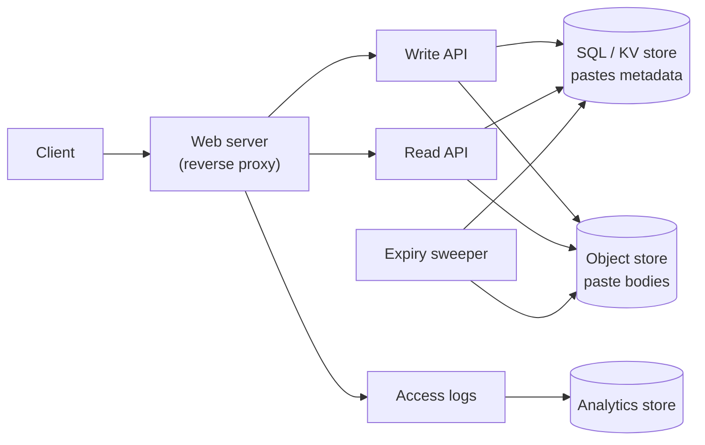
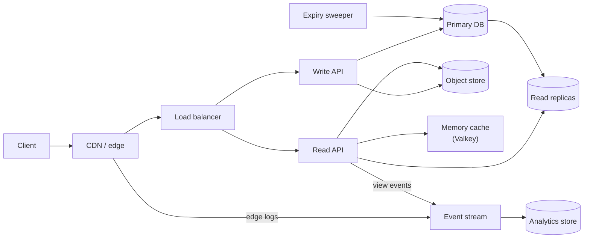

import { Aside } from '@astrojs/starlight/components';

Pastebin and Bitly solve the same problem. A user hands over something long (a block of text or a URL) and gets back a short key such as `aB3xY9q` that anyone can resolve later. Pastebin stores the content behind the key. A shortener stores a destination URL and answers with a redirect. The system is small enough to sketch in 45 minutes and still has real design choices: how to mint short keys that never clash, which redirect status to return, how to expire data, and how to count clicks without slowing down reads.

<Aside type="tip" title="TL;DR">
- **Keys:** a random 7–8 character Base62 key plus an atomic "insert if absent" works without any coordination. Use counter ranges with a scrambling step if you need guaranteed uniqueness and the shortest keys.
- **Storage:** metadata goes in a key-value or SQL table keyed by the short key. Paste bodies go in object storage, or inline in the row when they are small.
- **Reads** outnumber writes 10:1 or more. Pastes never change after creation, so a CDN and an in-memory cache absorb most traffic. Expiry is checked on every read, and a background sweeper deletes the data later.
- **Redirects and analytics:** use 302 (or a 301 with a short cache lifetime) when every click must be counted. Clicks become events on a stream that feeds a columnar analytics store, never a synchronous database write.
</Aside>

## Step 1 — Requirements and constraints

### Use cases

In scope:

- **User** submits text and receives a short link. Optional expiry; by default the paste never expires.
- **User** opens a short link and sees the paste (for the shortener variant, the user is redirected to the destination).
- **Service** keeps monthly view statistics per link.
- **Service** removes expired pastes.
- **Service** is highly available, and resolving a link is fast.

Out of scope: accounts and login, editing pastes, custom aliases ("vanity URLs"), and per-paste privacy settings. We mention custom aliases where they change the design.

### Non-functional requirements

- **Low read latency.** Resolving a key should take tens of milliseconds at p99, because it sits in front of every click.
- **Durability.** A link that was handed out must keep working until it expires. People print short links on posters and in papers.
- **Unguessable keys.** Pastes are unlisted, so the key is effectively the only access control. Keys must not be sequential.
- **Eventual analytics.** View statistics can be minutes or hours behind.
- **Skewed traffic.** Most pastes are read a few times. A few go viral and receive most of the reads.

### Assumptions

- 10 million users, 10 million new pastes per month, 100 million reads per month (10:1).
- Average paste is 1 KB of text. Metadata (key, object pointer, timestamps, status) is about 100 bytes.
- For the shortener variant we also check a scale 100× larger: 1 billion new links and 10 billion redirects per month.

### Back-of-the-envelope

A 30-day month has 2.592 million seconds. The common "2.5 million seconds" shortcut rounds rates up by about 4 %, which is fine for an interview.

| Quantity | Calculation | Result |
|---|---|---|
| Paste writes | 10 M ÷ 2.592 M s | ≈ 3.9/s average, plan for ≈ 40/s peak |
| Paste reads | 100 M ÷ 2.592 M s | ≈ 39/s average, ≈ 390/s peak |
| Content per month | 10 M × 1 KB | ≈ 10 GB |
| Metadata per month | 10 M × 100 B | ≈ 1 GB |
| Pastes after 3 years | 10 M × 36 | 360 M keys |
| Storage after 3 years | 360 M × 1.1 KB | ≈ 400 GB (360 GB content, 36 GB metadata) |
| Read bandwidth | 39/s × 1 KB | ≈ 40 KB/s average |
| Hot set (last 7 days) | 2.3 M pastes × 1.1 KB | ≈ 2.6 GB, fits in one cache node |
| Shortener at 100× | 1 B links, 10 B redirects per month | ≈ 390 writes/s, ≈ 3,900 reads/s average, ≈ 39,000/s peak |
| Shortener storage at 100× | 36 B links × 200 B over 3 years | ≈ 7.2 TB |

The numbers are modest. At the base scale, one PostgreSQL primary and a bucket would cope. The design work is in **key generation**, **cache behaviour under skew**, and keeping **analytics off the hot path**.

<Aside type="note" title="Arithmetic vs. the original">
The original's figures (1.27 KB per paste with a full-width 255-byte path, 12.7 GB per month, "~450 GB" in three years; exactly 457 GB) are consistent with its assumptions. Its 4 and 40 requests/s come from the 2.5 M-second shortcut (exactly 3.86 and 38.6). The real flaw is in its key scheme: taking the **first** 7 characters of a Base62-encoded MD5 uses only about 1/7 of the 62⁷ key space (see below).
</Aside>

## Step 2 — High-level design



- **Create.** The Write API validates the text (size limit, abuse checks) and generates a key. It writes the body to object storage, then inserts the metadata row. The insert fails if the key already exists. The API returns the short URL.
- **Read.** The Read API looks up the key, rejects it if it is expired or taken down, and fetches the body. For a shortener, it returns a redirect to the stored URL instead.
- **Analytics.** Every view is logged. A separate job turns logs into monthly counts. Reads never wait for it.
- **Expiry.** A sweeper deletes rows and objects whose `expires_at` has passed.

Reads and writes go through separate API services. They have different scaling profiles, and a burst of abusive writes must not slow down link resolution.

## Step 3 — Core components

### API

```http title="Create a paste"
POST /api/v1/pastes
Content-Type: application/json
Idempotency-Key: 6f1c2a9e-1b7d-4f0e-9a51-3c2d8e7f9a10

{"content": "Hello, world!", "expires_in_seconds": 86400}
```

```http title="Response"
HTTP/1.1 201 Created
Location: https://paste.example/aB3xY9q

{"key": "aB3xY9q", "url": "https://paste.example/aB3xY9q", "expires_at": "2026-10-09T12:00:00Z"}
```

```http title="Read a paste"
GET /api/v1/pastes/aB3xY9q

HTTP/1.1 200 OK
Cache-Control: public, max-age=3600

{"content": "Hello, world!", "created_at": "2026-10-08T12:00:00Z", "expires_at": "2026-10-09T12:00:00Z"}
```

The `Idempotency-Key` header lets a client retry a timed-out create without producing two pastes. An expired or removed paste returns `410 Gone`, and an unknown key returns `404 Not Found`. For the shortener, `GET /aB3xY9q` returns a `302` (or `301`) with a `Location` header (see [Redirects](#redirects-301-vs-302)).

### Data model

```sql title="pastes table (PostgreSQL)"
CREATE TABLE pastes (
  shortlink   VARCHAR(10)  PRIMARY KEY,           -- unique index for free; room for 8+ character keys
  object_key  VARCHAR(64)  NOT NULL,              -- e.g. 'p/aB3xY9q'
  size_bytes  INTEGER      NOT NULL,
  created_at  TIMESTAMPTZ  NOT NULL DEFAULT CURRENT_TIMESTAMP,
  expires_at  TIMESTAMPTZ,                        -- NULL = never expires
  status      SMALLINT     NOT NULL DEFAULT 0     -- 0 live, 1 expired, 2 taken down
);
-- Partial index: the sweeper only cares about pastes that can expire.
CREATE INDEX pastes_expiry ON pastes (expires_at) WHERE expires_at IS NOT NULL;
```

The access pattern is a pure key lookup with no joins, so a key-value store (DynamoDB, Bigtable, Cassandra) fits as well as SQL. For a shortener, replace `object_key` with `long_url`. Bodies of a few KB can live inline in the row. That avoids a second network hop and a per-request object-store charge. Larger bodies go to object storage.

### Generating short keys

This is the heart of the problem. Base62 (`0-9A-Za-z`) is the usual alphabet because it is URL-safe without escaping. Base64 adds `+` and `/`, which need escaping in URLs. Each extra character multiplies the key space by 62:

| Length | Key space | Enough for |
|---|---|---|
| 5 | 62⁵ ≈ 9.2 × 10⁸ | 360 M keys only if assigned sequentially |
| 6 | 62⁶ ≈ 5.7 × 10¹⁰ | Small random-key services |
| 7 | 62⁷ ≈ 3.5 × 10¹² | Our 360 M random keys |
| 8 | 62⁸ ≈ 2.2 × 10¹⁴ | The 100× shortener (36 B keys) |

There are four families of approaches.

#### 1. Hash, then encode

Hash something (content, URL, or IP plus timestamp) with MD5 or SHA-256, encode it in Base62, and keep 7 characters.

- *Deterministic:* hashing the content or URL means identical inputs get the same key, which deduplicates. That is often unwanted: two users shortening the same URL usually want separate click counts and separate expiry. Hashing the content also lets anyone test whether a given text was ever pasted.
- *Truncation still collides.* Seven characters hold about 41.7 bits, so collisions follow birthday math no matter how good the hash is. You still need a uniqueness check and a retry with a salt.
- *Take the right characters.* A 128-bit number written in Base62 has 21–22 digits, and the leading digit of a 22-digit result can only be `1`–`7`. Keeping the **first** 7 characters therefore uses only about 1/7 of the key space (≈ 4.9 × 10¹¹ effective keys instead of 3.5 × 10¹²), giving about 132,000 collisions instead of 18,000 over three years. Reduce the hash modulo 62⁷ instead.

#### 2. Random key plus conditional insert

Draw 7 random Base62 characters from a cryptographic RNG and insert with "only if absent" semantics: a primary-key constraint, `INSERT ... ON CONFLICT DO NOTHING`, a DynamoDB condition expression, or an S3 `If-None-Match: *` write. On conflict, draw again.

```python title="shortlinks.py"
import secrets
import string

ALPHABET = string.digits + string.ascii_uppercase + string.ascii_lowercase  # 62 chars
KEY_LEN = 7
KEYSPACE = 62 ** KEY_LEN  # 3.52e12


def base62(n: int, width: int = KEY_LEN) -> str:
    """Encode a non-negative int as fixed-width Base62."""
    chars: list[str] = []
    while n:
        n, r = divmod(n, 62)
        chars.append(ALPHABET[r])
    return "".join(reversed(chars)).rjust(width, ALPHABET[0])


class KeyTaken(Exception):
    pass


class PasteStore:
    """Stand-in for a table with a unique primary key on `shortlink`."""

    def __init__(self) -> None:
        self._rows: dict[str, str] = {}

    def insert_if_absent(self, key: str, object_path: str) -> None:
        if key in self._rows:  # real DB: INSERT ... ON CONFLICT DO NOTHING
            raise KeyTaken(key)
        self._rows[key] = object_path


def create_shortlink(store: PasteStore, object_path: str, max_tries: int = 5) -> str:
    for _ in range(max_tries):
        key = base62(secrets.randbelow(KEYSPACE))  # uniform over all 62^7 keys
        try:
            store.insert_if_absent(key, object_path)
            return key
        except KeyTaken:
            continue  # ~1 in 10,000 at 360M keys: just draw again
    raise RuntimeError("keyspace too full - lengthen the key")


store = PasteStore()
print(create_shortlink(store, "s3://pastes/2026/10/08/abc"))
```

How often does a retry happen? With `n` keys already stored in a space of size `N`, a new random key collides with probability `n / N`. Summed over all inserts, the expected number of collisions is about `n² / 2N`:

| Key length | Chance a new key collides (360 M stored) | Expected retries over 3 years |
|---|---|---|
| 6 | 1 in 158 | ≈ 1.1 million |
| 7 | 1 in 9,800 | ≈ 18,000 |
| 8 | 1 in 607,000 | ≈ 300 |

Two lessons. Collisions are certain: with 7 characters, the chance of at least one collision passes 50 % after only 2.2 M keys, so the retry path is mandatory. But collisions are cheap: about 18,000 extra round trips spread over three years. At 100× scale (36 B keys), 7 characters would make 1 % of inserts retry, so the shortener moves to 8 characters.

#### 3. Counter or ticket server

A central counter (a database sequence, Redis `INCR`, or Flickr-style ticket servers) hands out integers that are Base62-encoded. Flickr ran two MySQL ticket servers, one producing odd numbers and the other even, so that either could fail. A counter never collides and gives the shortest possible keys: 360 M fits in 5 characters.

There are two problems. The counter is a central dependency on the write path. Sequential keys are also **enumerable**: anyone can walk `aaaab`, `aaaac`, ... and scrape every unlisted paste. Fix the second problem by passing the counter through a keyed permutation of the key space, a small format-preserving cipher. Each counter value maps to exactly one scattered key, so uniqueness is preserved:

```python title="permute.py"
import hashlib

KEYSPACE = 62 ** 7  # 3,521,614,606,208 < 2**42
HALF_BITS = 21
MASK = (1 << HALF_BITS) - 1


def _round(half: int, rnd: int, secret: bytes) -> int:
    digest = hashlib.blake2b(f"{rnd}:{half}".encode(), key=secret, digest_size=8).digest()
    return int.from_bytes(digest, "big") & MASK


def _feistel(x: int, secret: bytes, rounds: int = 4) -> int:
    left, right = x >> HALF_BITS, x & MASK
    for rnd in range(rounds):
        left, right = right, left ^ _round(right, rnd, secret)
    return (left << HALF_BITS) | right


def scramble(counter: int, secret: bytes) -> int:
    """Bijection on [0, 62^7): sequential counters -> scattered keys, no collisions."""
    assert 0 <= counter < KEYSPACE
    x = _feistel(counter, secret)
    while x >= KEYSPACE:  # cycle-walk until we land back inside the keyspace
        x = _feistel(x, secret)
    return x


secret = b"rotate-me-in-a-kms"
keys = [scramble(i, secret) for i in range(100_000)]
assert len(set(keys)) == len(keys)
print(keys[:3])
```

#### 4. Pre-allocated key ranges

To take the counter off the hot path, each API server leases a **block** of counter values (say 10,000) from a coordinator such as an `UPDATE ... RETURNING` row, etcd or ZooKeeper, and spends it from memory. Even at the 40 writes/s peak, the whole fleet uses one block about every 4 minutes, so the coordinator is nearly idle. If a server crashes, the rest of its block is simply lost, which is harmless with trillions of keys. A dedicated "key generation service" that stores pre-generated random keys and hands them out in batches works the same way.

#### Snowflake-style IDs

Twitter's Snowflake packs a 41-bit millisecond timestamp, a 10-bit worker ID and a 12-bit per-millisecond sequence into 64 bits. Workers need no coordination once they have a worker ID, IDs are roughly time-ordered, and 41 bits last about 69 years from a custom epoch. Instagram and Discord use variants. The catch for a shortener is **length**: a 64-bit ID needs 11 Base62 characters, and a UUIDv7 (RFC 9562, 2024) needs 22. They make excellent internal primary keys, but as public short keys they are too long and leak creation time.

#### Choosing

| Approach | Key length (360 M keys) | Coordination | Collisions | Guessable? | Main risk |
|---|---|---|---|---|---|
| Hash + truncate | 7 | None | Yes, retry with salt | No | Skew if truncated badly; unwanted dedup |
| Random + conditional insert | 7 | None (DB enforces) | Yes, rare retry | No | Retry rate grows as space fills |
| Counter / ticket server | 5 | Every write | Never | Yes, unless scrambled | Central bottleneck |
| Leased key ranges | 5–7 | Once per block | Never | Unless scrambled | Lost blocks (harmless) |
| Snowflake / UUIDv7 | 11 / 22 | Worker-ID assignment | Never | Partly (time-ordered) | Too long for a short link |

For Pastebin, we pick **random 7–8 characters with a conditional insert**. It needs no new component and gives unguessable keys. A very large shortener that wants the shortest keys uses **leased ranges plus a scrambling permutation**.

<Aside type="caution" title="Unlisted is not private">
With 360 M live keys in a 62⁷ space, an attacker making 1,000 guesses per second hits about one real paste every 10 seconds, roughly 8,800 per day. Rate-limit lookups per client and use 10+ character keys for anything sensitive. At 10 characters the same attacker finds about one paste every 27 days.
</Aside>

### Redirects: 301 vs 302

The status code a shortener returns decides who sees the next click.

| Status | Meaning | Cached by browsers by default? | Analytics | Typical use |
|---|---|---|---|---|
| `301 Moved Permanently` | Permanent | Yes, unless headers forbid it | Repeat clicks may never reach you | Permanent links, SEO hand-off |
| `308 Permanent Redirect` | Like 301, method preserved | Yes | Same as 301 | Rarely needed for GET links |
| `302 Found` | Temporary | Only with explicit freshness headers | Every click is seen | Counting, editable or revocable links |
| `307 Temporary Redirect` | Like 302, method preserved | Same as 302 | Same as 302 | Non-GET flows |

- A **301** is cacheable by default, so a browser may skip you on the next click. That saves load but loses clicks, and a takedown does not reach those browsers. Search engines treat a 301 as "credit the destination". Bitly documents that it returns 301.
- A **302** brings every click back to you: accurate counts, retargetable links and instant takedown of a phishing link, at the cost of serving every repeat visit.
- An explicit `Cache-Control` overrides the default, so a middle ground is a 301 with a short `max-age`, or `Cache-Control: private, no-store` when every click matters.

### Expiration

- Store `expires_at`, not a duration. Every read checks it, so an expired paste returns `410` immediately even if its data still exists. Deletion is cleanup, not correctness.
- A **sweeper** deletes in small batches using the partial index (`WHERE expires_at < now() ORDER BY expires_at LIMIT 1000`) so it never locks the table. Managed stores do this for you: DynamoDB TTL and Bigtable garbage-collection policies delete expired rows lazily (DynamoDB says typically within a few days). Expired items can still be returned until then, so you still filter on read. S3 lifecycle rules can expire objects by age or tag, for example by tagging each object `ttl=1d`, `ttl=30d`, and so on.
- Cache and CDN TTLs must never outlive the paste: set them to `min(default, expires_at - now)` and purge on takedown.
- **Do not recycle** expired keys quickly. Old links live on in documents, browser caches and chat logs, and should keep returning `410` rather than someone else's content.

### Analytics

Since real-time numbers are not required, the original design ran a nightly MapReduce over web-server logs. Today the same idea is simpler as events plus SQL:

1. The read path (or the CDN, if it serves the hit) emits a small event: key, timestamp, country, referrer, user-agent class, and a salted visitor hash. Emission is fire-and-forget into a local buffer, so the redirect never waits for it.
2. Events flow through a stream (Kafka, Kinesis, Pub/Sub) into object storage as Parquet files partitioned by day, and into a columnar store (ClickHouse, BigQuery, Druid) for dashboards.
3. Monthly stats are a `GROUP BY`. Unique visitors at scale use HyperLogLog sketches: a fixed ~12 KB per counter with under 1 % error.

```sql title="Monthly views per link (SQLite dialect)"
SELECT shortlink,
       strftime('%Y-%m', ts)      AS month,
       COUNT(*)                   AS views,
       COUNT(DISTINCT visitor_id) AS unique_visitors
FROM   view_events
WHERE  is_bot = 0
GROUP  BY shortlink, month
ORDER  BY views DESC;
```

Volume is small: 100 M events × ~200 bytes ≈ 20 GB per month. The hard part is **bot filtering**. Link-preview fetchers in chat apps, security scanners in email gateways and crawlers can outnumber humans on a fresh link, so they must be classified and excluded.

## Step 4 — Scaling the design

Scale iteratively: load-test, find the bottleneck, fix it, repeat. The bottlenecks, in rough order of appearance:

1. **Read hot spots.** A viral paste can get thousands of reads per second for a single key. Pastes are immutable, so the CDN can cache the rendered page and the API response with a long TTL (capped by expiry). An in-memory cache (Valkey or Redis) holds `key → metadata` with cache-aside reads. Request coalescing at the cache stops a stampede on a cold key. The 2.6 GB weekly hot set fits in one node, and a replica covers failover.
2. **Object-store round trips.** A first-byte latency of tens of milliseconds and per-request pricing make object storage a poor fit for millions of 1 KB reads. Store small bodies inline, keep large bodies in the bucket, and let the CDN serve them.
3. **Database reads.** Cache misses go to **read replicas**. Because a new paste is often opened right after creation, read your own write from the primary (or the cache populated at write time) to avoid a replica-lag `404`.
4. **Database writes.** 40 writes/s is nothing for one primary with a synchronous standby. At 100× (≈ 3,900 writes/s at peak) one well-tuned primary can still take the writes (see [estimation](/start/estimation/)), but 7.2 TB and growth make hash-partitioning by key, or a managed key-value store, the next step. Keys are random, so load spreads evenly without hot partitions.
5. **Key generation.** Random keys scale horizontally for free. If you use counters, lease ranges so the coordinator is touched once per block.
6. **Abuse.** Anonymous write endpoints attract spam, malware hosting and phishing redirects. Use per-IP and per-network [rate limiting](/reliability/rate-limiting/) at the edge, CAPTCHA on bursts, scanning of new destination URLs against reputation lists, and a takedown flag that the read path checks (this is where 302 pays off).
7. **Multiple regions.** Serve reads from the nearest region with a replicated table. Random keys can be minted in any region safely. Counter schemes need region bits or per-region ranges.



| Added component | Buys | Costs |
|---|---|---|
| CDN | Absorbs viral reads near users; DDoS shield | Purges on takedown; logs must be collected separately |
| Memory cache | Sub-millisecond lookups; protects the DB | Invalidation on takedown; memory |
| Read replicas | Read scale and failover | Replica lag right after creation |
| Event stream + OLAP | Analytics without touching the read path | Another pipeline to operate |
| Sharding / managed KV | Write scale at 100× | Cross-shard operations; vendor coupling |

## What's different in 2026

- **Serverless fits this load.** Four writes per second is a natural fit for functions (Lambda, Cloud Run, Workers) in front of a managed key-value table. You pay per request rather than for idle servers. The design questions do not change: key generation, caching and expiry.
- **Object storage has conditional writes.** Since August 2024, S3 supports `If-None-Match` on `PutObject`, so the bucket itself can enforce "create only if the key is new". GCS and Azure Blob have long had similar preconditions. A minimal pastebin can therefore store each paste as the object `p/<key>` and need no database at all.
- **Redirects at the edge.** CloudFront Functions with KeyValueStore and Cloudflare Workers with KV can resolve `key → URL` inside the CDN, with no origin hop. Edge key-value stores are eventually consistent: Cloudflare documents that a write can take 60 seconds or more to appear everywhere. A brand-new link must therefore fall back to the origin on a miss instead of returning `404`.
- **Cache engines.** Redis 8 (2025) added the open-source AGPLv3 as a licence option alongside RSALv2 and SSPLv1. The Valkey fork, created in 2024 and backed by the Linux Foundation, is what several cloud providers now offer as managed caches. The cache design is the same with either.
- **Shorteners are a long-term promise.** On 25 August 2025 Google stopped serving goo.gl links that had shown no activity in late 2024, and kept the active ones. Durability, export and a plan for shutdown are part of the design.
- **What still holds:** the read/write split, immutable content behind a CDN, the birthday math, and keeping analytics asynchronous.

<Aside type="note" title="In the interview">
- **"How do you guarantee unique keys?"** Show the collision math and the conditional insert. Then compare counters, leased ranges and Snowflake, and explain why sequential keys are a privacy bug.
- **"301 or 302?"** Tie the answer to analytics, revocation and SEO, and mention that `Cache-Control` can tune either one.
- **"A paste goes viral."** CDN plus cache, request coalescing, and immutable content with TTLs capped by expiry.
- **"Custom aliases?"** They share the namespace: reserve words, check them with the same conditional insert, and rate-limit them because short aliases are valuable.
- **Common mistakes:** checking "does the key exist?" and then inserting in two steps (a race), counting clicks with a synchronous DB write, caching past expiry, and recycling expired keys.
</Aside>

## Further reading

- [Announcing Snowflake (Twitter Engineering, 2010)](https://blog.x.com/engineering/en_us/a/2010/announcing-snowflake)
- [Ticket servers: distributed unique primary keys on the cheap (Flickr, 2010)](https://code.flickr.net/2010/02/08/ticket-servers-distributed-unique-primary-keys-on-the-cheap/)
- [Sharding & IDs at Instagram](https://medium.com/@instagram-engineering/sharding-ids-at-instagram-1cf5a71e5a5c)
- [RFC 9562: Universally Unique IDentifiers, including UUIDv7](https://www.rfc-editor.org/rfc/rfc9562.html)
- [MDN: 301 Moved Permanently](https://developer.mozilla.org/en-US/docs/Web/HTTP/Reference/Status/301)
- [Amazon S3 now supports conditional writes (2024)](https://aws.amazon.com/about-aws/whats-new/2024/08/amazon-s3-conditional-writes/)

## Related topics

- [Cache strategies](/caching/cache-strategies/): cache-aside, TTLs and stampede protection on the read path.
- [CDN](/traffic/cdn/): serving immutable pastes and redirects from the edge.
- [Object storage](/data/object-storage/): where paste bodies live, lifecycle rules and conditional writes.
- [Partitioning and sharding](/data/partitioning-and-sharding/): hash-partitioning the key table at 100× scale.
- [Event streaming](/async/event-streaming/): the click-event pipeline behind analytics.
- [Rate limiting](/reliability/rate-limiting/): protecting anonymous write and lookup endpoints.
