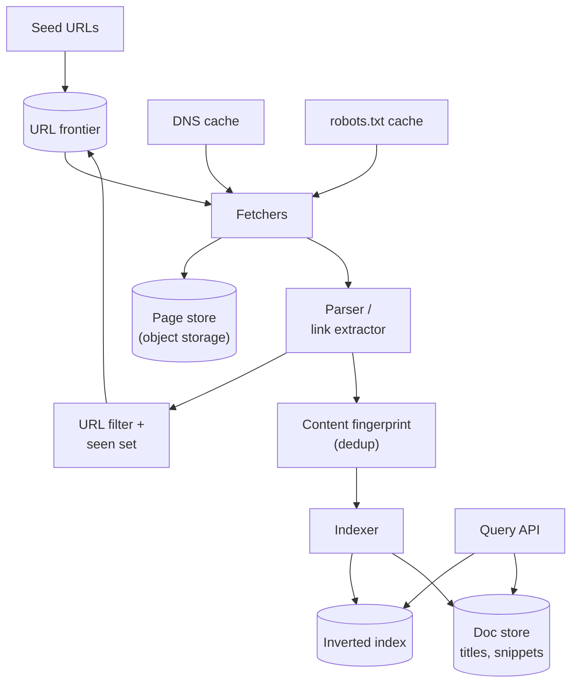
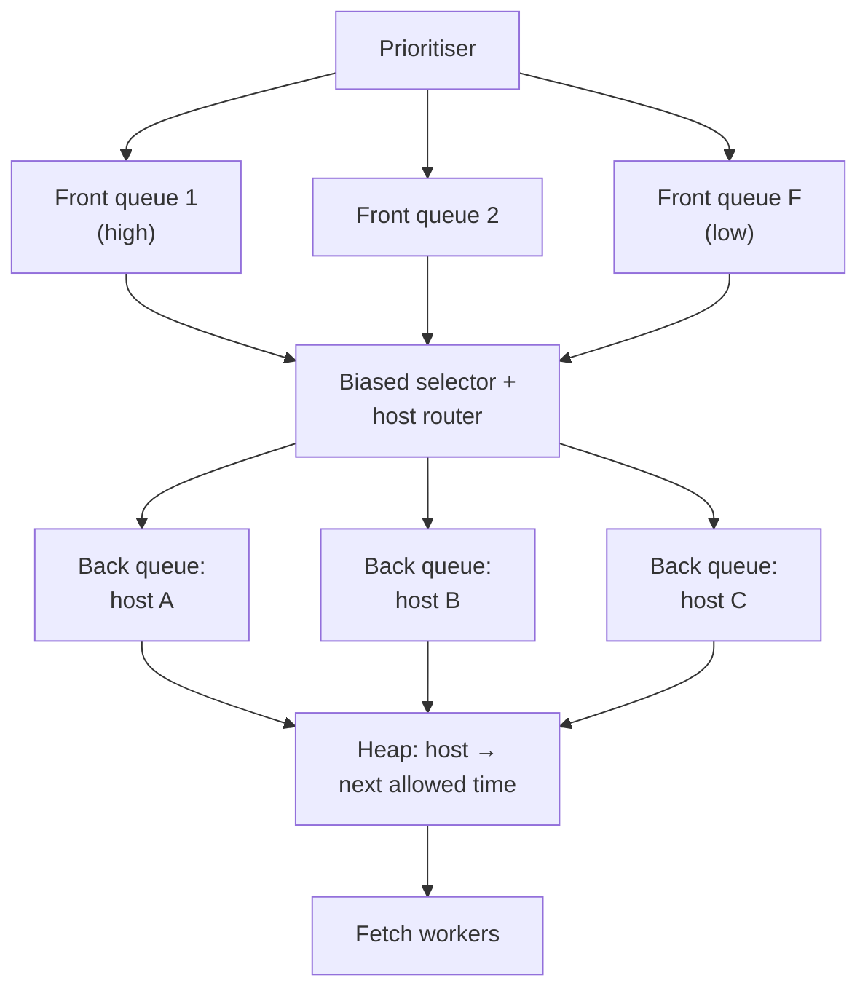
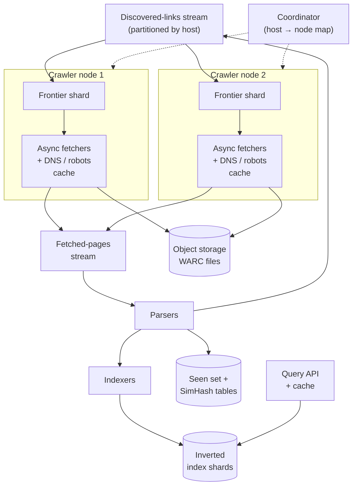

import { Aside } from '@astrojs/starlight/components';

A web crawler is simple in principle: fetch a page, extract its links, add them to a to-do list, repeat. At a billion pages a week, every part of that loop becomes a design problem. The to-do list has to be prioritised and polite to each site, duplicates hide behind different URLs, DNS turns into a bottleneck, and the web keeps changing under you. This case study designs a crawler that feeds a search index. It also sketches the query side, which turns crawled pages into results with titles and snippets.

<Aside type="tip" title="TL;DR">
- **URL frontier:** priority queues feed **per-host queues**. A heap of "host is next allowed at time T" enforces politeness, so the crawler never hammers one site while still keeping thousands of hosts busy.
- **Respect robots.txt** (RFC 9309): cache it per host for up to 24 hours, and slow down on `429`/`503`.
- **Deduplicate twice:** normalise URLs and check them against a "seen" set or Bloom filter before they enter the frontier, then fingerprint content after fetching: an exact hash for identical bodies and **SimHash** for near-duplicates.
- **Shard by host** across crawler nodes (consistent hashing), store raw pages in object storage (WARC files), and feed parsing, indexing and re-crawl scheduling from a stream. Re-crawl each page at a rate based on how often it actually changes.
</Aside>

## Step 1 — Requirements and constraints

### Use cases

In scope:

- **Service** crawls a seed list of URLs and keeps discovering new ones.
- **Service** builds an inverted index and stores a static title and snippet for each page.
- **Service** re-crawls pages regularly so the index stays fresh.
- **User** searches and gets a ranked list of pages with titles and snippets. This is sketched at a high level only.
- **Service** is highly available.

Out of scope: link-analysis ranking (PageRank), personalisation, search analytics, and executing JavaScript on every page (we treat rendering as an optional, expensive tier).

### Non-functional requirements

- **Politeness:** never overload a site. Obey robots.txt and back off on errors.
- **Robustness:** survive spider traps (infinite calendars, session IDs in URLs), malformed HTML and huge files.
- **Freshness:** popular pages within hours to a day, the long tail within weeks.
- **Scale-out:** add machines to crawl more, with no central bottleneck.
- **Fast queries:** search results in a few hundred milliseconds.

### Assumptions

- 1 billion URLs in the corpus, re-crawled about weekly on average. That gives about 4.3 billion fetches per month.
- An average page is about 100 KB of HTML. The original assumed 500 KB, which looks like full page weight with images and scripts, but a crawler for a text index downloads only the HTML.
- Compressed storage ratio about 4:1. About 10 KB of extracted text per page.
- 100 billion searches per month.

### Back-of-the-envelope

| Quantity | Calculation | Result |
|---|---|---|
| Fetches | 1 B × 30/7 per month ÷ 2.592 M s | ≈ 1,650/s average (the original's 1,600) |
| Download bandwidth | 1,650/s × 100 KB | ≈ 165 MB/s ≈ 1.3 Gbit/s sustained |
| Concurrent fetches | 1,650/s × ~1–2 s per fetch | ≈ 1,700–3,300 open connections |
| Hosts in rotation | 1,650/s ÷ 0.1 per host per second (10 s gap) | ≥ 16,500 hosts with queued URLs at any moment |
| Raw HTML per month | 4.3 B × 100 KB | ≈ 430 TB raw, ≈ 107 TB compressed |
| History over 3 years | 107 TB × 36 | ≈ 3.9 PB compressed if every fetch is kept |
| Latest snapshot only | 1 B × 100 KB ÷ 4 | ≈ 25 TB compressed |
| Extracted text | 1 B × 10 KB | ≈ 10 TB (input to indexing) |
| URL "seen" set | 10 B URLs, Bloom filter, 1 % false positives | ≈ 12 GB |
| Content fingerprints | 1 B × 8-byte SimHash | ≈ 8 GB |
| Searches | 100 B ÷ 2.592 M s | ≈ 38,600/s average |

<Aside type="note" title="Arithmetic vs. the original">
The original multiplies 4 B fetches by 500 KB to get 2 PB per month and 72 PB in three years, and those products are right. Two things change the picture, though. First, 1 B pages refreshed weekly is about 4.3 B fetches per month, not 4 B. Second, 500 KB is much larger than typical HTML: Common Crawl's 2026 monthly crawls hold about 185 KB of uncompressed data per captured page, and the 2025 Web Almanac puts the median HTML document at about 33–35 KB. With 100 KB pages and compression, the archive is about 3.9 PB over three years, or 25 TB if only the latest version is kept. Also, only pages that actually changed need a new copy.
</Aside>

## Step 2 — High-level design



1. The **frontier** decides which URL to fetch next, subject to priority and per-host politeness.
2. A **fetcher** resolves the host through a local DNS cache, checks the cached robots.txt rules, and downloads the page with timeouts and a size limit.
3. The raw response goes to the **page store**. The **parser** extracts text, the title and outgoing links.
4. New links are normalised, filtered (scheme, file type, trap heuristics) and checked against the **seen set**. Only new URLs enter the frontier.
5. Content is fingerprinted. Exact or near-duplicates are recorded as aliases of a canonical page and are not indexed twice.
6. The **indexer** updates the inverted index and the document store (URL, title, snippet). The **query API** reads both.

## Step 3 — Core components

### The URL frontier: priority and politeness

The frontier has two jobs that pull in opposite directions: fetch the most important URLs first, and never send many requests to the same host. The classic answer comes from the Mercator crawler and is described in *Introduction to Information Retrieval*:



- **Front queues** hold URLs by priority. Priority reflects estimated importance (link-based score, site authority, sitemap hints, whether the URL is new or a re-crawl) and freshness need.
- **Back queues** hold URLs for a **single host** each. A selector drains front queues with a bias toward high priority and routes each URL to its host's back queue.
- A **heap** keyed by "earliest time we may contact this host" decides which host to serve next. After a fetch that took `t` seconds, Mercator waited `10·t` before contacting the same host again. A fixed minimum of about 1 s, or the site's own `Crawl-delay`, works as a floor. Mercator's rule of thumb was about 3 back queues per fetch thread, so threads never idle.

```python title="frontier.py"
import heapq
import time
from collections import defaultdict, deque
from dataclasses import dataclass, field
from urllib.parse import urlsplit


@dataclass(order=True)
class HostSlot:
    ready_at: float
    host: str = field(compare=False)


class Frontier:
    """Front queues by priority, one back queue per host, a heap of 'host ready at' times."""

    def __init__(self, levels: int = 3, min_delay: float = 1.0, max_hosts: int = 1000) -> None:
        self.front: list[deque[str]] = [deque() for _ in range(levels)]   # 0 = most important
        self.back: dict[str, deque[str]] = defaultdict(deque)
        self.ready: list[HostSlot] = []
        self.in_flight: set[str] = set()
        self.next_ok: dict[str, float] = defaultdict(float)             # politeness clock per host
        self.min_delay = min_delay                                       # or the robots.txt delay
        self.max_hosts = max_hosts

    def add(self, url: str, priority: int) -> None:
        self.front[priority].append(url)

    def _refill(self) -> None:
        for q in self.front:                  # strict priority for brevity; real crawlers use weights
            while q and len(self.ready) < self.max_hosts:
                url = q.popleft()
                host = urlsplit(url).hostname or ""
                if not self.back[host] and host not in self.in_flight:
                    heapq.heappush(self.ready, HostSlot(self.next_ok[host], host))
                self.back[host].append(url)

    def next_url(self) -> tuple[str, float] | None:
        """Return (url, seconds to wait) for the host that becomes ready soonest."""
        if len(self.ready) < self.max_hosts:
            self._refill()
        if not self.ready:
            return None
        slot = heapq.heappop(self.ready)
        self.in_flight.add(slot.host)         # one connection per host at a time
        url = self.back[slot.host].popleft()
        return url, max(0.0, slot.ready_at - time.monotonic())

    def done(self, url: str, fetch_seconds: float) -> None:
        host = urlsplit(url).hostname or ""
        self.in_flight.discard(host)
        gap = max(self.min_delay, 10 * fetch_seconds)   # Mercator: wait 10x the last fetch time
        self.next_ok[host] = time.monotonic() + gap
        if self.back[host]:
            heapq.heappush(self.ready, HostSlot(self.next_ok[host], host))


f = Frontier()
for u in ("https://a.example/1", "https://a.example/2", "https://b.example/1"):
    f.add(u, priority=0)
first, second = f.next_url(), f.next_url()
assert first and second
print(first[0], second[0])          # one URL per host before a.example is touched again
f.done(first[0], fetch_seconds=0.2)
nxt = f.next_url()
assert nxt
print(nxt[0], round(nxt[1], 1))     # https://a.example/2 after ~2.0 s (10 x 0.2 s)
```

The arithmetic matters here. If each host gets one request roughly every 10 seconds, sustaining 1,650 fetches/s requires **at least 16,500 distinct hosts** with work queued at all times. A frontier that fills up with URLs from a few big sites stalls, however much hardware it has. Group politeness by **IP address or hosting provider** too, not just hostname, because thousands of small sites can share one server.

The frontier for billions of URLs does not fit in RAM. Keep the head of each queue in memory and the rest on disk: RocksDB, a sharded key-value store, or Kafka-style logs per priority level.

### robots.txt and good manners

The Robots Exclusion Protocol has been a standard since 2022 (RFC 9309):

- Fetch `/robots.txt` per host (scheme, host and port) before anything else, and cache it for **at most 24 hours**.
- Parse at least the first **500 KiB**. Follow at least 5 consecutive redirects.
- `4xx` (for example `404`) means no restrictions. `5xx` or a network error means **assume everything is disallowed**, and retry later. If the file stays unreachable for a long time (around 30 days), a crawler may fall back to a cached copy or treat the site as unrestricted.
- Match the most specific `User-agent` group and the longest matching `Allow`/`Disallow` rule. `Crawl-delay` is not part of the RFC. Some crawlers honour it, and Google ignores it.

```python title="robots.py"
from urllib.robotparser import RobotFileParser

ROBOTS_TXT = """\
User-agent: *
Disallow: /search
Disallow: /tmp/

User-agent: ExampleBot
Disallow: /private/
"""

rp = RobotFileParser()
rp.parse(ROBOTS_TXT.splitlines())       # in production: fetch, cache <= 24 h, cap at 500 KiB
for agent in ("ExampleBot", "OtherBot"):
    print(agent, [rp.can_fetch(agent, "https://example.com" + p) for p in ("/search?q=x", "/private/x")])
# ExampleBot [True, False]  - a bot that has its own group ignores the '*' group
# OtherBot   [False, True]
```

Beyond robots.txt: send an honest `User-Agent` with a contact URL, use conditional requests (`If-None-Match`, `If-Modified-Since`) so an unchanged page costs a `304` and no body, slow down automatically on `429`/`503` and rising latency, and read `sitemap.xml` (with its `lastmod` dates) for discovery.

### Deduplication, part 1: URLs

Many different strings point to the same page. Normalise each URL before the "have we seen it?" check:

```python title="normalize.py"
from urllib.parse import parse_qsl, urlencode, urlsplit, urlunsplit

TRACKING = {"utm_source", "utm_medium", "utm_campaign", "utm_term", "utm_content", "gclid", "fbclid"}
DEFAULT_PORTS = {"http": 80, "https": 443}


def normalize(url: str) -> str:
    parts = urlsplit(url.strip())
    scheme = parts.scheme.lower()
    host = (parts.hostname or "").lower().rstrip(".")
    port = f":{parts.port}" if parts.port and parts.port != DEFAULT_PORTS.get(scheme) else ""
    path = parts.path or "/"
    query = urlencode(sorted((k, v) for k, v in parse_qsl(parts.query, keep_blank_values=True)
                             if k.lower() not in TRACKING))
    return urlunsplit((scheme, host + port, path, query, ""))  # fragment dropped


assert normalize("HTTPS://Example.COM:443/a?utm_source=x&b=2&a=1#top") == "https://example.com/a?a=1&b=2"
assert normalize("http://example.com") == "http://example.com/"
print("ok")
```

Then test the normalised URL against a **seen set**. With 10 B URLs, an exact set of 8-byte hashes takes about 80 GB, though 64-bit hashes of 10 B URLs give about 3 expected false matches. A Bloom filter at 1 % false positives takes about 12 GB, which fits in RAM when partitioned across crawler nodes. A false positive means an occasional new URL is skipped, which is acceptable for a crawler. Also honour `<link rel="canonical">` and redirects, which tell you which URL a site prefers.

**Spider traps** are URL spaces with no end: calendars that link to the next month forever, session IDs, faceted search with endless parameter combinations. Defences: limits on URL length, path depth and query parameters; a per-host page budget; and detecting near-duplicate content under many URLs (the next section).

### Deduplication, part 2: content

A large share of crawled pages are exact or near copies: mirrors, printer-friendly versions, the same article with different ads or boilerplate.

- **Exact duplicates:** hash the normalised body (SHA-256, or a fast 64/128-bit hash) and look it up in a key-value table `hash → canonical URL`.
- **Near-duplicates:** **SimHash** (Charikar, 2002) maps a document to a 64-bit fingerprint where similar documents differ in only a few bits. Google reported (Manku et al., WWW 2007) that for 8 billion pages, 64-bit fingerprints with a Hamming distance of at most 3 worked well.

```python title="simhash.py"
import hashlib
import re
from collections import Counter


def _h64(token: str) -> int:
    return int.from_bytes(hashlib.blake2b(token.encode(), digest_size=8).digest(), "big")


def simhash(text: str, shingle: int = 3) -> int:
    """64-bit SimHash over word 3-grams: similar texts -> few differing bits."""
    words = re.findall(r"\w+", text.lower())
    grams = Counter(" ".join(words[i:i + shingle]) for i in range(max(1, len(words) - shingle + 1)))
    acc = [0] * 64
    for gram, weight in grams.items():
        h = _h64(gram)
        for bit in range(64):
            acc[bit] += weight if (h >> bit) & 1 else -weight
    return sum(1 << bit for bit in range(64) if acc[bit] > 0)


def hamming(a: int, b: int) -> int:
    return (a ^ b).bit_count()


body = " ".join(f"Paragraph {i} explains how crawlers schedule hosts politely." for i in range(40))
a = simhash(body + " Copyright 2025.")
b = simhash(body + " Copyright 2026.")     # same article, new footer
c = simhash("A completely different page about sourdough bread and starter cultures. " * 10)
print(hamming(a, b), hamming(a, c))        # small vs about 32
```

Finding all stored fingerprints within 3 bits of a new one without scanning 1 B values uses the **block trick**. Split the 64 bits into 4 blocks of 16. Any fingerprint within distance 3 matches the new one exactly in at least one block. Keep 4 tables, each sorted by one block, and look up only the candidates that share that block. That is about 15,000 candidates per table at 1 B pages, about 32 GB in total, and each candidate costs a quick XOR and popcount. MinHash with locality-sensitive hashing (LSH) is the alternative when you want Jaccard similarity over shingles.

### DNS

At 1,650 fetches/s, sending every lookup to a public resolver adds latency, creates load, and risks being rate-limited. Run a **local caching resolver** (Unbound, or a cache inside the fetcher) on each crawler node, and respect TTLs with a floor. Resolve the next hosts **asynchronously**, before their URLs reach the fetcher. Cache negative answers briefly. Since URLs are grouped by host, the hit rate is high. With a 95 % hit rate, the upstream sees about 80 lookups/s.

### Fetching

- **Asynchronous I/O:** one process with an event loop can keep thousands of connections open. Reuse HTTP/1.1 keep-alive or HTTP/2 connections to the same host.
- **Limits:** connect and read timeouts, a maximum body size (for example 10 MB), allowed content types, and a maximum redirect chain.
- **Rendering:** most pages are indexable from HTML. Send a small, prioritised share (single-page apps with valuable content) to a separate **headless-browser tier**, which costs 10–100× more per page.
- **Transport:** page fetches are HTTP over TCP and TLS. The original's tip to "switch to UDP" only makes sense for DNS, which already uses UDP. HTTP/3 (QUIC over UDP) is an option where servers support it, but it is not a crawler speed-up in itself.

### Storage and indexing

- **Raw pages:** append responses to large **WARC** files (the web-archive standard; around 1 GB each is typical) in object storage, with a separate index `URL → (file, offset, length)`. Large immutable files suit object storage far better than billions of 100 KB objects.
- **Crawl state:** a key-value table keyed by URL hash: last fetch time, status, ETag/Last-Modified, content hash, SimHash, change history, and next scheduled crawl.
- **Indexing pipeline:** parse → extract text, title and outgoing anchor text → tokenise → write postings. Shard the inverted index **by document** so each query goes to all shards in parallel and results are merged (scatter-gather). Build index segments in batch (Spark or MapReduce over the latest snapshot) and merge in small incremental updates for fresh pages.
- **Doc store:** URL, title and a static snippet per document, used to render results.

```http title="Search API"
GET /api/v1/search?q=consistent+hashing&page=1

{"results": [{"url": "https://example.com/ch", "title": "Consistent hashing explained", "snippet": "Consistent hashing maps keys and servers onto a ring…"}],
 "next_page": 2}
```

### Re-crawl scheduling

Pages change at very different rates. A news homepage changes every few minutes, while an old blog post may never change. Store a change history per URL and estimate a change rate λ (changes per day), for example with a Poisson model. Schedule the next visit from λ and the page's importance.

Two results from Cho and Garcia-Molina's work on crawl freshness are worth knowing:

- Revisiting **in proportion** to change rate is worse for average freshness than a uniform schedule. Pages that change every few minutes are stale again almost immediately, so chasing them wastes the crawl budget.
- The optimal policy is closer to uniform, increases visit frequency **sub-linearly** with change rate, and gives up on pages that change too often to keep fresh.

In practice: re-crawl important pages often, skip pages whose `ETag` or content hash has not changed (a `304` costs almost nothing), slow down pages that have not changed for a long time, and use push signals where sites offer them: sitemaps with `lastmod`, RSS and Atom feeds, and IndexNow notifications.

## Step 4 — Scaling the design

1. **Distribute the frontier by host.** Assign each host to one crawler node with consistent hashing on the registered domain. That node owns the host's queue, politeness clock, robots.txt cache and DNS cache, so politeness needs no global lock. Links discovered for other hosts are sent to their owners in batches through a stream. When nodes join or leave, only about 1/N of hosts move.
2. **Keep fetchers I/O-bound.** About 3,300 concurrent connections can run on a handful of machines with async I/O. Parsing is CPU-bound, so run parsers as separate consumers of a fetched-pages stream, scaled independently.
3. **Partition the seen set and dedup tables** by URL hash and by SimHash block, co-located with frontier nodes or held in a sharded key-value store.
4. **Absorb bursts with streams.** Fetch → parse → link-dedup → frontier and fetch → index are separate stages on Kafka-style topics. Each stage scales independently, and a slow indexer builds a backlog instead of stalling the crawl.
5. **Make work idempotent.** A node that crashes and re-fetches a page must not double-count. Key everything by URL hash and fetch time.
6. **Bandwidth and IP reputation.** At about 1.3 Gbit/s sustained, spread egress across regions near the content. Publish your crawler's IP ranges and identity so sites can verify it.
7. **Query side.** About 38,600 searches/s needs a replicated, document-sharded index and a result cache for popular queries, because query frequency is highly skewed. See [the search query cache case study](/practice/search-query-cache/).



| Added component | Buys | Costs |
|---|---|---|
| Host-partitioned frontier | Politeness without global locks; horizontal scale | Rebalancing when nodes change; skew from very large hosts |
| Streams between stages | Independent scaling, buffering, replay | Duplicates on replay, so stages must be idempotent |
| Bloom filter seen set | 12 GB instead of 80+ GB | Small chance of skipping a new URL |
| SimHash tables | Near-duplicate detection in a few lookups | About 32 GB of tables; threshold tuning |
| WARC files in object storage | Cheap, durable, replayable raw archive | Random access needs an offset index |
| Headless rendering tier | Indexes JavaScript-heavy sites | 10–100× the cost per page |

## What's different in 2026

- **Managed building blocks:** object storage (S3, GCS, R2) for WARC files, Kafka-compatible streams or Pub/Sub between stages, a sharded key-value store (DynamoDB, Bigtable, ScyllaDB) for crawl state, and Spark or BigQuery for batch dedup and index builds. Fetchers suit containers or long-running VMs, which hold connections and DNS caches warm. Serverless functions pay a cold start and lose those caches, so they fit bursty side jobs better than the core fetch loop.
- **Open datasets:** Common Crawl publishes about 2 billion pages per month, roughly 360 TiB uncompressed per crawl in 2026, as WARC files on S3. For research, or to bootstrap an index, start there instead of crawling.
- **AI crawlers changed the etiquette.** LLM training and answer engines now crawl at huge volume, and sites push back. Since July 2025, Cloudflare blocks AI crawlers by default on newly added domains and lets sites charge crawlers per fetch ("pay per crawl", which it began reshaping into "pay per use" in 2026). Since July 2026 its controls set search, AI training and AI agent access separately, and since 15 September 2026 a "disallow training" option keeps mixed-use crawlers such as Googlebot allowed for search. Site owners distinguish search from training crawlers in robots.txt by user agent. The IETF Web Bot Auth working group is drafting a standard for bots to sign requests with HTTP Message Signatures and publish their public keys in a well-known directory, so origins can verify who is crawling. A 2026 crawler should identify itself precisely, publish its IP ranges and keys, and honour per-purpose opt-outs.
- **Push-based discovery:** sitemaps, and IndexNow (supported by Bing, Yandex, Naver, Seznam, Yep, Amazon and the Internet Archive, though not Google) let sites announce changes instead of waiting to be re-crawled.
- **Rendering is routine but expensive:** headless Chromium pools (Playwright, Puppeteer) are standard, and still reserved for pages that need them.
- **What still holds:** the Mercator frontier, politeness per host, URL normalisation plus a seen set, SimHash for near-duplicates, and change-rate-based re-crawling.

<Aside type="note" title="In the interview">
- **"How do you stay polite while fetching 1,000+ pages per second?"** Per-host back queues, a ready-time heap, and enough distinct hosts in rotation. Show the 16,500-host arithmetic.
- **"How do you avoid crawling the same thing twice?"** URL normalisation plus a Bloom filter, then content hashes and SimHash with the block trick.
- **"Spider traps?"** Depth, length and parameter limits, per-host budgets, and duplicate-content detection.
- **"How often do you re-crawl?"** Based on estimated change rate and importance; conditional GETs; the "proportional is not optimal" result.
- **"How do you distribute it?"** Consistent hashing of hosts to nodes, and links routed to owners through a stream.
- **Common mistakes:** one global queue (impolite and a bottleneck), ignoring robots.txt `5xx` semantics, storing billions of tiny objects, and forgetting DNS.
</Aside>

## Further reading

- [RFC 9309: Robots Exclusion Protocol](https://www.rfc-editor.org/rfc/rfc9309.html)
- [Mercator: a scalable, extensible web crawler (Heydon and Najork, 1999)](https://www.cs.ucr.edu/~vagelis/classes/CS242/publications/scalable-crawler.pdf)
- [The URL frontier, *Introduction to Information Retrieval* (Manning, Raghavan, Schütze)](https://nlp.stanford.edu/IR-book/html/htmledition/the-url-frontier-1.html)
- [Detecting near-duplicates for web crawling (Manku, Jain, Das Sarma, WWW 2007)](https://archives.iw3c2.org/www2007/papers/paper215.pdf)
- [How Google interprets the robots.txt specification](https://developers.google.com/crawling/docs/robots-txt/robots-txt-spec)
- [Common Crawl: August 2026 crawl archive](https://commoncrawl.org/blog/august-2026-crawl-archive-now-available)

## Related topics

- [Event streaming](/async/event-streaming/): the streams that connect fetch, parse, dedup and indexing.
- [Partitioning and sharding](/data/partitioning-and-sharding/): consistent hashing of hosts to crawler nodes, and document-sharded indexes.
- [Object storage](/data/object-storage/): storing raw pages as large WARC files.
- [DNS](/traffic/dns/): why a crawler needs its own caching resolver.
- [Rate limiting](/reliability/rate-limiting/): politeness is rate limiting applied to yourself.
- [Design a key-value cache for a search engine](/practice/search-query-cache/): the query side of this system.
