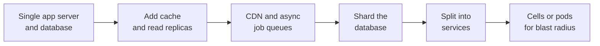

import { Aside } from '@astrojs/starlight/components';

Engineering write-ups show how the patterns in this guide behave under real traffic, deadlines and legacy code. This page lists, company by company, the articles worth reading and one line on what each one teaches. It keeps the companies from the original primer wherever a working source still exists, and adds strong posts from 2016 to 2024.

<Aside type="tip" title="TL;DR">
- Read each post for **the constraint that forced a change**, what the team tried, and what it cost.
- Older High Scalability snapshots (2007–2016) show **how teams grew a simple stack**. Their numbers are dated, but the order of steps still applies.
- Newer posts show **what changed**: managed cloud storage, Postgres and MySQL sharding layers, Rust services and cell-based isolation.
- To prepare for a specific question, use the **reading by theme** list below.
</Aside>

## How to read a case study

Treat each article as an answer to a design question that you did not see. While reading, write down:

- **The starting point and the trigger.** What was the stack, and what broke first: write throughput, a hot partition, fan-out cost, an outage, or developer speed?
- **The options they rejected.** The reasons a team gives for not choosing a technology are often more useful than the choice itself.
- **The cost.** Migrations take months, dual writes need verification, and new systems need operators. Good posts name these costs.
- **The date.** A 2011 post describes 2011 hardware and tools. Keep the reasoning and update the technology choices.

Most of the stories follow a similar growth path:

## Company write-ups

Sorted alphabetically. The year is the publication date of the article, not of the system.

| Company | Write-up | What you learn |
|---|---|---|
| Airbnb | [Avoiding double payments in a distributed payments system](https://medium.com/airbnb-engineering/avoiding-double-payments-in-a-distributed-payments-system-2981f6b070bb) (2019) | An idempotency library that keeps network calls out of database transactions, so retries never charge twice. |
| Amazon | [Amazon architecture](https://highscalability.com/amazon-architecture/) (2007) | The move from a two-tier monolith to services owned by small teams, based on an interview with Werner Vogels. |
| Amazon | [Building and operating a pretty big storage system called S3](https://www.allthingsdistributed.com/2023/07/building-and-operating-a-pretty-big-storage-system.html) (2023) | How scale changes the work: spreading data across huge numbers of drives, using heat management, and building team ownership. |
| Cinchcast | [Producing 1,500 hours of audio every day](https://highscalability.com/cinchcast-architecture-producing-1500-hours-of-audio-every-d/) (2012) | A .NET and SQL Server stack that shields the database with Redis, a CDN and Elasticsearch. |
| Cloudflare | [How we built Pingora](https://blog.cloudflare.com/how-we-built-pingora-the-proxy-that-connects-cloudflare-to-the-internet/) (2022) | Why Cloudflare replaced NGINX with its own Rust proxy: connection reuse across workers, efficiency and safety. |
| DataSift | [Realtime datamining at 120,000 tweets per second](https://highscalability.com/datasift-architecture-realtime-datamining-at-120000-tweets-p/) (2011) | Stream filtering at firehose rate by compiling filters, sharing common work between customers, and sharding the stream. |
| Discord | [How Discord stores billions of messages](https://discord.com/blog/how-discord-stores-billions-of-messages) (2017) | Moving chat history from MongoDB to Cassandra, with partitions keyed by channel and time bucket. |
| Discord | [How Discord stores trillions of messages](https://discord.com/blog/how-discord-stores-trillions-of-messages) (2023) | The follow-up: hot partitions and garbage-collection pauses, a move to ScyllaDB (177 nodes to 72), and Rust data services that coalesce requests. |
| Dropbox | [Inside the Magic Pocket](https://dropbox.tech/infrastructure/inside-the-magic-pocket) (2016) | Leaving S3 for an in-house, immutable block store: design goals, durability and the overall architecture. |
| Dropbox | [Rewriting the heart of our sync engine](https://dropbox.tech/infrastructure/rewriting-the-heart-of-our-sync-engine) (2020) | When a full rewrite is justified, and the testing practices that made a four-year rewrite ship safely. |
| ESPN | [Operating at 100,000 requests per second](https://highscalability.com/espns-architecture-at-scale-operating-at-100000-duh-nuh-nuhs/) (2013) | Serving sports traffic peaks from a few hundred servers by caching pages and page fragments heavily. |
| Facebook / Meta | [How Facebook Live streams to 800,000 simultaneous viewers](https://highscalability.com/how-facebook-live-streams-to-800000-simultaneous-viewers/) (2016) | Spiky live traffic, edge caches that collapse duplicate requests, and capacity planning for a new product. |
| Facebook / Meta | [How we built a general purpose key value store with ZippyDB](https://engineering.fb.com/2021/08/06/core-infra/zippydb/) (2021) | A strongly consistent, geo-distributed store on RocksDB, with consistency levels that clients choose per request. |
| Facebook / Meta | [How Meta built the infrastructure for Threads](https://engineering.fb.com/2023/12/19/core-infra/how-meta-built-the-infrastructure-for-threads/) (2023) | Launching to tens of millions of users in days by reusing proven platforms (the ZippyDB store and the Async serverless job platform) instead of building new ones. |
| Figma | [How Figma's multiplayer technology works](https://www.figma.com/blog/how-figmas-multiplayer-technology-works/) (2019) | Real-time collaboration with a central server and CRDT-inspired rules, and why Figma did not use operational transformation. |
| Figma | [How Figma's databases team lived to tell the scale](https://www.figma.com/blog/how-figmas-databases-team-lived-to-tell-the-scale/) (2024) | Horizontal sharding of Postgres behind a query proxy, after vertical partitioning ran out of room. |
| Flickr | [Flickr architecture](https://highscalability.com/flickr-architecture/) (2007) | A classic PHP and MySQL stack scaled with database sharding, memcached and Squid caching. |
| GitHub | [Partitioning GitHub's relational databases to handle scale](https://github.blog/engineering/infrastructure/partitioning-githubs-relational-databases-scale/) (2021) | Splitting one large MySQL cluster by schema domain, with tooling that detects queries crossing domain boundaries. |
| Google | [Google architecture](https://highscalability.com/google-architecture/) (2008) | How GFS, MapReduce and Bigtable fit together on commodity hardware. Read with the [foundational papers](/real-world/foundational-papers/). |
| Google | [How Google serves data from multiple datacenters](https://highscalability.com/how-google-serves-data-from-multiple-datacenters/) (2009) | Backups, leader-follower, multi-leader, two-phase commit and Paxos compared for multi-datacenter data. |
| Instagram | [14 million users, terabytes of photos](https://highscalability.com/instagram-architecture-14-million-users-terabytes-of-photos/) (2011) | How three engineers ran a fast-growing app on AWS with PostgreSQL, Redis, memcached and async task queues. |
| Instagram | [What powers Instagram](https://instagram-engineering.com/what-powers-instagram-hundreds-of-instances-dozens-of-technologies-adf2e22da2ad) (2011) | The team's own tour of its stack, from load balancing to monitoring, at roughly one year old. |
| Instagram | [Sharding and IDs at Instagram](https://medium.com/instagram-engineering/sharding-ids-at-instagram-1cf5a71e5a5c) (2012) | Time-sortable 64-bit IDs generated inside PostgreSQL, using thousands of logical shards mapped onto fewer physical servers. |
| Justin.tv (now Twitch) | [Live video broadcasting architecture](https://highscalability.com/justintvs-live-video-broadcasting-architecture/) (2010) | Building a replication tree of video servers for each stream, based on load and network position. |
| Mailbox | [From 0 to one million users in 6 weeks](https://highscalability.com/scaling-mailbox-from-0-to-one-million-users-in-6-weeks-and-1/) (2013) | Using a reservation queue to control growth while the backend caught up with demand. |
| Netflix | [What happens when you press play?](https://highscalability.com/netflix-what-happens-when-you-press-play/) (2017) | The split between the AWS control plane and the Open Connect CDN, which serves pre-positioned video from inside ISPs. |
| Netflix | [Zuul 2: the journey to asynchronous, non-blocking systems](https://netflixtechblog.com/zuul-2-the-netflix-journey-to-asynchronous-non-blocking-systems-45947377fb5c) (2016) | Moving the API gateway to async I/O: big gains in connection handling, little gain for CPU-bound work. |
| Netflix | [Introducing Netflix's key-value data abstraction layer](https://netflixtechblog.com/introducing-netflixs-key-value-data-abstraction-layer-1ea8a0a11b30) (2024) | Hiding Cassandra and other stores behind one API, with idempotency tokens, chunking and adaptive pagination. |
| Notion | [Herding elephants: lessons from sharding Postgres](https://www.notion.com/blog/sharding-postgres-at-notion) (2021) | 480 logical shards on 32 databases, application-level routing, and a migration through an audit log, backfill and verification. |
| Pinterest | [18 million visitors, 10x growth, 12 employees](https://highscalability.com/pinterest-architecture-update-18-million-visitors-10x-growth/) (2012) | A small team growing fast on AWS with sharded MySQL, Redis and memcached. |
| Pinterest | [From 0 to tens of billions of page views a month](https://highscalability.com/scaling-pinterest-from-0-to-10s-of-billions-of-page-views-a/) (2013) | Why they chose mature tools and manual sharding over clustered databases. A useful counterweight to chasing new technology. |
| Playfish | [50 million monthly users and growing](https://highscalability.com/playfishs-social-gaming-architecture-50-million-monthly-user/) (2010) | Social games on EC2: stateless Java servers, sharded MySQL, and each user's data stored as one blob. |
| PlentyOfFish | [PlentyOfFish architecture](https://highscalability.com/plentyoffish-architecture/) (2009) | How far vertical scaling, large-memory machines and a CDN can take a site run by very few people. |
| Salesforce | [How they handle 1.3 billion transactions a day](https://highscalability.com/salesforce-architecture-how-they-handle-13-billion-transacti/) (2013) | Multi-tenant SaaS partitioned into isolated instances and "superpods", with a separate store for large files. |
| Shopify | [A pods architecture to allow Shopify to scale](https://shopify.engineering/a-pods-architecture-to-allow-shopify-to-scale) (2018) | Isolating groups of shops into pods so a failure in one shard does not take down the whole platform. |
| Shopify | [Deconstructing the monolith](https://shopify.engineering/deconstructing-monolith-designing-software-maximizes-developer-productivity) (2019) | The modular monolith: one deployable Rails app with enforced domain boundaries, instead of microservices. |
| Slack | [Scaling datastores at Slack with Vitess](https://slack.engineering/scaling-datastores-at-slack-with-vitess/) (2020) | Moving from workspace-sharded MySQL to Vitess for flexible sharding keys, and how the migration was run. |
| Slack | [Real-time messaging](https://slack.engineering/real-time-messaging/) (2023) | Channel, gateway and presence servers that fan out messages and events to connected clients worldwide. |
| Stack Overflow | [Stack Overflow architecture](https://highscalability.com/stack-overflow-architecture/) (2009) | A famously small fleet that relied on scaling up, SQL Server and careful caching. |
| Stack Overflow | [Stack Overflow: the architecture, 2016 edition](https://nickcraver.com/blog/2016/02/17/stack-overflow-the-architecture-2016-edition/) (2016) | The same approach seven years later: load balancers, web tier, Redis, Elasticsearch and SQL Server, with real traffic numbers. |
| Stripe | [Scaling your API with rate limiters](https://stripe.com/blog/rate-limiters) (2017) | Four kinds of rate limiters and load shedders, and how to roll them out without hurting legitimate traffic. |
| Stripe | [Designing robust and predictable APIs with idempotency](https://stripe.com/blog/idempotency) (2017) | Idempotency keys, plus retries with exponential backoff and jitter, for APIs on unreliable networks. |
| Stripe | [Online migrations at scale](https://stripe.com/blog/online-migrations) (2017) | A four-step dual-write pattern for moving hundreds of millions of records with no downtime. |
| TripAdvisor | [40M visitors, 200M dynamic page views, 30 TB of data](https://highscalability.com/tripadvisor-architecture-40m-visitors-200m-dynamic-page-view/) (2011) | A Java and PostgreSQL stack with heavy caching, run by teams that owned features from end to end. |
| Tumblr | [15 billion page views a month](https://highscalability.com/tumblr-architecture-15-billion-page-views-a-month-and-harder/) (2012) | Why dashboard fan-out was harder than Twitter's timeline, and the move from a PHP monolith to JVM services. |
| Twitter / X | [Announcing Snowflake](https://blog.x.com/engineering/en_us/a/2010/announcing-snowflake) (2010) | Unique, roughly time-ordered 64-bit IDs generated without central coordination. |
| Twitter / X | [Timelines at scale](https://www.infoq.com/presentations/Twitter-Timeline-Scalability/) (2013) | Talk: fan-out on write into Redis timelines, and the special handling of accounts with millions of followers. |
| Twitter / X | [150M active users, 300K QPS, a 22 MB/s firehose](https://highscalability.com/the-architecture-twitter-uses-to-deal-with-150m-active-users/) (2013) | A written summary of the same design: home timelines precomputed on write, search computed on read. |
| Uber | [How Uber scales their real-time market platform](https://highscalability.com/how-uber-scales-their-real-time-market-platform/) (2015) | The dispatch system: geospatial indexing, a consistent-hash ring of workers, and surviving a datacenter failure. |
| Uber | [Lessons learned from scaling Uber to 2000 engineers, 1000 services](https://highscalability.com/lessons-learned-from-scaling-uber-to-2000-engineers-1000-ser/) (2016) | The hidden costs of a thousand microservices: many languages, tracing, ownership and coordination between teams. |
| Uber | [H3: Uber's hexagonal hierarchical spatial index](https://www.uber.com/blog/h3/) (2018) | Why hexagonal grid cells suit supply, demand and pricing analysis better than squares. |
| Uber | [How Uber serves over 40 million reads per second](https://www.uber.com/blog/how-uber-serves-over-40-million-reads-per-second-using-an-integrated-cache/) (2024) | CacheFront: a Redis cache built into the Docstore database's query path, with change data capture to invalidate stale entries. |
| WhatsApp | [The WhatsApp architecture Facebook bought for $19 billion](https://highscalability.com/the-whatsapp-architecture-facebook-bought-for-19-billion/) (2014) | Erlang on FreeBSD, millions of connections per server, and a very small engineering team. |
| YouTube | [YouTube architecture](https://highscalability.com/youtube-architecture/) (2008) | Early growth: Python app servers, MySQL replication and then sharding, and a CDN for popular videos. |

The foundational papers from these companies (memcache, TAO and Haystack at Facebook; Dynamo and Aurora at Amazon; Bigtable and Spanner at Google) are on the [foundational papers](/real-world/foundational-papers/) page.

## Reading by theme

If you are preparing for a particular kind of question, start here:

| Question type | Read |
|---|---|
| Chat, presence, real-time collaboration | Discord (both posts), Slack real-time messaging, WhatsApp, Figma multiplayer |
| News feed or timeline | Twitter timelines, Tumblr, Pinterest, Instagram |
| Sharding a relational database | Instagram IDs, Notion, Figma databases, GitHub, Slack and Vitess, Shopify pods |
| Video, photos and large files | Netflix Open Connect, YouTube, Justin.tv, Facebook Live, Dropbox Magic Pocket, Amazon S3 |
| Payments and API reliability | Stripe (all three), Airbnb double payments |
| Location and dispatch | Uber dispatch, Uber H3 |
| Caching at very high read rates | Uber CacheFront, ESPN, Stack Overflow |
| Monolith or services | Amazon, Shopify modular monolith, Netflix Zuul 2, Salesforce |
| Unique ID generation | Twitter Snowflake, Instagram sharding and IDs |

## What changed since the classic write-ups

- **Teams shard relational databases instead of leaving them.** Notion, Figma, GitHub and Slack all stayed on Postgres or MySQL and added a routing layer (custom code, a proxy or Vitess). In the 2010s, many teams moved to a NoSQL store at this point.
- **Cells and pods limit the blast radius.** Shopify pods, Salesforce superpods and many AWS services split users into isolated copies of the stack, so one failure affects only a fraction of customers.
- **Data access goes through platform abstractions.** Netflix's key-value layer and Uber's integrated cache hide storage engines behind an API. This makes migrations such as Discord's from Cassandra to ScyllaDB less painful.
- **Rust appears on hot paths.** Discord's data services and Cloudflare's Pingora show Rust used where garbage-collection pauses or memory safety matter.
- **Reuse beats invention at launch.** Meta's Threads launch shows that proven internal platforms let a product survive a sudden traffic spike.

<Aside type="note" title="In the interview">
Use a case study as evidence, not as a script: "Discord hit hot partitions on busy channels, so I'd add request coalescing in front of the message store." Interviewers value a design that follows from the stated requirements more than one copied from a famous company.

Be ready for follow-ups: why the company chose that option, what it cost, and whether your scale needs it at all. A design built for Netflix's scale is often over-engineered for the question you were given.

Interviewers at the company you are applying to may have written or reviewed the post you mention. Get the details right, or keep the reference general.
</Aside>

## Further reading

- [High Scalability](https://highscalability.com/): the archive behind most of the classic links above. Few new posts since 2024.
- [InfoQ: Architecture and design](https://www.infoq.com/architecture-design/): conference talks and articles from practitioners, updated weekly.
- [ByteByteGo newsletter](https://blog.bytebytego.com/): illustrated summaries of how well-known systems work.
- [Engineering blogs](/real-world/engineering-blogs/): where to find new write-ups like these.

## Related topics

- [Foundational papers and systems](/real-world/foundational-papers/): the research behind many of these designs.
- [Partitioning and sharding](/data/partitioning-and-sharding/): the technique behind most of the database stories above.
- [Monolith and microservices](/architecture/monolith-and-microservices/): the Amazon, Shopify and Uber stories, in general form.
- [Design a Twitter timeline](/practice/twitter-timeline/): a full case study built on the timeline write-ups.
- [Scaling to millions of users](/practice/scaling-to-millions/): the growth path from the diagram above, step by step.
