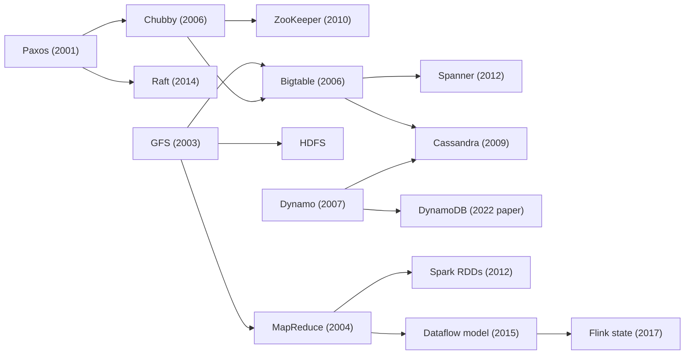

import { Aside } from '@astrojs/starlight/components';

Most of the building blocks used in system design interviews were first described in a handful of papers from Google, Amazon, Facebook, LinkedIn and academia. Reading them shows where today's databases, queues and schedulers came from, and which trade-offs their authors made on purpose. This page groups the essential papers by the problem they solve and says, in one line each, what to take away.

<Aside type="tip" title="TL;DR">
- Read for the **problem, the key idea and the trade-off**, not for every detail of the implementation.
- Most systems you will name in an interview descend from about 20 papers: GFS, MapReduce, Bigtable, Dynamo, Chubby, Spanner, Kafka, Dapper, Borg and Raft cover most of the ground.
- The same ideas keep coming back: **partition the data, replicate the log, agree through consensus, cache in front of storage, and treat failure as normal**.
- Several systems were later replaced (GFS by Colossus, MapReduce by dataflow engines, ZooKeeper inside Kafka by KRaft), but the reasoning in the papers still holds.
</Aside>

## How to read these papers

Do not try to memorise numbers or internal APIs. A design paper is useful in an interview when you can retell it in three sentences and connect it to a decision you are making. For each paper, look for:

1. **The problem and its constraints.** What workload, scale and failure rate did the authors design for? GFS assumed that disks and machines fail daily and that files are huge and mostly appended to. That assumption explains almost every other choice in the paper.
2. **The key idea.** Usually one mechanism carries the paper: TrueTime in Spanner, lineage in Spark, quorums and hinted handoff in Dynamo, the commit log in Kafka.
3. **What each component is for, and where it breaks.** Note which part handles metadata, which stores data, and which coordinates. Then ask where the design stops working: a single master, a hot partition, a cross-region round trip.
4. **Shared patterns.** Compare papers in the same group. Chubby and ZooKeeper both expose consensus as a small service; Bigtable and Cassandra both store data in sorted immutable files plus an in-memory buffer.
5. **Lessons learned.** The evaluation and "experience" sections are often the most practical part. They say what surprised the team in production.

A three-pass approach works well: skim the abstract, headings and figures first (10 minutes); then read the design section closely; read the proofs and evaluation only if you need them. S. Keshav's short note [How to Read a Paper](https://ccr.sigcomm.org/online/files/p83-keshavA.pdf) describes this method.

## How the ideas connect

Many of these systems build directly on each other. The arrows below mean "builds on or borrows ideas from".

## Data processing

| System | Year and venue | Why it matters | Paper |
|---|---|---|---|
| **MapReduce** (Google) | 2004, OSDI | Two user functions, while the framework handles partitioning, scheduling, stragglers and machine failures. The template for batch processing on commodity clusters. | [research.google](https://research.google/pubs/mapreduce-simplified-data-processing-on-large-clusters/) |
| **Spark: Resilient Distributed Datasets** (UC Berkeley) | 2012, NSDI | Keeps working data in memory as immutable datasets. Lost partitions are rebuilt from their lineage instead of being replicated, which makes iterative and interactive jobs fast. | [usenix.org](https://www.usenix.org/conference/nsdi12/technical-sessions/presentation/zaharia) |
| **The Dataflow model** (Google) | 2015, VLDB | One model for batch and streaming: event time versus processing time, windows, watermarks and triggers. The basis of Apache Beam and of most modern stream processors. | [vldb.org (PDF)](https://www.vldb.org/pvldb/vol8/p1792-Akidau.pdf) |
| **State management in Apache Flink** | 2017, VLDB | How a stream processor keeps large state consistent across failures with asynchronous distributed snapshots. This is the mechanism behind exactly-once stream processing. | [vldb.org (PDF)](https://www.vldb.org/pvldb/vol10/p1718-carbone.pdf) |

## Data stores

| System | Year and venue | Why it matters | Paper |
|---|---|---|---|
| **Bigtable** (Google) | 2006, OSDI | A sorted, sparse map split into tablets and stored on GFS, with memtables and immutable SSTables. It introduced the wide-column model that HBase and Cassandra follow. | [research.google](https://research.google/pubs/bigtable-a-distributed-storage-system-for-structured-data/) |
| **Dynamo** (Amazon) | 2007, SOSP | The classic leaderless, always-writable key-value store: consistent hashing, sloppy quorums, hinted handoff, vector clocks and Merkle-tree repair. | [allthingsdistributed.com (PDF)](https://www.allthingsdistributed.com/files/amazon-dynamo-sosp2007.pdf) |
| **Cassandra** (Facebook) | 2009, LADIS | Dynamo's partitioning and replication combined with Bigtable's storage model. A good case study of tunable consistency and its costs. | [cornell.edu (PDF)](https://www.cs.cornell.edu/projects/ladis2009/papers/lakshman-ladis2009.pdf) |
| **Spanner** (Google) | 2012, OSDI | Global SQL with externally consistent transactions. TrueTime bounds clock uncertainty, and data is split into Paxos-replicated groups. The ancestor of distributed SQL databases. | [usenix.org](https://www.usenix.org/conference/osdi12/technical-sessions/presentation/corbett) |
| **Aurora** (Amazon) | 2017, SIGMOD | Sends only redo-log records to a shared storage tier and writes them to 4 of 6 copies across three Availability Zones. Separating compute from storage became the standard design for cloud databases. | [amazon.science](https://www.amazon.science/publications/amazon-aurora-design-considerations-for-high-throughput-cloud-native-relational-databases) |
| **Amazon DynamoDB** | 2022, USENIX ATC | Ten years of running a managed NoSQL service: predictable latency, partition splitting, admission control and Multi-Paxos replication. It differs a lot from the 2007 Dynamo design. | [usenix.org](https://www.usenix.org/conference/atc22/presentation/elhemali) |
| **Memcache at Facebook** | 2013, NSDI | Look-aside caching at billions of requests per second: leases against stale sets and thundering herds, regional pools, and invalidations driven by the database's replication stream. | [usenix.org](https://www.usenix.org/conference/nsdi13/technical-sessions/presentation/nishtala) |
| **TAO** (Facebook) | 2013, USENIX ATC | A read-optimised, graph-aware cache over sharded MySQL that serves objects and their associations. Shows how to build a social graph store with eventual consistency. | [usenix.org](https://www.usenix.org/conference/atc13/technical-sessions/presentation/bronson) |

## File systems and blob storage

| System | Year and venue | Why it matters | Paper |
|---|---|---|---|
| **Google File System (GFS)** | 2003, SOSP | One master holds metadata, data lives in 64 MB chunks with three replicas, and consistency is relaxed for append-heavy workloads. It treats component failure as normal. | [research.google](https://research.google/pubs/the-google-file-system/) |
| **HDFS architecture** (Apache Hadoop) | Design doc | The open-source counterpart of GFS: NameNode and DataNodes, rack-aware replica placement, and the write and read paths. | [hadoop.apache.org](https://hadoop.apache.org/docs/stable/hadoop-project-dist/hadoop-hdfs/HdfsDesign.html) |
| **Haystack** (Facebook) | 2010, OSDI | Packs billions of small photos into large volume files so that reading a photo needs about one disk seek. The same idea appears in many blob stores. | [usenix.org](https://www.usenix.org/conference/osdi10/finding-needle-haystack-facebooks-photo-storage) |

## Coordination and consensus

| System | Year and venue | Why it matters | Paper |
|---|---|---|---|
| **Paxos Made Simple** (Leslie Lamport) | 2001 | The consensus algorithm explained in plain prose. Every replicated log and leader-election service relies on this idea. | [lamport.azurewebsites.net (PDF)](https://lamport.azurewebsites.net/pubs/paxos-simple.pdf) |
| **Chubby** (Google) | 2006, OSDI | A coarse-grained lock service and small-file store built on Paxos. Explains why application teams find a lock service easier to use correctly than a consensus library. | [research.google](https://research.google/pubs/the-chubby-lock-service-for-loosely-coupled-distributed-systems/) |
| **ZooKeeper** (Yahoo!) | 2010, USENIX ATC | Simple wait-free primitives (znodes, watches, sequential nodes) from which clients build locks, leader election, group membership and configuration. | [usenix.org](https://www.usenix.org/conference/usenix-atc-10/zookeeper-wait-free-coordination-internet-scale-systems) |
| **Raft** (Stanford) | 2014, USENIX ATC | Consensus designed to be understandable: a strong leader, log replication and safe membership changes. Used by etcd, Consul and most distributed SQL databases. | [usenix.org](https://www.usenix.org/conference/atc14/technical-sessions/presentation/ongaro) · [raft.github.io](https://raft.github.io/) |

## Messaging and logs

| System | Year and venue | Why it matters | Paper |
|---|---|---|---|
| **Kafka** (LinkedIn) | 2011, NetDB | A partitioned, append-only log on disk. Consumers pull data and track their own offsets, so messages become durable, replayable streams. | [microsoft.com (PDF)](https://www.microsoft.com/en-us/research/wp-content/uploads/2017/09/Kafka.pdf) |
| **The Log** (Jay Kreps, essay) | 2013 | Not a paper, but the clearest explanation of why an ordered log ties together databases, replication, data integration and stream processing. | [engineering.linkedin.com](https://engineering.linkedin.com/distributed-systems/log-what-every-software-engineer-should-know-about-real-time-datas-unifying) |

## Observability

| System | Year and venue | Why it matters | Paper |
|---|---|---|---|
| **Dapper** (Google) | 2010, tech report | Sampled, low-overhead tracing: trace and span IDs travel with every RPC. The model behind Zipkin, Jaeger and OpenTelemetry tracing. | [research.google](https://research.google/pubs/dapper-a-large-scale-distributed-systems-tracing-infrastructure/) |

## Cluster management

| System | Year and venue | Why it matters | Paper |
|---|---|---|---|
| **Borg** (Google) | 2015, EuroSys | Runs latency-sensitive services and batch jobs together on shared clusters of up to tens of thousands of machines, using priorities, quotas and overcommit to keep utilisation high. | [research.google](https://research.google/pubs/large-scale-cluster-management-at-google-with-borg/) |
| **Borg, Omega, and Kubernetes** | 2016, ACM Queue | Lessons from three generations of Google cluster managers and how they shaped Kubernetes: pods, labels and the reconciliation loop. | [research.google](https://research.google/pubs/borg-omega-and-kubernetes/) |

## More worth reading

| System | Year and venue | Why it matters | Paper |
|---|---|---|---|
| **Zanzibar** (Google) | 2019, USENIX ATC | A global authorization service built on relation tuples and Spanner. Many open-source permission systems copy its model. | [usenix.org](https://www.usenix.org/conference/atc19/presentation/pang) |
| **FoundationDB** (Apple) | 2021, SIGMOD | A transactional key-value store split into separate components, tested with deterministic simulation. It shows how to make a distributed database testable. | [foundationdb.org (PDF)](https://www.foundationdb.org/files/fdb-paper.pdf) |

The original primer also linked introductory slides on HBase, MongoDB, Memcached and Redis. Those decks are gone. The [NoSQL](/data/nosql/) and [caching](/caching/caching-layers/) pages cover the same material.

## What changed by 2026

- **GFS became Colossus.** Google moved file-system metadata into a scalable database and dropped the single master. [Google's overview of Colossus](https://cloud.google.com/blog/products/storage-data-transfer/a-peek-behind-colossus-googles-file-system) is a short follow-up to the GFS paper.
- **MapReduce gave way to dataflow engines.** Spark, Flink, Beam and cloud data warehouses replaced hand-written map and reduce jobs. The ideas of partitioning work and re-running failed tasks are unchanged.
- **Kafka no longer needs ZooKeeper.** Kafka now keeps its metadata in its own Raft-based quorum (KRaft), and Kafka 4.0 removed ZooKeeper mode. Consensus moved inside the system instead of living in a separate service.
- **Leader-based replication won for new databases.** DynamoDB itself uses Multi-Paxos rather than the leaderless Dynamo design, and the distributed SQL databases inspired by Spanner use Raft or Paxos groups per range. The Dynamo paper is still the best explanation of the leaderless alternative.
- **Storage was separated from compute.** The Aurora design, with a shared log-structured storage tier under stateless database nodes, is now common across managed Postgres and MySQL services.
- **Borg led to Kubernetes, and Dapper led to OpenTelemetry.** Both papers explain why the open-source tools you use look the way they do.

<Aside type="note" title="In the interview">
Nobody will ask you to recite a paper. What helps is using a paper's mechanism to justify a decision: "Like Dynamo, I'd use consistent hashing with virtual nodes so adding a node moves only a small share of keys", or "I'd put a lease on cache fills, as Facebook's memcache paper does, to stop a thundering herd."

Typical follow-ups: what breaks if the single master in GFS fails; why Spanner needs accurate clocks; how Kafka keeps ordering (only within a partition); why ZooKeeper should not store application data.

Common mistakes: treating Dynamo (the 2007 paper) and DynamoDB (the service) as the same design; calling Cassandra strongly consistent without naming the quorum settings; reaching for consensus where a single leader with a lease is enough.
</Aside>

## Further reading

- [How to Read a Paper](https://ccr.sigcomm.org/online/files/p83-keshavA.pdf) by S. Keshav: the three-pass method in two pages.
- [Papers We Love](https://github.com/papers-we-love/papers-we-love): a large, community-curated index of computer science papers, sorted by topic.
- [The Morning Paper archive](https://blog.acolyer.org/): Adrian Colyer's summaries of more than a thousand papers. No new posts since 2021, but the archive is excellent.
- [Murat Demirbas's blog](https://muratbuffalo.blogspot.com/): regular, readable reviews of new distributed systems papers.
- [Jepsen analyses](https://jepsen.io/analyses): tests of what real databases do under network partitions, compared with what their documentation claims.

## Related topics

- [CAP theorem and PACELC](/fundamentals/cap-theorem/): the trade-off that Dynamo and Spanner sit on opposite sides of.
- [Replication](/data/replication/): leader-based and leaderless replication, as used by these systems.
- [Partitioning and sharding](/data/partitioning-and-sharding/): consistent hashing and range partitioning in practice.
- [Event streaming](/async/event-streaming/): Kafka-style logs and stream processing today.
- [Observability](/reliability/observability/): tracing, metrics and logs, following on from Dapper.
- [How companies built it](/real-world/company-architectures/): engineering write-ups that apply these ideas.
