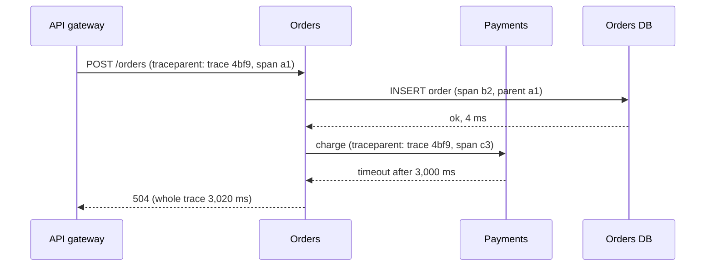

import { Aside } from '@astrojs/starlight/components';

Observability is how well you can understand what a running system is doing, and why, from the data it emits, without shipping new code to ask a new question. Monitoring checks the failures you predicted. Observability helps with the ones you did not. In a design you need both: a few signals that tell you users are hurting, and enough context to find the cause quickly across dozens of services.

<Aside type="tip" title="TL;DR">
- **Metrics** say *that* something is wrong, and cheaply. **Traces** say *where*. **Logs** say *why*. Link them with a shared trace ID.
- Instrument every service with **RED** (rate, errors, duration) and every resource with **USE** (utilisation, saturation, errors).
- Record latency as **histograms**. You cannot average p99s across hosts, but you can add histogram buckets.
- Alert on **SLO burn rate**, which measures user pain, not on CPU or individual errors.
- **OpenTelemetry** is the vendor-neutral standard for instrumentation. Watch **cardinality**, because it drives cost.
</Aside>

## Three signals, three questions

| Signal | What it is | Answers | Cost driver |
|---|---|---|---|
| Metrics | Numbers aggregated over time, with labels | Is it broken? How much? Since when? | Number of time series (cardinality) |
| Logs | Timestamped records of discrete events | What exactly happened to this request? | Volume (GB ingested and kept) |
| Traces | The tree of spans for one request across services | Where did the time go? Which hop failed? | Spans per request × sampling rate |

A typical investigation moves through them in order. An alert fires on the checkout error-rate metric. You open an exemplar trace from the bad minute and see that the `payments` span takes 4 s and times out. Its logs, found by trace ID, show `connection pool exhausted` right after a deploy. Profiles, the emerging fourth signal, then show which function burns the CPU.

## What to measure: RED, USE and the golden signals

- **RED**, for request-driven services: **R**ate (requests per second), **E**rrors (failed requests per second), **D**uration (a latency distribution). Tom Wilkie proposed it for microservices. Dashboards that look the same for every service make on-call work much easier.
- **USE**, for resources (CPU, memory, disks, NICs, but also thread pools, connection pools and queues): **U**tilisation, **S**aturation (work waiting: run-queue length, queue depth) and **E**rrors. It comes from Brendan Gregg's performance analysis method.
- **Four golden signals** from Google's SRE book: latency, traffic, errors and saturation. RED is the first three, and saturation brings in USE.

Two details matter. Measure latency of successes and failures *separately*, because fast errors make latency look great. Count errors you return deliberately (a 200 with an error body, an empty search result caused by a timeout) as errors too.

## Histograms and percentiles

Latency is skewed, so averages hide the slow requests users notice. Use percentiles: p50, p95, p99, p99.9. They come from **histograms**, which count observations into latency buckets.

**Percentiles do not average.** Server A handles 9,000 requests, all at 40 ms. Server B handles 1,000, and 200 of them take 2 s. A's p99 is 40 ms and B's is 2,000 ms. Their average, 1,020 ms, describes nothing. The fleet's true p99 is 2,000 ms, because the slow 2% of all requests sit on B. With other traffic mixes the average overstates the truth instead. The only correct method is to **add the bucket counts first, then compute the percentile**.

- **Prometheus summaries** compute quantiles inside the process, so they cannot be combined across instances. Prefer histograms.
- **Classic histograms** with fixed buckets are only as precise as the bucket containing the percentile. Choose boundaries around your SLO threshold, roughly exponential (Google's SRE book suggests about ×3 apart).
- **Exponential or native histograms** (OpenTelemetry exponential histograms, Prometheus native histograms) adjust bucket boundaries automatically, with bounded relative error and lower storage cost. Prometheus recommends them where your client libraries support them.
- **Exemplars** attach a trace ID to a bucket sample, so you can jump from "p99 spiked" to a real slow trace.

## SLIs, SLOs and burn-rate alerting

- **SLI** (service level indicator): good events ÷ valid events, measured as close to the user as practical. Example: the share of checkout requests that return non-5xx within 300 ms.
- **SLO** (objective): the target for an SLI over a window, for example 99.9% over 30 days.
- **Error budget**: 1 − SLO. For 99.9% over 30 days, that is 0.1% of requests, or 43.2 minutes of full downtime. When the budget is spent, reliability work takes priority over features. See [availability patterns](/fundamentals/availability-patterns/) for what each extra nine costs.

Alert on the **burn rate**: how fast you are spending the budget, relative to spending it evenly over the window. A burn rate of 1 uses the whole budget in exactly 30 days. A burn rate of 14.4 uses it in about 2 days. Google's SRE workbook recommends multiwindow, multi-burn-rate alerts for a 99.9% SLO:

| Severity | Long window | Short window | Burn rate | Budget used when it fires |
|---|---|---|---|---|
| Page | 1 hour | 5 minutes | 14.4 | 2% |
| Page | 6 hours | 30 minutes | 6 | 5% |
| Ticket | 3 days | 6 hours | 1 | 10% |

The long window makes the alert significant, so a two-minute blip does not page anyone. The short window must also exceed the threshold, so the alert stops soon after the problem does. These alerts fire on what users experience, whatever the cause, which is why they replace dozens of "CPU above 80%" alerts. Keep resource alerts as dashboards or tickets.

## Distributed tracing

A **trace** follows one request across services. It is a tree of **spans**, one per unit of work (an HTTP handler, a database query, a queue publish), each with a start time, a duration, a parent span and attributes.



- **Origins.** Google's **Dapper** paper (2010) set the template: propagate trace and span IDs through every RPC, sample to keep overhead low, and make instrumentation transparent by building it into shared libraries. Zipkin and Jaeger followed. OpenTracing and OpenCensus merged in 2019 to form OpenTelemetry.
- **Propagation.** Context crosses process boundaries in headers. The **W3C Trace Context** `traceparent` header (a W3C Recommendation) carries a version, a 16-byte trace ID, an 8-byte parent span ID and flags. For async hops, put it in message headers so a trace continues through queues and Kafka topics.
- **OpenTelemetry (OTel)** is the vendor-neutral standard: APIs, SDKs, the OTLP wire protocol and the **Collector**, which receives, processes and exports telemetry to any backend. It became a CNCF **graduated** project in May 2026. As of October 2026, the specification lists **traces** as stable across API, SDK and protocol, **metrics** with a stable API and protocol (SDK maturity varies by language), **logs** stable through a bridge API that connects existing logging libraries, and **profiles** in public alpha (announced March 2026) and not yet recommended for critical production use. Per-language maturity still varies, so check the SDK you use.
- **Sampling.** Tracing everything at high volume is expensive. *Head sampling* decides at the start (keep 1%) and is cheap but blind to outcome. *Tail sampling* decides after the trace completes, keeping all errors and slow traces plus a small share of the rest. It needs all spans of a trace to reach the same collector instance, which usually means a load-balancing tier keyed by trace ID.

## Structured logs and correlation IDs

Write logs as **structured events** (JSON or logfmt) with stable field names, not free-form text:

```json
{"ts":"2026-10-08T10:15:02.731Z","level":"error","service":"orders",
 "msg":"payment call failed","trace_id":"4bf92f3577b34da6a3ce929d0e0e4736",
 "span_id":"00f067aa0ba902b7","order_id":"o-81723","error":"deadline_exceeded",
 "duration_ms":3000,"version":"2026.10.07-3"}
```

- Include the **trace ID** in every log line. OTel log bridges and most logging libraries add it automatically, which is what links logs to traces. Older systems use a separate correlation or request ID header, and the idea is the same.
- Prefer **one wide event per request per service** (all the useful context in one record) over dozens of narrow lines. Wide events can be queried like a table: which build, region and customer tier have the errors?
- Log levels and **sampling** keep volume sane. Keep all errors, sample routine successes.
- Never log secrets or personal data you do not need. Logs are often copied and kept for longer than the database is.

## Cardinality and cost control

A metric's **cardinality** is the number of distinct label combinations, and each one is a separate time series. They multiply:

| Labels | Distinct values | Series |
|---|---|---|
| endpoint × method × status class | 50 × 4 × 5 | 1,000 |
| × pod | × 200 | 200,000 |
| × 14 series per histogram (12 buckets, sum, count) | × 14 | 2.8 million |
| × `customer_id` | × 10,000 | 28 billion: unaffordable |

Rules of thumb:

- **Bounded labels only** in metrics: region, endpoint template (`/users/{id}`, never the raw path), status class, build version. Unbounded values (user ID, order ID, full URL, error message) go into traces and logs, which are built for high cardinality.
- **Aggregate early.** Drop the pod label for dashboards that only need service-level views. The OTel Collector and recording rules can do this before storage.
- **Tier retention.** Keep raw data for days, downsampled data for months. Move logs to object storage and query them on demand.
- **Sample traces** with a tail-sampling policy rather than storing everything.
- **Budget telemetry like any resource.** Tie each team's bill to its usage. Observability spend that grows faster than traffic usually means a label or a log line exploded.

## Trade-offs

| Choice | Benefit | Cost |
|---|---|---|
| Metrics-first | Cheap, fast, ideal for alerting | No per-request detail |
| Wide events and traces | Answers new questions after the fact | Storage and query cost; sampling decisions |
| Head sampling | Simple, low overhead | Misses rare errors |
| Tail sampling | Keeps the interesting traces | Collector state, routing by trace ID |
| Vendor agent | Quick start, rich UI | Lock-in; harder to switch backends |
| OpenTelemetry + Collector | Portable, one pipeline for all signals | You run the pipeline; per-language maturity varies |

<Aside type="note" title="In the interview">
- Name concrete SLIs and an SLO for the system ("99.9% of feed loads under 400 ms over 30 days"), and say you would alert on burn rate.
- Mention RED dashboards per service, USE for queues and pools, and consumer lag for async pipelines.
- Explain how you would find the cause of a latency spike: metric → exemplar trace → logs by trace ID.
- If asked about scale, talk about sampling, cardinality limits and retention tiers. Observability can cost as much as the system it watches.
- Common mistakes: averaging percentiles, alerting on CPU instead of user impact, and putting user IDs in metric labels.
</Aside>

## Further reading

- [Monitoring distributed systems](https://sre.google/sre-book/monitoring-distributed-systems/): Google SRE book on the four golden signals and tail latency.
- [Alerting on SLOs](https://sre.google/workbook/alerting-on-slos/): the SRE workbook's derivation of multiwindow, multi-burn-rate alerts.
- [Dapper, a large-scale distributed systems tracing infrastructure](https://research.google/pubs/dapper-a-large-scale-distributed-systems-tracing-infrastructure/): the 2010 paper behind modern tracing.
- [OpenTelemetry specification status](https://opentelemetry.io/docs/specs/status/): current maturity of each signal.
- [Prometheus: histograms and summaries](https://prometheus.io/docs/practices/histograms/): why quantiles don't aggregate and when to use native histograms.
- [The USE method](https://www.brendangregg.com/usemethod.html): Brendan Gregg's checklist for resource bottlenecks.

## Related topics

- [Availability patterns](/fundamentals/availability-patterns/): SLOs, error budgets and the cost of each nine.
- [Latency vs throughput](/fundamentals/latency-vs-throughput/): percentiles, tail latency and why averages mislead.
- [Resilience patterns](/reliability/resilience-patterns/): what to do once observability shows a dependency failing.
- [Event streaming](/async/event-streaming/): consumer lag and tracing across asynchronous hops.
- [Service discovery and mesh](/architecture/service-discovery-and-mesh/): meshes that emit RED metrics and spans for free.
