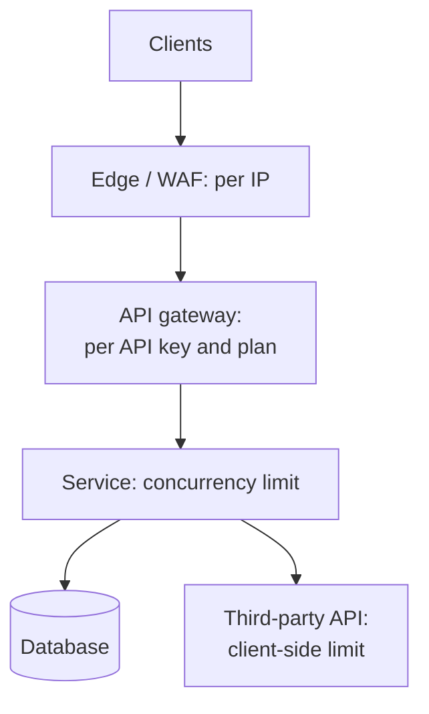

import { Aside } from '@astrojs/starlight/components';

A rate limiter caps how many requests a client may make in a period of time and rejects or delays the rest. It keeps one noisy client from using up shared capacity, slows down abuse such as credential stuffing and scraping, keeps costs predictable and enforces pricing tiers. Almost every public API has one, and "design a rate limiter" is a classic interview question.

<Aside type="tip" title="TL;DR">
- Limit in layers: per IP at the edge, per API key or user at the gateway, and concurrency limits inside each service.
- The **token bucket** is the default. It allows bursts up to the bucket size and enforces a steady average rate, with two numbers stored per key.
- **Fixed windows** let through up to 2× the limit at a window boundary. The **sliding-window counter** fixes most of that error for one extra counter.
- In a shared store, the check and the update must be **atomic**: a Lua script or `MULTI` with `INCR` and `EXPIRE … NX`.
- Reject with **429 Too Many Requests** and `Retry-After`. Clients back off with jitter. The IETF `RateLimit` header fields are still a draft.
</Aside>

## Why and where to limit

Rate limits do four jobs, and each job points to a different place in the stack:

| Goal | Typical key | Where |
|---|---|---|
| Absorb floods and abuse | IP address, IPv6 `/64` prefix, ASN | CDN, WAF, edge proxy |
| Fair use and pricing tiers | API key, user, tenant | API gateway |
| Protect a fragile resource | Endpoint, tenant, or nothing (global) | Inside the service, near the resource |
| Stay within someone else's quota | Your own credentials | Client side, before calling a third-party API |



Choosing the key needs care. Many users share one IPv4 address behind carrier-grade NAT or a corporate proxy, while one IPv6 client controls billions of addresses, so limit IPv6 by prefix. Authenticated keys (user, API key, tenant) are fairer but only exist after authentication, so login endpoints also need limits per IP and per target account.

Rate limits also differ by cost. One search may cost 100 times as much as a profile read. Charge different numbers of tokens per endpoint, or keep separate limits for expensive operations. Stripe, for example, combines a request-rate limiter with a **concurrency limiter**, which caps requests *in flight* per user, and two load shedders that protect critical traffic when the fleet is short of capacity.

## Algorithms

### Token bucket

A bucket holds up to `b` tokens and refills at `r` tokens per second. Each request takes a token. When the bucket is empty, the request is rejected, or delayed until a token arrives. Over any interval `t`, at most `b + r·t` requests pass. Bursts are allowed up to `b`, and the long-run average is `r`. You store only the token count and the time of the last refill, and refill lazily on each request. Envoy's local rate limiter and Stripe's API limits both use it.

### Leaky bucket

There are two variants. **As a queue**, requests enter a fixed-size FIFO that drains at a constant rate. Output is perfectly smooth, but bursts wait and latency grows. Nginx's `limit_req` works this way: `burst` sets the queue size, and `nodelay` serves queued requests immediately while still counting them. **As a meter** (GCRA, the generic cell rate algorithm), it stores one timestamp per key, the "theoretical arrival time", and behaves like a token bucket.

### Fixed window

Count requests per key in calendar windows (`user42:2026-10-08T10:15`), and reset when the window rolls over. It is one `INCR` per request and trivially cheap. The flaw is the boundary: with a limit of 100 per minute, a client can send 100 requests at 10:15:59 and 100 more at 10:16:00, which is 200 in two seconds.

### Sliding log

Store the timestamp of every accepted request, for example in a Redis sorted set. On each request, drop entries older than the window and count the rest. It is exact, but memory grows with the limit: with 1 million active keys and a limit of 1,000 per window, that is a billion timestamps, about 8 GB before any data-structure overhead.

### Sliding-window counter

Keep fixed-window counters for the current and previous windows, and weight the previous one by how much of it still overlaps the sliding window:

```text
estimate = previous_count × (window − elapsed) / window + current_count
```

Limit 100 per minute, 15 s into the current minute, previous minute had 84 requests, current has 36: `84 × 45/60 + 36 = 99`, so one more request is allowed. The estimate assumes requests in the previous window were spread evenly. Cloudflare measured this method on 400 million requests and found only 0.003% wrongly allowed or limited.

### Comparison

| Algorithm | Memory per key | Bursts | Accuracy | Good for |
|---|---|---|---|---|
| Token bucket | 2 numbers | Up to bucket size, by design | Exact for its model | Default for APIs |
| Leaky bucket (queue) | Queue of requests | Queued, output smoothed | Exact | Smoothing traffic to a fragile backend |
| Leaky bucket (GCRA) | 1 timestamp | Up to a tolerance | Exact | Same as token bucket, less state |
| Fixed window | 1 counter | Up to 2× at boundaries | Coarse | Daily or monthly quotas, billing |
| Sliding log | 1 entry per request | None beyond the limit | Exact | Low limits where precision matters (logins) |
| Sliding-window counter | 2 counters | Small overshoot possible | Approximate, usually within a few % | High-volume per-key limits |

## A token bucket in Python

```python title="token_bucket.py"
import threading
import time
from dataclasses import dataclass, field


@dataclass
class TokenBucket:
    """Allow `rate` requests per second on average, with bursts up to `capacity`."""

    rate: float                      # tokens added per second
    capacity: float                  # maximum burst size
    tokens: float = field(init=False)
    updated: float = field(init=False)
    lock: threading.Lock = field(default_factory=threading.Lock, repr=False)

    def __post_init__(self) -> None:
        self.tokens = self.capacity          # start full: allow an initial burst
        self.updated = time.monotonic()

    def try_acquire(self, cost: float = 1.0) -> tuple[bool, float]:
        """Return (allowed, seconds_until_enough_tokens)."""
        with self.lock:
            now = time.monotonic()
            # Refill lazily: no background timer, just elapsed time × rate.
            self.tokens = min(self.capacity, self.tokens + (now - self.updated) * self.rate)
            self.updated = now
            if self.tokens >= cost:
                self.tokens -= cost
                return True, 0.0
            return False, (cost - self.tokens) / self.rate


if __name__ == "__main__":
    bucket = TokenBucket(rate=5, capacity=10)        # 5 req/s, bursts of 10
    burst = [bucket.try_acquire()[0] for _ in range(12)]
    print("burst of 12:", burst.count(True), "allowed")   # 10 allowed
    allowed, wait = bucket.try_acquire()
    print(f"next allowed={allowed}, retry after {wait:.2f}s")  # ~0.20s
    time.sleep(1.0)                                  # refill ~5 tokens
    print("after 1 s:", sum(bucket.try_acquire()[0] for _ in range(10)), "allowed")  # 5
```

The second value of `try_acquire` is exactly what the server should put in `Retry-After`, rounded up to whole seconds.

## Distributed rate limiting

With 20 gateway nodes behind a load balancer, a per-node bucket only works if traffic is spread evenly. Giving each node `limit / 20` is cheap and needs no coordination, but a client whose connections stick to one node gets a twentieth of its quota. For a precise global limit, keep the state in a shared store such as Redis or Valkey.

The classic bug is **check-then-act**: `GET` the counter, compare, then `INCR`. Two nodes read 99 at the same moment, both allow, and the counter ends at 101. The second classic bug is `INCR` followed by a separate `EXPIRE`. If the process dies between the two calls, the key never expires and the client stays blocked for good. Two safe patterns:

**Fixed window with a transaction.** `INCR` returns the new value atomically. `EXPIRE … NX` (Redis 7.0+) sets the TTL only if none exists, so retries cannot extend the window:

```text
MULTI
INCR rl:user42:29857575        # window id = unix_time // 60 (10:15 UTC)
EXPIRE rl:user42:29857575 60 NX
EXEC                           # allow if the INCR result is <= limit
```

**Token bucket as a Lua script.** Redis runs a script atomically, so the read, the refill and the write cannot interleave with another client:

```lua title="token_bucket.lua"
-- KEYS[1]: bucket key, e.g. "rl:{api-key-42}"
-- ARGV[1]: refill rate (tokens/s), ARGV[2]: capacity, ARGV[3]: cost
local rate, capacity, cost = tonumber(ARGV[1]), tonumber(ARGV[2]), tonumber(ARGV[3])
local t = redis.call('TIME')                       -- one clock for all app servers
local now = tonumber(t[1]) + tonumber(t[2]) / 1000000
local s = redis.call('HMGET', KEYS[1], 'tokens', 'ts')
local tokens = tonumber(s[1]) or capacity
local ts = tonumber(s[2]) or now
tokens = math.min(capacity, tokens + math.max(0, now - ts) * rate)
local allowed = 0
if tokens >= cost then
  tokens = tokens - cost
  allowed = 1
end
redis.call('HSET', KEYS[1], 'tokens', tokens, 'ts', now)
redis.call('EXPIRE', KEYS[1], math.ceil(capacity / rate) + 1)  -- idle buckets vanish
return {allowed, tostring(tokens)}
```

Using the Redis server's `TIME` avoids clock skew between application servers. Load the script once with `SCRIPT LOAD` and call it by hash with `EVALSHA`.

Operational questions to settle:

- **Latency.** Every request now waits for a round trip to the store, typically well under a millisecond inside one zone. Pipelining or a local pre-check can save it for clients that are far below their limit.
- **Store outage.** Decide in advance: **fail open** (allow traffic, risk overload) or **fail closed** (reject, risk a self-inflicted outage). Most public APIs fail open with a coarse local limit as a backstop.
- **Hot keys.** One huge tenant hammers one shard. Use local token caches that take several tokens from the shared bucket at once and sync periodically, which trades a little accuracy for far fewer round trips. Envoy uses a similar two-stage setup: a local token bucket absorbs bursts, then a global rate-limit service (with a Redis backend in the reference implementation) enforces the shared limit.
- **Multi-region.** A single global counter across regions costs a cross-region round trip per request. Usually you give each region a share of the limit, or sync counters asynchronously and accept a bounded overshoot.

## Responding to limited clients

- **429 Too Many Requests** (RFC 6585) means *this client* exceeded *its* limit. **503 Service Unavailable** means the server is overloaded for everyone. Nginx's `limit_req` returns 503 by default, so set `limit_req_status 429` when the limit is per client.
- **`Retry-After`** (RFC 9110) gives either a number of seconds or an HTTP date. Send it with both 429 and 503.
- **Quota headers.** Many APIs send non-standard `X-RateLimit-Limit`, `-Remaining` and `-Reset` headers. GitHub, for example, sends `x-ratelimit-*` headers and returns 403 or 429 when a limit is exceeded. The IETF httpapi working group is standardising this as `RateLimit-Policy` and `RateLimit` structured fields, for example `RateLimit-Policy: "default";q=100;w=60` and `RateLimit: "default";r=37;t=21`. As of October 2026 it is still an Internet-Draft (revision -11, May 2026), and its syntax has changed between revisions. Pin to a version if you adopt it.
- **Make the body useful.** Say which limit was hit and link to documentation. Never reveal limits that help an attacker tune a brute-force attack.
- **Shadow mode first.** Log what *would* be rejected before enforcing a new limit. A wrong limit on a payment endpoint is an outage.

## Client-side behaviour

Good clients make rate limiting cheap for everyone:

- Honour `Retry-After`. Otherwise use **exponential backoff with full jitter** and a cap on attempts. Never retry a 429 in a tight loop.
- **Throttle yourself.** Put a token bucket in the SDK or the worker that calls a third-party API, sized just under your quota, so you queue locally instead of collecting 429s.
- **Spread scheduled work.** Ten thousand clients that all sync at minute zero form a self-made thundering herd. Add random offsets.
- Batch where the API allows it. Treat `RateLimit-Remaining`-style headers as a hint to slow down before you hit zero.

## Trade-offs

| Decision | Option A | Option B |
|---|---|---|
| Placement | Edge or gateway: cheap rejection, coarse keys | In-service: knows cost and tenant, runs after work has started |
| State | Local per node: fast, approximate | Shared store: precise, adds a hop and a dependency |
| Store failure | Fail open: availability first | Fail closed: protection first |
| Excess requests | Reject (429): simple, client retries | Queue or delay: smoother, adds latency and memory |
| Algorithm | Token bucket: bursts allowed | Sliding log: strict, more memory |

<Aside type="note" title="In the interview">
- Start with requirements: what is limited (requests, bytes, concurrent calls), by which key, how precisely, and what happens at the limit.
- Draw where the limiter sits, and justify the algorithm. A token bucket with two numbers per key in Redis is a strong default answer.
- Expect the race-condition question. Answer with an atomic Lua script or `INCR` with `EXPIRE NX`, and use the server's clock.
- Discuss failure: Redis down (fail open or closed), hot keys, multi-region limits, and the 429 response with `Retry-After`.
- Common mistakes: fixed windows without knowing about the boundary burst, limiting only by IP, and forgetting clients retrying in sync.
</Aside>

## Further reading

- [Scaling your API with rate limiters](https://stripe.com/blog/rate-limiters): Stripe's four limiter types and their token-bucket implementation in Redis.
- [How we built rate limiting capable of scaling to millions of domains](https://blog.cloudflare.com/counting-things-a-lot-of-different-things/): the sliding-window counter and how accurate it is in production.
- [Redis `INCR`: rate limiter patterns](https://redis.io/docs/latest/commands/incr/): the official patterns and the race conditions they avoid.
- [RateLimit header fields for HTTP (IETF draft)](https://datatracker.ietf.org/doc/draft-ietf-httpapi-ratelimit-headers/): track the current revision and status.
- [Envoy global rate limiting](https://www.envoyproxy.io/docs/envoy/latest/intro/arch_overview/other_features/global_rate_limiting): combining local token buckets with a central service.
- [Nginx `limit_req` module](https://nginx.org/en/docs/http/ngx_http_limit_req_module.html): leaky bucket with `burst`, `nodelay` and `limit_req_status`.

## Related topics

- [Resilience patterns](/reliability/resilience-patterns/): retries, backoff with jitter and load shedding.
- [Message queues and back pressure](/async/queues-and-back-pressure/): what to do with work you accept but cannot process yet.
- [Reverse proxy and API gateway](/traffic/reverse-proxy-and-api-gateway/): where most rate limits are enforced.
- [Security](/reliability/security/): abuse, brute force and credential stuffing.
- [Caching layers](/caching/caching-layers/): Redis and Valkey as the shared state store.
- [LLM-powered systems](/architecture/llm-applications/): limiting by tokens per minute, not only requests, when one call can cost a hundred times another.
