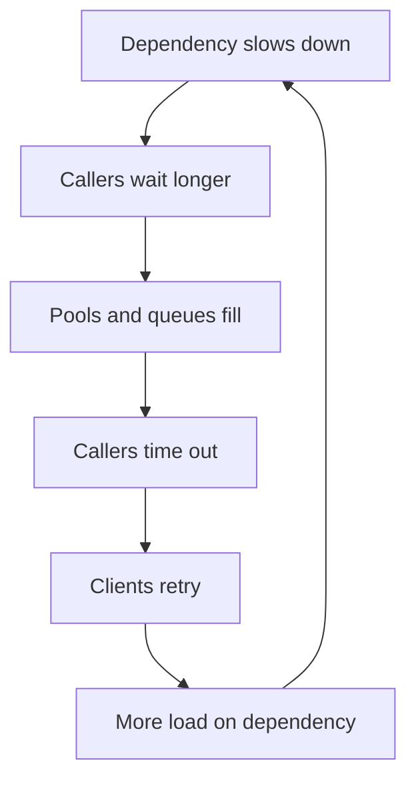
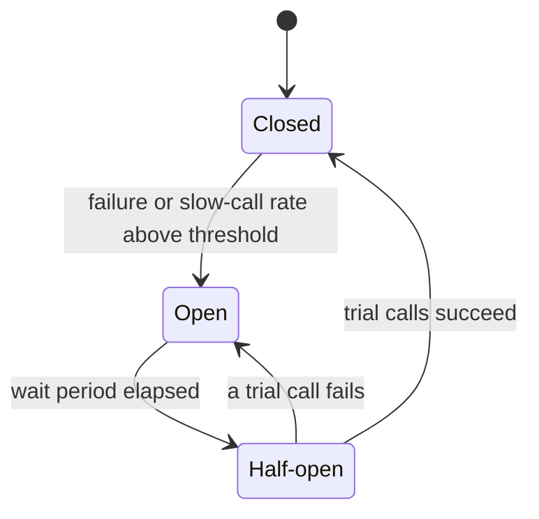

import { Aside } from '@astrojs/starlight/components';

In a distributed system, something is always slow or broken: a disk, a node, a dependency, a whole zone. Resilience patterns keep such a partial failure local. They limit how long you wait, how often you retry and how much load you accept, and they decide what to drop. Most big outages come less from the first failure than from the system's reaction to it, so these patterns are about restraint as much as recovery.

<Aside type="tip" title="TL;DR">
- Every remote call needs a **timeout**. Better, propagate a **deadline** so downstream services stop working on requests nobody is waiting for.
- Retry only idempotent operations (or use **idempotency keys**), with **exponential backoff and jitter**, at **one layer**, inside a **retry budget**.
- A **circuit breaker** fails fast when a dependency is broken. **Bulkheads** keep one slow dependency from taking every thread.
- Under overload, **shed load early** and by priority, and **degrade gracefully** instead of failing everything.
- **Hedged requests** trade a few percent of extra load for a much shorter tail.
</Aside>

## How cascading failures happen

A cascading failure is a feedback loop: a failure causes more load or more waiting, which causes more failures. Typical chains:

1. **Overload spreads.** One of three replicas dies, so the other two each get 50% more traffic, pass their limit, slow down, fail health checks and are removed. The last one now takes everything.
2. **Resources run out.** A dependency slows from 20 ms to 2 s. Callers keep the same request rate, so by Little's law in-flight requests grow 100×. Thread pools, connection pools and memory fill up, and the caller stops serving even requests that never touch the slow dependency.
3. **Retries amplify.** Each layer makes up to 3 attempts. With 4 layers of services, one user request can become 3⁴ = 81 calls to the bottom layer, all of them arriving just as it is struggling.
4. **Recovery fails.** A restarted service with a cold cache takes full traffic at once and falls over again. Clients that failed together retry together.

The last stage has a name: a **metastable failure**. The trigger is gone, but the system stays broken because the feedback loop (retries, queues, cold caches) keeps load above capacity. Recovery often needs load to drop *well below* the level that started the incident. The patterns below break those loops.



## Timeouts and deadlines

A call without a timeout can hold a thread forever. gRPC, for example, sets no deadline by default.

- **Set timeouts from measurements.** Use slightly above the dependency's p99.9 latency, not a round "30 s". A timeout below the normal tail turns slow successes into failures and retries.
- **Separate connect and request timeouts.** A connect should take milliseconds, and a long connect usually means the host is gone.
- **Propagate a deadline.** The edge sets an end-to-end budget, say 800 ms. Each hop passes on the *remaining* time, and every service checks it before starting expensive work or dequeuing a request. gRPC does this natively: it sends a remaining timeout rather than an absolute time, so clock skew doesn't matter. With HTTP, carry it in a header.
- **Give up on abandoned work.** A request whose caller has timed out is pure waste. Dropping it is the cheapest load shedding there is.

## Retries without retry storms

Retries fix transient faults: a dropped packet, a node restarting, a 503 from a busy replica. Rules:

- **Retry only what is safe to repeat:** reads, idempotent writes, or writes carrying an idempotency key (below). Never retry 4xx errors except 408 and 429.
- **Back off exponentially with jitter.** Use full jitter: `sleep = random(0, min(cap, base × 2^attempt))`. Synchronised retries hit the dependency in waves, and AWS's simulations show full jitter does the least total work.
- **Cap attempts and respect the deadline.** Three attempts is a common ceiling. Never sleep past the caller's deadline.
- **Retry at one layer.** Usually that is the layer closest to the user or the one that knows the operation is idempotent. Lower layers fail fast.
- **Use a retry budget.** Allow retries only while they are a small fraction of traffic. Google's SRE book describes a per-client budget of 10% of requests. Worst case, three attempts per request triple the load, while a 10% budget limits growth to about 1.1×. The token bucket in the code below does this: each first attempt adds 0.1 tokens and each retry costs a whole one.

```python title="retry.py"
import random
import time
from collections.abc import Callable
from dataclasses import dataclass


class RetryableError(Exception):
    """Timeouts, 429, 503: the request may succeed later."""


@dataclass
class RetryBudget:
    """Allow retries only while they stay under `ratio` of first attempts."""

    ratio: float = 0.1
    max_tokens: float = 10.0
    tokens: float = 10.0

    def on_request(self) -> None:          # every first attempt earns a fraction
        self.tokens = min(self.max_tokens, self.tokens + self.ratio)

    def try_spend(self) -> bool:           # every retry costs a whole token
        if self.tokens >= 1:
            self.tokens -= 1
            return True
        return False


def call_with_retries[T](
    op: Callable[[float], T],
    budget: RetryBudget,
    deadline_s: float = 2.0,
    max_attempts: int = 3,
    base_s: float = 0.05,
    cap_s: float = 1.0,
) -> T:
    deadline = time.monotonic() + deadline_s
    budget.on_request()
    for attempt in range(max_attempts):
        remaining = deadline - time.monotonic()
        if remaining <= 0:
            break
        try:
            return op(remaining)           # pass the remaining time downstream
        except RetryableError:
            if attempt + 1 == max_attempts or not budget.try_spend():
                raise
            # "Full jitter": sleep a random time in [0, min(cap, base * 2^attempt)]
            sleep = random.uniform(0, min(cap_s, base_s * 2**attempt))
            time.sleep(min(sleep, max(0.0, deadline - time.monotonic())))
    raise TimeoutError("deadline exceeded")


if __name__ == "__main__":
    calls = 0

    def flaky(timeout_s: float) -> str:
        global calls
        calls += 1
        if calls < 3:
            raise RetryableError("503")
        return f"ok after {calls} attempts (had {timeout_s:.2f}s left)"

    print(call_with_retries(flaky, RetryBudget()))
```

## Idempotency keys

A timeout does not tell you whether the server acted. Was the payment taken before the connection dropped? An **idempotency key** makes a non-idempotent write safe to retry. The client generates a unique key (a UUIDv4) per *logical* operation and sends it with every attempt, for example in an `Idempotency-Key` header. The server:

1. stores the key with a fingerprint of the request, atomically, before doing the work;
2. on a repeat with the same key and the same parameters, returns the stored response instead of acting again;
3. on a repeat with different parameters, returns an error, because the key was reused by mistake;
4. if the original is still running, tells the client to retry later (typically `409 Conflict`);
5. expires keys after a retention period. Stripe allows keys to be pruned after 24 hours.

Store the key in the same database transaction as the effect, or the guarantee has a gap. An IETF draft tried to standardise the `Idempotency-Key` header, but it expired in 2026 without becoming an RFC. The convention is still widely used.

## Circuit breaker

When a dependency is clearly broken, waiting for each call to time out wastes threads and adds load to something that is already failing. A **circuit breaker** wraps the call and tracks recent outcomes:



- **Closed.** Calls pass through. Failures and slow calls are counted over a sliding window, by count or by time.
- **Open.** Calls fail immediately, or go to a fallback, without touching the dependency. That gives it room to recover.
- **Half-open.** After a wait, a few trial calls go through. Success closes the breaker. Failure opens it again.

Use a library: resilience4j on the JVM (Netflix Hystrix is in maintenance mode), Polly in .NET, or the outlier detection built into Envoy and service meshes. Keep one breaker per endpoint and shard, because a single breaker for a sharded dependency opens for every shard when one is bad. Breakers hide failures, so alert on their state.

## Bulkheads

Named after the watertight compartments of a ship, a **bulkhead** gives each dependency or tenant its own bounded pool of resources: threads, connections, concurrency slots, even separate instances. When the recommendations service hangs, it can fill only its own 20 connections. Checkout still has its pool.

At larger scale the same idea becomes a **cell-based architecture**: independent copies of the whole stack, each serving a subset of customers, so a bad deployment or poison request hits one cell. The cost is idle capacity and more configuration. Size pools with Little's law: rate × latency, plus headroom.

## Load shedding and admission control

When demand exceeds capacity, serving everyone slowly means serving no one usefully. **Goodput** (useful completed work) collapses even while throughput looks high. **Load shedding** rejects some requests early and cheaply, so the rest complete within their deadlines.

- **Shed at the door.** Reject before parsing bodies or touching the database. A 503 that costs 1 ms beats a success that costs 2 s and arrives after the client gave up.
- **Use a real signal.** Watch concurrency (in-flight requests over a limit), queue wait time, or latency rising above target. CPU alone reacts too late.
- **Shed by priority.** Health checks and in-progress work (step 2 of checkout) come first. Google tags requests with criticality, from `CRITICAL_PLUS` down to `SHEDDABLE`, and sheds the lowest first.
- **Adaptive concurrency limits** find the limit automatically by treating latency as a congestion signal, as TCP does. Netflix's `concurrency-limits` library is one example, and Envoy has a similar filter.
- **Client-side throttling.** Google's adaptive throttling has each client compare requests sent with requests accepted, and once requests reach 2× accepts, the client drops some locally, so rejected traffic never reaches the network.
- **Prefer LIFO or deadlines in queues.** Under overload, the oldest requests in a FIFO queue have usually timed out already.

## Graceful degradation and fallbacks

Decide in advance what the product does without each dependency:

- Serve **stale data** from a cache, flagged as possibly out of date.
- Return a **simpler default**: popular items instead of personalised recommendations.
- **Disable non-essential features** with flags: hide reviews, pause analytics, turn off image resizing.
- Accept the write and **process it later** through a queue.
- Return **partial results**: a search over 95 of 100 shards, marked as partial.

Fallbacks must be cheaper and more reliable than the primary path, and tested: one that runs once a year usually fails when it does. Never fall back onto a shared system that cannot take the load, such as a database behind a failed cache.

## Hedged requests

At high fan-out, tail latency dominates. If a request has not answered within roughly the p95 latency, send a second copy to another replica and use whichever reply comes first. In *The Tail at Scale*, a BigTable benchmark reading 1,000 keys across 100 servers cut p99.9 latency from 1,800 ms to 74 ms by hedging after 10 ms, with only 2% more requests. Hedging is safe only for idempotent reads. Cancel the slower copy, and cap hedges with a budget so that a slow dependency doesn't get double the traffic exactly when it is struggling.

## Pattern summary

| Pattern | Failure it addresses | Cost |
|---|---|---|
| Timeout | Calls hanging forever, threads held | Choosing values; false failures if too tight |
| Deadline propagation | Work continuing after the caller gave up | Plumbing a header through every hop |
| Retry with backoff and jitter | Transient faults | Extra load; needs idempotence |
| Retry budget | Retry storms, amplification across layers | Some transient failures surface to users |
| Idempotency key | Duplicate effects from retries | Key storage, request fingerprinting |
| Circuit breaker | Waiting on a dead dependency, hammering it | Tuning thresholds; hides errors |
| Bulkhead | One slow dependency taking all resources | Idle capacity, more configuration |
| Load shedding | Overload collapsing goodput | Some requests rejected on purpose |
| Graceful degradation | Total outage when a non-critical part fails | Building and testing fallbacks |
| Hedged requests | Tail latency at high fan-out | A few % extra load; idempotent reads only |

## Trade-offs

These patterns interact. A shed request that is retried at once is not shed, and an outer timeout shorter than the inner retry loop makes the retries pointless. Keep each dependency's policy (timeout, attempts, budget, breaker thresholds, fallback) in one place and test it with fault injection: kill instances, add latency, fill disks. A mechanism that is never exercised is a guess.

<Aside type="note" title="In the interview">
- When you draw a call between services, say its timeout, its retry policy and what happens when it fails.
- Expect "what if the payment service times out?" Answer: idempotency key, retry with backoff and jitter, and a reconciliation path.
- Show you know retries can cause outages: budgets, a single retry layer, jitter, honouring `Retry-After`.
- Mention load shedding by priority and graceful degradation for non-critical features. Interviewers like a concrete fallback.
- Common mistakes: retries without idempotence, timeouts longer than the caller's, one shared thread pool for all dependencies, and circuit breakers as the only defence.
</Aside>

## Further reading

- [Addressing cascading failures](https://sre.google/sre-book/addressing-cascading-failures/): Google SRE book on overload spirals, retries and deadline propagation.
- [Handling overload](https://sre.google/sre-book/handling-overload/): criticality, client-side throttling and retry budgets.
- [Using load shedding to avoid overload](https://builder.aws.com/content/3Eun1EEyX6p2e3VYNyRLSJzLuMV/using-load-shedding-to-avoid-overload): Amazon Builders' Library on goodput, priorities and deadlines.
- [Fixing retries with token buckets and circuit breakers](https://brooker.co.za/blog/2022/02/28/retries.html): Marc Brooker simulates retry strategies.
- [The Tail at Scale](https://cacm.acm.org/research/the-tail-at-scale/): Dean and Barroso on hedged and tied requests.
- [Metastable failures in the wild](https://www.usenix.org/conference/osdi22/presentation/huang-lexiang): OSDI '22 study of 22 real incidents sustained by feedback loops.
- [Release It!, 2nd edition](https://pragprog.com/titles/mnee2/release-it-second-edition/): Michael Nygard's book that popularised circuit breakers and bulkheads.

## Related topics

- [Rate limiting](/reliability/rate-limiting/): protecting services from individual clients.
- [Message queues and back pressure](/async/queues-and-back-pressure/): bounded queues and idempotent consumers.
- [Availability patterns](/fundamentals/availability-patterns/): redundancy, failover and availability numbers.
- [Latency vs throughput](/fundamentals/latency-vs-throughput/): Little's law and tail amplification behind these patterns.
- [Service discovery and mesh](/architecture/service-discovery-and-mesh/): where timeouts, retries and breakers often live.
- [Observability](/reliability/observability/): seeing the failure before the cascade.
