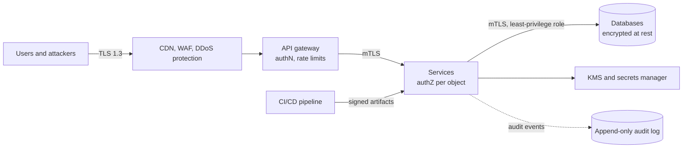
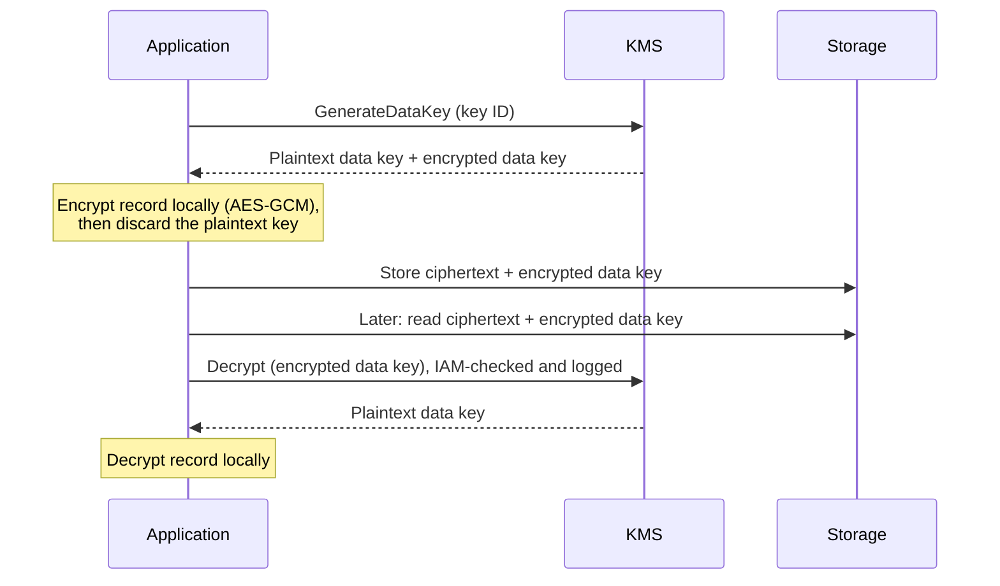
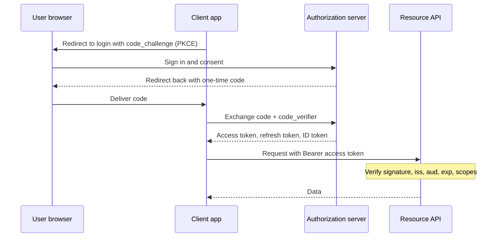

import { Aside } from '@astrojs/starlight/components';

Security is not a component you add at the end; it is a set of properties every component must keep
under attack. A system designer does not need to be a cryptographer, but must know where the trust
boundaries are, which standard control protects each one, and what it costs in latency, complexity
and operations. Interviewers increasingly expect this layer in every design, not only in
"design a payment system".

<Aside type="tip" title="TL;DR">
- Encrypt everything in transit (TLS 1.3 at the edge, mTLS between services) and at rest (KMS-managed keys with envelope encryption).
- Authentication proves *who*; authorization decides *what*. Check authorization on every request, for every object — broken access control is the top web risk.
- Prefer short-lived credentials everywhere: sessions or short JWTs for users, workload identities instead of static keys for services, a secrets manager for what remains.
- Treat all input as hostile: parameterized queries, context-aware output encoding, CSRF defences, allowlists for outbound URLs.
- Assume breach: least privilege, zero-trust networking, audit logs you can trust, and collect less personal data in the first place.
</Aside>

## Start with trust boundaries

Before choosing controls, draw where data crosses from less trusted to more trusted zones: the
public internet to your edge, the edge to internal services, services to data stores, your CI
system to production, your system to third parties. Each crossing needs answers to the same
questions: is the channel encrypted, is the caller authenticated, is the action authorized, is the
input validated, and is it logged?



## Encryption in transit

- **TLS everywhere,** not only at the public edge. Internal networks are shared, mirrored and misconfigured; "it's inside the VPC" is not a control. Use TLS 1.3 where you can, automate certificate issuance and renewal (ACME), and send HSTS so browsers never fall back to plain HTTP. Automation is no longer optional: public TLS certificates are limited to 200 days from March 2026, falling to 100 days in 2027 and 47 days in 2029.
- **Mutual TLS (mTLS)** authenticates *both* ends: each service presents a certificate that encodes its identity. Service meshes and SPIFFE-style workload identities issue short-lived certificates automatically, so services authenticate each other without shared passwords.
- **Terminate deliberately.** If TLS ends at a load balancer or CDN, decide whether traffic is re-encrypted to the origin (it should be) and who can read it in between.

TLS costs one round trip on a new connection and some CPU; connection reuse removes most of it (see
[HTTP](/communication/http/)).

## Encryption at rest and key management

Cloud object stores and most managed disks and databases encrypt data at rest by default or with a
single setting. That protects against stolen drives and decommissioned hardware — not against an attacker with
valid credentials, because the storage decrypts transparently for them. The real control is **who
can use the keys**.

A **key management service** (KMS) keeps root keys inside hardware security modules; they never
leave in plaintext. Applications use **envelope encryption**: data is encrypted locally with a
per-object *data key*, and only that small data key is encrypted by the KMS.



Why it is the standard: bulk data never travels to the KMS, each KMS call is authorised and audited,
rotating the root key does not require re-encrypting terabytes, and destroying a key makes every
record encrypted under it unreadable. For especially sensitive fields (card numbers, national IDs),
add **field-level encryption** or **tokenization** in the application, so database administrators,
backups and analytics copies only ever see ciphertext or tokens.

## Authentication and authorization

**Authentication (authN)** establishes identity: a password plus a second factor, a passkey, a
client certificate, a signed token. **Authorization (authZ)** decides whether that identity may
perform this action on this object. They fail differently: authN failures let strangers in;
authZ failures let legitimate users read each other's data — and are far more common.

For human logins, current guidance (NIST SP 800-63B-4, 2025) is to drop composition rules and
forced periodic changes, require long passwords (15+ characters when the password is the only
factor), check them against breached-password lists, and prefer phishing-resistant factors such as
passkeys. Store passwords only as slow, salted hashes — Argon2id, or scrypt or bcrypt on older
stacks — never encrypted and never with a fast hash like SHA-256.

### Sessions vs tokens

| | Server-side session | Self-contained token (JWT) |
|---|---|---|
| What the client holds | Random session ID in a cookie | Signed claims (user, scopes, expiry) |
| Validation | Look up the session store | Verify the signature locally, no lookup |
| Revocation | Delete the session, immediate | Hard: wait for expiry or keep a denylist |
| Scaling | Needs a shared store (Redis or Valkey, DB) | Stateless, any service can verify |
| Typical use | Browser web apps | APIs, mobile apps, service-to-service |

For browsers, an opaque session ID in a cookie marked `HttpOnly`, `Secure` and `SameSite=Lax` (or
`Strict`) remains the simplest, safest choice. Tokens shine when many services must verify identity
without a central lookup; keep them short-lived (minutes) and pair them with refresh tokens that can be
revoked.

### OAuth 2.0 and OpenID Connect in brief

**OAuth 2.0** lets a user grant an application limited access to an API without sharing their
password; the application receives an *access token* scoped to specific permissions. **OpenID
Connect (OIDC)** adds authentication on top: an *ID token* (a JWT) tells the application who signed
in. "Sign in with Google" and enterprise single sign-on are OIDC.



Current best practice (RFC 9700, 2025): use the **authorization code flow with PKCE** for every
client, including mobile and single-page apps; do not use the implicit grant or the password grant;
use the **client credentials** grant for service-to-service calls. OAuth 2.1, which folds these rules
into one document, is still an IETF draft in 2026.

### JWT pitfalls

- **Accepting `alg: none` or letting the token choose the algorithm.** Pin the expected algorithm and key; otherwise an attacker can switch RS256 to HS256 and sign with your *public* key.
- **Weak HMAC secrets.** A guessable HS256 key can be brute-forced offline from any captured token.
- **Skipping claim checks.** Validate `iss`, `aud` and `exp`; a token issued for another service must be rejected.
- **Secrets in the payload.** A JWT is signed, not encrypted — anyone can base64-decode it.
- **Long lifetimes without revocation.** A stolen 30-day token is a 30-day breach. Use short access tokens, rotating refresh tokens, and sender-constrained tokens (mTLS or DPoP) for high-value APIs.
- **Storing tokens in `localStorage`,** where any XSS can read them. In browsers, prefer `HttpOnly` cookies or a backend-for-frontend that keeps tokens server-side.

### Least privilege: RBAC, ABAC and relationships

Grant every human, service and job the minimum permissions it needs, for the shortest time.

- **RBAC** assigns permissions to roles (`viewer`, `editor`, `billing-admin`) and roles to users. It is easy to audit but tends to explode into hundreds of roles.
- **ABAC** evaluates policies over attributes of the user, resource and context ("managers can approve expenses under 10,000 in their own department during business hours"). Policy engines such as OPA or Cedar keep these rules out of application code.
- **Relationship-based access** (ReBAC), popularised by Google's Zanzibar paper, answers "can user X view document Y?" from a graph of relationships — the model behind sharing in collaborative apps.

Whatever the model, enforce it **server-side on every object access**. The top API vulnerability
is fetching `/invoices/1043` after being authorized only to see `/invoices/1042`.

## Secrets management

Database passwords, API keys and signing keys must never live in source code, container images or
committed config files.

- Keep them in a **secrets manager** (a cloud provider's service, HashiCorp Vault or its open-source fork OpenBao), fetched at runtime, encrypted with KMS, access-controlled and audited.
- Prefer **no static secret at all:** workload identity (cloud IAM roles for VMs and pods, OIDC federation for CI jobs) issues short-lived credentials automatically.
- Where secrets remain, generate **dynamic, short-lived** ones and rotate the rest automatically.
- Run **secret scanning** in pre-commit hooks and CI, and have a playbook for revoking a leaked key in minutes.

## Input handling: injection, XSS, CSRF, SSRF

**Injection.** Never build queries, shell commands or LDAP filters by concatenating input. With
parameterized queries the driver sends values separately from the statement, so input cannot change
its structure:

```python title="param_query.py"
import sqlite3

db = sqlite3.connect(":memory:")
db.execute("CREATE TABLE users (id INTEGER PRIMARY KEY, email TEXT, is_admin INTEGER)")
db.executemany("INSERT INTO users (email, is_admin) VALUES (?, ?)",
               [("ana@example.com", 0), ("root@example.com", 1)])

user_input = "nobody@example.com' OR '1'='1"

# Vulnerable: the input becomes part of the SQL text.
unsafe = db.execute(f"SELECT email FROM users WHERE email = '{user_input}'").fetchall()

# Safe: the driver sends the value separately; it can never change the query's structure.
safe = db.execute("SELECT email FROM users WHERE email = ?", (user_input,)).fetchall()

print("string-built query returned:", unsafe)   # every row leaks
print("parameterized query returned:", safe)    # []
```

Identifiers that cannot be parameters (sort columns, table names) go through an allowlist.

**Cross-site scripting (XSS).** Encode output for the context it lands in (HTML body, attribute,
JavaScript, URL); modern template engines and frameworks do this by default, so the danger is in
bypasses such as raw-HTML helpers. Sanitize user-authored HTML with a maintained library, and add a
Content Security Policy as a second layer.

**Cross-site request forgery (CSRF).** A malicious page makes the victim's browser send a
state-changing request with their cookies. Defences: `SameSite` cookies, rejecting cross-site
requests using the `Sec-Fetch-Site` header (with an `Origin` check as fallback), and anti-CSRF tokens
in frameworks that provide them. Never change state on GET.

**Server-side request forgery (SSRF).** Any feature that fetches a user-supplied URL — webhooks,
link previews, image import — can be pointed at internal services or cloud metadata endpoints. Resolve
the hostname, block private and link-local ranges, and send such traffic through an egress proxy.

## OWASP Top 10:2025

The OWASP Top 10 is the industry's shared checklist of web application risks; the current edition
is 2025. Read it as a list of design responsibilities:

| Risk (2025) | Design-level control |
|---|---|
| A01 Broken Access Control (now includes SSRF) | Deny by default; per-object authZ checks; egress allowlists |
| A02 Security Misconfiguration | Hardened defaults as code; no debug endpoints or default credentials |
| A03 Software Supply Chain Failures | Pinned dependencies, SBOMs, signed builds |
| A04 Cryptographic Failures | TLS everywhere, KMS-managed keys, no home-grown crypto |
| A05 Injection | Parameterized queries, context-aware encoding |
| A06 Insecure Design | Threat modelling at design time, abuse cases, rate limits |
| A07 Authentication Failures | MFA or passkeys, breached-password checks, login throttling |
| A08 Software or Data Integrity Failures | Verify signatures on updates, artifacts and deserialized data |
| A09 Security Logging and Alerting Failures | Audit logs with alerts that someone acts on |
| A10 Mishandling of Exceptional Conditions | Fail closed, no stack traces to clients, handle partial failure |

For APIs specifically, OWASP keeps a separate API Security Top 10 (2023 edition), led by broken
object-level authorization.

## DDoS and abuse protection

Attacks keep growing: Cloudflare reported an HTTP/2 "Rapid Reset" flood peaking above 201 million
requests per second in 2023 and a 31.4 Tbps network attack in late 2025 that lasted 35 seconds. No
single origin absorbs that, so protection is layered:

- **Network floods (L3/L4):** anycast CDNs and scrubbing services absorb volumetric traffic far from your servers; hide origin IPs and accept traffic only from the edge.
- **Application floods (L7):** WAF rules, bot detection, challenges for suspicious clients, aggressive caching of anything public.
- **Abuse of legitimate features:** credential stuffing, scraping, sign-up spam, expensive search or GraphQL queries — handled by per-user and per-key [rate limiting](/reliability/rate-limiting/), cost-based quotas and anomaly detection.
- **Graceful overload:** autoscaling with upper bounds (an attacker should not be able to run up your bill indefinitely), load shedding and timeouts so an overloaded dependency does not take everything down.

## Zero-trust networking

The old model trusted anything inside the corporate network or VPC. Zero trust (NIST SP 800-207;
Google's BeyondCorp) removes network location as a source of trust: every request is authenticated
and authorized based on the identity of the user *and* the workload or device, regardless of where
it comes from.

In practice: employees reach internal tools through an identity-aware proxy instead of a VPN;
services authenticate each other with mTLS workload identities and are authorized per call;
network segmentation still exists, but as defence in depth, not the main control; and credentials
are short-lived so a stolen one expires quickly.

## Supply-chain security

Your system includes every dependency, base image, build tool and CI runner. The 2024 xz-utils
backdoor, hidden in the release tarballs of a widely used compression library, showed how far up
the chain an attack can start. Baseline controls:

- Pin dependencies with lockfiles, review updates, and scan them for known vulnerabilities.
- Produce an **SBOM** (software bill of materials) for each release so you can answer "are we affected?" within hours.
- **Sign** build artifacts and container images (Sigstore makes this keyless) and verify signatures at deploy time.
- Build in isolated, ephemeral CI runners that use short-lived credentials, and record provenance — the SLSA framework defines levels for this.

## Audit logging

Audit logs answer "who did what, to which resource, when, from where, and was it allowed?" for
security-relevant events: logins, permission changes, data exports, admin actions, key usage.

- Write them to an **append-only**, tamper-evident store in a separate account that application admins cannot modify; cloud audit trails (for example of KMS and IAM calls) belong there too.
- Keep them structured, with a request ID linking them to application traces (see [observability](/reliability/observability/)).
- Never log secrets, tokens, passwords or full personal data.
- Alert on the events that matter (privilege escalation, mass export, repeated authorization failures); a log nobody watches is A09 on the list above.

## Privacy and data minimisation

The data you never collect cannot leak. Privacy laws such as the EU's GDPR turn this into
requirements that shape architecture:

- **Inventory and classify** personal data (PII): which tables, topics, buckets, logs and analytics copies contain it.
- **Minimise:** collect only what a feature needs, keep it only as long as needed (TTL policies on tables, logs and object storage), and pseudonymise analytics data.
- **Right to erasure:** GDPR Article 17 requires deleting a person's data "without undue delay" on valid request. Deletion must reach replicas, caches, search indexes, data warehouses, event logs and backups — design a deletion pipeline keyed by user ID from the start.
- **Crypto-shredding** makes this tractable for immutable stores: encrypt each user's data with a per-user key and delete the key to render every copy, including backups, unreadable.
- **Residency:** some data must stay in a jurisdiction; partition storage by region accordingly.

## Threats and controls

| Threat | Primary controls |
|---|---|
| Eavesdropping, tampering in transit | TLS 1.3, HSTS, mTLS between services |
| Stolen disks, snapshots or backups | Encryption at rest, KMS key policies, separate backup accounts |
| Credential stuffing, phishing | MFA or passkeys, breached-password checks, login rate limits |
| Stolen session or token | Short lifetimes, `HttpOnly` cookies, refresh-token rotation, revocation |
| Accessing other users' objects | Per-object authZ checks, deny by default, tests for IDOR |
| SQL or command injection | Parameterized queries, allowlists, least-privilege DB roles |
| XSS | Context-aware output encoding, HTML sanitization, CSP |
| CSRF | SameSite cookies, Fetch Metadata checks, CSRF tokens |
| SSRF | Egress allowlists, block private ranges, egress proxy |
| Leaked secrets | Secrets manager, workload identity, scanning, fast rotation |
| DDoS, scraping, abuse | CDN and scrubbing, WAF, rate limiting, cost quotas |
| Compromised dependency or build | Lockfiles, SBOM, signed artifacts, isolated CI |
| Insider misuse | Least privilege, just-in-time access, audit logs with alerts |
| Personal data breach | Data minimisation, field-level encryption or tokenization, retention TTLs |

<Aside type="note" title="In the interview">
- Mention security briefly in every design: TLS, authN at the gateway, authZ in services, encryption at rest, rate limits, audit logs. Thirty seconds is enough unless asked for more.
- Expect "sessions or JWTs?" — explain revocation and where each fits. Expect "how do services authenticate each other?" — mTLS or signed short-lived tokens, not shared API keys.
- For sensitive data, describe envelope encryption and who can call the KMS.
- For user-supplied URLs or webhooks, raise SSRF yourself — it signals real-world experience.
- Common mistakes: trusting the internal network, checking authorization only at the gateway, long-lived tokens with no revocation, and forgetting backups and logs when asked to delete user data.
</Aside>

## Further reading

- [OWASP Top 10:2025](https://top10.owasp.org/2025/) — the current list of web application risks.
- [OWASP Cheat Sheet Series](https://cheatsheetseries.owasp.org/) — concise, practical guidance on XSS, CSRF, SQL injection, secrets and password storage.
- [RFC 9700: Best Current Practice for OAuth 2.0 Security](https://www.rfc-editor.org/rfc/rfc9700.html) — what to use and what to stop using in OAuth.
- [RFC 8725: JSON Web Token Best Current Practices](https://www.rfc-editor.org/rfc/rfc8725.html) — the JWT pitfalls above, with mitigations.
- [NIST SP 800-207: Zero Trust Architecture](https://csrc.nist.gov/pubs/sp/800/207/final) — the reference definition of zero trust.
- [AWS KMS cryptography essentials](https://docs.aws.amazon.com/kms/latest/developerguide/kms-cryptography.html) — envelope encryption and key hierarchy explained.

## Related topics

- [Rate limiting](/reliability/rate-limiting/) — the first line against abuse and application-layer floods.
- [HTTP](/communication/http/) — TLS 1.3, 0-RTT replay risk, cookies and caching of private data.
- [Reverse proxy and API gateway](/traffic/reverse-proxy-and-api-gateway/) — where authentication, WAF and rate limits usually sit.
- [Service discovery and mesh](/architecture/service-discovery-and-mesh/) — mTLS and workload identity between services.
- [Observability](/reliability/observability/) — logs, traces and alerts that audit logging builds on.
- [API styles](/communication/api-styles/) — webhook signatures, replay protection and GraphQL cost limits.
