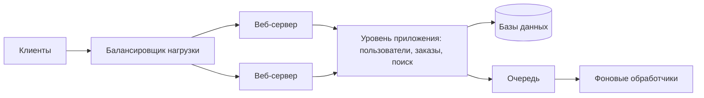

import { Aside } from '@astrojs/starlight/components';

Любая система должна решить, как разделить код на развёртываемые единицы: одно приложение, несколько или сотни небольших сервисов. Это решение определяет, как работают команды, как система отказывает и сколько стоит её эксплуатация. Индустрия качнулась от монолитов к микросервисам и частично обратно. Нынешний консенсус меньше зависит от моды: границы должны соответствовать командам и реальным потребностям в масштабировании.

<Aside type="tip" title="Коротко">
- Отделите веб-уровень от уровня приложения (платформы), чтобы каждый можно было масштабировать и менять независимо.
- **Модульный монолит** — одна развёртываемая единица со строго соблюдаемыми внутренними границами модулей — правильный выбор по умолчанию для большинства продуктов и команд.
- Микросервисы окупаются, когда многим командам нужно деплоиться независимо или когда у частей системы сильно различаются требования к масштабированию, надёжности или технологиям.
- Их цена — сложность распределённых систем: сетевые вызовы, частичные отказы, данные, разнесённые по разным базам, и большой объём работы над платформой и наблюдаемостью.
- Мигрируйте постепенно по паттерну strangler fig, а не переписыванием «большим взрывом».
</Aside>

## Веб-уровень и уровень приложения

Первое разделение в большинстве систем — между **веб-уровнем**, который отвечает за HTTP, сессии, рендеринг и публичный API, и **уровнем приложения, или платформы**, где живёт бизнес-логика и происходит работа с хранилищами данных.

Зачем разделять:

- **Независимое масштабирование.** Новый внутренний API или тяжёлая пакетная задача требуют добавить серверы приложения, но не веб-серверы, и наоборот.
- **Повторное использование.** Веб, мобильные клиенты и партнёрские API могут пользоваться одним уровнем платформы, а не реализовывать логику каждый заново.
- **Разделение команд.** Продуктовые команды развивают веб-уровень, а платформенная команда — ядро.
- **Асинхронная работа.** Обработчики на уровне приложения забирают медленные задачи с пути запроса через [очереди](/async/queues-and-back-pressure/).

## Единственная ответственность — от классов к сервисам

**Принцип единственной ответственности** гласит, что у единицы кода должна быть одна причина для изменения. В архитектуре это значит: каждый модуль или сервис владеет одной бизнес-возможностью (биллинг, поиск, уведомления) и её данными и предоставляет узкий стабильный интерфейс. Хорошие границы следуют предметной области (в предметно-ориентированном проектировании их называют *ограниченными контекстами*, bounded contexts), а не техническим слоям. «Сервис базы данных» или «сервис валидации» — признак неверного разреза.

Этот принцип не требует сетевой границы. Его можно применить внутри одной кодовой базы — в этом и состоит идея модульного монолита.

## Что такое микросервисы

**Микросервисы** — архитектура, в которой приложение построено из набора небольших сервисов, каждый из которых:

- работает в собственном процессе и **развёртывается независимо**;
- владеет своими данными: никакой другой сервис не читает его таблицы напрямую;
- общается с другими по сети через чётко определённые API (HTTP/JSON, gRPC) или события;
- принадлежит одной команде целиком, включая дежурства.

У сервиса обмена фотографиями могут быть сервисы профилей, графа подписок, ленты, поиска, загрузки медиа и уведомлений — у каждого своё хранилище и свой ритм релизов. «Микро» относится к масштабу ответственности (одна возможность), а не к числу строк кода.

## Модульный монолит как сильный выбор по умолчанию

**Модульный монолит** — одно развёртываемое приложение, код которого разделён на модули с явными публичными интерфейсами и принудительными правилами зависимостей. Модуль A может вызывать публичный API модуля B, но не может трогать его внутренности или таблицы. Он сохраняет эксплуатационную простоту монолита — одна сборка, один деплой, вызовы внутри процесса и одна база данных (со схемой или набором таблиц на модуль) — и при этом даёт большую часть проектных преимуществ сервисов.

Самый известный пример — Shopify. Его большой монолит на Ruby on Rails, над которым работают более тысячи разработчиков, был реорганизован в компоненты по предметным областям, а инструменты отмечают вызовы в обход публичного API компонента. Микросервисы рассматривались и были отвергнуты из-за их эксплуатационной цены и задержек.

Чтобы модули были настоящими, а не просто папками:

- проверяйте границы в CI правилами зависимостей, архитектурными тестами или инструментами вроде Packwerk и ArchUnit;
- выделите каждому модулю собственные таблицы и не делайте join между таблицами разных модулей;
- взаимодействуйте через интерфейсы или внутрипроцессные события, которые позже смогут стать сетевыми вызовами или сообщениями;
- поддерживайте быструю сборку за счёт наборов тестов на уровне модулей.

Хорошо разбитый на модули монолит к тому же проще всего разделить позже: швы уже есть.

## Когда разделение окупается

Микросервисы решают в основном **организационные** проблемы и лишь некоторые технические:

- **Много команд, один поезд релизов.** Когда десятки команд делят одну развёртываемую единицу, слияния, наборы тестов и координация релизов тормозят всех. Независимые сервисы позволяют каждой команде выпускаться по своему графику.
- **Закон Конвея.** Мелвин Конвей ещё в 1968 году заметил, что системы повторяют структуру коммуникаций создающих их организаций. Границы сервисов, совпадающие с границами команд, сокращают координацию. Границы, пересекающие команды, порождают постоянные межкомандные переговоры. Некоторые организации сначала проектируют команды и дают архитектуре следовать за ними («обратный манёвр Конвея», inverse Conway manoeuvre).
- **Очень разные профили масштабирования.** Транскодеру видео нужны GPU, и он масштабируется вместе с загрузками; сервису аккаунтов нужно немного. Разделение избавляет от необходимости масштабировать всё ради одной части.
- **Изоляция отказов и безопасности.** Утечка памяти в рекомендациях не должна ронять оформление заказа. Платёжный сервис в зоне PCI можно закрыть отдельно.
- **Технологическое соответствие.** Часть, которой действительно нужен другой язык или среда выполнения, например сервер ML-моделей, может их получить.

Если ничего из этого не про вас, разделение в основном добавляет затрат.

## Сколько стоят микросервисы

- **Сетевые вызовы вместо вызовов функций.** Каждый переход добавляет задержку (часто миллисекунду и больше против наносекунд внутри процесса) и может завершиться ошибкой. Запрос, который последовательно проходит через 10 сервисов с доступностью 99,9% каждый, успешен лишь примерно в 99,0% случаев — около 87 часов отказов в год вместо менее 9.
- **Частичные отказы.** Тайм-ауты, повторные попытки, предохранители (circuit breakers), идемпотентность и запасные варианты становятся повседневным кодом. См. [паттерны устойчивости](/reliability/resilience-patterns/).
- **Распределённые данные.** Нет транзакций и join между сервисами. Нужны саги или события через outbox, приходится принимать [согласованность в конечном счёте](/fundamentals/consistency-patterns/) и дублировать часть данных для чтения.
- **Эксплуатация.** Десятки конвейеров, дашбордов, алертов и графиков дежурств; [обнаружение сервисов](/architecture/service-discovery-and-mesh/); распределённая трассировка и централизованные логи ([наблюдаемость](/reliability/observability/)); совместимость версий между сервисами; платформенная команда, чтобы всё это было терпимо.
- **Тестирование и локальная разработка.** Запустить всю систему на ноутбуке становится трудно. Нужны контрактные тесты и общие тестовые окружения.
- **Неверные границы стоят дорого.** Перенос ответственности между сервисами означает изменение API и миграцию данных, а не рефакторинг в одном репозитории. Худший исход — **распределённый монолит**: сервисы, которые приходится деплоить вместе и которые синхронно вызывают друг друга на каждый запрос, — все затраты и никаких преимуществ.

Команды действительно возвращаются назад. В 2018 году Twilio Segment объединил более 140 сервисов (по одному на каждое направление доставки) в один, а в 2023 году команда мониторинга Prime Video сообщила о снижении затрат на инфраструктуру более чем на 90% после того, как свернула распределённый serverless-конвейер в один процесс. Оба случая — о границах, проведённых мельче, чем требовала задача, а не доказательство того, что сервисы плохи.

## Миграция: паттерн strangler fig

Переписывание «большим взрывом» обычно проваливается: оно занимает годы, старая система продолжает меняться, и никто точно не знает всего, что она делает. Паттерн **strangler fig** («фикус-душитель»), названный Мартином Фаулером в честь лианы, которая постепенно обвивает дерево-хозяина, заменяет систему по частям.

1. Поставьте перед унаследованной системой маршрутизирующий слой — обратный прокси или [API-шлюз](/traffic/reverse-proxy-and-api-gateway/).
2. Выберите одну возможность с ясным швом. Реализуйте её заново и переводите на неё трафик постепенно — по процентам или с теневым трафиком для сравнения результатов.
3. Поддерживайте согласованность данных на переходный период: захват изменений данных (CDC), двойная запись через outbox или временная задача синхронизации.
4. Удалите старый путь в коде, когда трафик полностью переведён. Повторите.

Тот же паттерн подходит и для выделения модуля из модульного монолита, и для переезда между платформами.

## Serverless

**Функции как сервис** — AWS Lambda, Google Cloud Run functions, Azure Functions, Cloudflare Workers — развивают идею сервисов дальше: вы деплоите функции, а платформа берёт на себя серверы, масштабирование (вплоть до нуля) и оплату за вызов. Контейнерные платформы вроде Google Cloud Run и AWS Fargate — промежуточный вариант: serverless-эксплуатация для обычных долгоживущих HTTP-сервисов.

Serverless хорошо подходит для событийной «склейки» (реакция на загрузку файла, сообщение в очереди, вебхук), для неравномерной или небольшой нагрузки и для задач по расписанию. Следите за:

- **холодными стартами** у редко вызываемых функций (смягчаются заранее выделенной параллельностью или средами выполнения на изолятах);
- **лимитами выполнения**: например, Lambda ограничивает запуск 15 минутами;
- **стоимостью при высокой постоянной нагрузке**, когда постоянно работающие контейнеры часто дешевле;
- **давлением на нижележащие системы**: тысячи параллельных функций могут исчерпать соединения с базой данных;
- **фрагментацией**: сотни крошечных функций — это распределённая система, о которой трудно рассуждать.

Serverless — модель развёртывания и оплаты. Вопросы о границах, описанные выше, остаются в силе.

## Сравнение

| | Монолит | Модульный монолит | Микросервисы |
|---|---|---|---|
| Развёртываемые единицы | Одна | Одна | Много, по одной на сервис |
| Границы модулей | Часто неявные, размываются со временем | Явные, проверяются инструментами | Обеспечиваются сетью |
| Вызовы между частями | Внутри процесса | Внутри процесса | По сети (RPC, HTTP, события) |
| Данные | Одна общая схема | Одна база, таблицы закреплены за модулями | База на каждый сервис |
| Транзакции | Локальные ACID | Локальные ACID | Саги, outbox, согласованность в конечном счёте |
| Независимый деплой | Нет | Нет | Да |
| Независимое масштабирование | Масштабируется всё приложение | Масштабируется всё приложение | Для каждого сервиса |
| Изоляция отказов | Низкая | От низкой до средней | Высокая, если на неё проектировали |
| Эксплуатационные затраты | Низкие | Низкие | Высокие: платформа, трассировка, обнаружение |
| Лучше всего для | Маленькой команды, раннего продукта | Большинства продуктов, вплоть до многих команд | Многих автономных команд, сильно неравномерного масштабирования |

<Aside type="note" title="На собеседовании">
На собеседовании по системному дизайну рисовать сервисы вроде «сервис ленты» и «сервис пользователей» нормально и часто ожидаемо. Важно уметь обосновать границы (разное масштабирование, разные данные, разные команды) и признать цену: как сервисы находят друг друга, что происходит, когда один из них медленный, как данные остаются согласованными без межсервисных транзакций. Хорошо бы подготовиться к вопросам: «Вы бы начали с микросервисов?», «Как бы вы мигрировали этот монолит?», «Как двум сервисам синхронизировать данные?» Тревожный сигнал — деление по техническим слоям или утверждение, что микросервисы автоматически лучше масштабируются.
</Aside>

## Что почитать

- [Microservices](https://martinfowler.com/articles/microservices.html) — определяющая статья Джеймса Льюиса и Мартина Фаулера (2014).
- [Monolith First](https://martinfowler.com/bliki/MonolithFirst.html) — почему большинство успешных микросервисных систем начинались как монолиты.
- [Strangler Fig](https://martinfowler.com/bliki/StranglerFigApplication.html) — обновлённое описание постепенной замены от Фаулера.
- [Deconstructing the Monolith](https://shopify.engineering/deconstructing-monolith-designing-software-maximizes-developer-productivity) — модульный монолит Shopify на практике.
- [Goodbye Microservices](https://www.twilio.com/en-us/blog/developers/best-practices/goodbye-microservices) — Twilio Segment о слиянии 140+ сервисов обратно в один.
- [How Do Committees Invent?](https://www.melconway.com/Home/Committees_Paper.html) — оригинальная статья Конвея 1968 года.

## Связанные темы

- [Обнаружение сервисов и service mesh](/architecture/service-discovery-and-mesh/) — как сервисы находят друг друга и общаются.
- [Обратный прокси и API-шлюз](/traffic/reverse-proxy-and-api-gateway/) — входная дверь для многих сервисов и фасад для strangler fig.
- [RPC и REST](/communication/rpc-and-rest/) — как сервисы вызывают друг друга.
- [Потоки событий](/async/event-streaming/) — развязка сервисов с помощью событий вместо синхронных вызовов.
- [Паттерны устойчивости](/reliability/resilience-patterns/) — как пережить частичные отказы между сервисами.
