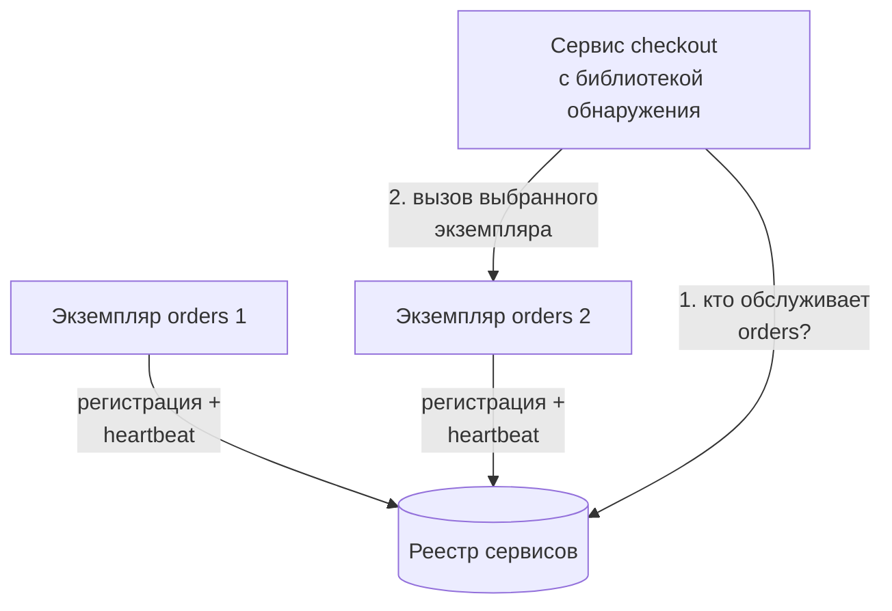
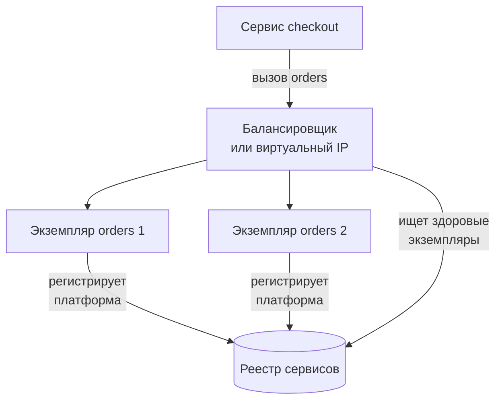
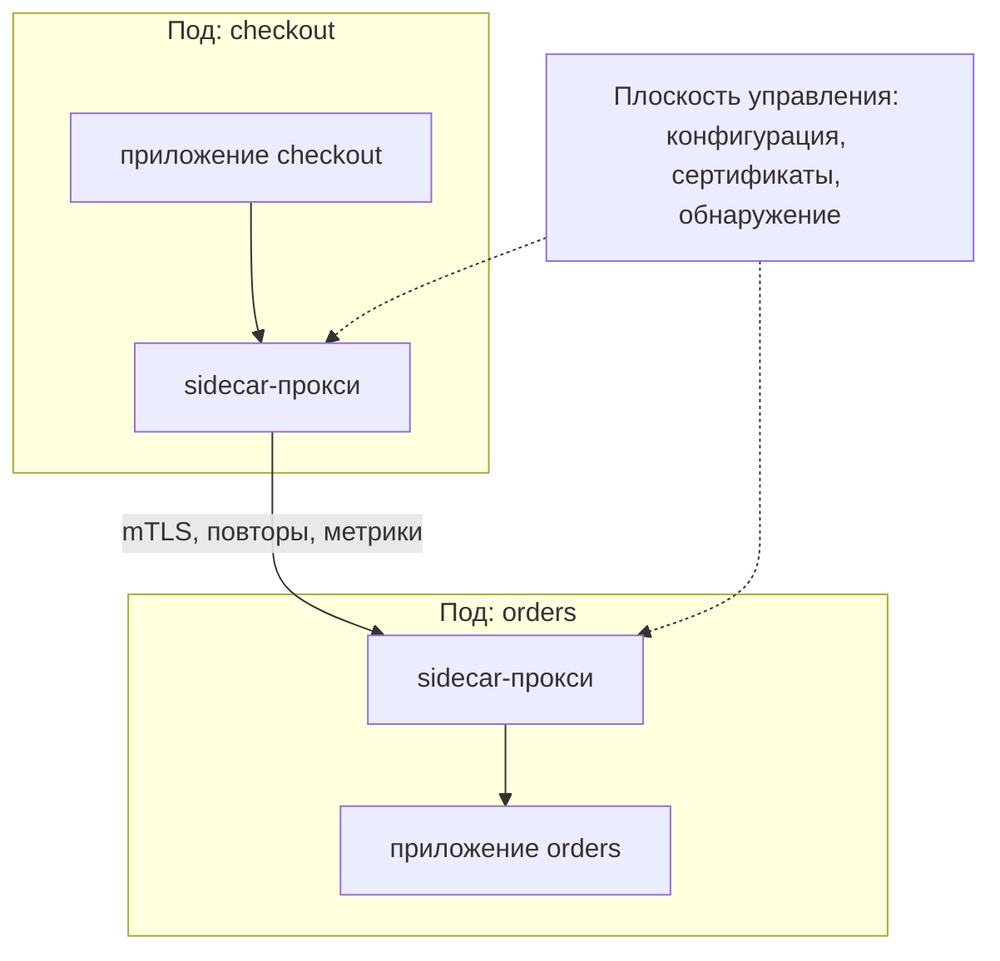

import { Aside } from '@astrojs/starlight/components';

В системе из многих сервисов экземпляры постоянно появляются и исчезают: автомасштабирование, деплои, падения, перепланирование. Зашитые в конфигурацию IP-адреса перестают работать уже через несколько часов. **Обнаружение сервисов** (service discovery) поддерживает актуальное соответствие между логическим именем вроде `orders` и здоровыми экземплярами за ним. **Service mesh** идёт дальше: он выносит весь слой межсервисного взаимодействия — шифрование, повторные попытки, переключение трафика, телеметрию — из кода приложений в инфраструктуру.

<Aside type="tip" title="Коротко">
- Реестр сервисов отслеживает, какие экземпляры каждого сервиса живы. Экземпляры регистрируются сами (или их регистрирует платформа) и удаляются, когда не проходят проверки здоровья или истекает TTL.
- Обнаружение на клиенте: вызывающий сам опрашивает реестр и балансирует — меньше переходов, но логика в каждом клиенте. Обнаружение на сервере: вызывающий обращается к балансировщику или виртуальному IP, который выполняет поиск.
- В Kubernetes обнаружение «из коробки» дают Service, EndpointSlice и DNS кластера. Consul, etcd и ZooKeeper покрывают другие окружения и задачи координации.
- Mesh добавляет mTLS, повторные попытки, тайм-ауты, разделение трафика и единообразные метрики без изменения кода — через sidecar-прокси или плоскости данных без sidecar (режим ambient).
- Mesh — это инвестиция в платформу. При нескольких сервисах обычно хватает библиотек и хорошего балансировщика.
</Aside>

## Задача

Статическая конфигурация («orders живёт на 10.0.3.17:8080») ломается, как только экземпляры становятся эфемерными. Обнаружению нужны три части:

1. **Регистрация**: экземпляр сообщает о себе, когда готов, — сам (самостоятельная регистрация) или через платформу (оркестратор или регистратор, наблюдающий за ним).
2. **Отслеживание здоровья**: умершие или нездоровые экземпляры быстро удаляются.
3. **Поиск**: вызывающие разрешают имя в текущий набор здоровых адресов — в идеале получая обновления через push, а не опрашивая реестр.

## Обнаружение на клиенте

Вызывающий запрашивает у реестра список экземпляров, кэширует его, получает обновления и сам выбирает экземпляр (round robin, P2C, с учётом зоны). Этот подход популяризировал Netflix — реестр Eureka и клиентская библиотека Ribbon. Сегодня та же идея воплощена в **поддержке xDS в gRPC**, где клиенты получают эндпоинты и политику балансировки от плоскости управления, и в клиентских библиотеках вообще.

- **Плюсы:** нет лишнего перехода; умная балансировка на уровне запросов, которая подходит для долгоживущих соединений HTTP/2 и gRPC; клиент может предпочитать экземпляры в своей зоне.
- **Минусы:** каждому языку и фреймворку нужна библиотека обнаружения, и её надо обновлять; реестр становится зависимостью каждого клиента; поведение расходится между версиями клиентов.

## Обнаружение на сервере

Вызывающий отправляет трафик на стабильный адрес — балансировщик, прокси или виртуальный IP. Маршрутизатор обращается к реестру и пересылает запрос. Так работают внутренние балансировщики AWS и Service типа ClusterIP в Kubernetes.

- **Плюсы:** клиенты остаются простыми и не зависят от языка; политика балансировки в одном месте.
- **Минусы:** ещё один компонент, который нужно эксплуатировать и масштабировать, и, возможно, лишний переход. Виртуальный IP на уровне L4 балансирует по соединениям, поэтому долгоживущие gRPC-соединения могут оказаться привязаны к одному экземпляру.

Service mesh — гибрид: прокси рядом с каждой нагрузкой (или на каждом узле) выполняет обнаружение и балансировку на клиенте от имени приложения, а приложение видит простой локальный или виртуальный адрес.

## Реестры

| Реестр | Модель | Здоровье и живость | Примечания |
|---|---|---|---|
| Kubernetes Service + EndpointSlice + CoreDNS | Управляется платформой: поды, подходящие под селектор, становятся эндпоинтами | Readiness-пробы; неготовые поды исключаются из EndpointSlice | `orders.shop.svc.cluster.local` разрешается в ClusterIP или в IP подов для headless Service. Виртуальный IP маршрутизирует kube-proxy или плоскость данных на eBPF |
| HashiCorp Consul | Каталог сервисов с DNS и HTTP API, плюс хранилище «ключ-значение» и собственный mesh | Проверки агента: HTTP, TCP, gRPC, скрипт и TTL-проверки, которые сервис должен обновлять | Работает с ВМ, Kubernetes и несколькими дата-центрами. С версии 1.17 распространяется под лицензией BUSL 1.1 |
| etcd | Строго согласованное хранилище «ключ-значение» (Raft) | Аренды (leases) с TTL, которые клиент продлевает. Ключи исчезают, когда аренда истекает | Хранилище, на котором работает Kubernetes. Обнаружение строится из аренд и наблюдения (watch) |
| Apache ZooKeeper | Иерархическое согласованное хранилище | Эфемерные узлы, исчезающие с окончанием сессии клиента | Долго служил для координации (Hadoop, HBase, старые версии Kafka). Kafka 4.0 отказалась от него в пользу встроенного KRaft |
| Eureka (Netflix) | AP-реестр, доступность важнее согласованности | Heartbeat-сообщения клиентов | Ориентирован на JVM; встречается в основном в проектах на Spring Cloud |
| Облачные | AWS Cloud Map, ECS Service Connect, VPC Lattice | Управляет провайдер | Обнаружение как управляемая функция платформы |

Согласованность важна меньше, чем кажется. Если реестр ненадолго отстал, лишь несколько запросов попадут на экземпляр, который только что ушёл, — а вызывающие всё равно должны справляться с этим повторами и тайм-аутами. Поэтому AP-решения вроде Eureka работают. А вот для **выбора лидера и блокировок** нужно хранилище на основе консенсуса с линеаризуемыми записями: etcd, ZooKeeper (перед чтением, которое должно быть актуальным, вызывайте `sync()`) или Consul (с режимом чтения `consistent`). См. [модели согласованности](/fundamentals/consistency-patterns/) и [консенсус и координацию](/fundamentals/consensus-and-coordination/).

## Проверки здоровья и TTL

Реестр может заметить пропажу экземпляра двумя способами:

- **Активные проверки**: реестр или его агент опрашивает экземпляр (HTTP `/healthz`, TCP-подключение, протокол проверки здоровья gRPC). Kubernetes разделяет их на пробы *liveness* (перезапусти меня) и *readiness* (шли мне трафик). На обнаружение влияет только readiness.
- **Heartbeat / TTL**: экземпляр постоянно продлевает аренду, TTL-проверку или сессию. Если он перестаёт это делать — упал или оказался отрезан сетью, — запись истекает. Время обнаружения примерно равно TTL: при TTL в 10 секунд мёртвый экземпляр может получать трафик до 10 секунд, если вызывающие не обнаружат сбой сами.

Практические моменты:

- **Корректное завершение (graceful shutdown).** Сначала снимите регистрацию (провалите readiness), подождите, пока вызывающие это увидят, дождитесь завершения текущих запросов и только потом выходите. Большинство «ошибок во время деплоя» — следствие пропуска этого шага.
- **Кэширование на клиенте.** Обнаружение через DNS наследует проблемы кэширования DNS. Среды выполнения, которые надолго кэшируют результаты, и пулы соединений, никогда не разрешающие имя заново, продолжают обращаться по старым адресам. Предпочитайте push-обновления (watch, xDS) или короткие TTL с повторным разрешением.
- **Сочетайте с обнаружением выбросов.** Реестры медленно замечают «серые» отказы, например экземпляр, который жив, но возвращает ошибки. Вызывающие или прокси должны исключать плохие эндпоинты по реальному трафику, как описано в разделе о [балансировщиках нагрузки](/traffic/load-balancers/).
- **Защитите реестр.** Если реестр отказал, клиенты должны продолжать пользоваться последним известным корректным списком, а не сбрасывать всё.

## Service mesh

**Service mesh** добавляет плоскость данных из прокси, через которые идёт весь межсервисный трафик, и плоскость управления, которая снабжает их данными обнаружения, сертификатами и политиками.

Что обычно даёт mesh без изменений в приложениях:

- **mTLS везде.** Каждая нагрузка получает короткоживущий сертификат, привязанный к её идентичности (часто в стиле SPIFFE), который обновляется автоматически. Трафик шифруется, а политики авторизации могут задавать правило «только `checkout` может вызывать `orders`» на основе криптографической идентичности, а не IP-адреса.
- **Средства надёжности.** Тайм-ауты, повторные попытки (с бюджетами, чтобы повторы не раздували сбой), исключение выбросов, предохранители и внедрение сбоев для тестирования. См. [паттерны устойчивости](/reliability/resilience-patterns/).
- **Управление трафиком.** Разделение по весам для канареечных и blue/green-релизов, маршрутизация по заголовкам, зеркалирование трафика на новую версию, переключение между зонами или кластерами.
- **Единообразная телеметрия.** Частота запросов, доля ошибок и задержка для каждой пары сервисов плюс передача заголовков трассировки — всё в одном формате. Для полной трассировки сервисам всё равно нужно самим пробрасывать заголовки. См. [наблюдаемость](/reliability/observability/).

### Варианты плоскости данных в 2026 году

- **Sidecar-прокси.** Контейнер-прокси в каждом поде: Envoy в классическом режиме Istio, «микропрокси» на Rust в Linkerd. Полный набор L7-функций для каждой нагрузки и сильная изоляция (каждый под хранит только свои ключи). Цена: CPU и память на каждый под (с запасом на худший случай), два перехода через прокси на вызов и перезапуск подов для внедрения или обновления. Нативные sidecar-контейнеры Kubernetes (стабильны с v1.33) устранили старые проблемы с порядком запуска и остановки.
- **Плоскости данных без sidecar («ambient»).** **Режим ambient** в Istio, общедоступный (GA) с Istio 1.24 (ноябрь 2024), делит работу. Узловой **ztunnel** (написан на Rust) обслуживает L4: mTLS, идентичность, L4-авторизацию и телеметрию. Необязательные **waypoint**-прокси (Envoy) на пространство имён или на сервис добавляются только там, где нужны функции L7. Нагрузки попадают в mesh после пометки пространства имён меткой, без перезапусков. Собственные измерения Istio показывают меньшие накладные расходы и задержку, чем у sidecar, особенно без waypoint. Ambient стабилен для mesh в одном кластере; поддержка нескольких кластеров в разных сетях получила статус beta только в Istio 1.29 (февраль 2026), поэтому для мультикластерных конфигураций и ВМ sidecar остаётся более надёжным выбором.
- **eBPF и узловые прокси.** Service mesh **Cilium** обрабатывает L3/L4 в ядре с помощью eBPF и использует Envoy на узле для L7 — тоже без sidecar. Его взаимная аутентификация на основе SPIFFE так и не вышла из beta и объявлена устаревшей в Cilium 1.20 (июль 2026). Предлагаемая замена — прозрачное шифрование через ztunnel: Cilium берёт ztunnel из Istio для L4 mTLS, и эта функция тоже пока в beta.
- **Без прокси (proxyless).** gRPC-клиенты могут получать конфигурацию xDS напрямую от плоскости управления mesh, так что балансировка и маршрутизация происходят в клиентской библиотеке вообще без прокси.

Основные варианты: **Istio** (выпускник CNCF; sidecar или ambient), **Linkerd** (выпускник CNCF; sidecar на Rust, упор на простоту; открытый проект выпускает edge-релизы, а стабильные сборки предоставляют вендоры), **Cilium**, **Consul service mesh** (sidecar на Envoy; охватывает ВМ и Kubernetes) и облачные предложения вроде Google Cloud Service Mesh. AWS App Mesh прекратил работу 30 сентября 2026 года. Пользователям ECS AWS предлагает переходить на ECS Service Connect, а пользователям EKS — на Amazon VPC Lattice, которому не нужны sidecar. Mesh и шлюзы всё чаще настраиваются через общий **Kubernetes Gateway API** (маршрутизацию внутри mesh покрывает его инициатива GAMMA, входящая в Standard-канал с Gateway API v1.1 2024 года).

## Когда mesh избыточен

Mesh оправдан, когда сервисов и команд много, когда mTLS по модели нулевого доверия (zero trust) нужен для соответствия требованиям, когда канареечные релизы идут часто или нужна единая телеметрия для сервисов на разных языках. Обычно он избыточен, когда:

- у вас монолит или несколько сервисов одной команды — хорошая HTTP-клиентская библиотека с тайм-аутами и повторами плюс балансировщик справятся;
- некому владеть плоскостью управления, её обновлениями и режимами отказов. Неверно настроенный mesh может сломать *весь* трафик сразу;
- бюджет задержки предельно жёсткий, и каждый переход через прокси на счету;
- платформа уже даёт то, что нужно: управляемые L7-балансировщики, облачный IAM между сервисами, шифрование на уровне VPC.

Начинайте с конкретной проблемы — «нам нужен mTLS» или «нам нужны ключевые метрики по каждому сервису» — и выбирайте самый лёгкий инструмент, который её решает.

## Компромиссы

| Подход | Плюсы | Минусы |
|---|---|---|
| Статическая конфигурация / обычный DNS | Тривиально | Ломается с эфемерными экземплярами; медленные обновления |
| Обнаружение на клиенте (библиотека или gRPC без прокси) | Нет лишнего перехода; умная балансировка | Библиотеки для каждого языка; логика размазана по клиентам |
| Обнаружение на сервере (балансировщик или VIP) | Простые клиенты, не зависящие от языка | Лишний компонент и переход; L4 VIP привязывает долгие соединения |
| Mesh с sidecar | Полный набор L7-функций для каждой нагрузки, сильная изоляция | Накладные расходы на под, сложности с обновлением, эксплуатационная сложность |
| Mesh в режиме ambient или на eBPF | Гораздо меньше накладных расходов, без перезапусков, L7 только где нужно | Новее; узловые компоненты общие; для L7 нужны waypoint |

<Aside type="note" title="На собеседовании">
Если в вашем дизайне несколько сервисов, скажите, как они находят друг друга: «в Kubernetes — через Service и DNS» или «через реестр вроде Consul с проверками здоровья». Интервьюер спросит, что происходит, когда экземпляр умирает (обнаружение по TTL или проверке здоровья плюс повторы у вызывающего), как деплой обходится без ошибок (readiness и дренирование) и добавили бы вы mesh (только с конкретной причиной: mTLS, канарейки, единая телеметрия — в масштабе, который оправдывает эксплуатационные затраты). Упоминание накладных расходов sidecar и вариантов ambient или без sidecar показывает актуальные знания. Не подавайте mesh как бесплатный.
</Aside>

## Что почитать

- [Pattern: Client-side service discovery](https://microservices.io/patterns/client-side-discovery.html) и [Server-side service discovery](https://microservices.io/patterns/server-side-discovery.html) — описания паттернов от Криса Ричардсона.
- [Kubernetes: Service](https://kubernetes.io/docs/concepts/services-networking/service/) — Service, EndpointSlice, headless Service и DNS.
- [Документация Consul](https://developer.hashicorp.com/consul/docs) — реестр, проверки здоровья и mesh на разных платформах.
- [Istio: ambient mode overview](https://istio.io/latest/docs/ambient/overview/) — архитектура ztunnel и waypoint.
- [Istio: sidecar or ambient?](https://istio.io/latest/docs/overview/dataplane-modes/) — сравнение режимов плоскости данных, включая цифры задержки.
- [Linkerd overview](https://linkerd.io/2-edge/overview/) — лёгкий mesh на sidecar.

## Связанные темы

- [Монолит, модульный монолит и микросервисы](/architecture/monolith-and-microservices/) — откуда вообще берётся множество сервисов, которые нужно находить.
- [Балансировщики нагрузки](/traffic/load-balancers/) — алгоритмы и проверки здоровья, которыми пользуются прокси с поддержкой обнаружения.
- [DNS](/traffic/dns/) — старейший механизм обнаружения и его ловушки с кэшированием.
- [Паттерны устойчивости](/reliability/resilience-patterns/) — повторные попытки, тайм-ауты и предохранители, которые реализует mesh.
- [Безопасность](/reliability/security/) — mTLS и идентичность сервисов.
- [Консенсус и координация](/fundamentals/consensus-and-coordination/) — что etcd, ZooKeeper и Consul делают «под капотом», когда служат для выбора лидера и блокировок.
