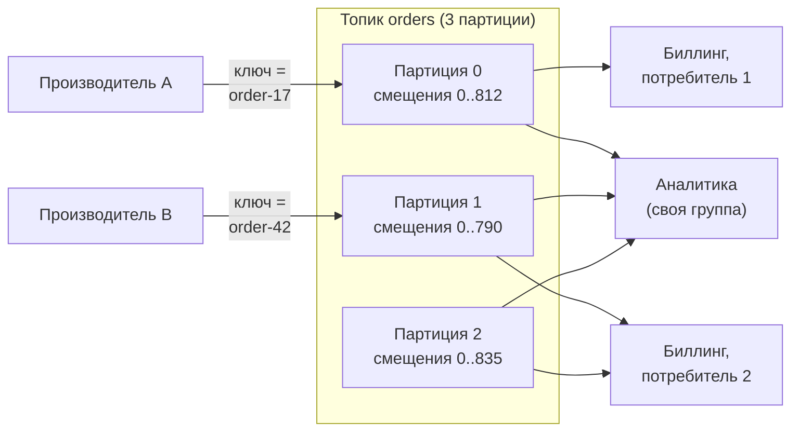
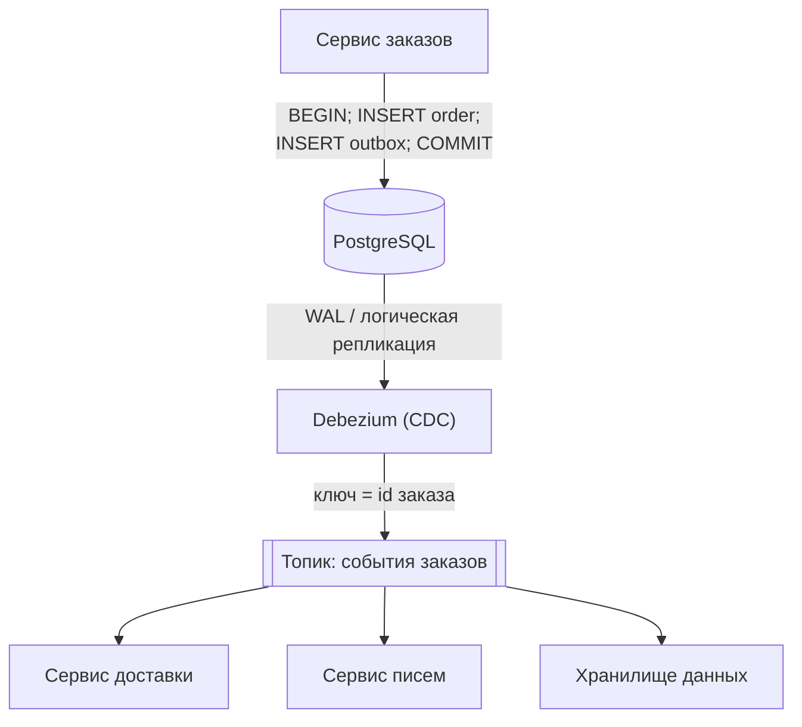

import { Aside } from '@astrojs/starlight/components';

Брокер на основе журнала (log) хранит события в реплицируемом журнале, куда можно только дописывать, и не удаляет их после чтения. Потребители сами следят за своей позицией в журнале. Одни и те же события могут читать сколько угодно независимых потребителей, новый потребитель может начать с прошлой недели, а ошибочный — отмотать назад и обработать заново. Поэтому журнал служит основой для конвейеров данных, передачи изменений между сервисами и аналитики в реальном времени. Это другая задача, чем у [очереди задач](/async/queues-and-back-pressure/).

<Aside type="tip" title="Коротко">
- **Топик** делится на **партиции**. Порядок гарантирован только внутри партиции, поэтому ключ партиционирования выбирают по тому, что должно оставаться упорядоченным (например, `order_id`).
- **Группа потребителей** делит партиции между участниками: одну партицию читает не более одного участника. Параллелизм ограничен числом партиций.
- Потребители фиксируют **смещения** (offsets). Фиксация после обработки даёт доставку хотя бы один раз. Данные хранятся весь **срок хранения** (retention), поэтому их можно **перечитать** (replay).
- **Exactly-once** в Kafka покрывает цикл «прочитать — обработать — записать» *внутри Kafka*. Для всего внешнего по-прежнему нужны идемпотентные записи.
- Чтобы надёжно публиковать события при изменении базы, используйте **transactional outbox** и **захват изменений данных** (CDC), а не двойную запись.
</Aside>

## Журнал как абстракция

Журнал — упорядоченная последовательность записей, в которую можно только дописывать. Каждая запись получает в своей партиции порядковое **смещение**. Производители пишут в конец. Потребители читают вперёд с выбранного ими смещения и запоминают его. Чтение ничего не удаляет: записи истекают по возрасту или размеру либо уплотняются по ключу.

Производитель хеширует ключ записи, чтобы выбрать партицию, поэтому все события `order-17` попадают в одну партицию и идут по порядку. Каждая партиция реплицируется на несколько брокеров, записи принимает её лидер. В Kafka запись считается зафиксированной, когда она есть у всех синхронных реплик (in-sync replicas). С `acks=all` и `min.insync.replicas=2` при коэффициенте репликации 3 отказ одного брокера не теряет подтверждённых записей. Это не значения брокера по умолчанию (`min.insync.replicas` и `default.replication.factor` по умолчанию равны 1), поэтому для важных топиков их задают явно.

## Брокеры-журналы в 2026 году

| | Apache Kafka | Redpanda | Apache Pulsar | Amazon Kinesis Data Streams |
|---|---|---|---|---|
| Что это | Эталонный брокер-журнал (JVM) | Брокер на C++, совместимый с API Kafka | Брокеры без состояния поверх Apache BookKeeper | Полностью управляемый сервис AWS |
| Метаданные | KRaft (встроенный Raft) | Встроенный Raft | Oxia (рекомендуется) или ZooKeeper | Управляются AWS |
| Единица масштабирования | Партиция | Партиция | Партиция | Шард |
| Долгое хранение | Многоуровневое хранение в объектных хранилищах | Многоуровневое хранение (корпоративная лицензия) | Многоуровневое хранение | Хранение до 365 дней |
| Лицензия | Apache 2.0 | Community: BSL (через 4 года — Apache 2.0) | Apache 2.0 | Проприетарный сервис |

Что влияет на решения:

- **Kafka 4.0** (2025) полностью отказалась от ZooKeeper. Кластеры работают на **KRaft**, и эксплуатировать нужно одну систему. Многоуровневое хранение (tiered storage), которое переносит старые сегменты в объектное хранилище, стало готовым к продакшену в 3.9. Новый протокол ребалансировки потребителей (KIP-848) стал GA в 4.0. **Share groups** («очереди для Kafka») с подтверждением каждой записи и счётчиком доставок готовы к продакшену с 4.2. Производители по умолчанию используют `acks=all` и идемпотентность. Предложение о «бездисковых топиках» (KIP-1150), которые пишут прямо в объектное хранилище, принято в 2026 году и ещё реализуется.
- **Управляемая Kafka** (Amazon MSK, Confluent Cloud, Aiven и другие) — обычный выбор, потому что эксплуатировать брокеры самостоятельно — серьёзная работа.
- **Pulsar** разделяет обслуживание (брокеры) и хранение (bookies). Брокеры можно добавлять и заменять без переноса данных. Подписки бывают exclusive, failover, shared и key-shared, так что одна система покрывает и сценарии очереди, и сценарии журнала. Версия 5.0 вышла в октябре 2026 года.
- **Kinesis**: шард принимает до 1 МБ/с или 1000 записей/с и отдаёт 2 МБ/с на чтение, общие для всех стандартных потребителей. Enhanced fan-out даёт каждому зарегистрированному потребителю собственные 2 МБ/с на шард. Срок хранения по умолчанию 24 часа, его можно поднять до 365 дней. С конца 2025 года запись может весить до 10 МиБ. Режим on-demand добавляет шарды автоматически.

## Партиции и порядок

- **Порядок есть только внутри партиции.** У записей с разными ключами в разных партициях порядок между собой не определён.
- **Выбирайте ключ по инварианту.** Если «платёж проведён» должен идти после «заказ создан», у обоих событий должен быть один ключ (ID заказа), а не тип события.
- **Горячие ключи** создают горячие партиции. Один аккаунт знаменитости или один огромный клиент может нагрузить партицию до предела, пока остальные простаивают. Варианты: составной ключ (`tenant:shard-n`) ценой порядка между шардами или отдельный топик для гиганта.
- **Добавление партиций меняет отображение ключей на партиции** для новых записей, и на время изменения порядок по ключу нарушается. Закладывайте партиции с запасом.
- **Повторы могут нарушить порядок** в партиции, если производитель не идемпотентный (в Kafka он идемпотентный по умолчанию).

**Пример расчёта.** Сейчас ожидается 50 МБ/с, через два года — в 3 раза больше. Один экземпляр потребителя обрабатывает около 10 МБ/с. Сегодня нужно минимум 5 партиций, с учётом роста — 15. Берём около 24, чтобы хватило на неравномерное распределение ключей. В Kinesis для 50 МБ/с записи в режиме provisioned нужно минимум 50 шардов.

## Группы потребителей и смещения

**Группа потребителей** (consumer group) — набор экземпляров, которые делят между собой чтение топика. Координатор группы отдаёт каждую партицию ровно одному участнику. При 12 партициях и 4 участниках каждый читает 3 партиции. Тринадцатый участник будет простаивать. Другая группа (скажем, аналитика) читает тот же топик независимо, со своими смещениями.

Каждая группа хранит прогресс как зафиксированные смещения (Kafka держит их во внутреннем топике). Момент фиксации определяет семантику доставки:

| Фиксация | При сбое | Семантика |
|---|---|---|
| До обработки | Записи после фиксации пропускаются | Не более одного раза |
| После обработки | Записи с последней фиксации обрабатываются повторно | Хотя бы один раз (по умолчанию) |
| В одной транзакции с результатом | Ни того, ни другого | Exactly-once, если результат в Kafka или в том же хранилище |

**Отставание потребителя** (consumer lag) — расстояние между последним смещением и зафиксированным. Это главная метрика здоровья потоковой обработки. Отставание в 1,8 млн записей при потреблении 30 000 записей/с и поступлении 20 000 записей/с разбирается за 1 800 000 ÷ 10 000 = 180 с. Алерты ставьте на отставание, пересчитанное во *время*, и на отставание, которое продолжает расти.

**Ребалансировка** происходит, когда участники присоединяются, уходят или не отвечают. Партиции переезжают, незафиксированная работа выполняется заново. Протокол KIP-848 в Kafka 4.x (клиенты включают его через `group.protocol=consumer`; с Kafka 4.3 потребители на классическом протоколе пишут в лог совет перейти на новый, потому что классический будет объявлен устаревшим) переносит только те партиции, которые должны переехать, и не останавливает всю группу.

## Хранение, уплотнение и повторное чтение

- **Хранение по времени или размеру.** Kafka по умолчанию хранит 7 дней. С многоуровневым хранением держать месяцы дёшево.
- **Уплотнение журнала** (log compaction) оставляет как минимум последнюю запись по каждому ключу и удаляет более старые. Запись с ключом и пустым значением (*tombstone*) удаляет ключ. Уплотнённый топик — надёжная таблица, которую можно перечитать: текущие профили клиентов, флаги функций, outbox агрегата.
- **Повторное чтение** — главная сила журнала. Сдвиньте смещения группы на прошлый вторник, чтобы переобработать данные после исправления ошибки, или запустите новую группу с самого раннего смещения, чтобы построить новый поисковый индекс. Это работает, только если потребители идемпотентны, а события содержат достаточно данных для повторной обработки без обращений к сервисам, которые с тех пор изменились.

## Семантика доставки: что на самом деле значит exactly-once

- **Не более одного раза** (at-most-once): без дубликатов, возможны потери. Годится для сэмплирования метрик и логов, которые можно потерять.
- **Хотя бы один раз** (at-least-once): без потерь, возможны дубликаты. Вариант по умолчанию и правильный для большинства задач — вместе с идемпотентными потребителями.
- **Ровно один раз** (exactly-once) в Kafka складывается из трёх частей:
  1. **идемпотентный производитель** (ID производителя плюс порядковые номера в каждой партиции), который убирает дубликаты от повторов производителя;
  2. **транзакции**, которые атомарно пишут в несколько партиций *и* фиксируют смещения потребителя;
  3. потребители с `isolation.level=read_committed`, которые не видят записей отменённых транзакций.

Kafka Streams включает это через `processing.guarantee=exactly_once_v2`. Гарантия покрывает цикл «прочитать → преобразовать → записать», который не выходит за пределы Kafka. Как только потребитель пишет в Postgres, вызывает API или отправляет письмо, мы возвращаемся к схеме «хотя бы один раз» плюс идемпотентность — либо храним смещения в той же транзакции базы, что и результат. Поэтому честнее говорить «фактически однократная обработка» (effectively-once).

## Надёжная публикация событий: transactional outbox и CDC

Сервису часто нужно обновить свою базу *и* опубликовать событие «заказ создан». Две отдельные записи (**двойная запись**, dual write) могут оборваться между шагами: строка сохранена, а событие потеряно, или событие опубликовано, а транзакция откатилась. Распределённая транзакция (2PC) между базой и брокером редко доступна и редко разумна.

**Transactional outbox** записывает событие в таблицу `outbox` **в той же локальной транзакции**, что и бизнес-изменение. Отдельный ретранслятор публикует строки outbox в брокер. Он может опрашивать таблицу или использовать **захват изменений данных** (change data capture, CDC), читая журнал репликации базы (логическая репликация PostgreSQL, binlog MySQL). Популярный open-source инструмент CDC — Debezium. Он работает как source-коннектор Kafka Connect, как отдельный Debezium Server (среди целей — Kinesis, Pub/Sub и Pulsar) или встраивается в Java-приложение. Его outbox event router направляет каждую строку outbox в топик по типу агрегата и использует ID агрегата как ключ.

Свойства, которые стоит назвать на собеседовании:

- Событие публикуется **тогда и только тогда**, когда транзакция зафиксирована, и в порядке фиксации.
- Ретранслятор может опубликовать строку дважды (например, упасть после публикации, но до сохранения позиции). Потребители отсеивают дубликаты по ID события.
- Строки outbox можно удалять сразу после вставки или периодическим заданием. CDC читает вставку из журнала, так что таблица остаётся маленькой.
- CDC по обычным таблицам, без outbox, отлично подходит для репликации и аналитики, но превращает внутреннюю схему в публичный контракт. Outbox позволяет публиковать продуманные версионированные события.

## Event sourcing и CQRS вкратце

**Event sourcing** хранит последовательность изменений («товар добавлен», «адрес изменён») как источник истины. Текущее состояние получают, воспроизводя её. Это даёт полный аудит, ответ на вопрос «что мы знали 1 марта» и возможность строить новые представления по истории. Цена: схемы событий вечны, поэтому версионирование обязательно; для восстановления состояния нужны снимки; исправлять плохие данные приходится компенсирующими событиями.

**CQRS** (command query responsibility segregation, разделение команд и запросов) использует разные модели для записи и чтения. Чтение обслуживают проекции, построенные по потоку событий: поисковый индекс, денормализованная таблица, кэш. Чтение масштабируется отдельно, и каждое представление подогнано под свой запрос. Плата — согласованность в конечном счёте (eventual consistency) между сторонами записи и чтения плюс дополнительная инфраструктура. Предупреждение Мартина Фаулера по-прежнему в силе: большинству систем лучше с одной моделью. Применяйте эти паттерны там, где их оправдывают аудит, запросы по времени или сильно разные формы чтения.

## Очередь или журнал

| | Очередь сообщений (RabbitMQ, SQS) | Журнал (Kafka, Kinesis, Pulsar) |
|---|---|---|
| После потребления | Сообщение удаляется при ack | Запись хранится до истечения срока |
| Потребители | Конкурирующие воркеры делят одну очередь | Много независимых групп, у каждой свои смещения |
| Повторное чтение | Нет (кроме redrive из DLQ) | Да, с любого сохранённого смещения |
| Порядок | Слабый или в группе сообщений | Строгий в партиции |
| Параллелизм | Добавляйте воркеров свободно | Ограничен числом партиций |
| Повтор и задержка сообщения | Встроены (видимость, DLQ) | Вручную (retry-топики) или share groups |
| Кто следит за прогрессом | Брокер, по каждому сообщению | Потребитель, одно смещение на партицию |
| Типичное применение | Фоновые задачи, распределение работы | Конвейеры событий, CDC, аналитика, event sourcing |

Очередь распределяет *работу*, журнал — *факты*. Многие системы используют оба: журнал фактов и небольшие очереди для задач, которые эти факты порождают.

<Aside type="note" title="На собеседовании">
- Назовите ключ партиционирования и объясните выбор. Ждите вопроса «а что с горячим ключом?».
- Если дизайн обновляет базу и отправляет событие, интервьюер проверяет, заметите ли вы двойную запись. Ответ: transactional outbox плюс CDC и идемпотентные потребители.
- Говорите об exactly-once точно: транзакции Kafka внутри Kafka, фактически однократная обработка (идемпотентность) на границах.
- Упомяните отставание потребителя как метрику здоровья и повторное чтение как инструмент восстановления. Помните, что параллелизм равен числу партиций.
- Типичные ошибки: предположения о глобальном порядке, журнал там, где хватило бы простой очереди задач, и event sourcing для CRUD-приложения.
</Aside>

## Что почитать

- [The Log: what every software engineer should know about real-time data's unifying abstraction](https://engineering.linkedin.com/distributed-systems/log-what-every-software-engineer-should-know-about-real-time-datas-unifying): эссе Джея Крепса, которое определило облик Kafka.
- [Kafka design: message delivery semantics](https://kafka.apache.org/43/design/design/): официальное описание идемпотентности, транзакций и уплотнения.
- [Exactly-once semantics are possible: here's how Kafka does it](https://www.confluent.io/blog/exactly-once-semantics-are-possible-heres-how-apache-kafka-does-it/): устройство exactly-once и его пределы.
- [Pattern: transactional outbox](https://microservices.io/patterns/data/transactional-outbox.html): описание паттерна от Криса Ричардсона.
- [Debezium outbox event router](https://debezium.io/documentation/reference/stable/transformations/outbox-event-router.html): готовый ретранслятор outbox на основе CDC.
- [Designing Data-Intensive Applications, 2nd edition](https://www.oreilly.com/library/view/designing-data-intensive-applications/9781098119058/): Клеппман и Риккомини (2026), главы о потоковой обработке и производных данных.

## Связанные темы

- [Очереди сообщений и обратное давление](/async/queues-and-back-pressure/): очереди задач, DLQ и расчёт числа потребителей.
- [Партиционирование и шардирование](/data/partitioning-and-sharding/): те же проблемы выбора ключа и горячих точек в базах данных.
- [Репликация](/data/replication/): лидеры, фолловеры и журналы репликации, на которых построен CDC.
- [Модели согласованности](/fundamentals/consistency-patterns/): что согласованность в конечном счёте значит для моделей чтения, построенных по потокам.
- [Монолит и микросервисы](/architecture/monolith-and-microservices/): события как контракт между сервисами.
