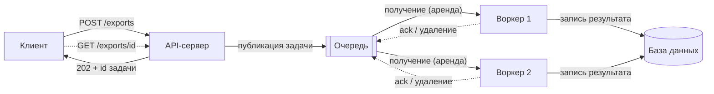
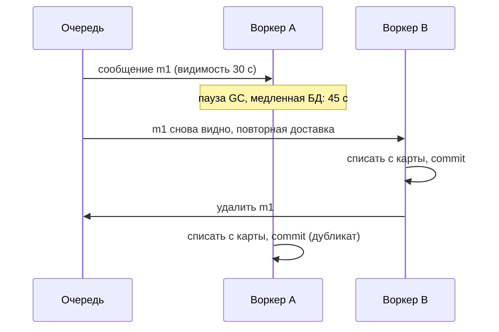

import { Aside } from '@astrojs/starlight/components';

Очередь сообщений позволяет одной части системы передать работу другой и не ждать её завершения. Вызывающая сторона быстро получает ответ, а воркеры выполняют медленную часть в фоне в своём темпе. Так мы снижаем задержку, сглаживаем всплески и ослабляем связность. Взамен появляются дубликаты, нарушение порядка, «ядовитые» сообщения и очереди, растущие без предела, и каждую из этих проблем дизайн должен учитывать.

<Aside type="tip" title="Коротко">
- Очередь нужна, когда пользователю не нужен результат прямо сейчас: письма, миниатюры, выгрузки, вебхуки, рассылка записей по лентам.
- Реальные брокеры доставляют сообщения **хотя бы один раз** (at-least-once). Готовьтесь к дубликатам и делайте потребителей **идемпотентными**. Подтверждайте сообщение только после фиксации результата.
- Ограничивайте число повторных доставок и отправляйте неудачные сообщения в **очередь недоставленных сообщений** (DLQ). «Ядовитое» сообщение не должно крутиться вечно.
- **Ограничивайте каждую очередь.** Когда она полна, отказывайте сразу (429/503 с `Retry-After`). Клиенты повторяют запрос с **экспоненциальной задержкой и случайным разбросом** (jitter).
- Число воркеров считают по **закону Литтла**: задач в работе = интенсивность потока × время на задачу. Сверху добавляют запас, чтобы успевать разбирать накопившийся хвост.
</Aside>

## Зачем нужна асинхронность

К очереди приводят три разные задачи:

- **Медленная работа на пути запроса.** Перекодирование видео занимает минуты, и держать ради него HTTP-соединение никто не должен. API сохраняет файл, ставит задачу в очередь и отвечает `202 Accepted` с идентификатором задачи. Клиент потом опрашивает эндпоинт статуса или получает вебхук.
- **Всплески нагрузки.** Распродажа может дать в 10 раз больше трафика на пять минут. Очередь принимает пик, а воркеры разбирают его в ровном темпе, и их не нужно рассчитывать на максимум.
- **Связность.** Производителю не нужно знать, кто потребляет сообщение, сколько потребителей и работают ли они прямо сейчас. Каждая сторона разворачивается, масштабируется и падает независимо.

Через очереди идёт и работа, которую никто не запрашивал: ночные агрегаты, прогрев кэша, переиндексация. Задержку часто можно скрыть в продукте. Новая запись сразу появляется в ленте автора, а доставка в ленты подписчиков идёт в фоне.

## Как работает очередь сообщений



1. **Публикация.** Производитель отправляет сообщение и ждёт, пока брокер подтвердит надёжное сохранение: например, через publisher confirms в RabbitMQ или ответ `SendMessage` в SQS. Публикация «выстрелил и забыл» теряет сообщения при перезапуске брокера.
2. **Получение.** Воркер забирает одно сообщение или пачку. Брокер не удаляет сообщение, а прячет его от других воркеров на время **аренды** (lease): это *тайм-аут видимости* (visibility timeout) в SQS, неподтверждённая доставка в RabbitMQ, запись в списке ожидающих (pending) в Redis Streams.
3. **Обработка**, затем **подтверждение** (ack или удаление). Если воркер упал или аренда истекла раньше, брокер отдаёт сообщение другому воркеру.

Третий шаг делает очереди надёжными, и из-за него же появляются дубликаты.

## Очереди задач и планировщики

**Очередь задач** (task queue) — это очередь сообщений плюс фреймворк воркеров. Функция вызывается асинхронно, а фреймворк берёт на себя сериализацию, отложенные повторы, ограничения частоты, результаты и периодические расписания. Примеры: **Celery** для Python (стабильные брокеры — RabbitMQ, Redis, SQS), **Sidekiq** для Ruby и **BullMQ** для Node.js (оба на Redis).

Проверяйте режим подтверждения. По умолчанию Celery подтверждает задачу *перед* запуском, поэтому падение посреди работы её теряет. `acks_late` подтверждает после выполнения, и при падении задача запустится снова. Включайте его только для идемпотентных задач.

Многошаговым процессам с ожиданиями и компенсациями лучше подходит движок **устойчивого выполнения** (durable execution), например Temporal, чем самодельные цепочки очередей и таблиц статусов. У планировщиков те же проблемы, что у очередей: один хост с cron — единая точка отказа, а управляемые планировщики вроде Amazon EventBridge Scheduler доставляют **хотя бы один раз**, поэтому запланированную задачу должно быть безопасно выполнить дважды.

## Выбор брокера

| | RabbitMQ 4.x | Amazon SQS | Redis / Valkey Streams |
|---|---|---|---|
| Модель | Exchange маршрутизирует в очереди | Управляемая очередь, pull по HTTPS | Журнал с группами потребителей |
| Надёжность | Quorum-очереди реплицируются через Raft | Хранится в нескольких AZ | Зависит от AOF/RDB; репликация асинхронная |
| Порядок | В очереди; теряется при конкурирующих потребителях | Standard: по возможности. FIFO: в группе сообщений | В рамках стрима |
| Повторная доставка | Неподтверждённые возвращаются; лимит доставок | Тайм-аут видимости, `maxReceiveCount` | Список ожидающих, `XAUTOCLAIM` |
| Эксплуатация | Свой кластер (или управляемый сервис) | Не нужна | Redis обычно уже есть для кэша |
| Когда брать | Гибкая маршрутизация, AMQP, умеренный объём | Выбор по умолчанию в AWS, пиковая нагрузка | Низкая задержка, простые конвейеры |

Актуальные факты:

- **RabbitMQ 4.x** удалил классические зеркалируемые очереди. Реплицируемые очереди теперь **quorum-очереди**; с версии 4.0 они по умолчанию отправляют сообщение в dead-letter или удаляют его после 20 доставок. AMQP 1.0 поддерживается нативно наряду с AMQP 0-9-1, а **стримы** (streams) дают журнал с повторным чтением внутри того же брокера.
- **SQS**: стандартные очереди дают почти неограниченную пропускную способность, доставку хотя бы один раз и порядок «по возможности». FIFO-очереди сохраняют порядок в *группе сообщений* и отбрасывают повторную отправку с тем же идентификатором дедупликации в пределах 5 минут. По умолчанию они выдерживают 300 вызовов API в секунду на операцию, или 3000 сообщений/с пачками по 10; режим высокой пропускной способности даёт намного больше. Сообщение может весить до 1 МиБ (с 2025 года) и храниться до 14 дней.
- **Redis Streams** (`XADD`, `XREADGROUP`, `XACK`) держат неподтверждённые записи в списке ожидающих, в отличие от pub/sub, который теряет сообщения при отсутствии подписчиков. Слабое место — надёжность: при `appendfsync everysec` сбой может стоить около секунды записей, а переключение на реплику — записей, которые до неё ещё не дошли.

Если одни и те же события нужны нескольким независимым потребителям, нужен повторный проход по истории или объёмы доходят до сотен МБ/с, берите **журнал** (log) вроде Kafka — см. [потоковую передачу событий](/async/event-streaming/). С версии Kafka 4.2 *share groups* дают и потребление в стиле очереди, с подтверждением каждой записи.

## Гарантии доставки на практике

В ненадёжной сети брокер может обещать доставку **не более одного раза** (подтвердить до обработки и смириться с потерями) или **хотя бы один раз** (подтвердить после обработки и смириться с дубликатами). Почти все выбирают второе. Дубликаты появляются, когда:

- воркер зафиксировал результат и упал до подтверждения;
- обработка длилась дольше тайм-аута видимости, и сообщение получил второй воркер;
- производитель не дождался подтверждения публикации и отправил снова;
- брокер сам доставил дважды (стандартные очереди SQS так умеют).



Достижима **фактически однократная обработка** (effectively-once): доставка хотя бы один раз плюс идемпотентный потребитель. Либо сделайте операцию идемпотентной по природе (upsert по ID заказа, «установить статус SHIPPED» вместо «увеличить счётчик»), либо записывайте ID обработанных сообщений **в той же транзакции**, что и сам результат:

```python title="idempotent_consumer.py"
import sqlite3

db = sqlite3.connect(":memory:")
db.executescript("""
CREATE TABLE processed_messages (message_id TEXT PRIMARY KEY);
CREATE TABLE balances (account TEXT PRIMARY KEY, cents INTEGER NOT NULL);
INSERT INTO balances VALUES ('acc-1', 0);
""")


def handle(message_id: str, account: str, cents: int) -> bool:
    """Зачислить платёж не более одного раза, сколько бы раз брокер его ни доставил."""
    with db:  # одна транзакция: отметка о дедупликации и результат фиксируются вместе
        cur = db.execute(
            "INSERT INTO processed_messages (message_id) VALUES (?) "
            "ON CONFLICT (message_id) DO NOTHING",
            (message_id,),
        )
        if cur.rowcount == 0:
            return False  # повторная доставка: уже применено, просто подтверждаем
        db.execute("UPDATE balances SET cents = cents + ? WHERE account = ?", (cents, account))
    return True  # вызывающий код подтверждает/удаляет сообщение только после commit


for _ in range(3):  # брокер трижды доставляет одно и то же сообщение
    print(handle("msg-7f3a", "acc-1", 500))
print(db.execute("SELECT cents FROM balances").fetchone()[0])  # 500, а не 1500
```

Для побочных эффектов вне вашей базы — вызова платёжного провайдера, отправки письма — нужно, чтобы внешний API принимал **ключ идемпотентности**, выведенный из ID сообщения.

## Подтверждения, повторы и недоставленные сообщения

- **Подтверждайте после commit, никогда до.** Режимы автоподтверждения меняют надёжность на скорость.
- **Подбирайте аренду под работу.** Тайм-аут видимости должен быть больше p99 времени обработки. Для долгих задач продлевайте аренду по heartbeat (`ChangeMessageVisibility` в SQS). Аренда в SQS может длиться до 12 часов. RabbitMQ по умолчанию закрывает канал потребителя, если подтверждение не пришло за 30 минут.
- **Отличайте временные ошибки от постоянных.** Тайм-аут зависимости стоит повторить позже. Некорректное сообщение не обработается никогда, его сразу отправляют в DLQ.
- **Откладывайте повторы.** Мгновенный возврат в очередь превращает одну сбойную зависимость в горячий цикл. Используйте отложенные очереди, увеличение тайм-аута видимости на каждой попытке или retry-топики с растущей задержкой.
- **Ограничивайте попытки.** **«Ядовитое» сообщение** (poison message) падает каждый раз. Без лимита оно крутится вечно, а в FIFO-очереди ещё и блокирует всю свою группу. Задайте лимит (`maxReceiveCount` в SQS, лимит доставок с dead-letter exchange в RabbitMQ) и переносите такие сообщения в **очередь недоставленных сообщений** (dead-letter queue, DLQ).
- **Эксплуатируйте DLQ.** Поднимайте алерт, как только в ней что-то появилось, держите срок хранения больше, чем у исходной очереди, и имейте инструмент для просмотра и повторной отправки (redrive) после исправления.

## Оговорки про порядок

Даже строгая FIFO-очередь теряет порядок, когда её параллельно читают несколько воркеров: воркер 2 может закончить сообщение 2 раньше, чем воркер 1 закончит сообщение 1. Повторы и redrive из DLQ перемешивают ещё сильнее. Варианты, от дешёвых к дорогим:

1. **Сделать порядок неважным.** Передавать версию или метку времени и игнорировать устаревшие обновления либо использовать коммутативные операции.
2. **Порядок по ключу, а не глобальный.** Направлять все сообщения одной сущности одному последовательному потребителю: группа сообщений SQS FIFO, ключ партиции Kafka, single active consumer в RabbitMQ.
3. **Глобальный порядок** означает одного потребителя и пропускную способность одного потребителя.

## Обратное давление

Очередь — только буфер. Если производители долго опережают потребителей, неограниченная очередь превращает перегрузку в минуты задержки, а потом в исчерпание памяти или диска. Каждое сообщение в ней в итоге обрабатывается слишком поздно, чтобы иметь смысл. **Обратное давление** (backpressure) возвращает перегрузку к источнику:

- **Ограничьте очередь.** Задайте максимальную длину, например `x-max-length` с `x-overflow: reject-publish` в RabbitMQ. Если у управляемой очереди нет жёсткого лимита, пусть производитель проверяет глубину или возраст самого старого сообщения и отказывает выше порога.
- **Отказывайте на входе.** Возвращайте `429 Too Many Requests`, когда один клиент превысил квоту, и `503 Service Unavailable`, когда перегружен весь сервис; в обоих случаях с `Retry-After`. См. [ограничение частоты запросов](/reliability/rate-limiting/).
- **Сбрасывайте по ценности.** Первыми отбрасывайте низкоприоритетную и просроченную работу. Задача, пользователь которой уже ушёл, — чистые потери.
- **Следите за возрастом самого старого сообщения**, а не только за глубиной. Десять тысяч сообщений — это и две секунды работы, и два часа.

Клиенты должны повторять вежливо: **экспоненциальная задержка с полным разбросом** (full jitter), `sleep = random(0, min(cap, base × 2^attempt))`, и ограниченное число попыток. Без разброса все клиенты, упавшие одновременно, одновременно и повторяют, ударяя по восстанавливающемуся сервису в один момент. Подробнее — в [паттернах устойчивости](/reliability/resilience-patterns/).

## Расчёт числа потребителей по закону Литтла

Закон Литтла, `L = λ × W`, связывает число задач в работе (`L`), интенсивность потока (`λ`) и время на задачу (`W`). См. [задержку и пропускную способность](/fundamentals/latency-vs-throughput/).

**Пример.** Миниатюры приходят со скоростью 400 задач/с, каждая обрабатывается в среднем 0,5 с.

| Шаг | Расчёт | Результат |
|---|---|---|
| Задач в работе в установившемся режиме | 400 × 0,5 | 200 |
| Слотов при загрузке 70% | 200 ÷ 0,7 | 286 |
| Подов по 16 параллельных задач | 286 ÷ 16, вверх | 18 подов (288 слотов) |
| Максимальная пропускная способность | 288 ÷ 0,5 | 576 задач/с |
| Хвост после 10-минутного простоя | 400 × 600 | 240 000 задач |
| Время разбора хвоста при 18 подах | 240 000 ÷ (576 − 400) | ≈ 23 мин |
| Время разбора хвоста при 25 подах | 240 000 ÷ (800 − 400) | 10 мин |

Запас мощности определяет, как быстро система восстанавливается, а не только справляется ли она с потоком. Те же цифры ограничивают очередь: если миниатюра бесполезна после 10 с ожидания, нет смысла держать больше 576 × 10 ≈ 5800 сообщений — остальные устареют раньше, чем до них дойдёт воркер. Масштабируйте по возрасту самого старого сообщения или по хвосту на воркер, а не по CPU.

## Когда асинхронность не нужна

- **Ответ нужен пользователю сейчас**: вход, поиск, проверка цены, валидация ввода. Очередь только добавит задержку.
- **Работа дешёвая.** Постановка в очередь, опрос и извлечение могут стоить дороже, чем 5 мс синхронного вызова.
- **Важно читать свои записи** (read-your-writes). Асинхронный путь делает следующее чтение пользователя устаревшим, если это специально не продумать.
- **Система маленькая.** Брокер — ещё один stateful-сервис, который надо эксплуатировать. Таблица в базе с `SELECT … FOR UPDATE SKIP LOCKED` — вполне годная очередь при умеренном объёме.

Отлаживать тоже сложнее: сбой проявляется через минуты в другом процессе. Передавайте контекст трассировки в заголовках сообщений (см. [наблюдаемость](/reliability/observability/)).

## Компромиссы

| | Синхронный вызов | Очередь (RabbitMQ, SQS) | Журнал (Kafka, Kinesis) |
|---|---|---|---|
| Задержка для пользователя | Вся стоимость работы | Только постановка | Только дозапись |
| Отказ потребителя | Падает вызывающий | Работа ждёт в очереди | Работа ждёт; можно перечитать |
| Потребителей на сообщение | Один | Один (конкурирующие воркеры) | Много независимых групп |
| Дубликаты, порядок | Повторяет вызывающий | Хотя бы раз, слабый порядок | Хотя бы раз, порядок в партиции |
| Стоимость эксплуатации | Минимальная | Средняя | Максимальная |

<Aside type="note" title="На собеседовании">
- Объясните, *почему* шаг асинхронный (медленный, пиковый или развязывающий) и что пользователь видит в это время (`202`, опрос статуса, оптимистичный UI).
- Обязательно спросят: что будет, если воркер упадёт посреди задачи? Ожидаемый ответ: аренда или тайм-аут видимости, доставка хотя бы один раз, идемпотентный потребитель, DLQ.
- Посчитайте пул воркеров вслух по закону Литтла и скажите, сколько займёт разбор накопившегося хвоста.
- Типичные ошибки: обещать exactly-once от брокера, неограниченные очереди, повторы без разброса и вера в то, что FIFO-порядок переживёт параллельных потребителей.
</Aside>

## Что почитать

- [Applying back pressure when overloaded](https://mechanical-sympathy.blogspot.com/2012/05/apply-back-pressure-when-overloaded.html): Мартин Томпсон об ограниченных очередях и отказе от лишней нагрузки.
- [Queues don't fix overload](https://ferd.ca/queues-don-t-fix-overload.html): Фред Эбер о том, почему больший буфер только откладывает отказ.
- [Exponential backoff and jitter](https://aws.amazon.com/blogs/architecture/exponential-backoff-and-jitter/): моделирование AWS, сравнение стратегий разброса.
- [RabbitMQ quorum queues](https://www.rabbitmq.com/docs/quorum-queues): репликация, лимиты доставок и обработка «ядовитых» сообщений.
- [Amazon SQS dead-letter queues](https://docs.aws.amazon.com/AWSSimpleQueueService/latest/SQSDeveloperGuide/sqs-dead-letter-queues.html): политика redrive и подводные камни со сроком хранения.
- [Celery: tasks](https://docs.celeryq.dev/en/stable/userguide/tasks.html): режимы подтверждения, повторы и почему задачи должны быть идемпотентными.

## Связанные темы

- [Потоковая передача событий](/async/event-streaming/): журналы, партиции, повторное чтение и transactional outbox.
- [Ограничение частоты запросов](/reliability/rate-limiting/): отказ от лишней нагрузки до того, как она попадёт в очередь.
- [Паттерны устойчивости](/reliability/resilience-patterns/): повторы, бюджеты, тайм-ауты и сброс нагрузки.
- [Задержка и пропускная способность](/fundamentals/latency-vs-throughput/): закон Литтла и почему задержка взрывается у предела загрузки.
- [Наблюдаемость](/reliability/observability/): возраст очереди, отставание потребителей и трассировка через асинхронные переходы.
