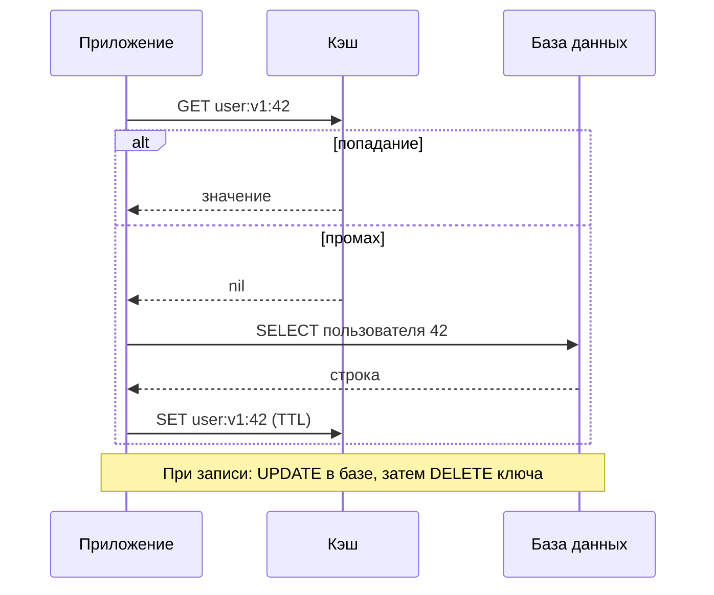
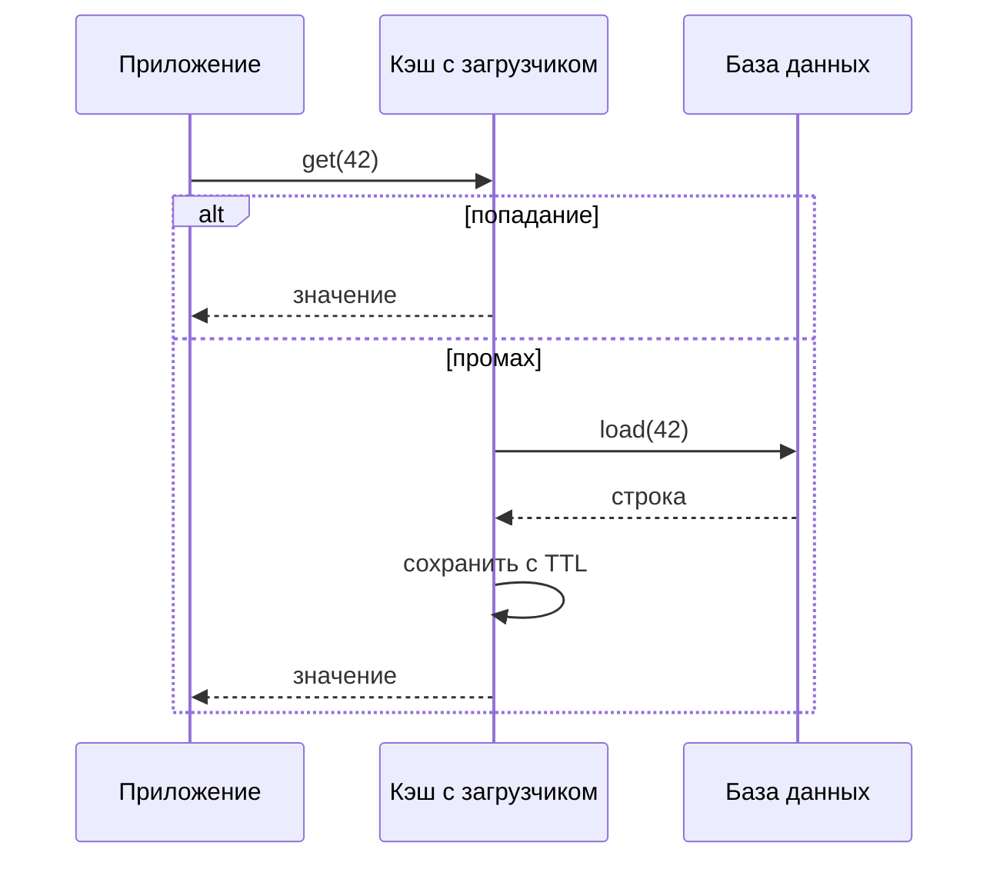
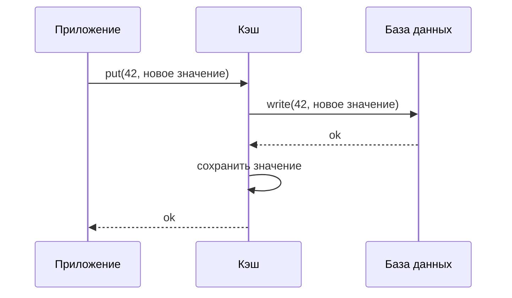
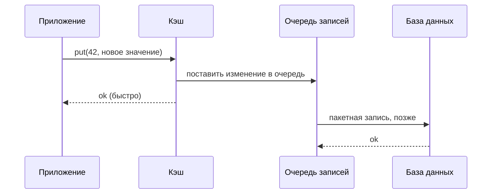
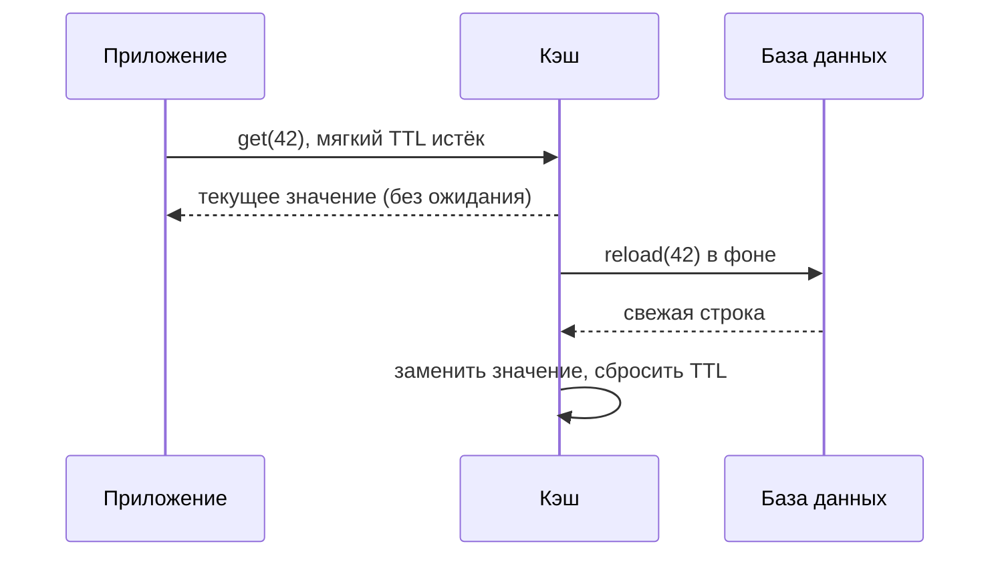
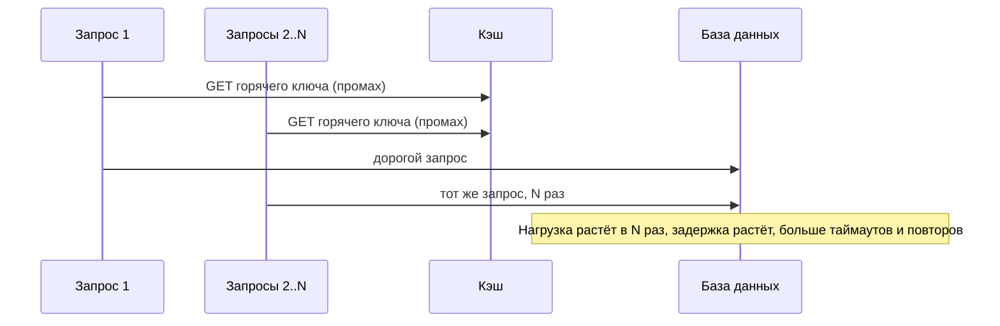
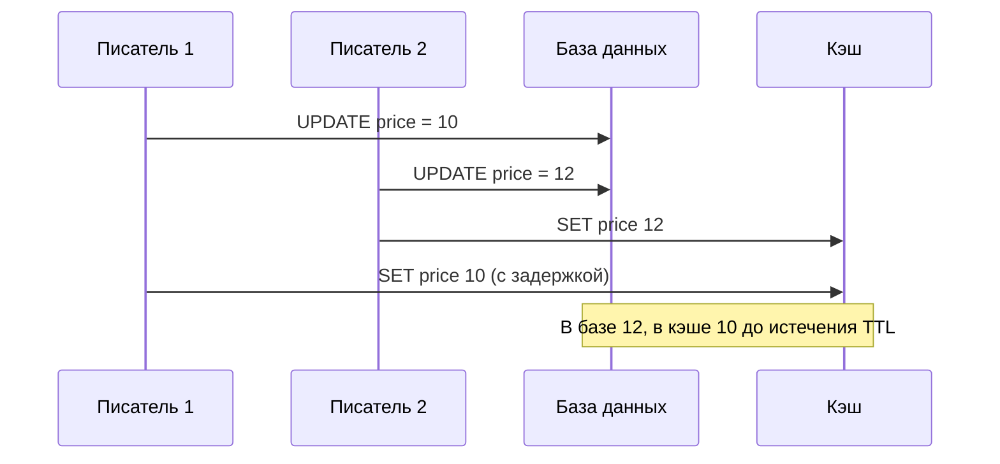

import { Aside } from '@astrojs/starlight/components';

Когда понятно, [где кэшировать](/caching/caching-layers/), остаются вопросы: как данные попадают в кэш, как они его покидают и что происходит, когда взаимодействуют множество клиентов, писателей и отказов. От этих решений зависит, станет ли кэш тихим ускорителем или причиной следующей аварии.

<Aside type="tip" title="Коротко">
- **Cache-aside** (ленивая загрузка) — стратегия по умолчанию: приложение читает кэш, при промахе загружает данные из базы, а при записи удаляет ключ.
- **Write-through** держит кэш свежим ценой задержки записи; **write-behind** ускоряет запись, но может терять данные; **refresh-ahead** прячет задержку перезагрузки горячих ключей.
- Инвалидируйте **удалением** ключей после коммита в базу, держите **TTL** как страховку и используйте **CDC**, когда одни и те же данные пишут многие сервисы.
- Защищайте источник от **лавины запросов** (объединение запросов, блокировки, досрочное обновление), **промахов по несуществующим ключам** (отрицательное кэширование, фильтры Блума) и **горячих ключей** (локальные кэши, репликация ключей).
</Aside>

## Стратегии чтения и записи

### Cache-aside (ленивая загрузка)

Приложение управляет обоими путями. Кэш ничего не знает о базе.



- **Плюсы:** кэшируется только запрошенное; кэш может упасть или быть очищен без потери данных; работает с любым кэшем и любой базой; форма данных в кэше может отличаться от формы таблицы.
- **Минусы:** промах стоит трёх обращений; первые чтения после деплоя или очистки медленные; данные устаревают до истечения TTL или удаления ключа; гонки между читателями и писателями (см. ниже).
- **Когда применять:** нагрузки с преобладанием чтения и понятной объектной моделью. Так используют Memcached и большинство инсталляций Redis или Valkey.

Корректная минимальная реализация на современном Python. В отличие от многих учебных версий, ключ строится ровно в одном месте (поэтому чтение и запись не могут использовать разные ключи), запрос параметризован, при попадании и промахе возвращается один и тот же тип, «не найдено» тоже кэшируется, а к TTL добавляется случайный разброс.

```python title="user_cache.py"
import json
import random
import sqlite3
from dataclasses import asdict, dataclass

import redis

TTL_SECONDS = 300
NEGATIVE_TTL_SECONDS = 30
MISSING = b"__missing__"  # маркер «такого пользователя нет» (отрицательное кэширование)

cache = redis.Redis(host="localhost", port=6379)
db = sqlite3.connect("app.db")


@dataclass(frozen=True)
class User:
    id: int
    name: str
    email: str


def user_key(user_id: int) -> str:
    # Ключ строит одна функция, поэтому читатели и писатели не разойдутся.
    return f"user:v1:{user_id}"


def ttl_with_jitter(base: int) -> int:
    # Разносим истечение, чтобы ключи, записанные вместе, не истекали вместе.
    return base + random.randint(0, base // 10)


def get_user(user_id: int) -> User | None:
    key = user_key(user_id)
    cached = cache.get(key)
    if cached == MISSING:
        return None
    if cached is not None:
        return User(**json.loads(cached))

    # Промах: читаем источник истины параметризованным запросом.
    row = db.execute(
        "SELECT id, name, email FROM users WHERE id = ?", (user_id,)
    ).fetchone()
    if row is None:
        cache.set(key, MISSING, ex=NEGATIVE_TTL_SECONDS)
        return None

    user = User(*row)
    cache.set(key, json.dumps(asdict(user)), ex=ttl_with_jitter(TTL_SECONDS))
    return user


def update_email(user_id: int, email: str) -> None:
    with db:  # сначала коммитим транзакцию в базе...
        db.execute("UPDATE users SET email = ? WHERE id = ?", (email, user_id))
    cache.delete(user_key(user_id))  # ...затем инвалидируем; следующее чтение перезагрузит
```

Этот код без изменений работает и с Valkey, который говорит на том же протоколе.

### Read-through (чтение через кэш)

Кэш стоит на пути чтения и сам загружает недостающие записи через функцию-загрузчик или встроенный коннектор. Приложение общается только с кэшем.



- **Плюсы:** логика загрузки сосредоточена в одном месте; кэш может объединить одновременные промахи по одному ключу в одну загрузку.
- **Минусы:** нужен кэш с поддержкой загрузчиков (библиотеки внутри процесса вроде Caffeine, data grid-системы или управляемые кэши вроде DynamoDB Accelerator); форма данных в кэше привязана к загрузчику.
- **Когда применять:** если доступ к данным можно сосредоточить в библиотеке или использовать кэш, встроенный в конкретную базу.

### Write-through (сквозная запись)

Записи идут в кэш, а кэш (или библиотека перед ним) синхронно пишет в базу, прежде чем подтвердить операцию.



- **Плюсы:** после каждой записи через этот путь данные в кэше свежие; чтение сразу после записи быстрое.
- **Минусы:** каждая запись платит задержкой двух записей; кэш заполняется данными, которые могут никогда не прочитать (нужен TTL); записи в обход кэша (миграции, другие сервисы) оставляют его устаревшим; новый или перезапущенный узел кэша пуст, пока данные не запишут, поэтому для чтения сочетайте с cache-aside или read-through.
- **Когда применять:** данные читают вскоре после записи, а пишет их один сервис. DynamoDB Accelerator (DAX) — управляемый кэш со сквозной записью и чтением через кэш.

### Write-behind (отложенная запись, write-back)

Приложение пишет в кэш и сразу получает подтверждение; кэш сбрасывает изменения в базу асинхронно, часто пачками.



- **Плюсы:** очень низкая задержка записи; поглощает всплески записи; может схлопнуть много обновлений одного ключа в одну запись в базу (счётчики, лайки, просмотры).
- **Минусы:** данные теряются, если кэш или очередь откажут до сброса; база отстаёт от кэша, и другие читатели базы видят старые данные; порядок, повторные попытки и идемпотентность — ваша забота; самый сложный в корректной эксплуатации вариант.
- **Когда применять:** если потеря нескольких секунд обновлений допустима (счётчики просмотров, аналитика, контрольные точки игрового состояния) или очередь надёжна (например, лог вроде Kafka перед базой).

### Refresh-ahead (упреждающее обновление)

Кэш перезагружает горячие записи **до** их истечения, поэтому читатели редко видят промах. Типичные реализации используют мягкий TTL (после него обращение запускает асинхронную перезагрузку, а старое значение пока отдаётся) и жёсткий TTL (после него запись исчезает).



- **Плюсы:** прячет задержку перезагрузки популярных ключей; сглаживает нагрузку на базу; продолжает отдавать данные при кратковременной недоступности базы (до жёсткого TTL).
- **Минусы:** лишняя работа для ключей, которые больше не прочитают; читатель может получить значение возрастом в один период обновления; нужен кэш или библиотека с поддержкой (`refreshAfterWrite` в Caffeine, `stale-while-revalidate` в HTTP).
- **Когда применять:** небольшой набор горячих ключей, которые дорого пересобирать: главные страницы, конфигурация, курсы валют, результаты ранжирования.

### Сравнение

| Стратегия | Кто загружает при промахе | Путь записи | Свежесть | Задержка записи | Главный риск | Типичное применение |
|---|---|---|---|---|---|---|
| Cache-aside | Приложение | БД, затем удаление ключа | Устаревает до TTL или удаления | Только БД | Гонки чтения и записи | Вариант по умолчанию |
| Read-through | Загрузчик кэша | Обычно как в cache-aside | Как в cache-aside | Только БД | Зависимость от возможностей кэша | Централизованный слой доступа к данным |
| Write-through | Загрузчик или приложение | Кэш и БД синхронно | Свежо для записей через кэш | БД + кэш | Записи в обход устаревают | Данные, читаемые сразу после записи |
| Write-behind | Кэш | Кэш, БД позже | Кэш свежий, БД отстаёт | Только кэш | Потеря данных при отказе | Счётчики, всплески |
| Refresh-ahead | Кэш, заранее | Любой из перечисленных | В пределах периода обновления | Без изменений | Лишние перезагрузки | Горячие дорогие ключи |

## Инвалидация

Именно на инвалидации кэши чаще всего ломаются. Распространённые подходы, обычно в сочетании:

- **TTL.** Каждая запись истекает через фиксированное время. Это просто и самовосстанавливается: устаревание ограничено, даже если остальные механизмы отказали. Задавайте TTL всегда и добавляйте разброс, чтобы записи, сделанные вместе, не истекали вместе.
- **Явное удаление при записи.** После коммита изменения в базе удалите затронутые ключи. Быстро и точно, но покрывает только записи, которые проходят через код, знающий ключи.
- **Версионированные ключи.** Включите версию в ключ (`product:42:v17` или номер поколения пространства имён, например `catalog:gen:8:product:42`). Запись увеличивает версию в базе; читатели строят ключи по текущей версии, поэтому старые записи никто не читает, и они просто истекают. Увеличение поколения пространства имён инвалидирует целую группу разом. Так же CDN работают с неизменяемыми ресурсами.
- **Инвалидация через CDC.** Конвейер захвата изменений (change data capture) читает журнал базы и удаляет или обновляет ключи при каждом закоммиченном изменении, независимо от того, какой сервис его сделал. В memcache Facebook это делали демоны, читавшие журнал коммитов MySQL; сегодня обычно используют Debezium или нативные потоки изменений базы с публикацией в Kafka. Тот же механизм рассылает инвалидации во все регионы и в L1-кэши внутри процессов.

Удаления и сообщения об инвалидации могут теряться или задерживаться, поэтому оставляйте TTL как страховку, делайте инвалидацию идемпотентной и измеряйте согласованность (Meta рассказывает, что напрямую измеряет согласованность своего кэша TAO с базой).

## Политики вытеснения

Когда кэш заполнен, политика вытеснения (eviction) решает, что выбросить.

| Политика | Вытесняет | Хороша для | Слабость |
|---|---|---|---|
| LRU | Давно не использованные | Нагрузок, где важна давность | Разовое сканирование вымывает горячие данные |
| LFU | Редко используемые | Стабильной популярности | Медленно забывает былую популярность; нужно затухание |
| По TTL | Записи, ближайшие к истечению (`volatile-ttl` в Redis) | Данных с осмысленным сроком жизни | Не учитывает популярность |
| FIFO или случайная | Самые старые или любые | Дёшево и предсказуемо | Ниже доля попаданий |
| W-TinyLFU | Отклоняет новичков, менее популярных, чем кандидат на вытеснение | Смешанных и перекошенных нагрузок | Сложнее; в основном в библиотеках |

Redis и Valkey аппроксимируют LRU и LFU, выбирая несколько случайных ключей, а не отслеживая точный порядок; политика по умолчанию — `noeviction` (при заполнении памяти запись завершается ошибкой). Для чистого кэша задайте `maxmemory` и `allkeys-lru` или `allkeys-lfu`; политики `volatile-*` используйте, когда в том же экземпляре лежат и ключи, которые вытеснять нельзя.

**W-TinyLFU**, используемая библиотекой Caffeine для Java, сочетает маленькое LRU-«окно» для новых записей с большой основной областью на сегментированном LRU и пускает запись в основную область, только если компактный частотный скетч показывает, что она популярнее вытесняемой. Политика устойчива к сканированиям, сама подстраивает размер окна и на многих реальных трассах не уступает другим политикам или превосходит их.

## Режимы отказа и способы защиты

### Лавина запросов (cache stampede, thundering herd)

Популярный ключ истекает или кэш перезапускается — и сотни одновременных запросов промахиваются разом и все идут в базу с одним и тем же дорогим запросом.



Способы защиты — от простых к самым надёжным:

- **Разброс TTL** — не даёт множеству ключей истечь одновременно.
- **Объединение запросов (single-flight)** — внутри одного процесса в базу идёт только первый промах по ключу; остальные одновременные вызовы ждут его результата.
- **Распределённая блокировка или аренда (lease)** — первый промахнувшийся клиент берёт короткую блокировку (`SET lock:key token NX PX 5000`) и пересчитывает значение; остальные недолго ждут, повторяют попытку или получают устаревшее значение. Так работали **аренды** в memcache Facebook: они снизили пиковую частоту запросов к базе для ключей, склонных к лавинам, с 17 000/с до 1 300/с.
- **Отдача устаревшего с фоновым обновлением** — держать старое значение после мягкого TTL и позволить одному запросу его обновить.
- **Вероятностное досрочное истечение (XFetch)** — каждый читатель может обновить значение чуть раньше срока, с вероятностью, растущей по мере приближения истечения и со стоимостью пересчёта:

```python title="xfetch.py"
import math
import random
import time


def should_refresh_early(expiry: float, recompute_secs: float, beta: float = 1.0) -> bool:
    """XFetch: обновить до истечения с вероятностью, растущей по мере его приближения.

    -log(random()) распределён экспоненциально, поэтому у большинства вызовов
    фора маленькая и лишь немногие обновляют значение сильно заранее.
    """
    head_start = -recompute_secs * beta * math.log(1.0 - random.random())
    return time.time() + head_start >= expiry
```

Храните `expiry` и измеренное `recompute_secs` вместе со значением. Для значения, которое пересобирается за 1 с, чтение за 10 с до истечения запускает обновление с вероятностью около 0,005%, за 2 с — около 14%, за 0,5 с — около 61%. При постоянном трафике значение пересобирает один из ранних читателей, а все остальные продолжают попадать в кэш.

### Промахи по несуществующим ключам (cache penetration)

Запросы к несуществующим ключам (удалённые ID, опечатки или намеренные атаки со случайными ID) всегда промахиваются мимо кэша и всегда идут в базу.

- **Отрицательное кэширование** — кэшируйте «не найдено» с коротким TTL (маркер `MISSING` выше).
- **Фильтр Блума** — держите перед кэшем компактное вероятностное множество всех допустимых ID. Запросы «точно отсутствует» отклоняются без обращения к базе; ложноположительные срабатывания стоят лишь обычного поиска. В Redis 8 фильтры Блума встроены; Valkey предоставляет их через модуль `valkey-bloom`.
- **Проверяйте входные данные** — отсекайте некорректные ID на границе и ограничивайте частоту запросов клиентов, порождающих много промахов.

### Горячие ключи

Один ключ получает столько трафика, что шард кэша, где он лежит, упирается в предел (профиль знаменитости, товар распродажи).

- **Локальный L1-кэш** с TTL в секунду-две на каждом сервере приложения поглощает большую часть чтений.
- **Репликация ключа** — храните копии под `item:42#0` … `item:42#7`, читайте случайную копию, а записывайте или удаляйте все.
- **Реплики для чтения** у шарда кэша или отдельный кластер для заранее известных горячих данных.
- **Обнаружение** горячих ключей — по метрикам на ключ или выборке (`redis-cli --hotkeys` и `valkey-cli --hotkeys` работают при политике вытеснения LFU); не допускайте, чтобы трафик одного ключа перехешировался на другой узел, который тоже упадёт.

### Массовое истечение и отказ кэша

Если много ключей истекает одновременно или кластер кэша отказывает, база разом получает всю нагрузку чтения (иногда это называют лавиной кэша, cache avalanche). Используйте разброс TTL, держите реплики кэша в разных зонах, ставьте перед базой [предохранитель (circuit breaker)](/reliability/resilience-patterns/) и ограничение частоты запросов, прогревайте кэш перед переключением трафика. Хороший пример — пул «gutter» в Facebook: небольшой набор запасных серверов кэша, временно подменяющих отказавшие.

### Гонка удаления и обновления

Два писателя обновляют одну строку. Если каждый **записывает** новое значение в кэш, записи в кэш могут прийти в порядке, отличном от порядка коммитов в базе:



Если оба писателя вместо этого **удаляют** ключ, порядок не важен: удаление идемпотентно, и следующий читатель загрузит последнее закоммиченное значение. Поэтому «обновить базу, затем удалить ключ» — более безопасный вариант по умолчанию, и именно поэтому memcache в Facebook при записи использовал удаления, а не установку значений.

Удаление оставляет более узкую гонку: читатель промахивается, читает из базы старое значение и задерживается; тем временем писатель коммитит изменение и удаляет ключ; затем читатель кладёт в кэш старое значение. Для этого нужны медленный читатель и запись в узком окне, а лечится это так:

- **TTL** ограничивает, сколько может прожить устаревшее значение.
- **Аренды или версионированная запись** — кэш отклоняет `SET` от читателя, чья аренда аннулирована удалением, или запись с более старой версией (compare-and-set).
- **Отложенное повторное удаление** — удалить ключ ещё раз через короткое время после записи, чтобы убрать запоздавшие устаревшие записи.
- **Инвалидация через CDC**, которая удаляет ключ после того, как коммит стал надёжным, и может повторяться.

И всегда коммитьте транзакцию в базе **до** удаления ключа: если удалить раньше, читатель может снова наполнить кэш старым значением до того, как коммит завершится.

<Aside type="note" title="На собеседовании">
- Называйте стратегию вместе с правилом инвалидации: «cache-aside, удаление при записи после коммита, TTL 5 минут с разбросом».
- Ждите вопросов «а если на ключ придёт миллион запросов в секунду?» (L1-кэш, репликация ключа) и «а если кластер кэша перезапустится?» (объединение запросов, аренды, прогрев, ограничение частоты).
- Объясните, почему при записи ключ удаляют, а не обновляют, и какая гонка при этом остаётся.
- Понимайте, где write-behind допустим, а где нет (никогда для платежей без надёжного лога).
- Типичные ошибки: отсутствие TTL, кэширование без плана инвалидации и уверенность, что кэш всегда доступен.
</Aside>

## Что почитать

- [Scaling Memcache at Facebook](https://www.usenix.org/conference/nsdi13/technical-sessions/presentation/nishtala) — аренды, инвалидация через журнал коммитов, пулы gutter (NSDI 2013).
- [Cache made consistent](https://engineering.fb.com/2022/06/08/core-infra/cache-made-consistent/) — как Meta измеряет и улучшает согласованность кэша TAO.
- [Optimal Probabilistic Cache Stampede Prevention](https://www.vldb.org/pvldb/vol8/p886-vattani.pdf) — статья об алгоритме XFetch (VLDB 2015).
- [TinyLFU: A Highly Efficient Cache Admission Policy](https://arxiv.org/abs/1512.00727) и [заметки об эффективности](https://github.com/ben-manes/caffeine/wiki/Efficiency) Caffeine.
- [Caching strategies](https://docs.aws.amazon.com/AmazonElastiCache/latest/dg/Strategies.html) (документация ElastiCache) и [Key eviction](https://redis.io/docs/latest/develop/reference/eviction/) (документация Redis).

## Связанные темы

- [Уровни кэширования](/caching/caching-layers/) — где стоят кэши и как определить их размер.
- [LRU-кэш](/ood/lru-cache/) — реализация классической политики вытеснения с нуля.
- [Модели согласованности](/fundamentals/consistency-patterns/) — слабая, в конечном счёте и строгая согласованность глазами читателей кэша.
- [Потоковая обработка событий](/async/event-streaming/) — конвейеры CDC, на которых строится инвалидация по журналу.
- [Паттерны отказоустойчивости](/reliability/resilience-patterns/) — предохранители и сброс нагрузки при отказе кэша.
